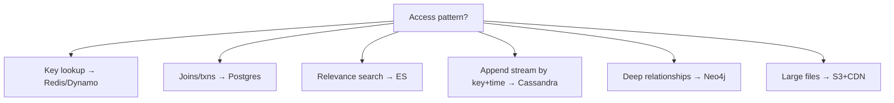
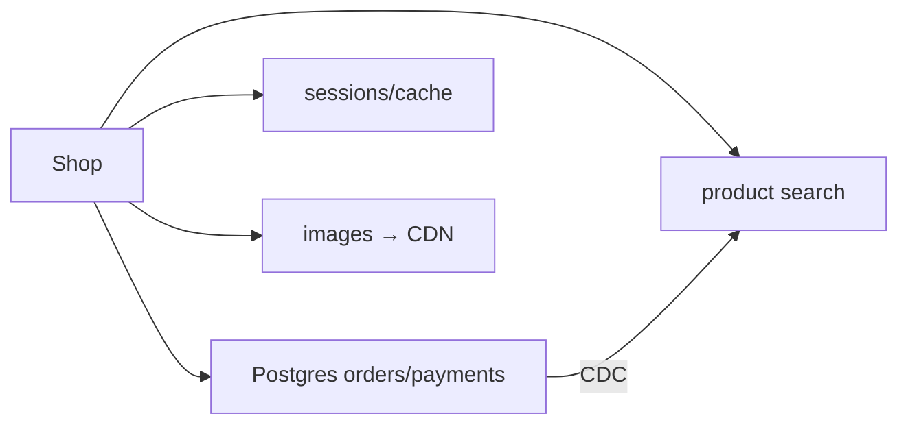
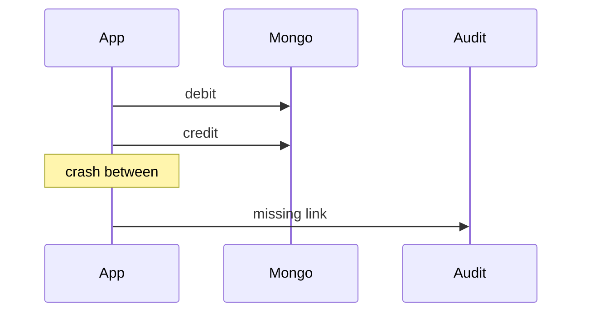

# Lesson 33: How to Choose a Database — Access Patterns & Polyglot Persistence

> **Prerequisites:** [Lesson 13: NoSQL Explained](../13-nosql-explained/README.md) (conceptual), [Lesson 31: Change Data Capture](../31-change-data-capture/README.md), [Lesson 32: Distributed SQL Explained](../32-distributed-sql-explained/README.md).  
> **Estimated Reading Time:** 28–35 minutes  
> **Target Audience:** Engineers answering “which database?” in system design interviews by leading with access patterns — and designing polyglot shops without dual-write chaos.  
> **Free PDF Notes:** [Download SD-E-033.pdf](https://backendroadmap.com/notes/system-design/SD-E-033.pdf) · [Phase 2, Notes (PDF)](https://backendroadmap.com/notes/system-design/Phase2_Notes.pdf)

> [!NOTE]
> **In one line:** choose a database by asking about access patterns, consistency, scale, query flexibility, and the team’s ops skills and cost. Default to a relational database, and add a specialised store only for a clear need (polyglot persistence).

> [!TIP]
> **The Golden Rule of Database Selection:** **Access patterns first, product names last.** Default to **Postgres**. Add Redis/S3/Elasticsearch/Cassandra only with a named pattern or number. Keep **one source of truth** per datum; sync derived stores with **CDC/outbox**, never dual writes. “It might need to scale someday” is not a reason.

---

## Words You'll Meet Today

| Word | In Plain Words | Role in a Live Backend System |
| :--- | :--- | :--- |
| **Access pattern** | How data is read/written (key, join, search, time, graph). | Narrows the family. |
| **Polyglot persistence** | Several stores, each for its best job. | Shop: PG + Redis + S3 + ES. |
| **Source of truth** | The one store that owns a piece of data. | Others are derived/rebuildable. |
| **CDC** | Stream DB change log to other systems. | Keep search in sync. |
| **Wide-column store** | Partition key + clustering order. | Cassandra/Scylla chat messages. |
| **Ops maturity** | What the team can run and recover. | Underrated selection criterion. |
| **Object storage** | Cheap large files (S3) + CDN. | Images/video, not OLTP rows. |
| **Derived data** | Rebuildable copy (cache, search). | Never the system of record. |

---

## Visual Mental Models & Architecture

### Start With Questions, Not a Product

“MongoDB because it scales” / “Postgres because I like it” are red flags. Lead with:

1. **Access patterns** — key lookup, joins, full-text, time ranges, graph? Read/write ratio? Which queries must be fast?
2. **Consistency** — multi-row txns (payments) vs eventual (like counters)?
3. **Scale** — data size, QPS, growth rate?
4. **Query flexibility** — will questions change? (SQL wins ad-hoc.)
5. **Ops maturity & cost** — managed service? Team skills?

### Everyday Picture: Toolbox, Not a Magic Hammer

You don’t buy a chainsaw for every screw. Default screwdriver (Postgres); add specialized tools when the job is clearly different — and remember each tool needs oiling at 3 a.m.



*Figure 1. Pattern → family (products are examples).*



*Figure 2. Polyglot shop: Postgres is SoT for products; search is a derived copy.*

---

## Systematic Reference & Comparison Grid

| Access pattern | Family | Examples |
| :--- | :--- | :--- |
| Lookup by key | Key-value | Redis, DynamoDB |
| Joins, multi-row txns | Relational | Postgres, MySQL |
| Full-text, relevance | Search engine | Elasticsearch, OpenSearch |
| Huge append-only, key+time | Wide-column | Cassandra, ScyllaDB |
| Relationship traversals | Graph | Neo4j |
| Large files | Object storage | S3 + CDN |

### Cost of Every Extra Store

- Another deploy/monitor/backup/patch/secure surface  
- Another skill + 3 a.m. page  
- Sync lag and failure cases  

Add only when benefit is clear; keep one SoT.

---

## Core Definition & Taxonomic Comparison

**Database selection** is matching workload shape and operational constraints to a storage family — not picking a brand from Twitter.

| Term | Precise Meaning | Production Example |
| :--- | :--- | :--- |
| **SoT** vs **derived** | Owns correctness vs rebuildable projection. | Orders in PG; ES catalog copy. |
| **Default relational** vs **specialized** | Start PG; branch on named need. | Search relevance → ES. |
| **Polyglot** vs **dual write** | Multiple stores with sync discipline vs app writes two. | CDC vs `save()+index()`. |

---

## Component Anatomy & The Observability Gap

```text
 interview / design
  ask patterns → pick family → name product
  for each derived store: define SoT + sync (CDC/outbox) + rebuild plan
  load-test the hot access path, not the brand brochure
```

| Vantage Point | Captures | Hides |
| :--- | :--- | :--- |
| **“We use Mongo”** | Brand | Whether access pattern fits |
| **Per-query latency SLOs** | Real fitness | — |
| **Sync lag dashboards** | Polyglot health | Dual-write silence |
| **Metrics** | SoT error budget; derived lag; rebuild time | — |

---

## Mathematical Model of “Does Postgres Fit?”

### 1. Order-of-Magnitude Comfort Zone

A well-tuned Postgres primary + replicas often handles **thousands of writes/s** and **tens of thousands of reads/s** on decent hardware for years. If your ledger is 500 writes/s, “Mongo for scale” is usually wrong.

### 2. Chat Messages Partition Growth

Busy channel without time buckets → unbounded partition. With bucket size $D$ days:

$$\text{partition cardinality} \propto \frac{\text{message rate} \times D}{1}$$

Caps size while “latest in channel” stays one partition (current bucket).

### 3. Decision Weights (interview rubric)

| Factor | Weight if ignored |
| :--- | :--- |
| Access pattern | Instant wrong family |
| Consistency | Reimplement txns in app |
| Scale numbers | Premature NoSQL |
| Ops skill | 3 a.m. outages |
| Sync design | Silent drift |

### 4. Mitigations / Process

1. Default Postgres.  
2. Name the pattern/number before adding a store.  
3. SoT + CDC for derived indexes.  
4. Split workloads (chat: PG metadata + wide-column messages at scale).  
5. Prefer managed services matching team maturity.

---

## Production War Story Post-Mortem: Payments on Mongo “for Scale”

- **Severity & Impact:** SEV-1 month after launch. Money movement bugs from app-level multi-document “transactions”; audit gaps.
- **Detection:** Inconsistent balances under concurrency; write rate was only ~400/s.



### Root Cause Analysis

Chose product before patterns. Ledger needed multi-row ACID + constraints; scale didn’t justify leaving Postgres.

### The Fix

Move ledger to Postgres; keep Mongo only if a document pattern remains; interview rubric updated: ask consistency + QPS first.

---

## Multi-Language Production Implementation

````carousel
```go
package chooser

type Pattern string

const (
	KeyLookup Pattern = "key"
	Relational Pattern = "relational"
	Search    Pattern = "search"
	WideCol   Pattern = "wide_column"
	Graph     Pattern = "graph"
	Object    Pattern = "object"
)

func Family(p Pattern) string {
	switch p {
	case KeyLookup:
		return "Redis/DynamoDB"
	case Relational:
		return "Postgres/MySQL"
	case Search:
		return "Elasticsearch"
	case WideCol:
		return "Cassandra/Scylla"
	case Graph:
		return "Neo4j"
	case Object:
		return "S3+CDN"
	default:
		return "Postgres (default)"
	}
}
```
<!-- slide -->
```typescript
export type AccessPattern =
  | "key"
  | "relational"
  | "search"
  | "wide_column"
  | "graph"
  | "object";

export function pickFamily(p: AccessPattern): string {
  const map: Record<AccessPattern, string> = {
    key: "Redis / DynamoDB",
    relational: "Postgres / MySQL",
    search: "Elasticsearch / OpenSearch",
    wide_column: "Cassandra / ScyllaDB",
    graph: "Neo4j",
    object: "S3 + CDN",
  };
  return map[p];
}

/** Chat at small scale: Postgres. At large message volume: wide-column for messages. */
export function chatStores(users: number): { meta: string; messages: string } {
  return {
    meta: "Postgres",
    messages: users < 100_000 ? "Postgres partitioned by time" : "Cassandra/Scylla ((channel,bucket), ts)",
  };
}
```
<!-- slide -->
```python
def choose(access: str, needs_txn: bool, qps_write: float) -> str:
    if needs_txn or access in {"join", "ad_hoc"}:
        if qps_write < 5_000:
            return "Postgres"
        return "Postgres or distributed SQL if cross-shard txn required"
    if access == "search_relevance":
        return "Elasticsearch (derived via CDC from Postgres SoT)"
    if access == "append_by_key_time":
        return "Cassandra/Scylla"
    if access == "session_cache":
        return "Redis"
    return "Postgres (default)"
```
<!-- slide -->
```csharp
public static class DbChooser
{
    public static string Family(string accessPattern) => accessPattern switch
    {
        "key" => "Redis/DynamoDB",
        "relational" => "Postgres/MySQL",
        "search" => "Elasticsearch",
        "wide_column" => "Cassandra/Scylla",
        "graph" => "Neo4j",
        "object" => "S3+CDN",
        _ => "Postgres (default)"
    };

    public static bool PrematureNosql(long writeQps) => writeQps < 1000;
}
```
````

---

## Practical Hands-On Verification CLI Workflows

### 1. Interview self-check

```bash
python3 -c "print('1 patterns 2 consistency 3 scale 4 flexibility 5 ops/cost')"
```

### 2. Chat split reminder

```bash
echo "meta: Postgres | messages@scale: ((channel_id,bucket), ts)"
```

### 3. Dual-write ban

```bash
echo "derived search <= CDC/outbox from SoT"
```

---

## Pause and Think

> [!exercise] SQL or NoSQL for a chat app?

<details><summary>Answer</summary>

Both, split by pattern: users/channels/memberships in Postgres; messages at large scale in wide-column keyed by `(channel_id, time bucket)` sorted by time. Small scale: time-partitioned Postgres is enough.

</details>

---

## Common Mistakes & Troubleshooting

- Naming a product before asking how data is read/written.
- NoSQL “for scale” on transactional/join-heavy data.
- New store per feature without SoT.
- Dual writes instead of CDC/outbox.
- Partition chat by channel only → unbounded hot partitions.

---

## Recap in Three Lines

1. Patterns → family → product; default Postgres.
2. Polyglot with SoT + CDC; every store has an ops bill.
3. Split chat/search/etc. by access path, not fashion.

---

## Interview Practice Questions

### Basic Conceptual Questions (Q1–Q4)

<details><summary><strong>Q1: How do you pick a database for a new system? [BASIC]</strong></summary>

Start from access patterns, then consistency, scale, query flexibility, ops maturity and cost. Default relational; add a specialised store only for a clear need.

</details>

<details><summary><strong>Q2: What is polyglot persistence, and what does it cost? [BASIC]</strong></summary>

Several stores each for what they do best (Postgres orders, Redis sessions, S3 images, ES search). Each adds deploys, monitoring, backups, security, skills, and sync work.

</details>

<details><summary><strong>Q3: Why is Postgres a good default? [BASIC]</strong></summary>

Transactions, joins, flexible queries, JSON; one primary with replicas handles thousands of writes and tens of thousands of reads/s on decent hardware. Move away only for a named pattern or scale.

</details>

<details><summary><strong>Q4: What should you ask before saying “MongoDB”? [BASIC]</strong></summary>

How is data read/written, do you need multi-row transactions, what are QPS/size, will queries change, and can the team operate it — then see if a document store actually fits.

</details>

### Scenario-Based Architecture Questions (Q5–Q8)

<details><summary><strong>Q5: SQL or NoSQL for a chat app? [SCENARIO]</strong></summary>

Both: Postgres for users/channels/memberships; Cassandra/Scylla for messages at scale with `((channel_id, bucket), ts)`. Small scale: partitioned Postgres messages table.

</details>

<details><summary><strong>Q6: Product search with `LIKE '%shoe%'` slow on 10M products. [SCENARIO]</strong></summary>

Try Postgres full-text + GIN first. If you need relevance, typos, facets → Elasticsearch as derived index via CDC; Postgres remains SoT.

</details>

<details><summary><strong>Q7: Team wants Mongo for payments ledger “because it scales.” Response? [SCENARIO]</strong></summary>

Ask pattern + consistency first. Ledgers need multi-row txns, constraints, audits; 500 writes/s is easy for Postgres. Without a specific scale/pattern reason, use relational.

</details>

<details><summary><strong>Q8: Design polyglot for an online shop. [SCENARIO]</strong></summary>

Postgres orders/payments; Redis sessions/cache; S3+CDN images; Elasticsearch product search fed by CDC from Postgres.

</details>

### Advanced & Tricky Interview Questions (Q9–Q12)

<details><summary><strong>Q9: How do you keep search in sync with the database? [TRICKY]</strong></summary>

Not dual writes. Use CDC (Debezium → Kafka) or transactional outbox; make the index rebuildable from SoT.

</details>

<details><summary><strong>Q10: Why partition chat messages by channel and time bucket, not just channel? [TRICKY]</strong></summary>

A busy channel can have hundreds of millions of messages; one partition per channel grows without bound and hotspots. Time buckets cap size while latest messages stay a single-partition read.

</details>

<details><summary><strong>Q11: When is distributed SQL the right “relational” choice? [TRICKY]</strong></summary>

When you need cross-shard/region ACID and automatic placement you won’t build — accepting higher write latency ([lesson 32](../32-distributed-sql-explained/README.md)). Not when one Postgres primary meets the numbers.

</details>

<details><summary><strong>Q12: How do you decide a cache is not the SoT? [TRICKY]</strong></summary>

If you can flush Redis and rebuild from Postgres without lasting incorrect money/inventory, it’s derived. If losing Redis loses irreplaceable state, you mis-assigned SoT — move ownership to a durable store.

</details>

---

## One-Page Master Cheat Sheet

```text
┌─ How to Choose a Database (SD-E-033) ───────────────────────────┐
│ Ask: patterns → consistency → scale → flexibility → ops/cost    │
│ Default: Postgres · specialize with a named reason              │
│ Polyglot OK · SoT + CDC · no dual writes                        │
│ Chat: PG meta + (at scale) wide-column messages w/ time buckets │
│ Search: ES derived · Files: S3 · Sessions: Redis                │
└─────────────────────────────────────────────────────────────────┘
```

---

## Free PDF notes

[SD-E-033.pdf](https://backendroadmap.com/notes/system-design/SD-E-033.pdf)

## Sources

- Kleppmann, DDIA — choosing datastores / derived data
- Polyglot Persistence (Fowler)
- Prior lessons SD-E-013–032 in this track

## Next

Track complete for written lectures **23–33**. Continue to Phase estimation: [Track: Estimation & Numbers](../../05-estimation-and-numbers/README.md) (SD-D series) when you leave Databases — or return to [Track: Databases overview](../README.md) for lessons 01–22 as they publish.
