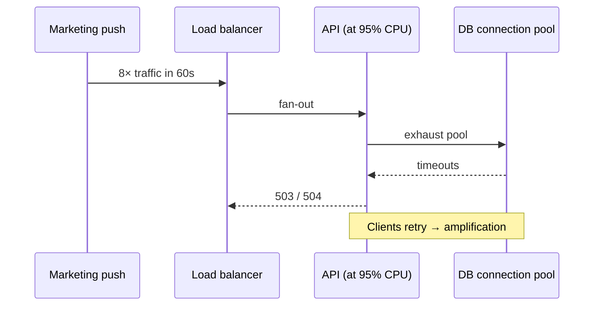

# Lesson 01: Back-of-the-Envelope Estimation: Which Numbers to Ask First

> **Prerequisites:** [Databases Overview](../../04-databases/README.md) and [Estimation Track Overview](../README.md) (Lesson 1 of 14).  
> **Estimated Reading Time:** 32 minutes  
> **Target Audience:** Backend engineers and candidates who must size traffic, storage, and capacity in system-design interviews before drawing boxes.  
> **Free PDF Notes:** [Download SD-D-001.pdf](https://backendroadmap.com/notes/system-design/SD-D-001.pdf)

> [!NOTE]
> **In one line:** Before you estimate, ask for daily and monthly users, actions per user (reads and writes), object size, retention, peak vs average traffic, and where users are. If a number is missing, state a round assumption out loud.

> [!TIP]
> **The Golden Rule of Estimation:** Order of magnitude beats false precision—write assumptions on the board, round hard ($86{,}400 \approx 10^5$), multiply by a peak factor, then say what the number implies for the design.

---

## Words You'll Meet Today

| Word | In Plain Words | Role in a Live Backend System |
| :--- | :--- | :--- |
| **DAU / MAU** | Daily / monthly active users. | DAU drives traffic; MAU drives account storage. |
| **Engagement** | $\mathrm{DAU}/\mathrm{MAU}$. | 50% sticky social vs ~15% weekly tool. |
| **Read:write ratio** | Reads per write. | Often $10{:}1$–$100{:}1$; shapes cache vs write path. |
| **Retention** | How long data must be kept. | Turns GB/day into TB over years. |
| **Peak factor** | Peak ÷ average. | Often $2$–$10\times$; size for peak. |
| **Order of magnitude** | Power of ten. | $10^3$ vs $10^5$ RPS → different architectures. |
| **Assumption** | Stated rounded number when none given. | Interviewer can correct it; silent guesses hide reasoning. |
| **RPS** | Requests per second. | The unit you size servers and DBs against. |

---

## Core Definition & Taxonomic Comparison

**Back-of-the-envelope estimation** is dead reckoning for systems: round numbers, explicit assumptions, and order-of-magnitude answers that decide the architecture. **What it is not:** spreadsheet precision, drawing boxes before knowing whether the product is a hobby ($10^3$ RPS) or a global service ($10^5$ RPS), or silent guesses the interviewer cannot correct.

| Term | Precise Meaning | Production Example |
| :--- | :--- | :--- |
| **Estimate** vs **exact capacity** | Estimate picks the design class; load tests set real fleet size. | "~1,200 writes/s" → shard; later load test says 1,050 at $p_{99}$. |
| **DAU** vs **MAU** | DAU drives daily traffic; MAU drives stored accounts. | 100 M DAU / 200 M MAU = 50% engagement. |
| **Average** vs **peak** | Average hides the hour that melts you. | Evening peak $\approx 1.7\times$ avg; celebrity spike $50\times$. |
| **Stated** vs **silent** assumption | Stated numbers are shared ground truth. | "Assume 100 M links/day" written on the board. |

**Business impact.** Wrong order of magnitude means either overbuilding (cost) or underbuilding (SEV-1 on launch). Interviewers grade the *method*: ask → assume → compute → conclude.

---

## Component Anatomy & The Observability Gap

### Four question groups (ask in this order)

```text
 1 USERS          2 ACTIONS           3 SIZE & RETENTION     4 SHAPE & GEO
 DAU, MAU         writes/user/day     bytes/object           peak vs average
 DAU/MAU =        reads/user/day      keep 30d / 5y / forever one country or world?
 engagement       → R/W ratio         → storage              → regions, CDN
        \______________\_______________\________________/
                         ↓
              RPS · storage · bandwidth · cache · servers
```

| Input | Feeds |
| :--- | :--- |
| DAU × actions / day | Average RPS |
| Read vs write split | Cache / replica vs primary / queue sizing |
| Object size × retention × replicas | Disk and shard count |
| Peak factor + geography | Headroom, multi-region, CDN |

### The Observability Gap

| Vantage Point | What It Captures | What It Hides |
| :--- | :--- | :--- |
| **Product analytics (DAU)** | Distinct users per day. | Concurrent users, burst shape inside the day. |
| **Edge RPS (CDN / LB)** | External request rate. | Internal fan-out ($1$ tap → $4+$ service calls). |
| **Primary DB QPS** | Writes + cache misses. | Replication lag, index amplification. |
| **Storage bill** | Bytes on disk today. | Growth trajectory and "forever" retention cliff. |

**Operational rule:** never size from one metric. Pair DAU with actions, average with peak, volume with retention.

---

## Mathematical Model & Worked Estimates

### Core conversions

$$\mathrm{RPS}_{\mathrm{avg}} = \frac{\mathrm{DAU} \times \text{actions/user/day}}{86{,}400} \approx \frac{\mathrm{DAU} \times \text{actions}}{10^5}$$

$$\mathrm{Storage} = (\text{size/object}) \times (\text{objects/day}) \times (\text{days retained}) \times (\text{replicas})$$

$$\mathrm{RPS}_{\mathrm{peak}} = \mathrm{RPS}_{\mathrm{avg}} \times f_{\mathrm{peak}},\quad f_{\mathrm{peak}} \in [2,10]\ \text{(events higher)}$$

| Utilization $\rho$ | Queue wait factor $1/(1-\rho)$ (M/M/1 intuition) | Interview takeaway |
| :--- | :--- | :--- |
| 50% | $2\times$ | Comfortable headroom |
| 70% | $\approx 3.3\times$ | Common operating target band |
| 80% | $5\times$ | Elevated — watch tails |
| 90% | $10\times$ | Dangerous for spikes |
| 95% | $20\times$ | Cliff — timeouts cascade |

### Worked example: URL shortener

- $100\,\mathrm{M}$ links/day ÷ $86{,}400$ ≈ $1{,}157$ → **$\sim 1{,}200$ writes/s**
- $10$ reads per write → **$\sim 12{,}000$ reads/s**
- $100\,\mathrm{M} \times 500\,\mathrm{B} = 50\,\mathrm{GB/day}$; $\times 1{,}825$ days (5 y) ≈ **$91\,\mathrm{TB}$** (~90 TB before replication)

### Worked example: chat app

| Quantity | Formula | Result |
| :--- | :--- | :--- |
| Messages/day | $50\,\mathrm{M}\,\mathrm{DAU} \times 40$ | $2 \times 10^9$ |
| Average rate | $/\,86{,}400$ | $\sim 23{,}000$/s |
| Peak ($3\times$) | $\times 3$ | $\sim 70{,}000$/s |
| Storage/day | $2\,\mathrm{B} \times 200\,\mathrm{B}$ | $400\,\mathrm{GB}$ |
| Storage/year $\times 3$ replicas | $400\,\mathrm{GB}\times 365\times 3$ | $\sim 438\,\mathrm{TB}$ |

**Design conclusion:** $70\,\mathrm{k}$ writes/s → partition by conversation; $438\,\mathrm{TB}$/year → tiered storage + retention policy.

---

## Metrics, Percentiles & Distributions

| Percentile | Who it describes | Estimation implication |
| :--- | :--- | :--- |
| $p_{50}$ | Typical second | Roughly near average on a flat day |
| $p_{95}$ | Busy hour users | Often $\sim 2$–$3\times$ daily average |
| $p_{99}$ | Spike / bad region | Size events and flash crowds here |
| $p_{99.9}$ | Celebrity / Black Friday | Need queues, waiting rooms, shed |

**Averages lie.** Nine hours at $1{,}000$ RPS and one hour at $10{,}000$ RPS → daily mean $\approx 1{,}900$, but the system dies in that one hour if sized for the mean.

---

## Compounding Effects at Scale

Retention compounds storage:

$$\mathrm{TB}_{5y} = \frac{\mathrm{GB/day} \times 1{,}825}{1{,}000}$$

Replication compounds again ($\times 3$). Fan-out compounds RPS:

$$\lambda_{\mathrm{internal}} = \lambda_{\mathrm{external}} \times N_{\mathrm{calls/action}}$$

| $N$ downstream calls | If each succeeds at $0.99$ | $P(\text{full success})$ |
| ---: | :--- | ---: |
| 1 | — | $99\%$ |
| 5 | — | $95\%$ |
| 10 | — | $90\%$ |
| 20 | — | $82\%$ |

---

## Numbers Every Backend Engineer Must Know

| Constant | Value | Use |
| :--- | :--- | :--- |
| Seconds/day | $86{,}400 \approx 10^5$ | Day → RPS |
| Seconds/month | $\sim 2.5 \times 10^6$ | Monthly → RPS |
| Seconds/year | $\sim 3 \times 10^7$ | Yearly volume |
| $1\,\mathrm{M}$/day | $\sim 12$/s | Tiny — one server |
| $100\,\mathrm{M}$/day | $\sim 1{,}200$/s | Real cluster |
| $1\,\mathrm{B}$/day | $\sim 12{,}000$/s | Sharding territory |

---

## Protocol & Network Deep Dive (why geography is an input)

```mermaid
sequenceDiagram
    participant U as User (EU)
    participant CDN as CDN edge
    participant API as API (US-East)
    participant DB as Primary DB
    U->>CDN: GET static (local RTT ~20ms)
    CDN-->>U: 200 cached
    U->>API: POST create link (~80-100ms RTT)
    API->>DB: INSERT
    DB-->>API: OK
    API-->>U: 201 + short URL
    Note over U,DB: Worldwide users → multi-region reads + CDN; one region → 150ms+ RTT tax
```

Cold path (DNS + TLS + first request) costs multiple RTTs; persistent connections amortize that—but **cross-continent RTT never drops below physics**. Ask where users are before promising $<100\,\mathrm{ms}$ $p_{99}$.

---

## Hierarchical Budgets & Capacity Sizing

| Budget slice | Example share of $200\,\mathrm{ms}$ page | Derived from estimates |
| :--- | :--- | :--- |
| Edge / CDN | $20\,\mathrm{ms}$ | Geography + cacheability |
| Gateway | $10\,\mathrm{ms}$ | Auth, rate limit |
| Service logic | $40\,\mathrm{ms}$ | Fan-out count |
| Cache | $5\,\mathrm{ms}$ | Hit ratio from R/W |
| Database | $50\,\mathrm{ms}$ | Miss path RPS |
| Headroom | $75\,\mathrm{ms}$ | Spikes + GC |

Timeouts cascade downward: if the page budget is $200\,\mathrm{ms}$, a single cross-region call at $150\,\mathrm{ms}$ already blows the budget.

---

## Top Engineering Mitigation Techniques

1. **Ask before drawing** — four question groups first.
2. **State assumptions out loud** — round numbers on the board.
3. **Split reads and writes** — never one blended RPS.
4. **Apply peak factor** — size for peak + headroom.
5. **End with design implication** — "so we shard / cache / multi-region…"

---

## Production War Story (SEV-1 Post-Mortem)

**Severity & Impact:** Launch-day SEV-1. Detection $4\,\mathrm{min}$, mitigation $45\,\mathrm{min}$. Checkout timeouts for ~35% of EU users during a marketing spike.

**What Happened:** Capacity planned from *average* DAU × actions with no peak factor. Marketing push created $8\times$ average for 20 minutes.

```python
# Flaw: sized for average only
avg_rps = dau * actions / 86_400
servers = math.ceil(avg_rps / per_server)  # no peak, no N+2
```



**RCA:** Missing peak factor + no load-shed. **Fix:** (1) Size $\mathrm{peak}=\mathrm{avg}\times 3$ + 40% headroom, (2) queue non-critical work, (3) rate-limit + `Retry-After`, (4) pre-scale for known campaigns.

---

## Multi-Language Production Code Tabs

Estimation helpers you can run in an interview sandbox or notebook:

````carousel
```go
package estimate

import "math"

func RPS(dau, actionsPerDay float64) float64 {
	return dau * actionsPerDay / 86400
}

func Peak(avg, factor float64) float64 { return avg * factor }

func StorageTB(objectsPerDay, bytesPerObj, days, replicas float64) float64 {
	return objectsPerDay * bytesPerObj * days * replicas / 1e12
}

func ChatExample() (avg, peak, tbYear float64) {
	dau, perUser, size := 50e6, 40.0, 200.0
	msgs := dau * perUser
	avg = msgs / 86400
	peak = avg * 3
	tbYear = msgs * size * 365 / 1e12
	return avg, peak, tbYear * 3 // with replicas
}

var _ = math.Ceil
```

<!-- slide -->

```typescript
export function rps(dau: number, actionsPerDay: number): number {
  return (dau * actionsPerDay) / 86_400;
}

export function peak(avg: number, factor = 3): number {
  return avg * factor;
}

export function storageTB(
  objectsPerDay: number,
  bytesPerObj: number,
  days: number,
  replicas = 3,
): number {
  return (objectsPerDay * bytesPerObj * days * replicas) / 1e12;
}

// Chat drill: ~23148 avg, ~69444 peak, ~438 TB/year with 3 replicas
const msgs = 50e6 * 40;
console.log(msgs / 86_400, (msgs / 86_400) * 3, (msgs * 200 * 365 * 3) / 1e12);
```

<!-- slide -->

```python
def rps(dau: float, actions_per_day: float) -> float:
    return dau * actions_per_day / 86_400

def peak(avg: float, factor: float = 3) -> float:
    return avg * factor

def storage_tb(objects_per_day: float, bytes_per_obj: float,
               days: float, replicas: float = 3) -> float:
    return objects_per_day * bytes_per_obj * days * replicas / 1e12

dau, per_user, size = 50e6, 40, 200
msgs = dau * per_user
avg = msgs / 86_400
print(round(avg), round(peak(avg)), storage_tb(msgs, size, 365))
```

<!-- slide -->

```csharp
public static class Estimate
{
    public static double Rps(double dau, double actionsPerDay) =>
        dau * actionsPerDay / 86_400;

    public static double Peak(double avg, double factor = 3) => avg * factor;

    public static double StorageTb(
        double objectsPerDay, double bytesPerObj, double days, double replicas = 3) =>
        objectsPerDay * bytesPerObj * days * replicas / 1e12;
}
```
````

---

## Hands-On CLI Verification

```bash
python -c "dau,per,size=50e6,40,200; msgs=dau*per; avg=msgs/86400; print(round(avg), round(avg*3), msgs*size*365*3/1e12)"
# Expect ~23148 69444 ~438 (TB/year with 3 replicas)
```

---

## Common Mistakes to Avoid

- Drawing architecture before knowing $10$ vs $10{,}000$ RPS.
- Chasing exact arithmetic ($1{,}157.4$) instead of order of magnitude (~$1{,}000$).
- Forgetting retention so storage is computed for one day instead of years.
- Sizing for the daily average and ignoring the $2$–$10\times$ peak.
- Making assumptions silently so the interviewer cannot follow or correct them.
- Blending reads and writes into one RPS number.
- Ignoring geography (regions, CDN, RTT floors).
- Stopping at the number without saying what it means for the design.

---

## Key Terms Glossary

| Term | Interview-ready definition |
| :--- | :--- |
| **Back-of-the-envelope** | Quick, rounded estimate used to pick a design class. |
| **DAU / MAU** | Daily / monthly active users. |
| **Peak factor** | Peak traffic ÷ average traffic. |
| **Retention** | How long data must be kept. |
| **Order of magnitude** | Nearest power of ten that decides architecture. |
| **RPS** | Requests per second. |

---

## Interview Practice Questions

<details>
<summary><strong>Q1. Which numbers do you ask for before estimating? [BASIC]</strong></summary>

<strong>What a strong answer covers:</strong>
DAU and MAU, actions per user per day (reads and writes), read-to-write ratio, object size, retention, peak vs average, and where users are located.

</details>

<details>
<summary><strong>Q2. What does the DAU/MAU ratio tell you? [BASIC]</strong></summary>

<strong>What a strong answer covers:</strong>
Engagement: share of monthly users active on a given day. 100 M DAU / 200 M MAU = 50% (sticky social); a weekly tool might be 15–20%.

</details>

<details>
<summary><strong>Q3. How do you compute storage? [BASIC]</strong></summary>

<strong>What a strong answer covers:</strong>
Size per object × objects per day × days retained (× replicas). 100 M × 500 B × 1,825 days ≈ 91 TB before replication (~270 TB at 3×).

</details>

<details>
<summary><strong>Q4. How many seconds are in a day, roughly? [BASIC]</strong></summary>

<strong>What a strong answer covers:</strong>
86,400, about $10^5$. A month ≈ 2.5 M seconds; a year ≈ 31.5 M.

</details>

<details>
<summary><strong>Q5. Estimate the URL shortener: 100 M links/day, 10:1 reads, 5 years, 500 B each. [SCENARIO]</strong></summary>

<strong>What a strong answer covers:</strong>
~1,200 writes/s, ~12,000 reads/s, ~90 TB over five years. Read-heavy → cache redirects; 90 TB → shard the link table.

</details>

<details>
<summary><strong>Q6. The interviewer won't give you a DAU. What do you do? [SCENARIO]</strong></summary>

<strong>What a strong answer covers:</strong>
State a round assumption out loud (“assume 10 M DAU”), write it down, continue. Offer to redo if they prefer another number—the method matters more than the input.

</details>

<details>
<summary><strong>Q7. Why ask where users are located? [SCENARIO]</strong></summary>

<strong>What a strong answer covers:</strong>
It decides regions, replication, and CDN. Worldwide users far from one region see 150 ms+ RTTs, so serve reads from several regions and static content from a CDN.

</details>

<details>
<summary><strong>Q8. You are told only 'design a chat app'. What do you ask before estimating? [SCENARIO]</strong></summary>

<strong>What a strong answer covers:</strong>
DAU, messages per user per day, message size, whether media is included, retention, and read-to-write pattern; then state defaults for anything they will not give.

</details>

<details>
<summary><strong>Q9. Your estimate says 1,157 writes per second. How do you present it? [TRICKY]</strong></summary>

<strong>What a strong answer covers:</strong>
As ~1,000 or ~1,200 writes/s. Estimates are for orders of magnitude; false precision hides that the inputs were rough guesses.

</details>

<details>
<summary><strong>Q10. Why does retention matter more than daily volume for storage? [TRICKY]</strong></summary>

<strong>What a strong answer covers:</strong>
Storage grows with every day you keep. 50 GB/day is trivial for one day but ~91 TB over five years; with “forever” it never stops—need archiving/tiering.

</details>

<details>
<summary><strong>Q11. Why round 86,400 to 100,000? [TRICKY]</strong></summary>

<strong>What a strong answer covers:</strong>
Keeps mental arithmetic fast; ~15% error is far smaller than input uncertainty, so the order of magnitude is unaffected.

</details>

<details>
<summary><strong>Q12. Is average QPS good enough to size the system? [TRICKY]</strong></summary>

<strong>What a strong answer covers:</strong>
No. Systems fail at peak—multiply by a peak factor (often 2×–5×) and note events can spike much higher.

</details>

---

## One-Page Master Cheat Sheet

```text
====================================================================================================
              BACK-OF-THE-ENVELOPE — WHICH NUMBERS TO ASK FIRST  —  CHEAT SHEET
====================================================================================================
ASK FIRST     DAU/MAU → actions (R/W) → size + retention → peak factor + geography

FORMULAS
  RPS_avg   = DAU × actions / 86_400   (≈ / 10^5 for speed)
  RPS_peak  = RPS_avg × f_peak         (f ≈ 2–10; events higher)
  Storage   = size × objects/day × days × replicas

ANCHORS      1M/day ≈ 12/s | 100M/day ≈ 1.2k/s | 1B/day ≈ 12k/s

GOLDEN RULE  State assumptions · round hard · size for peak · end with "so the design needs…"

ANTI-PATTERNS
  X Draw boxes before magnitude   X Exact 1,157.4 in interviews
  X Forget retention              X Size for average only   X Silent assumptions
====================================================================================================
```

---

## Free PDF notes

Download these notes as a printable PDF: [SD-D-001.pdf](https://backendroadmap.com/notes/system-design/SD-D-001.pdf).

---

## Sources

- Alex Xu, *System Design Interview* — Back-of-the-envelope estimation.
- Jeff Dean, *Numbers Everyone Should Know*.
- [SD-D-001.pdf](https://backendroadmap.com/notes/system-design/SD-D-001.pdf).

---

## Next

Next comes [Lesson 02: Latency Numbers & Powers of Two](../02-latency-numbers-powers-of-two-every-engineer-should-know/README.md). See [the track overview](../README.md) for the whole series.
