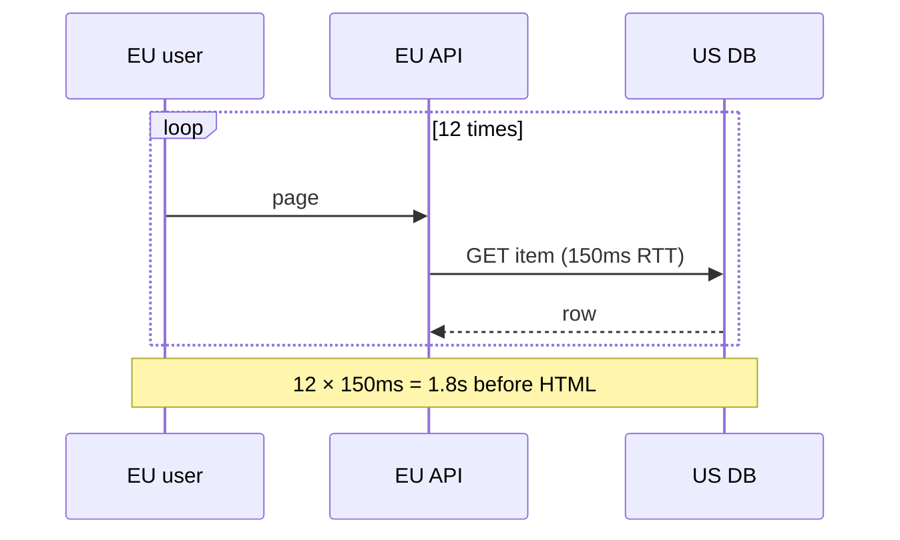

# Lesson 02: Latency Numbers & Powers of Two Every Engineer Should Know

> **Prerequisites:** [Lesson 01: Back-of-the-Envelope Estimation](../01-back-of-the-envelope-estimation/README.md) (Lesson 2 of 14).  
> **Estimated Reading Time:** 32 minutes  
> **Target Audience:** Backend engineers who must convert “1 million requests a day” into RPS and reason about cache vs disk vs WAN in interviews.  
> **Free PDF Notes:** [Download SD-D-002.pdf](https://backendroadmap.com/notes/system-design/SD-D-002.pdf)

> [!NOTE]
> **In one line:** Know powers of two (KB→PB), seconds per day ($86{,}400 \approx 10^5$), and the latency ladder from ~1 ns (L1) to ~150 ms (across continents). With them you turn “1 million requests a day” into “about 12 per second” in two seconds.

> [!TIP]
> **The Golden Rule of Latency Numbers:** Count round trips and their *length*—desk drawer (ns), room shelf (RAM), shop across town (SSD), another country (WAN). Design is mostly choosing how many trips of what length a request makes.

---

## Words You'll Meet Today

| Word | In Plain Words | Role in a Live Backend System |
| :--- | :--- | :--- |
| **$2^{10}$ / KB** | ~1 thousand bytes. | Unit for small rows and packets. |
| **$2^{30}$ / GB** | ~1 billion bytes. | RAM and SSD capacities. |
| **ns / µs / ms** | $10^{-9}$ / $10^{-6}$ / $10^{-3}$ s. | Mixing units is a common interview fail. |
| **RTT** | Round-trip time. | Floor on every remote call. |
| **Seek** | Moving a disk head. | ~10 ms — kills random IOPS on HDD. |
| **Sequential read** | Reading adjacent data. | One seek, then fast stream. |
| **Same-DC RTT** | ~0.5 ms. | Why Redis over the network is still fast. |
| **WAN RTT** | ~80–150 ms. | Speed-of-light floor between continents. |

---

## Core Definition & Taxonomic Comparison

**Latency numbers** are order-of-magnitude anchors, not datasheet precision. Hardware varies $2$–$3\times$, but **gaps between rungs stay huge**. **What they are not:** exact SLOs, reasons to avoid all network calls, or permission to chain 20 cross-region RPCs.

| Term | Precise Meaning | Production Example |
| :--- | :--- | :--- |
| **L1 (~1 ns)** vs **RAM (~100 ns)** | On-chip vs main memory. | Hot loops stay in cache; pointer chasing pays 100×. |
| **SSD (~100 µs)** vs **HDD seek (~10 ms)** | Flash random vs mechanical. | HDD ≈ 100 IOPS; SSD tens of thousands. |
| **Same-DC RTT (~0.5 ms)** vs **WAN (~150 ms)** | Intra-DC vs continents. | Redis OK; sync US↔EU chatty APIs not OK. |
| **MB (bytes)** vs **Mb (bits)** | $8\times$ difference. | 10 MB/s ≈ 80 Mbit/s. |

**Business impact.** Wrong rung → wrong design: treating Redis as “slow network” when it beats disk, or promising 50 ms $p_{99}$ for a multi-region sync path.

---

## Component Anatomy & The Observability Gap

### The latency ladder

```text
 L1 cache ~1 ns ── RAM ~100 ns ── SSD ~100 µs ── same-DC RTT ~0.5 ms ── HDD seek ~10 ms ── WAN ~150 ms
 |← ns →|         |← ns →|        |← µs →|         |← ms →|              |← ms →|            |← 100ms →|
 log scale: each major tick is ~1,000× the one before
```

### The Observability Gap

| Vantage Point | What It Captures | What It Hides |
| :--- | :--- | :--- |
| **Client RUM** | End-to-end including WAN DNS/TLS. | Whether 800 ms was geography or a lock. |
| **Service span** | Handler time. | Client queueing and retries. |
| **DB `pg_stat` / IOPS** | Disk vs buffer hits. | Cross-AZ replication lag. |
| **Synthetic probe same AZ** | Happy-path RTT. | Real user continents. |

**Operational rule:** annotate traces with region pairs; a “slow API” is often four sequential 100 ms RTTs.

---

## Mathematical Model & Worked Estimates

### Powers of two

$$2^{10}\approx 10^3\ (\mathrm{KB}),\ 2^{20}\approx 10^6\ (\mathrm{MB}),\ 2^{30}\approx 10^9\ (\mathrm{GB}),\ 2^{40}\approx 10^{12}\ (\mathrm{TB}),\ 2^{50}\approx 10^{15}\ (\mathrm{PB})$$

### Day → RPS

$$\mathrm{RPS} \approx \frac{N_{\mathrm{day}}}{10^5}\quad(\text{exact: }/\,86{,}400;\ \sim 14\%\ \text{low is fine})$$

### Relative cost

$$\frac{\text{HDD seek}}{\text{RAM read}} \approx \frac{10\,\mathrm{ms}}{100\,\mathrm{ns}} = 10^5$$

### Worked: 100 M requests/day @ 10 KB

- Average RPS: $100\,\mathrm{M}/10^5 \approx 1{,}000$/s (exact ~1,157).
- Peak $2$–$3\times$: a few thousand/s.
- Bandwidth: $1{,}000 \times 10\,\mathrm{KB} = 10\,\mathrm{MB/s} \approx 80\,\mathrm{Mbit/s}$.

### Worked: 200 ms budget, 10 sequential calls

| Placement | Cost |
| :--- | :--- |
| Same DC ($0.5\,\mathrm{ms}$ each) | $5\,\mathrm{ms}$ — invisible |
| Cross-region ($150\,\mathrm{ms}$) | $1{,}500\,\mathrm{ms}$ — broken |
| Batch / parallel / cache | ~$150\,\mathrm{ms}$ or µs |

---

## Metrics, Percentiles & Distributions

| Percentile | Who | Latency implication |
| :--- | :--- | :--- |
| $p_{50}$ | Typical user near origin | Dominated by service + DB buffer hits |
| $p_{95}$ | Distant metro / busy hour | One extra RTT shows up |
| $p_{99}$ | Far region / cold path | WAN + TLS cold start |
| $p_{99.9}$ | Packet loss / retries | Tail compounding |

**Averages lie.** Nine calls at $40\,\mathrm{ms}$, one cross-region at $2{,}000\,\mathrm{ms}$ → mean ~$236\,\mathrm{ms}$ while only $p_{99}$ exposes the geography bug.

---

## Compounding Effects at Scale

$$T_{\mathrm{seq}} = \sum_i \mathrm{RTT}_i,\qquad T_{\mathrm{par}} \approx \max_i \mathrm{RTT}_i$$

| Sequential WAN calls $N$ | $N \times 150\,\mathrm{ms}$ |
| ---: | ---: |
| 1 | 150 ms |
| 5 | 750 ms |
| 10 | 1,500 ms |
| 20 | 3,000 ms |

Batching or parallelizing collapses this to ~one RTT plus compute.

---

## Numbers Every Backend Engineer Must Know

| Operation | Typical latency | If RAM read = 1 s |
| :--- | :--- | :--- |
| L1 cache | ~1 ns | 0.01 s |
| Main memory | ~100 ns | 1 s |
| SSD random | ~100 µs | ~17 min |
| Same-DC RTT | ~0.5 ms | ~1.4 h |
| HDD seek | ~10 ms | >1 day |
| CA↔EU RTT | ~150 ms | ~17 days |

| Time constant | Value |
| :--- | :--- |
| 1 day | 86,400 s ≈ $10^5$ |
| 1 month | ~2.5 M s |
| 1 year | ~30 M s |

---

## Protocol & Network Deep Dive

```mermaid
sequenceDiagram
    participant C as Client (EU)
    participant A as API (US-East)
    participant R as Redis (same AZ as API)
    participant D as DB (US-East)
    C->>A: Request (RTT ~90ms)
    A->>R: GET cache (~0.5ms)
    R-->>A: miss
    A->>D: SELECT (~1-5ms SSD)
    D-->>A: row
    A->>R: SET
    A-->>C: Response (another ~90ms)
    Note over C,D: Cross-ocean dominates; Redis still ≪ HDD seek
```

Cold connection = DNS + TCP + TLS (+ HTTP/2 setup) = **multiple RTTs** before the first byte. Keep-Alive / HTTP/2 reuse amortizes that—WAN RTT remains.

---

## Hierarchical Budgets & Capacity Sizing

| Budget (200 ms page) | Allocation | Notes |
| :--- | :--- | :--- |
| Client ↔ edge | 40 ms | CDN / geo |
| Service logic | 30 ms | CPU |
| Cache | 5 ms | same-DC |
| DB | 40 ms | SSD path |
| Headroom | 85 ms | retries, GC |

**Derived timeout:** if one dependency may be cross-region, either forbid it on the critical path or budget ≥150 ms for that hop alone.

---

## Top Engineering Mitigation Techniques

1. **Memorize the ladder** — ns / µs / ms / 100 ms.
2. **Batch and parallelize** — collapse sequential RTTs.
3. **Cache hot data in RAM** — avoid disk and remote DB.
4. **Colocate** — put data next to compute / user.
5. **Avoid chatty cross-region sync** — speed of light is not negotiable.

---

## Production War Story (SEV-1 Post-Mortem)

**Severity & Impact:** SEV-1 “product page 3 s $p_{99}$” after expanding to EU users while DB stayed in `us-east-1`.

**What Happened:** Handler issued 12 sequential catalog lookups to the US primary.



**RCA:** Geography × sequential fan-out. **Fix:** (1) regional read replicas / cache, (2) batch `IN (...)` query, (3) parallelize remaining lookups, (4) CDN for static fragments.

---

## Multi-Language Production Code Tabs

````carousel
```go
package latency

import "fmt"

var Powers = map[string]float64{
	"KB": 1 << 10, "MB": 1 << 20, "GB": 1 << 30, "TB": 1 << 40, "PB": 1 << 50,
}

func DayToRPS(perDay float64) float64 { return perDay / 1e5 } // quick
func ExactRPS(perDay float64) float64 { return perDay / 86400 }

func SequentialBudget(rttMs float64, n int) float64 { return rttMs * float64(n) }

func Demo() {
	fmt.Println(ExactRPS(1e8), DayToRPS(1e8))           // ~1157, 1000
	fmt.Println(SequentialBudget(150, 10), "ms cross-region") // 1500
}
```

<!-- slide -->

```typescript
export const POWERS = { KB: 2 ** 10, MB: 2 ** 20, GB: 2 ** 30, TB: 2 ** 40, PB: 2 ** 50 };

export const rpsQuick = (perDay: number) => perDay / 1e5;
export const rpsExact = (perDay: number) => perDay / 86_400;
export const sequentialMs = (rttMs: number, n: number) => rttMs * n;

console.log(rpsExact(1e8), sequentialMs(150, 10)); // ~1157, 1500
```

<!-- slide -->

```python
POWERS = {"KB": 2**10, "MB": 2**20, "GB": 2**30, "TB": 2**40, "PB": 2**50}

def rps_quick(per_day: float) -> float:
    return per_day / 1e5

def rps_exact(per_day: float) -> float:
    return per_day / 86_400

rtt_local, rtt_far, n = 0.5, 150, 10  # ms
print(n * rtt_local, "ms same DC")
print(n * rtt_far, "ms cross region")
print(rtt_far, "ms if batched/parallel")
```

<!-- slide -->

```csharp
public static class LatencyNumbers
{
    public static double RpsQuick(double perDay) => perDay / 1e5;
    public static double RpsExact(double perDay) => perDay / 86_400;
    public static double SequentialMs(double rttMs, int n) => rttMs * n;
}
```
````

---

## Hands-On CLI Verification

```bash
python -c "print(1e8/1e5, 1e8/86400); print(10*0.5, 10*150); print(10e-3/100e-9)"
# 1000.0 1157... | 5.0 1500 | 100000.0 (HDD seek / RAM)
```

---

## Common Mistakes to Avoid

- Mixing ms vs µs vs ns, or MB (bytes) vs Mb (bits).
- Dividing by 86,400 with a calculator instead of using $10^5$.
- Calling every network hop “slow” — same-DC RTT beats HDD seek.
- Chaining cross-region calls in one request.
- Ignoring sequential vs random I/O on spinning disks.
- Treating latency numbers as exact SLOs instead of orders of magnitude.
- Forgetting cold-connection RTTs (DNS+TLS).
- Optimizing code path while the budget is spent on geography.

---

## Key Terms Glossary

| Term | Interview-ready definition |
| :--- | :--- |
| **Order of magnitude** | Nearest power-of-ten comparison (10 ms vs 100 ms). |
| **RTT** | Time for a message to go and return. |
| **Seek** | Positioning a disk head before transfer. |
| **Same-AZ / cross-AZ** | ~0.5 ms vs ~1–2 ms typical RTTs. |
| **IOPS** | Random I/O operations per second. |

---

## Interview Practice Questions

<details>
<summary><strong>Q1. How many seconds are in a day? [BASIC]</strong></summary>

<strong>What a strong answer covers:</strong>
86,400. Round to $10^5$ for quick math → 1 M/day ≈ 10/s (precisely ~12).

</details>

<details>
<summary><strong>Q2. How much slower is a disk seek than a memory read? [BASIC]</strong></summary>

<strong>What a strong answer covers:</strong>
~10 ms vs ~100 ns ≈ 100,000×. If memory were 1 s, a seek would take more than a day.

</details>

<details>
<summary><strong>Q3. What is $2^{30}$ bytes, roughly? [BASIC]</strong></summary>

<strong>What a strong answer covers:</strong>
About a billion bytes — a gigabyte. $2^{10}$≈KB, $2^{20}$≈MB, $2^{40}$≈TB.

</details>

<details>
<summary><strong>Q4. Roughly how much faster is RAM than SSD for random access? [BASIC]</strong></summary>

<strong>What a strong answer covers:</strong>
About 1,000× (100 ns vs 100 µs).

</details>

<details>
<summary><strong>Q5. 100 M requests/day, 10 KB each. Estimate RPS and bandwidth. [SCENARIO]</strong></summary>

<strong>What a strong answer covers:</strong>
~1,000 RPS average (few thousand at peak). 1,000×10 KB = 10 MB/s ≈ 80 Mbit/s average; size for peak.

</details>

<details>
<summary><strong>Q6. Service in Virginia calls DB in Frankfurt four times per request. Problem? [SCENARIO]</strong></summary>

<strong>What a strong answer covers:</strong>
Each Atlantic RTT ~80–100 ms → 320–400 ms before work. Colocate, batch, or cache.

</details>

<details>
<summary><strong>Q7. Why is Redis over the network still fast? [SCENARIO]</strong></summary>

<strong>What a strong answer covers:</strong>
Same-DC RTT ~0.5 ms and Redis serves RAM — ~20× faster than one HDD seek and usually faster than a disk-touching DB query.

</details>

<details>
<summary><strong>Q8. Page makes 20 sequential cross-region calls and takes 3 s. What do you do? [SCENARIO]</strong></summary>

<strong>What a strong answer covers:</strong>
20×150 ms explains it. Parallelize/batch, cache, or colocate data with compute.

</details>

<details>
<summary><strong>Q9. Is same-DC RTT faster than an SSD random read? [TRICKY]</strong></summary>

<strong>What a strong answer covers:</strong>
No. SSD ~100 µs; DC RTT ~500 µs — SSD ~5× faster. Both ≪ HDD seek or WAN.

</details>

<details>
<summary><strong>Q10. Why do sequential reads matter so much on spinning disk? [TRICKY]</strong></summary>

<strong>What a strong answer covers:</strong>
Each seek ~10 ms. 1 MB sequential ≈ one seek; 256 random 4 KB blocks ≈ 2.5+ s. Prefer logs and large pages.

</details>

<details>
<summary><strong>Q11. Why does the speed of light matter? [TRICKY]</strong></summary>

<strong>What a strong answer covers:</strong>
Sets a floor: ~70 ms one-way US coasts. Sync cross-region can never be “fast.”

</details>

<details>
<summary><strong>Q12. Is sequential disk always slower than random RAM access? [TRICKY]</strong></summary>

<strong>What a strong answer covers:</strong>
No — sequential disk throughput is high; large scans can beat scattered memory-miss patterns. Access pattern matters.

</details>

---

## One-Page Master Cheat Sheet

```text
====================================================================================================
                 LATENCY NUMBERS & POWERS OF TWO  —  CHEAT SHEET
====================================================================================================
POWERS     2^10=KB  2^20=MB  2^30=GB  2^40=TB  2^50=PB
TIME       day=8.64e4≈1e5 s   month≈2.5e6   year≈3e7
LADDER     L1 1ns | RAM 100ns | SSD 100µs | DC 0.5ms | HDD 10ms | WAN 150ms
QUICK      1M/day≈12/s | 100M/day≈1.2k/s | 1B/day≈12k/s
RULES      Count RTTs · batch/parallel · cache · colocate · don't chat across oceans
====================================================================================================
```

---

## Free PDF notes

Download these notes as a printable PDF: [SD-D-002.pdf](https://backendroadmap.com/notes/system-design/SD-D-002.pdf).

---

## Sources

- Colin Scott — Latency Numbers Every Programmer Should Know.
- Jeff Dean — Software Engineering Advice from Building Large-Scale Distributed Systems.
- [SD-D-002.pdf](https://backendroadmap.com/notes/system-design/SD-D-002.pdf).

---

## Next

Next comes [Lesson 03: How to Estimate RPS](../03-how-to-estimate-rps/README.md). See [the track overview](../README.md) for the whole series.
