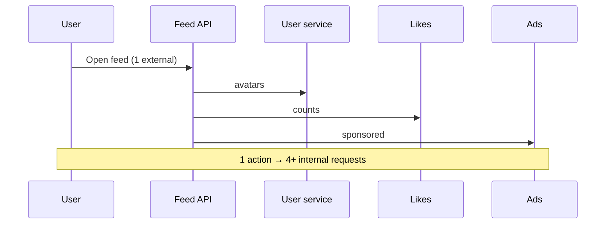
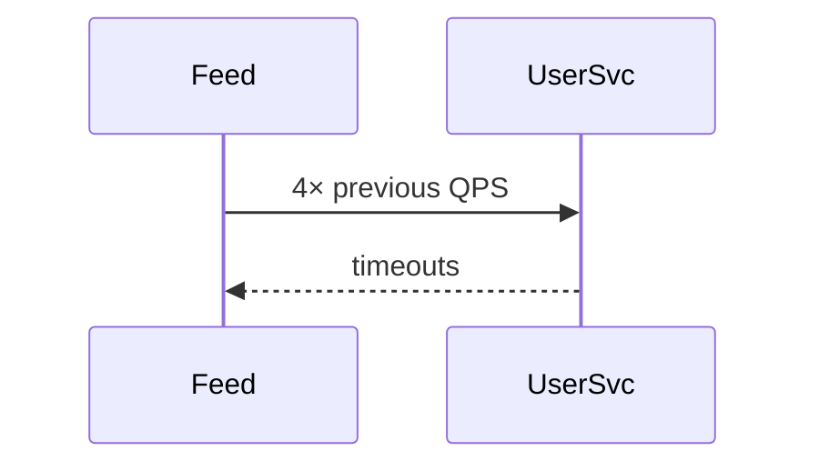

# Lesson 03: How to Estimate RPS: DAU, Reads vs Writes & Peak Traffic

> **Prerequisites:** [Lesson 02: Latency Numbers](../02-latency-numbers-powers-of-two-every-engineer-should-know/README.md) (Lesson 3 of 14).  
> **Estimated Reading Time:** 32 minutes  
> **Target Audience:** Engineers turning DAU and per-user actions into per-service peak RPS for sizing.  
> **Free PDF Notes:** [Download SD-D-003.pdf](https://backendroadmap.com/notes/system-design/SD-D-003.pdf)

> [!NOTE]
> **In one line:** RPS = DAU × actions per user per day ÷ 86,400 (≈ $10^5$). Then split reads from writes, multiply by the calls each action makes (fan-out), and apply a peak factor. Size for the peak.

> [!TIP]
> **The Golden Rule of RPS:** External RPS is the door count; fan-out is how many questions each customer asks at the counter—beginners lose a factor of 10–100 by forgetting the counter.

---

## Words You'll Meet Today

| Word | In Plain Words | Role |
| :--- | :--- | :--- |
| **RPS / QPS** | Requests/queries per second. | Sizing unit. |
| **Actions/user/day** | How often each DAU reads/writes. | Multiplier into daily volume. |
| **Read/write split** | Separate path estimates. | Cache vs primary. |
| **Fan-out** | Internal calls per user action. | Internal ≫ edge traffic. |
| **Peak factor** | Peak ÷ average. | Often 2–3× daily. |
| **Concurrent users** | Active at one moment. | Usually ≪ DAU. |

---

## Core Definition & Taxonomic Comparison

**RPS estimation** converts product metrics into load. **Not** a single blended number, not MAU-driven daily traffic, and not edge RPS alone when services fan out.

| Term | Precise Meaning | Production Example |
| :--- | :--- | :--- |
| **DAU** vs **concurrent** | Distinct users/day vs simultaneous. | 100 M DAU may be <1 M concurrent. |
| **Edge RPS** vs **internal RPS** | Client hits vs service mesh. | 10k feed opens → 40k+ internal. |
| **Read RPS** vs **write RPS** | Replica/cache vs primary/queue. | 11.6k reads vs 1.2k writes. |
| **Fan-out on write** | Copy to many timelines at write. | 116 posts/s × 200 followers = 23k inserts/s. |

---

## Component Anatomy & The Observability Gap

```text
 Daily actions → ÷86,400 → avg RPS → split R/W → × fan-out → × peak factor → size each tier
```

### Observability Gap

| Vantage | Captures | Hides |
| :--- | :--- | :--- |
| **API gateway RPS** | External | Per-service fan-out |
| **Service QPS** | That service | Downstream DB amplification |
| **DAU dashboard** | Users | Actions × fan-out |
| **DB QPS** | Queries | Whether from cache miss or write path |

---

## Mathematical Model & Worked Estimates

$$\mathrm{RPS}_{\mathrm{avg}} = \frac{\mathrm{DAU}\times A}{86{,}400}$$

**Feed:** $100\,\mathrm{M}\times 10 = 10^9$ reads/day → ~11,600 reads/s (shortcut $10^9/10^5=10{,}000$).

**Chat:** $50\,\mathrm{M}\times 20 = 10^9$ msgs/day → ~11,600 writes/s; peak $3\times$ → ~35,000/s.

**Photo feed:**

| Metric | Average | Peak ($3\times$) |
| :--- | ---: | ---: |
| Feed reads | ~5,800/s | ~17,400/s |
| New posts | ~116/s | ~350/s |
| Timeline inserts (×200) | ~23,000/s | ~70,000/s |

---

## Metrics, Percentiles & Distributions

| Percentile of day's seconds | Typical load vs average |
| :--- | :--- |
| $p_{50}$ second | Near or below average |
| Busy evening hour | ~2–3× average |
| Launch / celebrity | 10–100× (not in diurnal $p_{99}$) |

Use DAU for traffic; MAU overestimates daily RPS when engagement is low.

---

## Compounding Effects at Scale

$$\lambda_{\mathrm{svc}} = \lambda_{\mathrm{edge}} \times N_{\mathrm{calls}}$$

| Edge RPS | Calls/action | Internal RPS |
| ---: | ---: | ---: |
| 10,000 | 1 | 10,000 |
| 10,000 | 4 | 40,000 |
| 10,000 | 4×2 DB | 80,000 ops |

Celebrity exception: 50 M followers → hybrid fan-out on read.

---

## Numbers Every Backend Engineer Must Know

| Scenario | Order of magnitude |
| :--- | :--- |
| 500 peak RPS | Few servers + one DB |
| ~10k RPS | Real cluster + cache |
| ~100k RPS | Sharding / serious cache |
| Timeline inserts ≫ posts | Fan-out dominates design |

---

## Protocol & Network Deep Dive



---

## Hierarchical Budgets & Capacity Sizing

Size **each** service for its own peak, not site-wide average:

| Tier | Formula |
| :--- | :--- |
| Feed API | edge peak |
| User service | edge × 1 (if every open) × peak |
| Timeline store | posts × followers × peak |

---

## Top Engineering Mitigation Techniques

1. Split reads/writes. 2. Multiply by fan-out. 3. Apply peak factor. 4. Hybrid fan-out for celebrities. 5. Cross-check vs per-server capacity.

---

## Production War Story (SEV-1 Post-Mortem)

**SEV-1:** User-service CPU meltdown at 3× expected QPS after a feed redesign added avatar enrichment on every open without resizing.



**Fix:** cache profiles, batch gets, raise UserSvc capacity from fan-out math.

---

## Multi-Language Production Code Tabs

````carousel
```go
package rps

import "math"

func AvgRPS(dau, actions float64) float64 { return dau * actions / 86400 }
func PeakRPS(avg, factor float64) float64 { return avg * factor }
func FanOut(external float64, callsPerAction float64) float64 {
	return external * callsPerAction
}

func PhotoFeed() {
	dau, opens, postRate, followers, peak := 100e6, 5.0, 0.10, 200.0, 3.0
	reads := AvgRPS(dau, opens)
	posts := AvgRPS(dau, postRate)
	inserts := posts * followers
	_ = math.Ceil(reads * peak)
	_, _, _ = reads, posts, inserts
}
```

<!-- slide -->

```typescript
export const avgRps = (dau: number, actions: number) => (dau * actions) / 86_400;
export const peakRps = (avg: number, factor = 3) => avg * factor;

const dau = 100e6, opens = 5, postRate = 0.1, followers = 200, peak = 3;
const reads = avgRps(dau, opens);
const posts = avgRps(dau, postRate);
const inserts = posts * followers;
console.log({ reads: Math.round(reads), peakReads: Math.round(reads * peak), posts: Math.round(posts), inserts: Math.round(inserts) });
```

<!-- slide -->

```python
dau, opens, post_rate, followers, peak = 100e6, 5, 0.10, 200, 3
reads = dau * opens / 86_400
posts = dau * post_rate / 86_400
inserts = posts * followers
print(round(reads), round(reads * peak), round(posts), round(inserts))
# 5787 17361 116 23148
```

<!-- slide -->

```csharp
public static class RpsEstimate
{
    public static double Avg(double dau, double actions) => dau * actions / 86_400;
    public static double Peak(double avg, double factor = 3) => avg * factor;
    public static double FanOut(double external, double calls) => external * calls;
}
```
````

---

## Hands-On CLI Verification

```bash
python -c "dau,opens,post_rate,followers,peak=100e6,5,0.10,200,3; r=dau*opens/86400; p=dau*post_rate/86400; print(round(r), round(r*peak), round(p), round(p*followers))"
```

---

## Common Mistakes to Avoid

- One total RPS without R/W split.
- Forgetting fan-out on internal services.
- Sizing for average only.
- Using MAU for daily RPS.
- Exact long division instead of $10^5$.
- Ignoring celebrity skew on fan-out.
- Confusing DAU with concurrency.
- Not sanity-checking against known per-server capacity.

---

## Key Terms Glossary

| Term | Interview-ready definition |
| :--- | :--- |
| **RPS** | Requests per second. |
| **Fan-out** | Internal calls (or copies) per user action. |
| **Peak factor** | Peak ÷ average load. |
| **Hybrid fan-out** | Fan-out on write for normals; on read for celebrities. |

---

## Interview Practice Questions

<details>
<summary><strong>Q1. How do you estimate requests per second? [BASIC]</strong></summary>

<strong>What a strong answer covers:</strong>
DAU × actions/day ÷ 86,400 (or $10^5$). Split R/W, multiply by fan-out, apply peak factor.

</details>

<details>
<summary><strong>Q2. Why split reads from writes? [BASIC]</strong></summary>

<strong>What a strong answer covers:</strong>
Different subsystems: caches/replicas vs primary/queues. 11.6k reads and 1.2k writes need different designs.

</details>

<details>
<summary><strong>Q3. How wrong is dividing by 100,000 instead of 86,400? [BASIC]</strong></summary>

<strong>What a strong answer covers:</strong>
~14% low. Fine for order-of-magnitude.

</details>

<details>
<summary><strong>Q4. What is the difference between DAU and concurrent users? [BASIC]</strong></summary>

<strong>What a strong answer covers:</strong>
DAU = distinct users/day; concurrency = simultaneous actives, usually a small fraction of DAU.

</details>

<details>
<summary><strong>Q5. 50 M DAU, 20 messages/day each. Estimate RPS. [SCENARIO]</strong></summary>

<strong>What a strong answer covers:</strong>
1 B/day → ~11,600/s avg (~10k with $10^5$). At 3× peak ≈ 35k writes/s.

</details>

<details>
<summary><strong>Q6. 100 M DAU open feed 10×/day; each open calls 4 services. User service traffic? [SCENARIO]</strong></summary>

<strong>What a strong answer covers:</strong>
~11,600/s avg to user service if called once per open; ~35k/s at 3× peak.

</details>

<details>
<summary><strong>Q7. Estimate says 500 RPS at peak. What does that tell you? [SCENARIO]</strong></summary>

<strong>What a strong answer covers:</strong>
A couple of ordinary servers + single DB can handle it—no sharding yet.

</details>

<details>
<summary><strong>Q8. Each page view triggers 6 backend calls. Does estimate change? [SCENARIO]</strong></summary>

<strong>What a strong answer covers:</strong>
Yes—backend RPS is 6× page-view rate.

</details>

<details>
<summary><strong>Q9. Why is internal traffic often larger than external? [TRICKY]</strong></summary>

<strong>What a strong answer covers:</strong>
Fan-out: one action → many services/queries.

</details>

<details>
<summary><strong>Q10. DAU 10 M but MAU 100 M. Which for RPS? [TRICKY]</strong></summary>

<strong>What a strong answer covers:</strong>
DAU for traffic; MAU for storage/growth. Using MAU overestimates daily traffic ~10×.

</details>

<details>
<summary><strong>Q11. Why is fan-out the most dangerous multiplier? [TRICKY]</strong></summary>

<strong>What a strong answer covers:</strong>
One write expands to followers-many writes; skew makes it uneven.

</details>

<details>
<summary><strong>Q12. How do you handle a user with 50 M followers? [TRICKY]</strong></summary>

<strong>What a strong answer covers:</strong>
Don't fan-out on write; store once and merge at read (hybrid).

</details>

---

## One-Page Master Cheat Sheet

```text
====================================================================================================
                         HOW TO ESTIMATE RPS  —  CHEAT SHEET
====================================================================================================
RPS = DAU × actions / 86,400   (≈ / 1e5)
THEN  split R/W · × fan-out · × peak factor
WATCH celebrities break averages · internal ≫ edge
====================================================================================================
```

---

## Free PDF notes

Download these notes as a printable PDF: [SD-D-003.pdf](https://backendroadmap.com/notes/system-design/SD-D-003.pdf).

---

## Sources

- Alex Xu — news feed chapter.
- Twitter engineering — Timelines at scale.
- [SD-D-003.pdf](https://backendroadmap.com/notes/system-design/SD-D-003.pdf).

---

## Next

Next comes [Lesson 04: Peak vs Average Traffic](../04-peak-vs-average-traffic/README.md). See [the track overview](../README.md) for the whole series.
