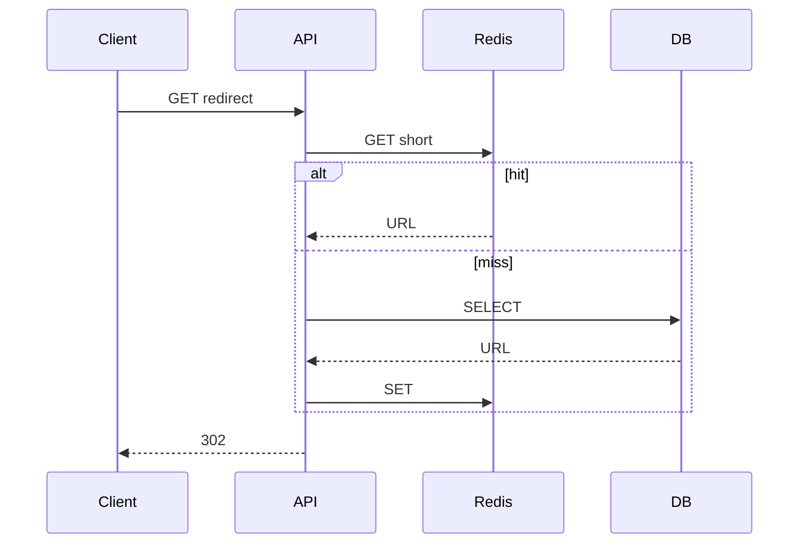

# Lesson 05: Read/Write Ratio: How 100:1 Reads Shape Your Architecture

> **Prerequisites:** [Lesson 04: Peak vs Average Traffic](../04-peak-vs-average-traffic/README.md) (Lesson 5 of 14).  
> **Estimated Reading Time:** 32 minutes  
> **Target Audience:** Architects choosing cache-first vs write-optimized designs from the read:write ratio.  
> **Free PDF Notes:** [Download SD-D-005.pdf](https://backendroadmap.com/notes/system-design/SD-D-005.pdf)

> [!NOTE]
> **In one line:** Find the read-to-write ratio early; read-heavy systems (100:1) are built cache-first with replicas, CDNs, and precomputed data; write-heavy systems use LSM stores, queues, batching, and partitioned writes.

> [!TIP]
> **The Golden Rule of R/W Ratio:** A library with 100 readers per author needs more reading rooms (copies/caches), not a bigger writing desk—unless you're ingesting metrics, then flip the design.

---

## Words You'll Meet Today

| Word | In Plain Words | Role |
| :--- | :--- | :--- |
| **Read-heavy** | Reads dominate (often ≥10:1). | Cache, CDN, replicas. |
| **Write-heavy** | Writes dominate. | LSM, queues, partitions. |
| **Write amplification** | 1 logical → many physical writes. | Indexes × replicas × compaction. |
| **Denormalization** | Pre-join for cheap reads. | Pay at write time. |
| **Hit rate** | Share served by cache. | Misses = DB load. |
| **Fan-out on write** | Push copies at write. | Feeds; celebrities hurt. |

---

## Core Definition & Taxonomic Comparison

| Term | Precise Meaning | Example |
| :--- | :--- | :--- |
| **100:1 reads** | Cache-first architecture. | URL shortener redirects. |
| **~1:1** | Balanced paths. | Chat send vs history. |
| **Write-dominated** | Ingest optimized. | Metrics, IoT, logs. |
| **Per-feature ratio** | Not one app-wide number. | Profiles read-heavy; messages write-heavy. |

---

## Component Anatomy & The Observability Gap

```text
 100k reads/s ──95% hit──► 5k DB reads/s ──► ~3 replicas @ 2k each
 1k writes/s  ─────────────────────────────► primary (+ queue if bursty)
```

### Observability Gap

| Vantage | Captures | Hides |
| :--- | :--- | :--- |
| **API write count** | Logical writes | Index + replica amplification |
| **Cache hit ratio** | Memory path | Stampede on expiry |
| **Replica lag** | Freshness | Read-your-writes bugs |
| **Primary IOPS** | Write truth | Fan-out side effects |

---

## Mathematical Model & Worked Estimates

$$\lambda_{\mathrm{DB,read}} = \lambda_{\mathrm{read}} \times (1 - h)$$

At $100{,}000$ reads/s and $h=0.95$ → $5{,}000$ DB reads/s → ~3 replicas @ $2{,}000$/s.

**Write amplification example:** 1 insert × 3 indexes × RF 3 → 12 physical writes.

**News feed estimate:** 2 posts/day + 20 loads × 50 posts → ~500:1 post reads vs posts.

---

## Metrics, Percentiles & Distributions

| Ratio band | Architecture skew |
| :--- | :--- |
| ≥100:1 | CDN + cache + replicas + denorm views |
| ~10:1 | Still cache-first |
| ~1:1 | Partition carefully; dual paths |
| Write-heavy | LSM, batching, time-series partitioning |

---

## Compounding Effects at Scale

Fan-out on write: $\lambda_{\mathrm{insert}} = \lambda_{\mathrm{post}} \times N_{\mathrm{followers}}$.

Celebrity $N=5\times 10^7$ breaks averages → hybrid fan-out.

---

## Numbers Every Backend Engineer Must Know

| System | Typical ratio | Technique |
| :--- | :--- | :--- |
| URL shortener | ~100:1 | Immutable cache |
| Product catalog | ~400:1 | CDN + cache + TTL/invalidation |
| Metrics ingest | write-heavy | Queue + LSM/TSDB |
| Chat messages | write-ish | Partition by conversation |

---

## Protocol & Network Deep Dive



---

## Hierarchical Budgets & Capacity Sizing

| Path | Budget focus |
| :--- | :--- |
| Hot read | µs–ms cache |
| Miss path | Replica capacity for $(1-h)\\lambda$ |
| Write | Primary + amplification |

---

## Top Engineering Mitigation Techniques

1. Cache first for read-heavy. 2. Replicas for misses. 3. Denormalize/precompute. 4. LSM + queue for write-heavy. 5. Analyze ratio per data type.

---

## Production War Story (SEV-1 Post-Mortem)

**SEV-1:** Catalog cache TTLs aligned → synchronized expiry → DB took 100% of 200k reads/s.

**Fix:** jittered TTLs, request coalescing, replicas sized for cold-cache, stale-while-revalidate.

---

## Multi-Language Production Code Tabs

````carousel
```go
package rwratio

import "math"

func DBReads(totalReads, hitRate float64) float64 {
	return totalReads * (1 - hitRate)
}

func ReplicasNeeded(dbReads, perReplica float64) int {
	return int(math.Ceil(dbReads / perReplica))
}

func Demo() {
	reads, hit := 100_000.0, 0.95
	db := DBReads(reads, hit) // 5000
	_ = ReplicasNeeded(db, 2000) // 3
}
```

<!-- slide -->

```typescript
export function dbReads(totalReads: number, hitRate: number) {
  return totalReads * (1 - hitRate);
}
export function replicasNeeded(dbReads: number, perReplica: number) {
  return Math.ceil(dbReads / perReplica);
}
console.log(dbReads(100_000, 0.95), replicasNeeded(5_000, 2_000)); // 5000, 3
```

<!-- slide -->

```python
reads, hit = 100_000, 0.95
db_reads = reads * (1 - hit)
per_replica = 2_000
import math
print(db_reads, math.ceil(db_reads / per_replica))  # 5000.0 3
```

<!-- slide -->

```csharp
public static class ReadWrite
{
    public static double DbReads(double totalReads, double hitRate) =>
        totalReads * (1 - hitRate);
    public static int ReplicasNeeded(double dbReads, double perReplica) =>
        (int)Math.Ceiling(dbReads / perReplica);
}
```
````

---

## Hands-On CLI Verification

```bash
python -c "import math; print(100000*0.05, math.ceil(5000/2000))"
```

---

## Common Mistakes to Avoid

- Never asking for the ratio.
- One ratio for the whole app.
- Counting API writes but ignoring amplification.
- Adding replicas before a high-hit cache.
- Caching mutable data without invalidation plan.
- Fan-out on write for celebrities.
- Ignoring read-your-writes after replica lag.
- Assuming write scaling is free once reads are cached.

---

## Key Terms Glossary

| Term | Interview-ready definition |
| :--- | :--- |
| **Read/write ratio** | Reads per write. |
| **Write amplification** | Physical writes per logical write. |
| **Denormalization** | Store pre-joined shapes for cheap reads. |
| **Hit rate** | Fraction of reads served by cache. |

---

## Interview Practice Questions

<details>
<summary><strong>Q1. How does a 100:1 read ratio influence design? [BASIC]</strong></summary>

<strong>What a strong answer covers:</strong>
Cache-first, replicas for misses, CDN, precomputed data; keep rare writes on primary.

</details>

<details>
<summary><strong>Q2. How do you design for write-heavy workloads? [BASIC]</strong></summary>

<strong>What a strong answer covers:</strong>
LSM stores, partition writes, batch, queue bursts, minimal indexes.

</details>

<details>
<summary><strong>Q3. What is write amplification? [BASIC]</strong></summary>

<strong>What a strong answer covers:</strong>
One logical write → many physical (indexes, replicas, compaction, fan-out).

</details>

<details>
<summary><strong>Q4. What is hit rate? [BASIC]</strong></summary>

<strong>What a strong answer covers:</strong>
Share of reads served by cache; misses × total reads = DB read load.

</details>

<details>
<summary><strong>Q5. Nobody gives ratio for a news feed. Estimate? [SCENARIO]</strong></summary>

<strong>What a strong answer covers:</strong>
From actions: e.g. 2 posts vs 20×50 post reads ≈ 500:1 → read-heavy.

</details>

<details>
<summary><strong>Q6. 120k redirects/s at 99% hit rate — DB load? [SCENARIO]</strong></summary>

<strong>What a strong answer covers:</strong>
1% → 1,200 reads/s + ~1,200 inserts/s; primary + few replicas suffice.

</details>

<details>
<summary><strong>Q7. Chat app: which parts read- vs write-heavy? [SCENARIO]</strong></summary>

<strong>What a strong answer covers:</strong>
Messages write-heavy (partitioned LSM); profiles read-heavy (cache).

</details>

<details>
<summary><strong>Q8. Product catalog 200k reads/s and 500 writes/s — outline? [SCENARIO]</strong></summary>

<strong>What a strong answer covers:</strong>
CDN+cache (400:1), few replicas, one primary, invalidate/TTL on updates.

</details>

<details>
<summary><strong>Q9. Why is caching a URL shortener easier than a product catalog? [TRICKY]</strong></summary>

<strong>What a strong answer covers:</strong>
Short links immutable → no staleness; catalog prices/stock need TTL/invalidation.

</details>

<details>
<summary><strong>Q10. Celebrity with 50 M followers posts — why fan-out on write hurts? [TRICKY]</strong></summary>

<strong>What a strong answer covers:</strong>
One post → 50 M feed writes; use fan-out on read for celebrities (hybrid).

</details>

<details>
<summary><strong>Q11. When are read replicas the wrong first step? [TRICKY]</strong></summary>

<strong>What a strong answer covers:</strong>
When a cache at 99% hit would remove more load cheaper than N replicas.

</details>

<details>
<summary><strong>Q12. How does replication lag interact with read-heavy designs? [TRICKY]</strong></summary>

<strong>What a strong answer covers:</strong>
Replicas are slightly stale; read-your-writes needs primary routing shortly after write.

</details>

---

## One-Page Master Cheat Sheet

```text
====================================================================================================
                         READ/WRITE RATIO  —  CHEAT SHEET
====================================================================================================
READ-HEAVY (≥10:1..100:1)  cache · CDN · replicas · denorm
WRITE-HEAVY                queue · batch · LSM · partition
DB_reads = reads × (1 − hit)     watch write amplification & fan-out
====================================================================================================
```

---

## Free PDF notes

Download these notes as a printable PDF: [SD-D-005.pdf](https://backendroadmap.com/notes/system-design/SD-D-005.pdf).

---

## Sources

- [SD-D-005.pdf](https://backendroadmap.com/notes/system-design/SD-D-005.pdf).
- Designing Data-Intensive Applications — replication & LSM chapters.

---

## Next

Next comes [Lesson 06: Storage Estimation](../06-storage-estimation/README.md). See [the track overview](../README.md) for the whole series.
