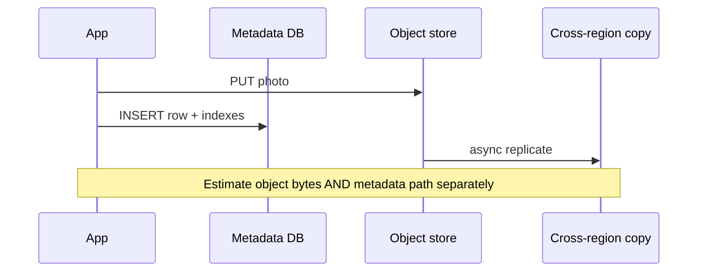

# Lesson 06: Storage Estimation: Size × Count × Retention × Replicas

> **Prerequisites:** [Lesson 05: Read/Write Ratio](../05-read-write-ratio/README.md) (Lesson 6 of 14).  
> **Estimated Reading Time:** 32 minutes  
> **Target Audience:** Engineers estimating disk/object-store capacity including replication and growth.  
> **Free PDF Notes:** [Download SD-D-006.pdf](https://backendroadmap.com/notes/system-design/SD-D-006.pdf)

> [!NOTE]
> **In one line:** Storage = object size × new objects per day × days retained × replication factor, plus metadata, indexes, and derived copies, adjusted for growth; the replication factor alone is usually 3×.

> [!TIP]
> **The Golden Rule of Storage:** Four factors multiply—size × count × retention × replicas. Most interview misses forget the last two; growth that doubles yearly makes “year1×5” catastrophically low.

---

## Words You'll Meet Today

| Word | Meaning | Role |
| :--- | :--- | :--- |
| **Replication factor** | Copies kept (often 3). | Durability tax. |
| **Overhead** | Metadata, indexes, thumbs. | +50–100% tables; +20–50% media. |
| **Erasure coding** | ~1.4–1.5× vs 3× RF. | Exabyte economics. |
| **Cold tier** | Cheaper old storage. | Retention without hot SSD cost. |
| **Compound growth** | Multiplicative yearly write volume. | Last year dominates totals. |

---

## Core Definition & Taxonomic Comparison

**Storage estimation** multiplies four factors then adds overhead. **Not** “objects × size for one day,” and not ignoring RF because “S3 is durable” (you still pay).

| Term | Meaning | Example |
| :--- | :--- | :--- |
| **Raw** vs **usable** | Before vs after RF/EC. | 1.8 EB → 5.5 EB at RF=3. |
| **Hot** vs **cold** | Frequent vs archive. | Tier after 90 days. |
| **Linear** vs **doubling growth** | Flat vs $2^y$. | 5× vs 31× over 5 years. |

---

## Component Anatomy & The Observability Gap

```text
 size × objects/day × days × replicas  = raw
 + metadata + indexes (+50–100%) + thumbnails (+20–50%) + backups/regions
```

### Observability Gap

| Vantage | Captures | Hides |
| :--- | :--- | :--- |
| **Object-store bill** | Bytes stored | Growth trajectory |
| **Table size** | Rows | Index bloat |
| **Backup size** | Snapshots | Cross-region copies |
| **Daily ingest** | One day | Retention cliff |

---

## Mathematical Model & Worked Estimates

$$\mathrm{Storage}=S\times N_{\mathrm{day}}\times D\times R + O$$

**Photos:** $500\,\mathrm{M}\times 2\,\mathrm{MB}=1\,\mathrm{PB/day}$; $\times 365\approx 365\,\mathrm{PB/y}$; $\times 5\approx 1.8\,\mathrm{EB}$; $\times 3\approx 5.5\,\mathrm{EB}$.

**Chat text:** $50\,\mathrm{M}\times 40\times 200\,\mathrm{B}=400\,\mathrm{GB/day}$; $\times 1825\approx 730\,\mathrm{TB}$; $\times 3\approx 2.2\,\mathrm{PB}$ (+indexes → ~2.5–3 PB). Media estimated separately—usually dominates.

**Doubling users yearly:** totals $1+2+4+8+16=31$ units vs naive $5$ → **6× underestimate**.

---

## Metrics, Percentiles & Distributions

Storage is cumulative—there is no $p_{50}$ “average day” erase. Plan $p_{99}$ growth scenarios (faster than forecast) with earlier tiering.

---

## Compounding Effects at Scale

$$\mathrm{Total}_{Y}=\sum_{y=0}^{Y-1} W_0\cdot g^{y}$$

For $g=2$, $Y=5$: $31 W_0$. Year 5 alone ≈ 52% of all data.

---

## Numbers Every Backend Engineer Must Know

| Unit | Approx |
| :--- | :--- |
| 1 PB | 1,000 TB |
| 1 EB | 1,000 PB |
| RF | often 3× |
| EC overhead | ~1.4–1.5× |
| Index overhead | +50–100% |

---

## Protocol & Network Deep Dive



---

## Hierarchical Budgets & Capacity Sizing

| Slice | Share of planning |
| :--- | :--- |
| Primary object bytes | Base |
| RF / EC | ×1.4–3 |
| Derived (thumbs) | +20–50% |
| Indexes/metadata | often small vs media, large vs chat text |
| Growth buffer | compound, not linear |

---

## Top Engineering Mitigation Techniques

1. Write all four factors. 2. Add overhead. 3. Model compound growth. 4. Erasure coding + cold tiers. 5. Compress, TTL, dedupe by hash.

---

## Production War Story (SEV-1 Post-Mortem)

**SEV-2 cost incident:** 5-year budget used `year1×5` while DAU doubled yearly → storage 6× over plan by year 4; emergency cold-tier migration under capacity pressure.

**Fix:** compound workbook + EC + lifecycle policies + separate media estimates.

---

## Multi-Language Production Code Tabs

````carousel
```go
package storage
func Bytes(size, perDay, days, replicas float64) float64 {
	return size * perDay * days * replicas
}
func GrowthTotal(year1 float64, years int, yearlyMul float64) float64 {
	t, x := 0.0, year1
	for i := 0; i < years; i++ { t += x; x *= yearlyMul }
	return t
}
```

<!-- slide -->

```typescript
export const storageBytes = (size: number, perDay: number, days: number, replicas = 3) =>
  size * perDay * days * replicas;
export function growthTotal(year1: number, years: number, mul = 2) {
  let t = 0, x = year1;
  for (let i = 0; i < years; i++) { t += x; x *= mul; }
  return t;
}
console.log(500e6 * 2e6 * 365 * 5 * 3 / 1e18, "EB raw photos"); // ~5.5
console.log(growthTotal(1, 5, 2)); // 31
```

<!-- slide -->

```python
def storage(size, per_day, days, replicas=3):
    return size * per_day * days * replicas
# photos: 500M * 2MB * 1825 * 3
print(500e6 * 2e6 * 1825 * 3 / 1e18)  # ~5.5 EB
# chat: 2e9 msgs/day * 200B * 1825 * 3
print(2e9 * 200 * 1825 * 3 / 1e12)  # ~2.2 PB
```

<!-- slide -->

```csharp
public static class StorageEst {
  public static double Bytes(double size, double perDay, double days, double replicas = 3)
    => size * perDay * days * replicas;
}
```
````

---

## Hands-On CLI Verification

```bash
python -c "print(500e6*2e6*365*5*3/1e18); print(2e9*200*1825*3/1e12); print(sum(2**i for i in range(5)))"
```

---

## Common Mistakes to Avoid

- Forgetting replicas.
- One-day storage only.
- Ignoring indexes/thumbs.
- Linear growth when compounding.
- Mixing media into text estimate.
- No TTL/tiering plan.
- Treating S3 as 'free durability'.
- False precision on EB math.

---

## Key Terms Glossary

| Term | Interview-ready definition |
| :--- | :--- |
| **Replication factor** | Number of stored copies. |
| **Erasure coding** | Parity-based redundancy with lower overhead than 3× copy. |
| **Cold tier** | Cheaper storage for infrequently accessed data. |
| **Write amplification (storage)** | Extra bytes from indexes, derived assets, backups. |

---

## Interview Practice Questions

<details>
<summary><strong>Q1. What is the storage formula? [BASIC]</strong></summary>

<strong>What a strong answer covers:</strong>
Size × objects/day × days retained × replicas, plus overhead.

</details>

<details>
<summary><strong>Q2. Why multiply by replication factor? [BASIC]</strong></summary>

<strong>What a strong answer covers:</strong>
Durability—DB replicas, Cassandra/HDFS RF≈3, object stores price in durability; backups/regions add more.

</details>

<details>
<summary><strong>Q3. What overheads do you add? [BASIC]</strong></summary>

<strong>What a strong answer covers:</strong>
Metadata rows, indexes (+50–100%), thumbnails (+20–50%), backups/other regions.

</details>

<details>
<summary><strong>Q4. 500 M × 2 MB photos, 5 years, RF=3 — rough raw storage? [BASIC]</strong></summary>

<strong>What a strong answer covers:</strong>
~1 PB/day → ~1.8 EB ×3 ≈ 5.5 EB.

</details>

<details>
<summary><strong>Q5. Chat: 50 M DAU, 40 msgs, 200 B, 5 years. Estimate? [SCENARIO]</strong></summary>

<strong>What a strong answer covers:</strong>
400 GB/day → ~730 TB ×3 ≈ 2.2 PB (+indexes ~2.5–3 PB); media separate.

</details>

<details>
<summary><strong>Q6. Users double yearly — why is year1×5 wrong? [SCENARIO]</strong></summary>

<strong>What a strong answer covers:</strong>
Totals 31× year1 units, not 5× — ~6× too low.

</details>

<details>
<summary><strong>Q7. When do you choose erasure coding? [SCENARIO]</strong></summary>

<strong>What a strong answer covers:</strong>
Exabyte object stores where 3× RF is too expensive; ~1.4–1.5× overhead.

</details>

<details>
<summary><strong>Q8. How do you estimate attachments vs text? [SCENARIO]</strong></summary>

<strong>What a strong answer covers:</strong>
Same formula on object store separately; attachments usually dwarf text.

</details>

<details>
<summary><strong>Q9. Does S3 mean you skip RF in the estimate? [TRICKY]</strong></summary>

<strong>What a strong answer covers:</strong>
You may not manage copies, but cost/capacity still reflects multi-copy durability—and CRR adds more.

</details>

<details>
<summary><strong>Q10. Why do indexes dominate some text workloads? [TRICKY]</strong></summary>

<strong>What a strong answer covers:</strong>
Small rows + multiple secondary indexes can rival or exceed row bytes.

</details>

<details>
<summary><strong>Q11. How does retention policy change architecture? [TRICKY]</strong></summary>

<strong>What a strong answer covers:</strong>
Finite retention caps growth; 'forever' forces tiering/sharding roadmap.

</details>

<details>
<summary><strong>Q12. What's a good interview presentation style? [TRICKY]</strong></summary>

<strong>What a strong answer covers:</strong>
Write each factor, round, multiply step by step out loud so slips are catchable.

</details>

---

## One-Page Master Cheat Sheet

```text
STORAGE = size × count/day × days × replicas + overhead
RF≈3 | EC≈1.4× | growth compounds (2^y) | media ≠ text
```

---

## Free PDF notes

Download these notes as a printable PDF: [SD-D-006.pdf](https://backendroadmap.com/notes/system-design/SD-D-006.pdf).

---

## Sources

- [SD-D-006.pdf](https://backendroadmap.com/notes/system-design/SD-D-006.pdf).
- DDIA — storage & encoding.

---

## Next

Next comes [Lesson 07: Bandwidth Estimation](../07-bandwidth-estimation/README.md). See [the track overview](../README.md) for the whole series.
