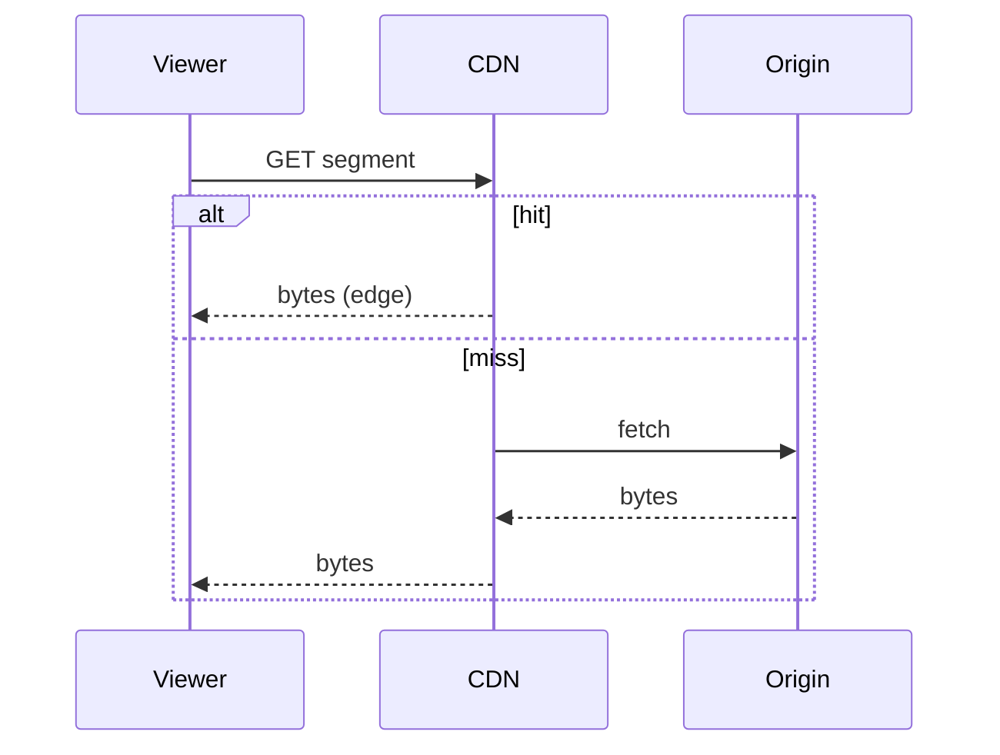

# Lesson 07: Bandwidth Estimation: Ingress, Egress, Gbps & CDN Offload

> **Prerequisites:** [Lesson 06: Storage Estimation](../06-storage-estimation/README.md) (Lesson 7 of 14).  
> **Estimated Reading Time:** 32 minutes  
> **Target Audience:** Engineers sizing NIC/link capacity and CDN offload for APIs and video.  
> **Free PDF Notes:** [Download SD-D-007.pdf](https://backendroadmap.com/notes/system-design/SD-D-007.pdf)

> [!NOTE]
> **In one line:** Bandwidth = requests per second (or concurrent streams) × payload size, converted from bytes to bits, then sized for the peak and reduced by CDN offload; 10,000 streams at 5 Mbps is 50 Gbps of egress.

> [!TIP]
> **The Golden Rule of Bandwidth:** Storage/payloads are bytes; links are bits—forget ×8 and you are 8× too small. Egress dominates consumer cost; CDNs exist to move those bits to the edge.

---

## Words You'll Meet Today

| Word | Meaning | Role |
| :--- | :--- | :--- |
| **Ingress** | Data in. | Uploads/API requests. |
| **Egress** | Data out. | Usually billed & larger. |
| **Gbps** | Gigabits/sec. | Link/NIC unit. |
| **CDN offload** | Fraction served at edge. | 95% → origin 5%. |
| **ABR** | Adaptive bitrate. | Match stream to device/network. |

---

## Core Definition & Taxonomic Comparison

| Term | Meaning | Example |
| :--- | :--- | :--- |
| **Request bandwidth** | RPS × bytes × 8. | 5k × 50 KB → 2 Gbps. |
| **Streaming bandwidth** | viewers × bitrate. | 10k × 5 Mbps → 50 Gbps. |
| **Origin** vs **CDN** | Miss path vs edge. | 50 → 2.5 Gbps at 95% offload. |

---

## Component Anatomy & The Observability Gap

```text
 Users ──ingress──► Origin/API/Storage ──egress──► Users
              CDN edges serve most egress bytes near viewers
```

### Observability Gap

| Vantage | Captures | Hides |
| :--- | :--- | :--- |
| **Cloud egress bill** | Bytes out | Peak vs average |
| **NIC util** | Per host | Asymmetric fan-in |
| **CDN hit ratio** | Offload | Origin storm on miss |
| **Avg Mbps** | Daily mean | Prime-time 3× |

---

## Mathematical Model & Worked Estimates

$$\mathrm{Gbps}=\frac{\mathrm{RPS}\times \mathrm{bytes}\times 8}{10^9},\quad \mathrm{Gbps}_{\mathrm{stream}}=N\times \mathrm{Mbps}/10^3$$

5,000 × 50 KB = 250 MB/s × 8 = **2 Gbps**.

10,000 × 5 Mbps = **50 Gbps**; monthly ≈ 6.25 GB/s × 2.6e6 s ≈ **16 PB**/month.

Origin after 95% offload: **2.5 Gbps**.

---

## Metrics, Percentiles & Distributions

Size links for prime-time / event $p_{99}$ concurrency, not daily-average bitrate × viewers.

---

## Compounding Effects at Scale

Cross-region replication multiplies transfer: upload once × regions copied. Live events stack peak factors on already-large egress.

---

## Numbers Every Backend Engineer Must Know

| Item | Typical |
| :--- | :--- |
| Server NIC | 10 or 25 Gbps |
| ×8 trap | bytes→bits |
| CDN offload | 90–99% video |
| Prime time | ~3× avg |

---

## Protocol & Network Deep Dive



---

## Hierarchical Budgets & Capacity Sizing

| Path | Budget |
| :--- | :--- |
| Peak egress | streams × bitrate × peak factor |
| Origin | peak × (1−offload) + headroom |
| NIC count | origin Gbps / (NIC × util target) |

---

## Top Engineering Mitigation Techniques

1. CDN. 2. Compress (gzip/brotli, modern codecs). 3. ABR. 4. Cache aggressively. 5. Paginate/trim API payloads. 6. Avoid needless cross-region copies.

---

## Production War Story (SEV-1 Post-Mortem)

**SEV-1:** Live launch without CDN capacity commitment — origin NICs saturated at ~40 Gbps offered; viewers stalled.

**Fix:** CDN pre-warm + committed bandwidth + ABR caps + origin shield.

---

## Multi-Language Production Code Tabs

````carousel
```go
package bw
func GbpsFromRPS(rps, bytesPerResp float64) float64 {
	return rps * bytesPerResp * 8 / 1e9
}
func StreamGbps(viewers, mbps float64) float64 { return viewers * mbps / 1e3 }
func OriginAfterCDN(total, offload float64) float64 { return total * (1 - offload) }
```

<!-- slide -->

```typescript
export const gbpsFromRps = (rps: number, bytes: number) => (rps * bytes * 8) / 1e9;
export const streamGbps = (viewers: number, mbps: number) => (viewers * mbps) / 1e3;
export const originAfterCdn = (total: number, offload: number) => total * (1 - offload);
console.log(gbpsFromRps(5000, 50_000), streamGbps(10_000, 5), originAfterCdn(50, 0.95));
```

<!-- slide -->

```python
def gbps(rps, nbytes): return rps * nbytes * 8 / 1e9
print(gbps(5000, 50_000))  # 2.0
print(10_000 * 5 / 1e3)    # 50 Gbps
print(50 * 0.05)           # 2.5 origin
```

<!-- slide -->

```csharp
public static class Bandwidth {
  public static double Gbps(double rps, double bytes) => rps * bytes * 8 / 1e9;
  public static double Streams(double n, double mbps) => n * mbps / 1e3;
}
```
````

---

## Hands-On CLI Verification

```bash
python -c "print(5000*50000*8/1e9); print(10000*5/1e3); print(50*0.05)"
```

---

## Common Mistakes to Avoid

- Forgetting ×8.
- Sizing average not peak.
- No CDN for video.
- Ignoring cross-region transfer cost.
- Sending fat JSON.
- Assuming one 10G NIC handles 50 Gbps.
- Confusing MB/s with Mbps.
- No ABR.

---

## Key Terms Glossary

| Term | Interview-ready definition |
| :--- | :--- |
| **Egress** | Outbound traffic, usually billed. |
| **Offload** | Fraction of bytes served by CDN. |
| **ABR** | Adaptive bitrate streaming. |

---

## Interview Practice Questions

<details>
<summary><strong>Q1. How do you estimate API bandwidth? [BASIC]</strong></summary>

<strong>What a strong answer covers:</strong>
RPS × payload bytes, then ×8 for bits/Gbps; size for peak.

</details>

<details>
<summary><strong>Q2. Ingress vs egress? [BASIC]</strong></summary>

<strong>What a strong answer covers:</strong>
In vs out; consumer apps usually egress-dominated and billed on egress.

</details>

<details>
<summary><strong>Q3. 10k streams at 5 Mbps? [BASIC]</strong></summary>

<strong>What a strong answer covers:</strong>
50 Gbps egress.

</details>

<details>
<summary><strong>Q4. Why ×8? [BASIC]</strong></summary>

<strong>What a strong answer covers:</strong>
Payloads in bytes; links in bits.

</details>

<details>
<summary><strong>Q5. With 95% CDN offload, origin load for 50 Gbps? [SCENARIO]</strong></summary>

<strong>What a strong answer covers:</strong>
2.5 Gbps.

</details>

<details>
<summary><strong>Q6. Monthly volume at 50 Gbps steady? [SCENARIO]</strong></summary>

<strong>What a strong answer covers:</strong>
~16 PB/month order of magnitude.

</details>

<details>
<summary><strong>Q7. How many 25G NICs for 50 Gbps with headroom? [SCENARIO]</strong></summary>

<strong>What a strong answer covers:</strong>
More than 2 at line rate—several servers after util target.

</details>

<details>
<summary><strong>Q8. Ways to cut bandwidth? [SCENARIO]</strong></summary>

<strong>What a strong answer covers:</strong>
CDN, compression, modern codecs, ABR, pagination, field filtering.

</details>

<details>
<summary><strong>Q9. Why is prime-time sizing mandatory? [TRICKY]</strong></summary>

<strong>What a strong answer covers:</strong>
Concurrency spikes several×; links fail at peak.

</details>

<details>
<summary><strong>Q10. Does compressing already-compressed video help? [TRICKY]</strong></summary>

<strong>What a strong answer covers:</strong>
Little—use better codecs/ABR; gzip helps JSON/HTML.

</details>

<details>
<summary><strong>Q11. Cross-AZ transfer surprise? [TRICKY]</strong></summary>

<strong>What a strong answer covers:</strong>
Replication/backups billed; multi-region multiplies.

</details>

<details>
<summary><strong>Q12. API 20k RPS × 5 KB at peak — Gbps? [TRICKY]</strong></summary>

<strong>What a strong answer covers:</strong>
20k×5e3×8/1e9 = 0.8 Gbps — modest vs video.

</details>

---

## One-Page Master Cheat Sheet

```text
Gbps = RPS × bytes × 8 / 1e9
Streams: N × Mbps / 1e3
CDN: origin = total × (1 − offload) | never forget ×8 | size peak
```

---

## Free PDF notes

Download these notes as a printable PDF: [SD-D-007.pdf](https://backendroadmap.com/notes/system-design/SD-D-007.pdf).

---

## Sources

- [SD-D-007.pdf](https://backendroadmap.com/notes/system-design/SD-D-007.pdf).

---

## Next

Next comes [Lesson 08: Cache Sizing](../08-cache-sizing/README.md). See [the track overview](../README.md) for the whole series.
