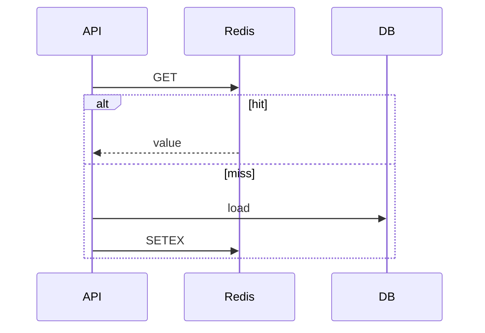

# Lesson 08: Cache Sizing: Working Set, the 80/20 Rule & Redis Nodes

> **Prerequisites:** [Lesson 07: Bandwidth Estimation](../07-bandwidth-estimation/README.md) (Lesson 8 of 14).  
> **Estimated Reading Time:** 32 minutes  
> **Target Audience:** Engineers sizing Redis/Memcached memory and node counts from working-set estimates.  
> **Free PDF Notes:** [Download SD-D-008.pdf](https://backendroadmap.com/notes/system-design/SD-D-008.pdf)

> [!NOTE]
> **In one line:** Estimate the working set (data actually read in a period), cache its hot fraction (80/20), multiply by entry size plus overhead, then add headroom and replicas to get a node count, and check throughput per node.

> [!TIP]
> **The Golden Rule of Cache Sizing:** Cache the hot working set, not the warehouse. 20% of keys often earn 80% of hits—then add ~50% entry overhead, 25% RAM headroom, and replicas.

---

## Words You'll Meet Today

| Word | Meaning | Role |
| :--- | :--- | :--- |
| **Working set** | Data touched in a window. | ≪ total data. |
| **80/20** | Hot fraction heuristic. | Size for hot keys. |
| **Per-key overhead** | Redis pointers/TTL/frag. | Often +50% small values. |
| **Usable RAM** | After ~25% headroom. | Fork/snapshot safety. |
| **Ops/s per node** | ~1e5 Redis ballpark. | Throughput check. |

---

## Core Definition & Taxonomic Comparison

| Term | Meaning | Example |
| :--- | :--- | :--- |
| **Total data** | All links ever. | Years of rows. |
| **Working set** | Read today. | 100 M distinct. |
| **Hot set** | ~20% of WS. | 20 M entries. |

---

## Component Anatomy & The Observability Gap

```text
 total ⊃ working set ⊃ hot 20% → × bytes/entry (+overhead) → × headroom → ÷ usable/node → primaries ×2 replicas
```

### Observability Gap

| Vantage | Captures | Hides |
| :--- | :--- | :--- |
| **Used memory** | RSS | Fragmentation / fragmentation ratio |
| **Hit rate** | Effectiveness | Skew / hot key CPU |
| **Evictions** | Pressure | Wrong maxmemory policy |
| **Ops/s** | Throughput | Single-thread hotspot |

---

## Mathematical Model & Worked Estimates

**URL shortener:** WS 100 M distinct; hot 20 M; 500 B + overhead → ~800 B; $20\,\mathrm{M}\times 800\,\mathrm{B}=16\,\mathrm{GB}$. Upper bound 200 M × 800 B = **160 GB**.

64 GB node → ~48 GB usable (25% free): $160/48\approx 3.3$ → **4 primaries**; +1 replica each → **8 nodes**.

Throughput: 1 B redirects/day ≈ 12k/s avg; peak higher—still ≪ 4 × ~100k ops/s.

---

## Metrics, Percentiles & Distributions

Hit rate $p_{50}$ keys ≠ traffic: measure byte/request hit ratio under peak; cold start hit rate can be ~0.

---

## Compounding Effects at Scale

Without headroom, Redis RDB fork copy-on-write doubles RAM briefly → OOM killer → stampede to DB.

---

## Numbers Every Backend Engineer Must Know

| Item | Value |
| :--- | :--- |
| Hot fraction | ~20% (often more skewed) |
| Small-value overhead | +~50% |
| RAM headroom | ~25% |
| Redis ops/s / node | ~1e5 order |

---

## Protocol & Network Deep Dive



---

## Hierarchical Budgets & Capacity Sizing

| Memory budget | Rule |
| :--- | :--- |
| Data | hot entries × size |
| Overhead | ×1.5 small KV |
| Headroom | /0.75 usable |
| HA | ×2 for replicas |

---

## Top Engineering Mitigation Techniques

1. Size hot WS. 2. Add overhead+headroom. 3. Shard primaries. 4. Replicas. 5. Validate ops/s. 6. Measure real skew.

---

## Production War Story (SEV-1 Post-Mortem)

**SEV-1:** Cache undersized → hit rate collapsed from 95%→40% → DB primary CPU red.

**Fix:** expand to working-set hot set math; add nodes; protect with request coalescing.

---

## Multi-Language Production Code Tabs

````carousel
```go
package cache
import "math"
func HotEntries(workingSet float64, hotFrac float64) float64 { return workingSet * hotFrac }
func MemGB(entries, bytesPer float64) float64 { return entries * bytesPer / 1e9 }
func Nodes(needGB, usablePerNode float64) int {
	return int(math.Ceil(needGB / usablePerNode))
}
```

<!-- slide -->

```typescript
export const hot = (ws: number, frac = 0.2) => ws * frac;
export const memGB = (entries: number, bytes: number) => (entries * bytes) / 1e9;
export const nodes = (need: number, usable: number) => Math.ceil(need / usable);
console.log(memGB(hot(100e6), 800), nodes(160, 48)); // 16, 4
```

<!-- slide -->

```python
hot = 100e6 * 0.2
mem = hot * 800 / 1e9  # 16 GB conservative upper: 200e6*800
print(mem, 200e6*800/1e9)
usable = 64 * 0.75
import math
print(math.ceil(160 / usable))  # 4 primaries
```

<!-- slide -->

```csharp
public static class CacheSize {
  public static double Hot(double ws, double frac = 0.2) => ws * frac;
  public static double MemGb(double entries, double bytes) => entries * bytes / 1e9;
}
```
````

---

## Hands-On CLI Verification

```bash
python -c "import math; print(20e6*800/1e9, math.ceil(160/(64*0.75)))"
```

---

## Common Mistakes to Avoid

- Caching all data.
- Ignoring Redis overhead.
- Filling RAM to 100%.
- No replicas.
- Ignoring ops/s limit.
- Not measuring skew.
- One giant key.
- Forgetting cold-cache DB load.

---

## Key Terms Glossary

| Term | Interview-ready definition |
| :--- | :--- |
| **Working set** | Keys/bytes accessed in a period. |
| **Hit rate** | Fraction of reads served from cache. |
| **maxmemory** | Redis cap triggering evictions. |

---

## Interview Practice Questions

<details>
<summary><strong>Q1. How do you size a cache? [BASIC]</strong></summary>

<strong>What a strong answer covers:</strong>
Working set → hot fraction → bytes+overhead → headroom → nodes; check ops/s.

</details>

<details>
<summary><strong>Q2. What is the working set? [BASIC]</strong></summary>

<strong>What a strong answer covers:</strong>
Data actually read in a period—usually ≪ total stored data.

</details>

<details>
<summary><strong>Q3. Why 80/20? [BASIC]</strong></summary>

<strong>What a strong answer covers:</strong>
~20% of items get ~80% of traffic; cache the hot part.

</details>

<details>
<summary><strong>Q4. Why leave ~25% RAM free? [BASIC]</strong></summary>

<strong>What a strong answer covers:</strong>
Spikes, fragmentation, Redis fork CoW during snapshots.

</details>

<details>
<summary><strong>Q5. URL shortener: 100 M distinct/day, 20% hot, 800 B — memory? [SCENARIO]</strong></summary>

<strong>What a strong answer covers:</strong>
16 GB hot; maybe size toward 160 GB upper bound.

</details>

<details>
<summary><strong>Q6. 160 GB on 64 GB nodes — how many? [SCENARIO]</strong></summary>

<strong>What a strong answer covers:</strong>
~48 GB usable → 4 primaries; ×2 with replicas → 8.

</details>

<details>
<summary><strong>Q7. 1 B redirects/day — is Redis throughput OK? [SCENARIO]</strong></summary>

<strong>What a strong answer covers:</strong>
~12k/s avg; few nodes at ~100k ops/s each are fine.

</details>

<details>
<summary><strong>Q8. What if traffic is more skewed than 80/20? [SCENARIO]</strong></summary>

<strong>What a strong answer covers:</strong>
Even smaller hot set may suffice—measure; watch hot-key CPU.

</details>

<details>
<summary><strong>Q9. Why can small values need +50% overhead? [TRICKY]</strong></summary>

<strong>What a strong answer covers:</strong>
Per-key pointers, TTL, allocator fragmentation dominate tiny payloads.

</details>

<details>
<summary><strong>Q10. Cache hit 99% but DB melts after failover — why? [TRICKY]</strong></summary>

<strong>What a strong answer covers:</strong>
Cold cache; size DB for miss storm or warm before cutover.

</details>

<details>
<summary><strong>Q11. Memory OK but p99 spikes — cause? [TRICKY]</strong></summary>

<strong>What a strong answer covers:</strong>
Single hot key / single-threaded command / eviction storms.

</details>

<details>
<summary><strong>Q12. Must you cache 100% of the working set? [TRICKY]</strong></summary>

<strong>What a strong answer covers:</strong>
No—hot fraction with high hit rate beats storing lukewarm keys.

</details>

---

## One-Page Master Cheat Sheet

```text
WS → ×0.2 hot → ×(size+overhead) → /0.75 usable → primaries + replicas
Check ops/s (~1e5/node) | don't fill RAM | measure skew
```

---

## Free PDF notes

Download these notes as a printable PDF: [SD-D-008.pdf](https://backendroadmap.com/notes/system-design/SD-D-008.pdf).

---

## Sources

- [SD-D-008.pdf](https://backendroadmap.com/notes/system-design/SD-D-008.pdf).

---

## Next

Next comes [Lesson 09: How Many Servers Do You Need?](../09-how-many-servers-do-you-need-capacity-60-target-n-2/README.md). See [the track overview](../README.md) for the whole series.
