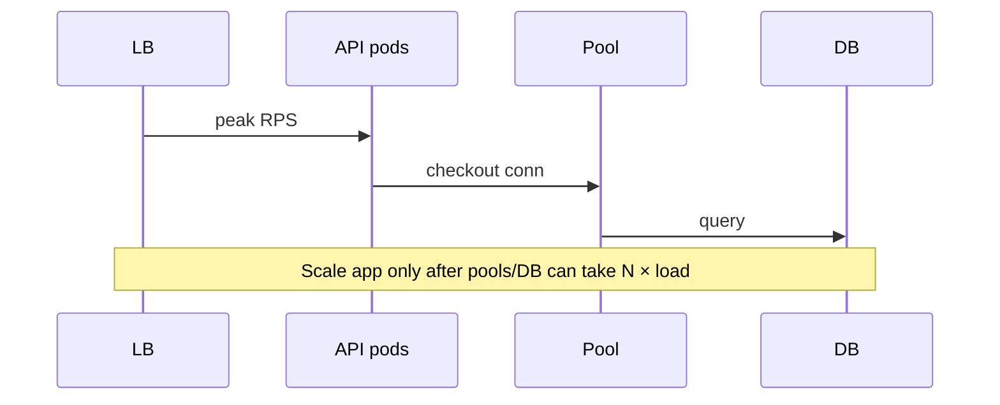

# Lesson 09: How Many Servers Do You Need? Capacity, 60% Target & N+2

> **Prerequisites:** [Lesson 08: Cache Sizing](../08-cache-sizing/README.md) (Lesson 9 of 14).  
> **Estimated Reading Time:** 32 minutes  
> **Target Audience:** Engineers converting peak RPS into instance counts with utilization targets and zone redundancy.  
> **Free PDF Notes:** [Download SD-D-009.pdf](https://backendroadmap.com/notes/system-design/SD-D-009.pdf)

> [!NOTE]
> **In one line:** Servers = peak RPS ÷ (measured per-instance capacity × a 60–70% utilization target), then add redundancy (N+1 or N+2) and spread across availability zones; also check memory, connections, and downstream limits.

> [!TIP]
> **The Golden Rule of Capacity:** Never plan to run at 100%. Target ~60% busy, add N+2 spares, and provision so two zones can carry the peak if one AZ dies.

---

## Words You'll Meet Today

| Word | Meaning | Role |
| :--- | :--- | :--- |
| **Per-instance capacity** | Max RPS at SLO. | From load test. |
| **Utilization target** | Planned busy share. | 60–70%. |
| **N+2** | N + two spares. | Failure + deploy. |
| **AZ** | Failure domain. | Spread replicas. |
| **I/O-bound** | Wait on deps. | Pool/DB limits first. |

---

## Core Definition & Taxonomic Comparison

| Term | Meaning | Example |
| :--- | :--- | :--- |
| **100% capacity** | Limit RPS. | 1,000 rps/server |
| **Usable** | ×0.6. | 600 rps |
| **N+2** | +2. | 34 → 36 |
| **Zone tolerant** | n/(z−1) per zone. | 34 → 51 across 3 AZ |

---

## Component Anatomy & The Observability Gap

```text
 peak RPS ÷ (capacity × 0.6) → ceil → +N+2 → (optional) recompute for AZ loss
```

### Observability Gap

| Vantage | Captures | Hides |
| :--- | :--- | :--- |
| **CPU %** | Compute pressure | Downstream saturation |
| **RPS/pod** | Offer rate | Uneven LB |
| **p99 latency** | SLO truth | Which resource queued |
| **Autoscale desired** | Reactive count | Floor for spikes |

---

## Mathematical Model & Worked Estimates

$$N=\left\lceil\frac{\lambda_{\mathrm{peak}}}{\mu\times u}\right\rceil,\ u\in[0.6,0.7]$$

Example: $\mu=1000$, $u=0.6$, $\lambda=20{,}000$ → $N=34$; N+2 → 36; 3 AZ zone loss → **51**.

| Target $u$ | Servers for 20k @ 1k | Headroom |
| :--- | ---: | :--- |
| 90% | 23 | almost none |
| 70% | 29 | moderate |
| 60% | 34 | common |
| 50% | 40 | costly comfort |

---

## Metrics, Percentiles & Distributions

Capacity is defined at the RPS where **$p_{99}$** crosses SLO—not where average CPU looks fine.

---

## Compounding Effects at Scale

Losing 1 of 3 AZs leaves 2/3 fleet → need ~1.5× baseline instances for full peak. Connection pools: servers × pool size can exceed DB `max_connections` before CPU does.

---

## Numbers Every Backend Engineer Must Know

| Rule | Value |
| :--- | :--- |
| Util target | 60–70% |
| Spares | N+2 |
| AZ factor (3 zones) | ~1.5× |
| Capacity source | load test |

---

## Protocol & Network Deep Dive



---

## Hierarchical Budgets & Capacity Sizing

| Check | Formula |
| :--- | :--- |
| App count | peak/(μ×u) |
| Redundancy | +2 |
| AZ | ceil(N/(z-1))*z |
| Downstream | tightest limit wins |

---

## Top Engineering Mitigation Techniques

1. Load-test μ. 2. Apply 60% target. 3. N+2. 4. Multi-AZ. 5. Verify DB/pools/memory bind first.

---

## Production War Story (SEV-1 Post-Mortem)

**SEV-1:** Scaled API 2× for launch; latency unchanged—Postgres `max_connections` saturated (36×50 > 500).

**Fix:** PgBouncer; then recompute app count from real bottleneck.

---

## Multi-Language Production Code Tabs

````carousel
```go
package servers
import "math"
func Count(peak, perInst, target float64) int {
	return int(math.Ceil(peak / (perInst * target)))
}
func WithNPlus2(n int) int { return n + 2 }
func SurviveZoneLoss(n, zones int) int {
	per := int(math.Ceil(float64(n) / float64(zones-1)))
	return per * zones
}
```

<!-- slide -->

```typescript
export const count = (peak: number, per: number, target = 0.6) =>
  Math.ceil(peak / (per * target));
export const nPlus2 = (n: number) => n + 2;
export const surviveZone = (n: number, zones = 3) => {
  const per = Math.ceil(n / (zones - 1));
  return per * zones;
};
console.log(count(20_000, 1_000), nPlus2(34), surviveZone(34)); // 34 36 51
```

<!-- slide -->

```python
import math
peak, per_srv, target = 20_000, 1_000, 0.60
n = math.ceil(peak / (per_srv * target))
print(n, n + 2)
zones = 3
print(math.ceil(n / (zones - 1)) * zones)
```

<!-- slide -->

```csharp
public static class ServerCount {
  public static int Need(double peak, double per, double target = 0.6) =>
    (int)Math.Ceiling(peak / (per * target));
  public static int NPlus2(int n) => n + 2;
}
```
````

---

## Hands-On CLI Verification

```bash
python -c "import math; n=math.ceil(20000/(1000*0.6)); print(n,n+2,math.ceil(n/2)*3)"
```

---

## Common Mistakes to Avoid

- Blog μ not load-tested.
- Planning 90–100% util.
- No N+2.
- Single AZ.
- Scaling app ignoring DB.
- CPU-only view of I/O-bound services.
- No floor capacity under autoscale.
- Ignoring connection math.

---

## Key Terms Glossary

| Term | Interview-ready definition |
| :--- | :--- |
| **Utilization target** | Planned fraction of capacity in use at peak. |
| **N+2** | Capacity for N plus two spares. |
| **Headroom** | Spare for spikes/GC/imbalance. |

---

## Interview Practice Questions

<details>
<summary><strong>Q1. How many servers for 20k RPS? [BASIC]</strong></summary>

<strong>What a strong answer covers:</strong>
Load-test μ, divide peak by μ×0.6, add N+2, consider AZ.

</details>

<details>
<summary><strong>Q2. Why 60–70% util? [BASIC]</strong></summary>

<strong>What a strong answer covers:</strong>
Queueing delay rises near saturation; headroom for spikes/GC/LB skew.

</details>

<details>
<summary><strong>Q3. How do you find one instance's capacity? [BASIC]</strong></summary>

<strong>What a strong answer covers:</strong>
Ramp load test until p99 breaches SLO—that RPS is μ.

</details>

<details>
<summary><strong>Q4. What does N+2 mean? [BASIC]</strong></summary>

<strong>What a strong answer covers:</strong>
Tolerate one failure while another instance is deploying/maintained.

</details>

<details>
<summary><strong>Q5. 12k peak, 1k rps/pod limit — pods? [SCENARIO]</strong></summary>

<strong>What a strong answer covers:</strong>
At 60%: 20; N+2→22; 3 AZ tolerant→30.

</details>

<details>
<summary><strong>Q6. Service mostly waits on DB — how to scale? [SCENARIO]</strong></summary>

<strong>What a strong answer covers:</strong>
I/O-bound: fix pools/DB first; async I/O; don't just add CPU pods.

</details>

<details>
<summary><strong>Q7. Peak 50k, μ=500, u=0.6? [SCENARIO]</strong></summary>

<strong>What a strong answer covers:</strong>
300 usable → 167 +2 ≈ 169.

</details>

<details>
<summary><strong>Q8. Survive AZ failure with 3 zones? [SCENARIO]</strong></summary>

<strong>What a strong answer covers:</strong>
Provision ~1.5× so remaining two zones carry peak.

</details>

<details>
<summary><strong>Q9. Why can zone tolerance need ~50% more instances? [TRICKY]</strong></summary>

<strong>What a strong answer covers:</strong>
Lose 1/3 capacity; each remaining zone needs half of N.

</details>

<details>
<summary><strong>Q10. Added servers, latency flat — why? [TRICKY]</strong></summary>

<strong>What a strong answer covers:</strong>
Bottleneck elsewhere (DB, cache, pool, dependency).

</details>

<details>
<summary><strong>Q11. Why not run at 90%? [TRICKY]</strong></summary>

<strong>What a strong answer covers:</strong>
Steep queueing; small bursts → large latency spikes.

</details>

<details>
<summary><strong>Q12. DB caps at 5k rps — app tier size? [TRICKY]</strong></summary>

<strong>What a strong answer covers:</strong>
Irrelevant beyond what DB can take; scale/cache DB path first.

</details>

---

## One-Page Master Cheat Sheet

```text
N = ceil(peak / (μ × 0.6)) + N+2 | multi-AZ ≈ 1.5× for 3 zones
Load-test μ | check pools/DB | don't run at 90%+
```

---

## Free PDF notes

Download these notes as a printable PDF: [SD-D-009.pdf](https://backendroadmap.com/notes/system-design/SD-D-009.pdf).

---

## Sources

- [SD-D-009.pdf](https://backendroadmap.com/notes/system-design/SD-D-009.pdf).
- Google SRE capacity planning.

---

## Next

Next comes [Lesson 10: Growth Projections](../10-growth-projections/README.md). See [the track overview](../README.md) for the whole series.
