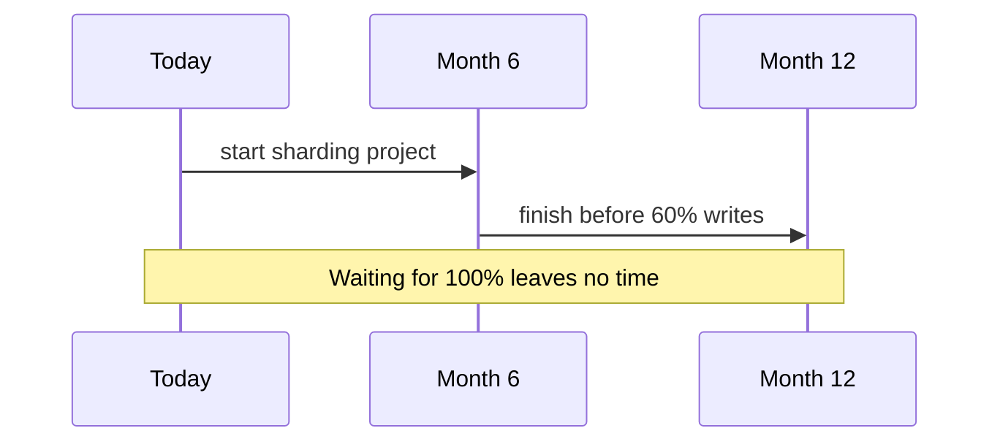

# Lesson 10: Growth Projections: Compound Growth, Runway & When to Shard

> **Prerequisites:** [Lesson 09: How Many Servers](../09-how-many-servers-do-you-need-capacity-60-target-n-2/README.md) (Lesson 10 of 14).  
> **Estimated Reading Time:** 32 minutes  
> **Target Audience:** Engineers forecasting when to add replicas, caches, or shards before hitting the wall.  
> **Free PDF Notes:** [Download SD-D-010.pdf](https://backendroadmap.com/notes/system-design/SD-D-010.pdf)

> [!NOTE]
> **In one line:** Project each resource's peak with compound growth, divide into its safe limit to get the runway, and start each big change (replicas, caching, sharding) one lead time before that runway runs out.

> [!TIP]
> **The Golden Rule of Growth:** 10%/month is ~3.1×/year, not +120%. Runway = time until the safe trigger (often 60%), and big migrations must start a full lead time earlier.

---

## Words You'll Meet Today

| Word | Meaning | Role |
| :--- | :--- | :--- |
| **CAGR** | Compound annual growth. | Yearly multiplier. |
| **Runway** | Time to safe limit. | Schedules projects. |
| **Trigger** | e.g. 60% capacity. | Start action. |
| **Lead time** | Project duration. | Start = trigger − lead. |
| **Ladder** | Ordered scale steps. | Replicas→cache→shard. |

---

## Core Definition & Taxonomic Comparison

| Term | Meaning | Example |
| :--- | :--- | :--- |
| **Naive +10%×12** | Additive mistake. | 2.2× |
| **Compound 1.1^12** | Correct. | ~3.1× |
| **Safe limit** | Not 100%. | 60–70% |

---

## Component Anatomy & The Observability Gap

```text
 today peak × (1+g)^t  → compare to safe limit → runway
 start_project = time_to_trigger − lead_time
```

### Observability Gap

| Vantage | Captures | Hides |
| :--- | :--- | :--- |
| **Monthly avg growth** | Trend | Peak growth differs |
| **CPU 40%** | Now | 6-month cliff |
| **Ticket “shard someday”** | Intent | No start date from runway |

---

## Mathematical Model & Worked Estimates

$$\mathrm{load}(t)=\mathrm{load}_0(1+g)^t$$

$$\mathrm{runway}=\frac{\log(L_{\mathrm{safe}}/L_0)}{\log(1+g)}$$

40%→70% at 10%/mo: $\log(1.75)/\log(1.1)\approx 5.9$ months.

Writes double/year from 30%: hit 60% at month 12; 6-month shard project **starts by month 6**.

---

## Metrics, Percentiles & Distributions

Project **peak** load growth, not average—storage accumulates even if RPS is flat seasonally.

---

## Compounding Effects at Scale

$3\times$/year for 3 years = $27\times$. Different resources grow differently (storage never shrinks).

---

## Numbers Every Backend Engineer Must Know

| Growth | Multiplier |
| :--- | :--- |
| 10%/mo | ~3.1×/yr |
| Double/yr | ~5.9%/mo |
| Safe trigger | ~60% |
| Shard lead | months–quarters |

---

## Protocol & Network Deep Dive



---

## Hierarchical Budgets & Capacity Sizing

| Step | Lead time |
| :--- | :--- |
| Read replicas | days–weeks |
| Scale up | hours–days |
| Caching | weeks |
| Partition | weeks–months |
| Shard | months+ |

---

## Top Engineering Mitigation Techniques

1. Compound correctly. 2. Per-resource runway. 3. Predefine triggers. 4. Start by trigger−lead. 5. Revisit quarterly.

---

## Production War Story (SEV-1 Post-Mortem)

**SEV-2:** Team noticed DB at 85% writes; sharding estimate 4 months—forced emergency read-only mode during migration.

**Fix:** runway dashboard + calendar triggers at 60%.

---

## Multi-Language Production Code Tabs

````carousel
```go
package growth
import "math"
func Future(load, monthlyG float64, months int) float64 {
	return load * math.Pow(1+monthlyG, float64(months))
}
func RunwayMonths(current, limit, monthlyG float64) float64 {
	return math.Log(limit/current) / math.Log(1+monthlyG)
}
```

<!-- slide -->

```typescript
export const future = (load: number, g: number, months: number) =>
  load * (1 + g) ** months;
export const runway = (cur: number, limit: number, g: number) =>
  Math.log(limit / cur) / Math.log(1 + g);
console.log(future(1, 0.1, 12).toFixed(2), runway(0.4, 0.7, 0.1).toFixed(1)); // 3.14, 5.9
```

<!-- slide -->

```python
import math
print((1.1)**12)
print(math.log(0.7/0.4)/math.log(1.1))  # ~5.9 months
# doubling yearly from 30% → 60% in 12 months; 6-mo shard project starts by month 6
```

<!-- slide -->

```csharp
public static class Growth {
  public static double Future(double load, double g, int months) =>
    load * Math.Pow(1 + g, months);
  public static double Runway(double cur, double limit, double g) =>
    Math.Log(limit / cur) / Math.Log(1 + g);
}
```
````

---

## Hands-On CLI Verification

```bash
python -c "import math; print((1.1)**12, math.log(0.7/0.4)/math.log(1.1))"
```

---

## Common Mistakes to Avoid

- Additive growth math.
- Projecting average not peak.
- Trigger at 100%.
- One growth rate for all resources.
- Starting shard when already on fire.
- Ignoring storage accumulation.
- No lead times.
- Orphaned 'we'll shard later' without date.

---

## Key Terms Glossary

| Term | Interview-ready definition |
| :--- | :--- |
| **Runway** | Time until usage hits the safe limit under growth. |
| **CAGR** | Compound annual growth rate. |
| **Lead time** | How long a capacity project takes. |

---

## Interview Practice Questions

<details>
<summary><strong>Q1. Why project growth? [BASIC]</strong></summary>

<strong>What a strong answer covers:</strong>
Big changes take months; you must start before the cliff.

</details>

<details>
<summary><strong>Q2. 10%/month for a year equals? [BASIC]</strong></summary>

<strong>What a strong answer covers:</strong>
~3.1×, not 2.2×.

</details>

<details>
<summary><strong>Q3. What is runway? [BASIC]</strong></summary>

<strong>What a strong answer covers:</strong>
log(safe/current)/log(1+g) periods until the safe limit.

</details>

<details>
<summary><strong>Q4. Why trigger at 60% not 100%? [BASIC]</strong></summary>

<strong>What a strong answer covers:</strong>
Need headroom for spikes/failover and time to finish work.

</details>

<details>
<summary><strong>Q5. DB 40% CPU, +10%/mo, safe 70% — runway? [SCENARIO]</strong></summary>

<strong>What a strong answer covers:</strong>
~5.9 months.

</details>

<details>
<summary><strong>Q6. Writes 30%, double yearly, shard takes 6 mo — when start? [SCENARIO]</strong></summary>

<strong>What a strong answer covers:</strong>
60% at month 12 → start by month 6.

</details>

<details>
<summary><strong>Q7. Which resource to act on first? [SCENARIO]</strong></summary>

<strong>What a strong answer covers:</strong>
Shortest runway.

</details>

<details>
<summary><strong>Q8. Typical scale ladder? [SCENARIO]</strong></summary>

<strong>What a strong answer covers:</strong>
Replicas → scale up → cache → partition → shard.

</details>

<details>
<summary><strong>Q9. Doubles every year — monthly g? [TRICKY]</strong></summary>

<strong>What a strong answer covers:</strong>
~$2^{1/12}-1$ ≈ 5.9%/mo.

</details>

<details>
<summary><strong>Q10. Why per-resource projections? [TRICKY]</strong></summary>

<strong>What a strong answer covers:</strong>
RPS, storage, writes, bandwidth grow differently.

</details>

<details>
<summary><strong>Q11. Storage growth special case? [TRICKY]</strong></summary>

<strong>What a strong answer covers:</strong>
Accumulates; even flat MAU grows bytes with retention.

</details>

<details>
<summary><strong>Q12. What if growth slows? [TRICKY]</strong></summary>

<strong>What a strong answer covers:</strong>
Recompute runway; don't cancel buffers already bought for peaks.

</details>

---

## One-Page Master Cheat Sheet

```text
load(t)=load0×(1+g)^t
runway=log(safe/cur)/log(1+g)
start = time_to_trigger − lead_time | 10%/mo ≈ 3.1×/yr
```

---

## Free PDF notes

Download these notes as a printable PDF: [SD-D-010.pdf](https://backendroadmap.com/notes/system-design/SD-D-010.pdf).

---

## Sources

- [SD-D-010.pdf](https://backendroadmap.com/notes/system-design/SD-D-010.pdf).

---

## Next

Next comes [Lesson 11: Full URL Shortener Drill](../11-back-of-the-envelope-estimation/README.md). See [the track overview](../README.md) for the whole series.
