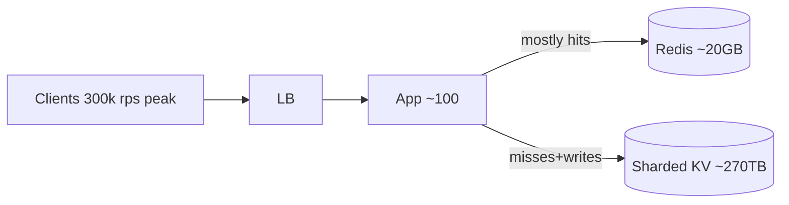

# Lesson 11: Back-of-the-Envelope Estimation: Full URL Shortener Drill

> **Prerequisites:** [Lesson 10: Growth Projections](../10-growth-projections/README.md) (Lesson 11 of 14). Lessons 01–10 tools combined.  
> **Estimated Reading Time:** 32 minutes  
> **Target Audience:** Candidates who must run a complete 5-minute estimation drill tying every number to a design decision.  
> **Free PDF Notes:** [Download SD-D-011.pdf](https://backendroadmap.com/notes/system-design/SD-D-011.pdf)

> [!NOTE]
> **In one line:** State assumptions, then derive traffic, storage, bandwidth, cache, and servers in order, rounding hard and tying each number to a design decision: for a URL shortener that is ~1k writes/s, ~100k reads/s, ~90 TB, ~20 GB of cache, and ~100 servers.

> [!TIP]
> **The Golden Rule of the Drill:** Fixed order—Assume → Traffic → Storage → Bandwidth/Cache → Servers—and end every line with what it means for the boxes you will draw.

---

## Words You'll Meet Today

| Word | Role in the drill |
| :--- | :--- |
| **Assumptions table** | Shared inputs on the board. |
| **Quick ÷10^5** | Day → RPS. |
| **Design implication** | Shard / cache / N servers. |
| **Sanity check** | Does the number imply absurd hardware? |

---

## Core Definition & Taxonomic Comparison

This lesson **integrates** prior ones into one whiteboard pass. **Not** a new formula—it's choreography under time pressure.

| Step | Outputs | Design implication |
| :--- | :--- | :--- |
| Assume | 100 M links/day, 100:1, 5y, 500 B, 3× peak | Writable inputs |
| Traffic | ~1k W / ~100k R; peak 3k / 300k | Cache-first + shard writes |
| Storage | ~90 TB → ~270 TB @3× | Partitioned KV |
| BW/Cache | ~1.2 Gbps; ~20 GB Redis | Few cache nodes |
| Servers | ~100 @ 3k rps usable | Multi-AZ fleet |

---

## Component Anatomy & The Observability Gap

```text
1 Assume → 2 Traffic (avg, peak) → 3 Storage (×years ×replicas) → 4 Bandwidth + cache → 5 Servers @60%
```

### Observability Gap

Interview “observability” is the board: if an assumption isn't written, neither of you can debug the math.

---

## Mathematical Model & Worked Estimates

Writes: $100\,\mathrm{M}/10^5\approx 1{,}000$/s. Reads: $\times 100\approx 100{,}000$/s. Peak $\times 3$: 3k / 300k.

Storage: $100\,\mathrm{M}\times 365\times 5\times 500\,\mathrm{B}\approx 90\,\mathrm{TB}$; $\times 3\approx 270\,\mathrm{TB}$.

Bandwidth: $300\,\mathrm{k}\times 500\,\mathrm{B}\approx 150\,\mathrm{MB/s}\approx 1.2\,\mathrm{Gbps}$.

Cache: 20 M hot × ~1 KB ≈ **20 GB**.

Servers: $300\,\mathrm{k}/3{,}000\approx 100$ (60% of 5k capacity).

---

## Metrics, Percentiles & Distributions

Present orders of magnitude (~1k, ~100k, ~100 TB, ~100 servers)—not 1,157.407.

---

## Compounding Effects at Scale

Base62 length: $62^7\approx 3.5\times 10^{12}$ codes ≫ 180 B links—namespace fine; storage/sharding dominate.

---

## Numbers Every Backend Engineer Must Know

| Result | ~Value |
| :--- | :--- |
| Writes | 1k/s |
| Reads | 100k/s |
| Peak reads | 300k/s |
| Storage | 90 TB (270 w/ RF) |
| Cache | 20 GB |
| App servers | ~100 |

---

## Protocol & Network Deep Dive



---

## Hierarchical Budgets & Capacity Sizing

| Number | Decision |
| :--- | :--- |
| 100:1 reads | Redis in front |
| 270 TB | Shard by short code |
| 1.2 Gbps | Fine for cluster egress |
| 100 servers | Multi-AZ + N+2 on top |

---

## Top Engineering Mitigation Techniques

1. Write assumptions. 2. Fixed order. 3. Round hard. 4. Sanity-check. 5. State design implication each step.

---

## Production War Story (SEV-1 Post-Mortem)

**Interview fail pattern:** Candidate draws 8 boxes first, then invents numbers that contradict the diagram (single MySQL for 270 TB).

**Recovery:** erase boxes, restart at assumptions table, rebuild.

---

## Multi-Language Production Code Tabs

````carousel
```go
package drill
func Shortener() map[string]float64 {
	writes := 100e6 / 1e5 // ~1000/s quick
	reads := writes * 100
	storageTB := 100e6 * 500 * 365 * 5 / 1e12 // ~91
	peakReads := reads * 3
	bwGbps := peakReads * 500 * 8 / 1e9
	cacheGB := 20e6 * 1000 / 1e9
	servers := peakReads / 3000
	return map[string]float64{"writes": writes, "reads": reads, "tb": storageTB,
		"peakReads": peakReads, "gbps": bwGbps, "cacheGB": cacheGB, "servers": servers}
}
```

<!-- slide -->

```typescript
export function shortenerDrill() {
  const writes = 100e6 / 1e5; // ~1k/s
  const reads = writes * 100;
  const storageTB = (100e6 * 500 * 365 * 5) / 1e12;
  const peakReads = reads * 3;
  return {
    writes, reads, storageTB: storageTB * 3,
    peakReads, gbps: (peakReads * 500 * 8) / 1e9,
    cacheGB: (20e6 * 1000) / 1e9,
    servers: peakReads / 3000,
  };
}
console.log(shortenerDrill());
```

<!-- slide -->

```python
writes = 100e6 / 1e5
reads = writes * 100
storage_tb = 100e6 * 500 * 365 * 5 / 1e12
peak_reads = reads * 3
print(writes, reads, storage_tb, peak_reads, peak_reads*500*8/1e9, 20e6*1000/1e9, peak_reads/3000)
```

<!-- slide -->

```csharp
public static class ShortenerDrill {
  public static void Main() {
    double writes = 100e6 / 1e5, reads = writes * 100;
    double tb = 100e6 * 500 * 365 * 5 / 1e12;
    double peakReads = reads * 3;
    System.Console.WriteLine($"{writes} {reads} {tb*3} {peakReads} {peakReads/3000}");
  }
}
```
````

---

## Hands-On CLI Verification

```bash
python -c "w=100e6/1e5;r=w*100;print(w,r,r*3,100e6*500*365*5*3/1e12,r*3/3000)"
```

---

## Common Mistakes to Avoid

- Boxes before numbers.
- Silent assumptions.
- False precision.
- Skipping peak.
- Forgetting RF on storage.
- No design implication.
- Inconsistent units.
- No sanity check.

---

## Key Terms Glossary

| Term | Interview-ready definition |
| :--- | :--- |
| **Drill order** | Assume→Traffic→Storage→BW/Cache→Servers. |
| **Sanity check** | Compare result to known per-box capacities. |

---

## Interview Practice Questions

<details>
<summary><strong>Q1. What order do you estimate in? [BASIC]</strong></summary>

<strong>What a strong answer covers:</strong>
Assumptions, traffic, storage, bandwidth/cache, servers—each with a design note.

</details>

<details>
<summary><strong>Q2. URL shortener key assumptions? [BASIC]</strong></summary>

<strong>What a strong answer covers:</strong>
Links/day, R/W ratio, retention, record size, peak factor.

</details>

<details>
<summary><strong>Q3. ~100 M links/day → write RPS? [BASIC]</strong></summary>

<strong>What a strong answer covers:</strong>
~$10^5$ → ~1k writes/s.

</details>

<details>
<summary><strong>Q4. Why ~100 servers? [BASIC]</strong></summary>

<strong>What a strong answer covers:</strong>
Peak reads / usable per server at 60% target.

</details>

<details>
<summary><strong>Q5. Walk the full shortener drill. [SCENARIO]</strong></summary>

<strong>What a strong answer covers:</strong>
1k W, 100k R, 300k peak R, 90–270 TB, 1.2 Gbps, 20 GB cache, ~100 servers, sharded KV + Redis.

</details>

<details>
<summary><strong>Q6. Interviewer changes to 10× links/day. What do you do? [SCENARIO]</strong></summary>

<strong>What a strong answer covers:</strong>
Scale every derived number ×10; sharding/cache conclusions strengthen.

</details>

<details>
<summary><strong>Q7. Is 7-char base62 enough? [SCENARIO]</strong></summary>

<strong>What a strong answer covers:</strong>
Yes for ~180 B links; storage/ops dominate.

</details>

<details>
<summary><strong>Q8. Where do most reads go? [SCENARIO]</strong></summary>

<strong>What a strong answer covers:</strong>
Cache; DB sees writes + misses.

</details>

<details>
<summary><strong>Q9. Why present ~1k not 1,157? [TRICKY]</strong></summary>

<strong>What a strong answer covers:</strong>
Inputs are guesses; order of magnitude is the product.

</details>

<details>
<summary><strong>Q10. What if peak factor is 10 not 3? [TRICKY]</strong></summary>

<strong>What a strong answer covers:</strong>
Servers/BW scale ×10/3; may need waiting room for launch spikes.

</details>

<details>
<summary><strong>Q11. Could one DB hold 270 TB? [TRICKY]</strong></summary>

<strong>What a strong answer covers:</strong>
Not comfortably—plan partitioned store from the estimate.

</details>

<details>
<summary><strong>Q12. How do you sanity-check server count? [TRICKY]</strong></summary>

<strong>What a strong answer covers:</strong>
Compare to known μ from similar services; if absurd, revisit assumptions.

</details>

---

## One-Page Master Cheat Sheet

```text
ASSUME → TRAFFIC → STORAGE → BW/CACHE → SERVERS
Shortener: ~1k W | ~100k R | ~90TB | ~20GB Redis | ~100 servers
Round hard · imply design each step
```

---

## Free PDF notes

Download these notes as a printable PDF: [SD-D-011.pdf](https://backendroadmap.com/notes/system-design/SD-D-011.pdf).

---

## Sources

- [SD-D-011.pdf](https://backendroadmap.com/notes/system-design/SD-D-011.pdf).

---

## Next

Next comes [Lesson 12: Architecture Diagrams](../12-architecture-diagrams/README.md). See [the track overview](../README.md) for the whole series.
