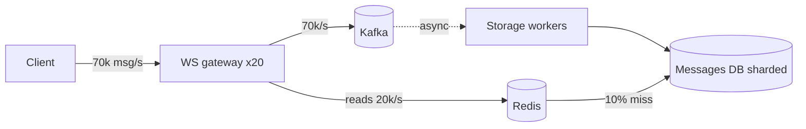

# Lesson 12: Architecture Diagrams: Sync vs Async, Read/Write Paths, C4

> **Prerequisites:** [Lesson 11: URL Shortener Drill](../11-back-of-the-envelope-estimation/README.md) (Lesson 12 of 14).  
> **Estimated Reading Time:** 32 minutes  
> **Target Audience:** Engineers who must whiteboard clear, labeled diagrams interviewers can follow.  
> **Free PDF Notes:** [Download SD-D-012.pdf](https://backendroadmap.com/notes/system-design/SD-D-012.pdf)

> [!NOTE]
> **In one line:** Lay boxes left to right in layers, label every box and arrow, draw sync calls solid and async messages dashed through a visible queue, split read and write paths, and keep interview diagrams at C4 context/container levels.

> [!TIP]
> **The Golden Rule of Diagrams:** A subway map, not a street map—show what talks to what, direction, and volume. Unlabeled arrows are decoration.

---

## Words You'll Meet Today

| Word | Meaning |
| :--- | :--- |
| **Sync** | Caller waits (solid arrow). |
| **Async** | Hand off via queue (dashed + queue box). |
| **Read/write path** | Separate flows when they scale differently. |
| **C4** | Context, Containers, Components, Code. |

---

## Core Definition & Taxonomic Comparison

| Term | Meaning | Example |
| :--- | :--- | :--- |
| **C4 Container** | Deployable/data unit | API, DB, Kafka—not necessarily Docker |
| **Sequence diagram** | Time downward | Checkout timeouts/retries |
| **One giant diagram** | Anti-pattern | Mixes admin+reads+writes |

---

## Component Anatomy & The Observability Gap

```text
 Client → Edge (DNS/CDN/LB) → Services → Data stores
 solid = sync HTTP/gRPC    dashed via [Queue] box = async
```

### Observability Gap

A diagram without RPS/backlog labels hides the estimate; production without service maps hides blast radius.

---

## Mathematical Model & Worked Estimates

Label arrows with estimates: e.g. client→gateway $23$–$70\,\mathrm{k}$ msg/s; cache hit 90% → DB sees 10% of reads.

$$\\lambda_{\\mathrm{DB,read}}=\\lambda_{\\mathrm{read}}(1-h)$$

---

## Metrics, Percentiles & Distributions

Diagram the **peak** path volumes, not daily averages—reviewers size what you label.

---

## Compounding Effects at Scale

Fan-out on write should appear as many arrows or a noted multiplier on the queue consumers.

---

## Numbers Every Backend Engineer Must Know

| C4 level | Interview use |
| :--- | :--- |
| 1 Context | Always |
| 2 Containers | Always |
| 3 Components | Sometimes |
| 4 Code | Rarely |

---

## Protocol & Network Deep Dive



---

## Hierarchical Budgets & Capacity Sizing

| Drawing budget (5 min) | Do |
| :--- | :--- |
| Minute 1 | Context + containers left→right |
| Minutes 2–3 | Label arrows with RPS |
| Minute 4 | Split read vs write if needed |
| Minute 5 | Mark failure domains / SPOFs |

---

## Top Engineering Mitigation Techniques

1. Layers L→R. 2. Label all. 3. Queue as a box. 4. Sync vs async style. 5. Separate R/W. 6. C4 L1–L2.

---

## Production War Story (SEV-1 Post-Mortem)

**Review fail:** Outage RCA diagram showed “async” as a line through services with no queue—on-call didn't know where backlog lived.

**Fix:** queue as first-class box with consumer lag SLO.

---

## Multi-Language Production Code Tabs

````carousel
```go
package diag
// Prefer diagrams-as-code in repos; interviews: left→right layers, label arrows.
type Edge struct{ From, To, Label string; Async bool }
```

<!-- slide -->

```typescript
export type Edge = { from: string; to: string; label: string; async?: boolean };
export const chatWritePath: Edge[] = [
  { from: "Client", to: "WS Gateway", label: "70k msg/s" },
  { from: "WS Gateway", to: "Kafka", label: "70k/s", async: true },
  { from: "Kafka", to: "Workers", label: "consume", async: true },
  { from: "Workers", to: "Messages DB", label: "shard writes" },
];
```

<!-- slide -->

```python
# Mermaid sketch kept next to the system (diffable)
CHART = """
flowchart LR
  U[Client] -->|70k msg/s| G[WS gateway]
  G -->|70k/s| Q[(Kafka)]
  Q -.async.-> W[Workers]
  W --> DB[(Messages DB)]
"""
print(CHART)
```

<!-- slide -->

```csharp
public record Edge(string From, string To, string Label, bool Async);
// Draw sync solid / async dashed through an explicit queue box.
```
````

---

## Hands-On CLI Verification

```bash
echo "Draw: Client -> LB -> API -> (Redis, Queue->Workers->DB) with RPS labels"
```

---

## Common Mistakes to Avoid

- Unlabeled arrows.
- Queue as a line.
- One mega diagram.
- Jumping to classes first.
- Crossing spaghetti.
- No R/W split when ratios differ.
- Forgetting external deps.
- No peak volumes.

---

## Key Terms Glossary

| Term | Interview-ready definition |
| :--- | :--- |
| **C4 model** | Context/Containers/Components/Code zoom levels. |
| **Async boundary** | Explicit queue/topic between producer and consumer. |

---

## Interview Practice Questions

<details>
<summary><strong>Q1. How show sync vs async? [BASIC]</strong></summary>

<strong>What a strong answer covers:</strong>
Solid request/response; dashed through an explicit queue box.

</details>

<details>
<summary><strong>Q2. What is C4? [BASIC]</strong></summary>

<strong>What a strong answer covers:</strong>
Simon Brown's four zoom levels; interviews use 1–2.

</details>

<details>
<summary><strong>Q3. How to lay out? [BASIC]</strong></summary>

<strong>What a strong answer covers:</strong>
Left→right: clients, edge, services, data; label boxes and arrows.

</details>

<details>
<summary><strong>Q4. Is C4 container a Docker container? [BASIC]</strong></summary>

<strong>What a strong answer covers:</strong>
No—any separately running/storing unit.

</details>

<details>
<summary><strong>Q5. Draw news feed write vs read. [SCENARIO]</strong></summary>

<strong>What a strong answer covers:</strong>
Write: store+queue+fan-out workers→Redis lists; Read: precomputed list+cache details.

</details>

<details>
<summary><strong>Q6. When add a sequence diagram? [SCENARIO]</strong></summary>

<strong>What a strong answer covers:</strong>
Critical multi-hop flows where order/timeouts/retries matter (checkout).

</details>

<details>
<summary><strong>Q7. Why draw the queue as its own box? [SCENARIO]</strong></summary>

<strong>What a strong answer covers:</strong>
It has backlog, consumers, scaling, failure modes.

</details>

<details>
<summary><strong>Q8. 5 minutes on whiteboard — first draw? [SCENARIO]</strong></summary>

<strong>What a strong answer covers:</strong>
Context+containers L→R, then volumes.

</details>

<details>
<summary><strong>Q9. Why separate R/W if same DB? [TRICKY]</strong></summary>

<strong>What a strong answer covers:</strong>
They scale differently; replicas/caches attach to read path.

</details>

<details>
<summary><strong>Q10. Why numbers on arrows? [TRICKY]</strong></summary>

<strong>What a strong answer covers:</strong>
Turns a sketch into an estimate reviewers can challenge.

</details>

<details>
<summary><strong>Q11. Component vs container level? [TRICKY]</strong></summary>

<strong>What a strong answer covers:</strong>
Containers=deployables; components=modules inside one.

</details>

<details>
<summary><strong>Q12. Anti-pattern? [TRICKY]</strong></summary>

<strong>What a strong answer covers:</strong>
Unlabeled arrows and queues drawn as anonymous lines.

</details>

---

## One-Page Master Cheat Sheet

```text
L→R layers | label all | solid sync | dashed+queue async | split R/W | C4 L1–L2
```

---

## Free PDF notes

Download these notes as a printable PDF: [SD-D-012.pdf](https://backendroadmap.com/notes/system-design/SD-D-012.pdf).

---

## Sources

- [SD-D-012.pdf](https://backendroadmap.com/notes/system-design/SD-D-012.pdf).
- Simon Brown — C4 model.

---

## Next

Next comes [Lesson 13: Identifying Bottlenecks](../13-identifying-bottlenecks/README.md). See [the track overview](../README.md) for the whole series.
