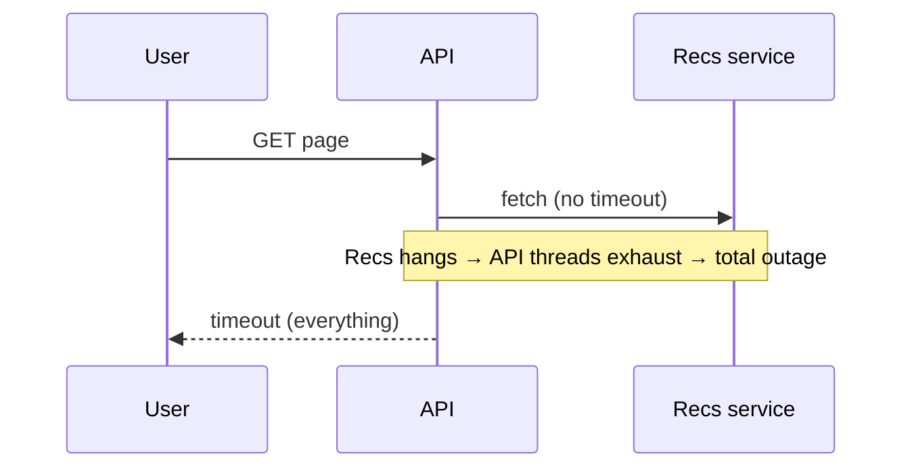

# Lesson 14: Identifying SPOFs: Ask 'What If This Dies?' for Every Box

> **Prerequisites:** [Lesson 13: Identifying Bottlenecks](../13-identifying-bottlenecks/README.md) (Lesson 14 of 14).  
> **Estimated Reading Time:** 32 minutes  
> **Target Audience:** Engineers auditing designs for single points of failure across boxes, arrows, and hidden dependencies.  
> **Free PDF Notes:** [Download SD-D-014.pdf](https://backendroadmap.com/notes/system-design/SD-D-014.pdf)

> [!NOTE]
> **In one line:** Walk every box, arrow, and external dependency and ask “what if this dies?”; anything whose loss stops the system is a SPOF, removed with redundancy across zones, automatic failover, graceful degradation, timeouts, and circuit breakers.

> [!TIP]
> **The Golden Rule of SPOFs:** Redundancy you have never failed over is a hope. Separate failure domains, automate detection, test the path, and name SPOFs you consciously accept.

---

## Words You'll Meet Today

| Word | Meaning |
| :--- | :--- |
| **SPOF** | One failure stops a critical function. |
| **Failover** | Promote/backup takes over. |
| **Blast radius** | Users/features affected. |
| **Graceful degradation** | Core works when extras die. |
| **Correlated failure** | “Two copies” sharing fate. |

---

## Core Definition & Taxonomic Comparison

| Term | Meaning | Example |
| :--- | :--- | :--- |
| **Server SPOF** | One box. | Single primary DB |
| **Arrow SPOF** | One link/NAT/LB | Single LB |
| **Hidden SPOF** | Off-diagram | DNS, certs, IdP, secrets |
| **Accepted SPOF** | Conscious risk | Internal tool single region |

---

## Component Anatomy & The Observability Gap

```text
 For each box/arrow/hidden dep:
   copies? failure domains? failover auto+tested? blast radius?
```

### Observability Gap

| Vantage | Captures | Hides |
| :--- | :--- | :--- |
| **Multi-pod Deployment** | App redundancy | Single LB/NAT |
| **Primary+replica** | Data copies | Manual failover at 3am |
| **Same-region monitoring** | Metrics | Blind in regional outage |

---

## Mathematical Model & Worked Estimates

Independent nodes: $A_2=1-(1-a)^2$. For $a=0.999$, $A_2=0.999999$ (~32 s/yr)—**only if** failover works and failures are independent.

Single DB at 99.9% ≈ 8.8 h downtime/year.

---

## Metrics, Percentiles & Distributions

MTTR dominates perceived availability more than adding a third idle replica with untested failover.

---

## Compounding Effects at Scale

Cold cache after Redis failover: DB suddenly sees $(1/(1-h))$× reads—cache HA without DB headroom is a latent SPOF cascade.

---

## Numbers Every Backend Engineer Must Know

| Often-forgotten SPOF | Mitigation |
| :--- | :--- |
| LB / NAT | Multi-AZ managed LB |
| DB primary | Auto failover, tested |
| DNS provider | Secondary DNS |
| TLS cert | Auto renew + alert |
| Config/flags | Local cache + defaults |
| One region | Multi-region / DR |
| One person | Docs + rotation |

---

## Protocol & Network Deep Dive



---

## Hierarchical Budgets & Capacity Sizing

| Control | Budget |
| :--- | :--- |
| Dependency timeout | e.g. 200 ms for optional |
| Failover RPO/RTO | Stated explicitly |
| Replica placement | Anti-affinity across AZ |

---

## Top Engineering Mitigation Techniques

1. Redundancy across zones. 2. Automatic tested failover. 3. Timeouts + circuit breakers. 4. Graceful degradation. 5. External probes. 6. Name accepted SPOFs.

---

## Production War Story (SEV-1 Post-Mortem)

**SEV-1:** Recommendations hung without timeout; page rendering blocked; thread pools drained; core browse died with an optional feature.

**Fix:** 200 ms timeout, circuit breaker, render without recs; chaos-test dependency loss.

---

## Multi-Language Production Code Tabs

````carousel
```go
package spof
func AvailabilityTwoNodes(a float64) float64 {
	// independent failures
	return 1 - (1-a)*(1-a)
}
```

<!-- slide -->

```typescript
export const twoNodeAvailability = (a: number) => 1 - (1 - a) ** 2;
console.log(twoNodeAvailability(0.999)); // 0.999999
// Still need tested automatic failover + independent failure domains
```

<!-- slide -->

```python
def two_node(a=0.999):
    return 1 - (1 - a) ** 2
print(two_node())
# K8s: topologySpreadConstraints across zones
```

<!-- slide -->

```csharp
public static double TwoNode(double a) => 1 - (1 - a) * (1 - a);
// Redundancy without tested failover is hope, not HA.
```
````

---

## Hands-On CLI Verification

```bash
python -c "a=0.999; print(1-(1-a)**2); print((1-0.999)*365*24, 'hours/yr single')"
```

---

## Common Mistakes to Avoid

- Only checking servers.
- Manual-only failover.
- Cache HA but DB can't survive cold cache.
- No timeouts.
- Silent SPOFs.
- Replicas in one rack/zone.
- Monitoring in same failure domain.
- Untested DR.

---

## Key Terms Glossary

| Term | Interview-ready definition |
| :--- | :--- |
| **SPOF** | Component whose loss stops the system or a critical feature. |
| **Blast radius** | Portion affected by a failure. |
| **Graceful degradation** | Keep core features when non-core deps fail. |

---

## Interview Practice Questions

<details>
<summary><strong>Q1. How find SPOFs? [BASIC]</strong></summary>

<strong>What a strong answer covers:</strong>
Ask what-if for every box/arrow/hidden dep; check copies, domains, failover speed.

</details>

<details>
<summary><strong>Q2. How remove them? [BASIC]</strong></summary>

<strong>What a strong answer covers:</strong>
Multi-AZ redundancy, automatic failover, degradation, timeouts/breakers.

</details>

<details>
<summary><strong>Q3. Is a SPOF always a server? [BASIC]</strong></summary>

<strong>What a strong answer covers:</strong>
No—link, cert, config store, region, or person.

</details>

<details>
<summary><strong>Q4. What is blast radius? [BASIC]</strong></summary>

<strong>What a strong answer covers:</strong>
Share of users/functions affected; cells/shards shrink it.

</details>

<details>
<summary><strong>Q5. Auth provider down an hour — what still works? [SCENARIO]</strong></summary>

<strong>What a strong answer covers:</strong>
Local JWT validation with cached keys; new logins degrade or secondary IdP.

</details>

<details>
<summary><strong>Q6. Redis failover empties cache — risk? [SCENARIO]</strong></summary>

<strong>What a strong answer covers:</strong>
DB stampede; size for cold cache, warm, or rate-limit refill.

</details>

<details>
<summary><strong>Q7. Recs hang, whole page dies — why? [SCENARIO]</strong></summary>

<strong>What a strong answer covers:</strong>
No timeout; add timeout+breaker+degrade.

</details>

<details>
<summary><strong>Q8. Three apps, one LB, one DB — SPOFs? [SCENARIO]</strong></summary>

<strong>What a strong answer covers:</strong>
LB, DB primary, shared DNS/certs/config; apps themselves not one SPOF.

</details>

<details>
<summary><strong>Q9. Monitoring in same region — problem? [TRICKY]</strong></summary>

<strong>What a strong answer covers:</strong>
Regional outage blinds you; probe from outside.

</details>

<details>
<summary><strong>Q10. When is keeping a SPOF OK? [TRICKY]</strong></summary>

<strong>What a strong answer covers:</strong>
When cost > risk; say so, estimate impact, have recovery plan.

</details>

<details>
<summary><strong>Q11. Are two replicas always enough? [TRICKY]</strong></summary>

<strong>What a strong answer covers:</strong>
Only with separate domains, auto failover, replicated state, and tests.

</details>

<details>
<summary><strong>Q12. Hidden SPOFs not on the diagram? [TRICKY]</strong></summary>

<strong>What a strong answer covers:</strong>
DNS, certs, IdP, secrets, CI/CD, third parties, people.

</details>

---

## One-Page Master Cheat Sheet

```text
Ask what-if on every box/arrow/hidden dep
Multi-AZ · auto failover · timeouts · degrade · test it
A2=1-(1-a)^2 only with independent failures + working failover
```

---

## Free PDF notes

Download these notes as a printable PDF: [SD-D-014.pdf](https://backendroadmap.com/notes/system-design/SD-D-014.pdf).

---

## Sources

- [SD-D-014.pdf](https://backendroadmap.com/notes/system-design/SD-D-014.pdf).
- Google SRE — managing overload & reliability.

---

## Next

You finished the Estimation track. Return to [the track overview](../README.md) or the [System Design course index](../../README.md).
