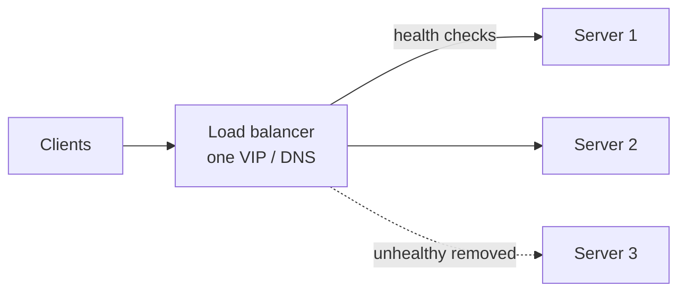
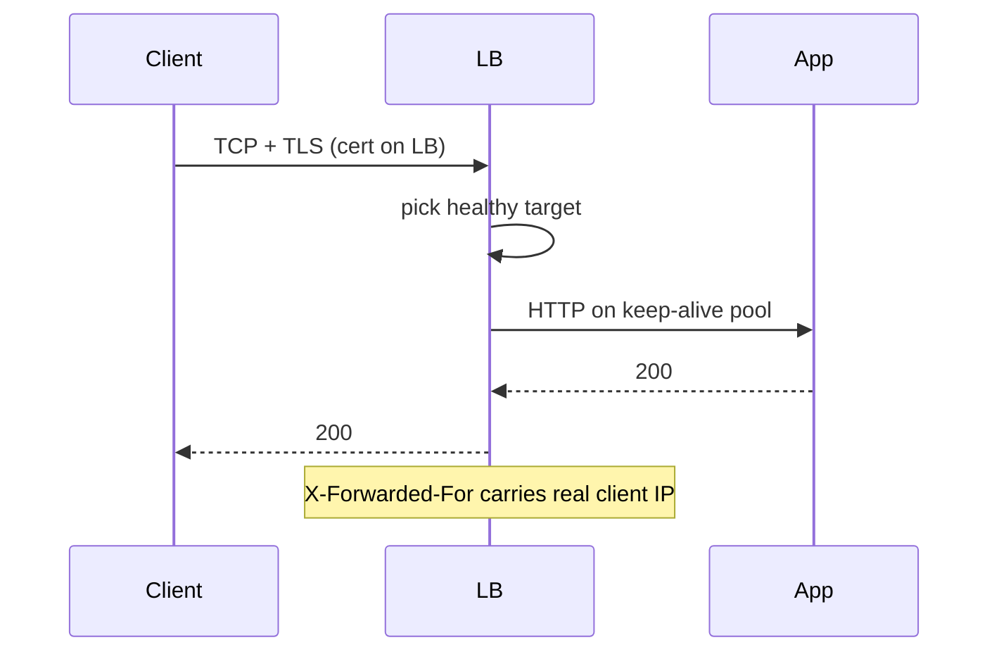
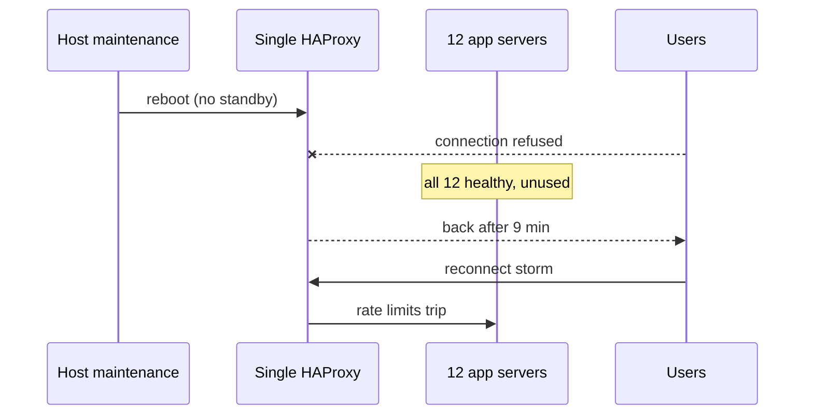

# Lesson 01: Load Balancer Fundamentals — One Address, Many Healthy Servers

> **Prerequisites:** [Horizontal Scaling](../../01-core-fundamentals/07-horizontal-scaling/README.md) · [Single Points of Failure](../../01-core-fundamentals/17-single-point-of-failure/README.md).  
> **Estimated Reading Time:** 30–35 minutes  
> **Target Audience:** Backend engineers, SREs, and architects putting a redundant front door in front of a server pool.  
> **Free PDF Notes:** [Download SD-G-001.pdf](https://backendroadmap.com/notes/system-design/SD-G-001.pdf)

> [!NOTE]
> **In one line:** A load balancer gives clients one address and spreads traffic across a pool of healthy servers, removing failed ones with health checks and letting you add or remove servers unseen. Run it redundantly, or it becomes your single point of failure.

> [!TIP]
> **The Golden Rule of Load Balancers:** Redundancy behind a single entry point is worth little — make the front door redundant too (VRRP pair, multi-node DNS/anycast, or a managed multi-AZ LB).

---

## 1. Core Definition & Taxonomic Comparison

A single server has a capacity ceiling and is a SPOF. Once you run several copies, clients need **one address** and something must decide which copy gets each request. That is the load balancer (LB).

| Term | Precise Meaning | Production Example |
| :--- | :--- | :--- |
| **Load balancer** | Spreads traffic over a healthy pool behind one VIP/DNS name | AWS ALB in front of ECS tasks |
| **VIP** | Virtual IP that can float between LB nodes | `10.0.0.100` via keepalived/VRRP |
| **Target group / backend pool** | The set of servers eligible for traffic | ALB target group, HAProxy `backend` |
| **Edge LB** | Internet-facing balancer (often TLS + WAF) | CloudFront → ALB, Cloudflare → origin |
| **Internal / mesh LB** | Balances between service tiers or sidecars | Internal NLB; Envoy sidecars |

---

## 2. Component Breakdown, Anatomy & Observability Gap

**What an LB does:**

1. Spreads load (round robin, least connections, hashing — lessons 3–6).
2. Removes failed servers (active/passive health checks — lesson 7).
3. Hides change: scale and deploy without clients noticing.
4. Terminates TLS (certs in one place; backends plain or re-encrypted).
5. Drains connections on deploy: finish in-flight, then stop.
6. Enforces limits: timeouts, body size, rate limits, connection caps.
7. Centralizes access logs, latency, and error rates **per backend**.



> [!WARNING]
> **The Observability Gap:** App-tier dashboards can look green while the **single** HAProxy/NLB node is dying. Alert on **LB node count, LB CPU/conn, and target-health skew** — not only on backend `/healthz`. Client `502`/`504` rates often show LB capacity or drain mistakes before app RPS does.

---

## 3. Mathematical Model & Saturation

With $N$ identical backends and arrival rate $\lambda$, if each backend capacity is $\mu$:

$$
\rho_{\text{backend}} = \frac{\lambda}{N\mu}
$$

Keep $\rho$ near **60–70%** headroom. At 95% utilization, $M/M/1$-style wait explodes:

$$
W_q \propto \frac{\rho}{1-\rho}
$$

| Utilization $\rho$ | Relative queue wait $\propto \rho/(1-\rho)$ |
| :--- | :--- |
| 50% | 1.0× |
| 70% | 2.3× |
| 80% | 4.0× |
| 90% | 9.0× |
| 95% | 19× |
| 99% | 99× |

**LB itself:** new connections/sec and concurrent connections are hard limits. Hitting them turns a healthy app pool into client timeouts.

---

## 4. Metrics, Percentiles & Distributions

| Metric | Who it describes |
| :--- | :--- |
| Target healthy count | Pool usable for routing |
| Request latency p50 / p99 at LB | End-to-end hop including LB |
| 5xx rate per target | Bad backend vs bad deploy |
| Active connections / new CPS | LB capacity cliff |
| Deregistration drain time | Deploy cutoffs |

**Average lies:** 11 of 12 backends at 40 ms and one stuck at 2 s → mean ≈ 200 ms while most users are fine — watch **per-backend p99** and skew.

---

## 5. Compounding Effects at Scale

Probability at least one of $N$ backends is unhealthy if each fails independently with probability $p$:

$$
P(\ge 1\ \text{unhealthy}) = 1 - (1-p)^N
$$

| $N$ | $p=0.01$ | $p=0.05$ |
| :--- | :--- | :--- |
| 1 | 1% | 5% |
| 10 | ~10% | ~40% |
| 50 | ~39% | ~92% |
| 100 | ~63% | ~99% |

With more backends you **need** health checks and draining — the chance something is sick grows with $N$.

---

## 6. Numbers Every Backend Engineer Must Know

| Fact | Typical value | Implication |
| :--- | :--- | :--- |
| L4 hop added latency | ≪ 1 ms | Cheap front door |
| L7 hop + TLS | ~1–5 ms | Worth it for routing |
| VRRP failover | ~1–3 s (`advert_int 1`) | Plan for brief blip |
| ALB deregistration delay | default 300 s | Drain budget for deploys |
| keepalived VIP move | seconds | Test monthly |

---

## 7. Protocol & Network Deep Dive

One request through an application LB:

1. DNS → several LB addresses across AZs.
2. Client TCP + TLS to LB (LB holds the cert).
3. LB picks a healthy target (algorithm lessons 3–5).
4. Forwards over a **reused** backend connection; relays response.
5. Background probes remove/re-add targets.



Real client IP arrives in `X-Forwarded-For`, not the TCP source (which is the LB).

---

## 8. Hierarchical Budgets & Capacity Sizing

| Tier | Budget / concern |
| :--- | :--- |
| Edge LB | CPS, bandwidth, TLS CPU, WAF |
| App pool | $\rho$ 60–70%, connection draining |
| Internal LB / mesh | East-west fan-out, timeout budgets |
| Headroom | AZ loss → remaining capacity ≥ peak |

**Three kinds of LB:**

| Kind | Examples | Strengths | Weaknesses |
| :--- | :--- | :--- | :--- |
| Hardware | F5, Citrix ADC | Fast, rich features | Expensive, slow change |
| Software | NGINX, HAProxy, Envoy | Free, scriptable | You operate it |
| Cloud managed | ALB/NLB, GCP/Azure LB | Multi-AZ, no patching | Less control, $ per GB |

Most new systems use **cloud or software**.

---

## 9. Top Engineering Mitigation Techniques

1. **Redundant LB:** active-passive VIP, multi-node DNS/anycast, or managed multi-AZ.
2. **Health checks + drain** on every deploy.
3. **TLS at the edge** with renewal alerts; re-encrypt if internal net untrusted.
4. **Alert on LB node count and capacity**, not only apps.
5. Prefer **stateless backends** so the LB is not a session SPOF (lesson 6).

---

## 10. Production War Story (SEV-1 Post-Mortem)

**Impact:** Shop ran **one** HAProxy VM in front of 12 carefully redundant app servers. Host reboot → **9 minutes** of downtime; reconnect storm tripped rate limits.



**RCA:** App redundancy behind a single front door.  
**Fix:** Second LB + keepalived VIP (or managed LB); monthly failover drill; alert on LB node count.

```text
# keepalived sketch: two HAProxy nodes, one VIP
vrrp_instance VI_1 {
    state MASTER
    interface eth0
    virtual_router_id 51
    priority 150
    advert_int 1
    virtual_ipaddress { 10.0.0.100 }
}
```

---

## 11. Multi-Language Production Code

Minimal “pick next healthy backend” plus target-health style reporting — the LB idea in application form.

````carousel
```go
package lb

import "sync/atomic"

type Backend struct {
	Addr    string
	Healthy atomic.Bool
}

type RoundRobin struct {
	backends []*Backend
	i        atomic.Uint64
}

func (r *RoundRobin) Pick() *Backend {
	n := uint64(len(r.backends))
	for tries := uint64(0); tries < n; tries++ {
		b := r.backends[r.i.Add(1)%n]
		if b.Healthy.Load() {
			return b
		}
	}
	return nil
}
```
<!-- slide -->
```typescript
export type Backend = { addr: string; healthy: boolean };

export class RoundRobin {
  private i = 0;
  constructor(private backends: Backend[]) {}

  pick(): Backend | undefined {
    const n = this.backends.length;
    for (let t = 0; t < n; t++) {
      const b = this.backends[this.i++ % n];
      if (b.healthy) return b;
    }
    return undefined;
  }
}
```
<!-- slide -->
```python
from itertools import count

class RoundRobin:
    def __init__(self, backends: list):
        self.backends = backends
        self._i = count()

    def pick(self):
        n = len(self.backends)
        for _ in range(n):
            b = self.backends[next(self._i) % n]
            if b.healthy:
                return b
        return None
```
<!-- slide -->
```csharp
public sealed class RoundRobin
{
    private readonly Backend[] _backends;
    private long _i;

    public RoundRobin(Backend[] backends) => _backends = backends;

    public Backend? Pick()
    {
        var n = _backends.Length;
        for (var t = 0; t < n; t++)
        {
            var b = _backends[Interlocked.Increment(ref _i) % n];
            if (b.Healthy) return b;
        }
        return null;
    }
}

public sealed class Backend
{
    public required string Addr { get; init; }
    public bool Healthy { get; set; } = true;
}
```
````

---

## 12. Hands-On CLI Verification Workflows

```bash
# AWS: what is healthy behind this target group?
aws elbv2 describe-target-health --target-group-arn "$TG_ARN" \
  --query 'TargetHealthDescriptions[].[Target.Id,TargetHealth.State]' --output table

# Local: utilization vs queue wait multiplier
python -c "
for rho in [0.5,0.7,0.8,0.9,0.95,0.99]:
    print(f'{rho:.0%}', round(rho/(1-rho), 1), '×')
"
```

Minimal HAProxy-shaped mental config:

```text
frontend web
    bind *:443 ssl crt /etc/ssl/site.pem
    default_backend app
backend app
    balance roundrobin
    option httpchk GET /healthz
    server app1 10.0.1.11:8000 check inter 2s fall 3 rise 2
    server app2 10.0.1.12:8000 check inter 2s fall 3 rise 2
```

---

## 13. Common Mistakes to Avoid

- One LB node in front of redundant servers.
- Health checks too shallow (always 200) or too deep (shared dependency kicks everyone out).
- No connection draining → deploys cut in-flight requests.
- TLS cert expiry on the LB with no renewal alert.
- Ignoring LB connection / CPS / bandwidth limits.
- Session state on backends + reliance on stickiness (lesson 6).

---

## 14. Key Terms Glossary

| Term | Definition |
| :--- | :--- |
| **Load balancer** | Spreads traffic over a pool behind one address |
| **VIP** | Virtual IP that moves between LB nodes |
| **VRRP** | Protocol for failover of a shared IP |
| **Target group** | Set of backends eligible for traffic |
| **Health check** | Probe that decides if a server is usable |
| **TLS termination** | LB decrypts HTTPS |
| **Connection draining** | Finish in-flight before removal |
| **Anycast** | Same IP announced from many places |
| **Service mesh** | Sidecar proxies doing internal balancing |

---

## 15. Complete 12 System Design Interview Q&As

<details>
<summary><strong>Q1. What does a load balancer do? [BASIC]</strong></summary>

It spreads requests across a pool of healthy servers behind one address, removes failed servers with health checks, and often terminates TLS.

</details>

<details>
<summary><strong>Q2. How do you make the load balancer itself highly available? [BASIC]</strong></summary>

Run it redundantly: active-passive with a floating VIP, several nodes across zones behind DNS or anycast, or a managed cloud load balancer.

</details>

<details>
<summary><strong>Q3. Name three kinds of load balancers. [BASIC]</strong></summary>

Hardware appliances (F5), software (NGINX, HAProxy, Envoy), and managed cloud (ALB, NLB, Google Cloud LB).

</details>

<details>
<summary><strong>Q4. Why terminate TLS at the load balancer? [BASIC]</strong></summary>

Certificates and cipher policy live in one place, backends save CPU, and the LB can inspect requests; re-encrypt if the internal network is untrusted.

</details>

<details>
<summary><strong>Q5. How do you deploy without dropping requests? [SCENARIO]</strong></summary>

Mark old instances draining so the LB stops new traffic, wait for in-flight (deregistration delay), then stop; start new ones and wait for health checks.

</details>

<details>
<summary><strong>Q6. Users hit a 502 during a rollout. Why? [SCENARIO]</strong></summary>

Backends removed/restarted before draining, or health checks marked new ones healthy too early. Add graceful shutdown, readiness checks, and a drain period.

</details>

<details>
<summary><strong>Q7. Where would you put LBs for a microservices system? [SCENARIO]</strong></summary>

An edge LB for the internet, internal LBs or a mesh between services, each redundant across zones.

</details>

<details>
<summary><strong>Q8. Your LB has high CPU. Options? [SCENARIO]</strong></summary>

Scale out LB nodes, offload TLS / session resumption, enable keep-alive and HTTP/2, move static content to a CDN.

</details>

<details>
<summary><strong>Q9. Does a load balancer make the system highly available? [TRICKY]</strong></summary>

It removes servers as SPOFs but is one itself; availability needs a redundant LB and redundant zones.

</details>

<details>
<summary><strong>Q10. DNS load balancing vs an LB? [TRICKY]</strong></summary>

DNS hands out addresses, but clients cache and DNS does not know live health; an LB sees health and decides per connection/request.

</details>

<details>
<summary><strong>Q11. Can a load balancer fix a slow backend? [TRICKY]</strong></summary>

Only by routing around it (latency-aware algorithms, health checks); it cannot make the backend faster.

</details>

<details>
<summary><strong>Q12. Why do LBs add latency, and how much? [TRICKY]</strong></summary>

They add a hop and processing — typically sub-ms to a few ms; layer 7 costs more than layer 4.

</details>

---

## 16. One-Page Master Cheat Sheet

```text
====================================================================================================
               LOAD BALANCER FUNDAMENTALS (SD-G-001)  —  MASTER CHEAT SHEET
====================================================================================================
JOB        One address → many healthy servers; health checks remove the dead
KINDS      Hardware | Software (NGINX/HAProxy/Envoy) | Cloud (ALB/NLB)
PLACE      Edge (TLS/WAF) · Internal · Mesh sidecars
HA         LB is a SPOF unless redundant: VRRP VIP, multi-node, or managed multi-AZ
DEPLOY     Drain → wait → stop; readiness before traffic; alert on LB node count
MATH       rho = λ/(Nμ); keep 60–70%; Wq ∝ ρ/(1-ρ) cliffs near 95%
ANTI       X single LB node   X no drain   X cert expiry blind   X sticky for correctness
====================================================================================================
```

---

## Free PDF notes

[SD-G-001.pdf](https://backendroadmap.com/notes/system-design/SD-G-001.pdf)

---

## Sources

- [AWS: How Elastic Load Balancing works](https://docs.aws.amazon.com/elasticloadbalancing/latest/userguide/how-elastic-load-balancing-works.html)
- [HAProxy documentation](https://www.haproxy.org/)
- [Envoy: Load balancing](https://www.envoyproxy.io/docs/envoy/latest/intro/arch_overview/upstream/load_balancing/load_balancing)

---

## Next

Next: [Lesson 02: Layer 4 vs Layer 7 Load Balancing](../02-layer-4-vs-layer-7-load-balancing/README.md). Track: [Load Balancing overview](../README.md).
