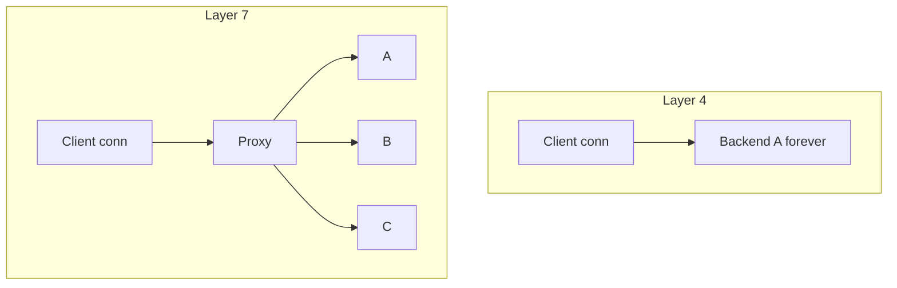
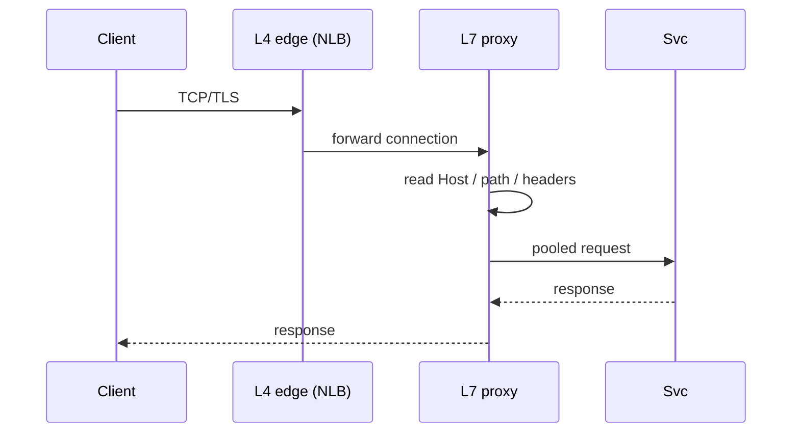
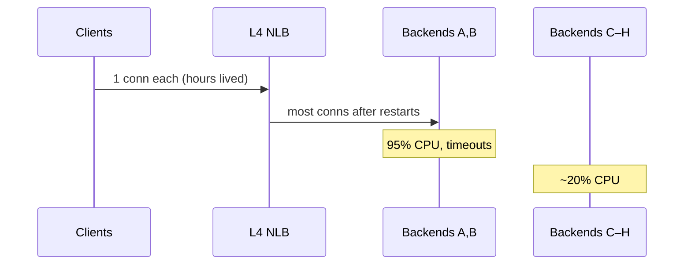

# Lesson 02: Layer 4 vs Layer 7 Load Balancing — NLB vs ALB, TLS Placement

> **Prerequisites:** [Lesson 01: Load Balancer Fundamentals](../01-load-balancer-fundamentals/README.md).  
> **Estimated Reading Time:** 30–35 minutes  
> **Target Audience:** Backend and platform engineers choosing connection-level vs request-level balancing.  
> **Free PDF Notes:** [Download SD-G-002.pdf](https://backendroadmap.com/notes/system-design/SD-G-002.pdf)

> [!NOTE]
> **In one line:** A layer 4 LB forwards TCP/UDP using only IPs and ports — fast and protocol-agnostic. A layer 7 LB terminates the connection, reads HTTP, and routes by path, host, header, or cookie — smarter and slower. Choose by what you need to decide on, and combine both at scale.

> [!TIP]
> **The Golden Rule of L4 vs L7:** Ask “Do I need to decide based on request contents?” If yes → L7. If you have long-lived multiplexed HTTP/2 or gRPC → L7 (or client-side balancing), because L4 balances **connections**, not **requests**.

---

## 1. Core Definition & Taxonomic Comparison

| Term | Precise Meaning | Production Example |
| :--- | :--- | :--- |
| **Layer 4 (transport)** | Routes by IP/port; does not read payload | AWS NLB, HAProxy `mode tcp` |
| **Layer 7 (application)** | Terminates, parses HTTP, routes by content | AWS ALB, NGINX, Envoy |
| **TLS passthrough** | Encrypted bytes forwarded untouched | NLB → app terminates TLS |
| **TLS termination** | LB decrypts; may re-encrypt to backends | ALB HTTPS listener |
| **Balancing unit** | L4: connection · L7: request | Critical for HTTP/2 & gRPC |

---

## 2. Component Breakdown, Anatomy & Observability Gap

| Aspect | Layer 4 | Layer 7 |
| :--- | :--- | :--- |
| Routing decision | IP and port only | Path, host, header, cookie, method |
| Speed / cost | Very low overhead | Higher CPU/memory per request |
| Protocols | Any TCP/UDP | HTTP, HTTP/2, gRPC, WebSocket |
| TLS | Passthrough (or terminate in some products) | Usually terminates; can re-encrypt |
| Features | Health checks, source-IP affinity | Rewrites, retries, rate limits, auth, WAF |
| Observability | Connections, bytes | Per-request latency, status, URLs |

> [!WARNING]
> **The Observability Gap:** L4 metrics show even **connection** counts while one backend can still be drowning in multiplexed **requests**. Measure **per-backend RPS and CPU**, not only open TCP connections — especially for gRPC/HTTP/2.



---

## 3. Mathematical Model & Saturation

Under HTTP/2/gRPC, one connection carries rate $r$ requests/s. With L4 and $K$ sticky long-lived clients on one backend:

$$
\lambda_{\text{hot}} = \sum_{i \in \text{clients on backend}} r_i
$$

While other backends may sit near idle. L7 spreads each request, so expected load per backend with $N$ backends and total rate $\Lambda$:

$$
\mathbb{E}[\lambda_j] \approx \frac{\Lambda}{N}
$$

| Pattern | Imbalance risk |
| :--- | :--- |
| Short HTTP/1.1, L4 RR | Low |
| Long HTTP/2/gRPC, L4 | High (work ≠ connections) |
| Same traffic, L7 per-request | Low |

Keep L7 proxy fleet at 60–70% CPU; push connection scale to an L4 edge.

---

## 4. Metrics, Percentiles & Distributions

| Metric | Layer | Use |
| :--- | :--- | :--- |
| Concurrent connections | L4/L7 | Capacity cliff |
| Requests per connection | L7 | Multiplex skew |
| Per-backend CPU p99 | Both | Catch hot backends |
| TLS handshake rate | L7 edge | CPU budget |
| Idle timeout mismatches | Both | Random 502s |

---

## 5. Compounding Effects at Scale

If each of $C$ clients opens 1 long-lived gRPC connection and L4 pins them:

$$
P(\text{backend } j \text{ gets } k \text{ clients}) \sim \text{Binomial}(C, 1/N)
$$

Variance grows with $C$; a few unlucky backends absorb most work. **Max connection age** forces reconnect → rebalance.

| Clients $C$ | Backends $N$ | Typical skew without L7/P2C |
| :--- | :--- | :--- |
| 100 | 8 | Mild |
| 10,000 | 8 | Severe after rolling restarts |
| 5M concurrent | — | Need L4 edge + L7 fleet |

---

## 6. Numbers Every Backend Engineer Must Know

| Fact | Value |
| :--- | :--- |
| L4 added latency | Sub-ms typical |
| L7 parse + route | ~1–5 ms class |
| AWS NLB | L4, static IPs, huge CPS |
| AWS ALB | L7 path/host/header rules |
| Common pattern | NLB → ALB/Envoy fleet |

---

## 7. Protocol & Network Deep Dive

**TLS placement:**

1. **Terminate at LB** — decrypt, route, plain or re-encrypt to targets; one place for certs.
2. **Passthrough** — encrypted bytes untouched; no content routing.
3. **Re-encrypt** — terminate for routing, new TLS to target (defense in depth).



---

## 8. Hierarchical Budgets & Capacity Sizing

| Need | Choose | Why |
| :--- | :--- | :--- |
| Raw TCP/UDP, millions of conns | L4 (NLB) | No HTTP parse |
| Path/host/header/cookie routing | L7 (ALB) | Understands HTTP |
| WebSocket / gRPC / HTTP/2 | Prefer L7 | Per-request balance + metrics |
| End-to-end encryption | L4 passthrough | LB never decrypts |
| WAF, auth, per-route metrics | L7 | Needs request visibility |

**Large-scale pattern:** L4 edge (stable IPs, huge CPS) → fleet of L7 proxies (smart routing, scale horizontally).

---

## 9. Top Engineering Mitigation Techniques

1. L7 (or client-side LB) for gRPC/HTTP/2.
2. Max connection age to force rebalance.
3. L4 in front of L7 for mega connection counts.
4. Re-encrypt on untrusted internal networks.
5. Alert on **per-backend load skew**, not only pool averages.

---

## 10. Production War Story (SEV-1 Post-Mortem)

**Impact:** gRPC services behind L4 NLB. Long-lived connections after rolling restarts landed on **2 of 8** backends → 95% CPU / timeouts; six backends ~20% CPU.



**Fix:** Envoy L7 per-request balancing; max connection age; skew alerts.  
**Lesson:** Balancing connections ≠ balancing work when connections are multiplexed.

---

## 11. Multi-Language Production Code

Path-based “L7” routing vs L4-style hash of connection key.

````carousel
```go
package route

import "strings"

type Pool string

func RouteByPath(path string) Pool {
	switch {
	case strings.HasPrefix(path, "/api/orders/"):
		return "orders"
	case strings.HasPrefix(path, "/api/users/"):
		return "users"
	default:
		return "default"
	}
}

// L4-style: sticky for life of connection key
func L4Backend(connID string, backends []string) string {
	h := 0
	for i := 0; i < len(connID); i++ {
		h = 31*h + int(connID[i])
	}
	if h < 0 {
		h = -h
	}
	return backends[h%len(backends)]
}
```
<!-- slide -->
```typescript
export function routeByPath(path: string): "orders" | "users" | "default" {
  if (path.startsWith("/api/orders/")) return "orders";
  if (path.startsWith("/api/users/")) return "users";
  return "default";
}

export function l4Backend(connId: string, backends: string[]): string {
  let h = 0;
  for (let i = 0; i < connId.length; i++) h = (Math.imul(31, h) + connId.charCodeAt(i)) | 0;
  return backends[Math.abs(h) % backends.length];
}
```
<!-- slide -->
```python
def route_by_path(path: str) -> str:
    if path.startswith("/api/orders/"):
        return "orders"
    if path.startswith("/api/users/"):
        return "users"
    return "default"

def l4_backend(conn_id: str, backends: list[str]) -> str:
    return backends[hash(conn_id) % len(backends)]
```
<!-- slide -->
```csharp
public static class Router
{
    public static string RouteByPath(string path) => path switch
    {
        var p when p.StartsWith("/api/orders/") => "orders",
        var p when p.StartsWith("/api/users/") => "users",
        _ => "default"
    };

    public static string L4Backend(string connId, string[] backends)
    {
        var h = connId.GetHashCode();
        return backends[Math.Abs(h % backends.Length)];
    }
}
```
````

---

## 12. Hands-On CLI Verification Workflows

```bash
# Simulate L4 skew: 10000 clients, 8 backends, one conn each
python -c "
import random
from collections import Counter
N,C=8,10000
c=Counter(random.randrange(N) for _ in range(C))
print(sorted(c.values()), 'min/max', min(c.values()), max(c.values()))
"
```

NGINX path routing sketch / HAProxy TCP mode:

```text
# L7 path pools
location /api/orders/ { proxy_pass http://orders; }
location /api/users/  { proxy_pass http://users; }

# L4 TCP passthrough
frontend game
    mode tcp
    bind *:7777
    default_backend game_servers
```

---

## 13. Common Mistakes to Avoid

- L4 for gRPC/HTTP/2 → skewed load.
- L7 for a protocol the proxy does not understand.
- Terminate TLS at L7 without re-encrypting on untrusted networks.
- Single L7 proxy as bottleneck/SPOF.
- Buffering huge bodies in the proxy → OOM.
- Idle-timeout mismatches between LB and backend.

---

## 14. Key Terms Glossary

| Term | Definition |
| :--- | :--- |
| **Layer 4** | Transport balancing by IP and port |
| **Layer 7** | Application balancing by request content |
| **TLS passthrough** | LB forwards encrypted bytes |
| **TLS termination** | LB decrypts |
| **NLB / ALB** | AWS L4 / L7 load balancers |
| **HTTP/2 multiplexing** | Many requests on one connection |
| **Listener rule** | L7 match-and-route rule |
| **Max connection age** | Force periodic reconnect |
| **Anycast** | One IP from many nodes |

---

## 15. Complete 12 System Design Interview Q&As

<details>
<summary><strong>Q1. Difference between layer 4 and layer 7 load balancing? [BASIC]</strong></summary>

L4 routes TCP/UDP by IP and port; L7 reads HTTP and can route by path, host, header, or cookie.

</details>

<details>
<summary><strong>Q2. Which is faster? [BASIC]</strong></summary>

Layer 4 — it does not parse requests or (usually) terminate application connections.

</details>

<details>
<summary><strong>Q3. When do you need layer 7? [BASIC]</strong></summary>

Path/host routing, header canaries, rewrites, retries, rate limits, auth, or per-request metrics.

</details>

<details>
<summary><strong>Q4. When is layer 4 enough? [BASIC]</strong></summary>

Non-HTTP protocols, TLS passthrough, extreme connection counts, or simple spreading without smart routing.

</details>

<details>
<summary><strong>Q5. gRPC traffic uneven behind your LB. Fix? [SCENARIO]</strong></summary>

Use an L7 proxy that balances per request, or client-side balancing; add max connection age so connections rebalance.

</details>

<details>
<summary><strong>Q6. Route /api to services and /static to a CDN origin. [SCENARIO]</strong></summary>

Layer 7 listener rules matching path prefixes to separate target groups.

</details>

<details>
<summary><strong>Q7. Design the entry for 5 million concurrent connections. [SCENARIO]</strong></summary>

An L4 tier (anycast or NLB) in front of a scalable fleet of L7 proxies.

</details>

<details>
<summary><strong>Q8. Do you terminate TLS at the LB? [SCENARIO]</strong></summary>

Usually yes for routing and offload; re-encrypt to backends if the internal network is untrusted or compliance requires it.

</details>

<details>
<summary><strong>Q9. Can a layer 4 LB read cookies? [TRICKY]</strong></summary>

No — not unless it terminates the connection, which makes it layer 7 behavior.

</details>

<details>
<summary><strong>Q10. Does layer 7 always cost more? [TRICKY]</strong></summary>

Per request yes, but it often saves backend work via retries, compression, and caching.

</details>

<details>
<summary><strong>Q11. Why do WebSockets complicate balancing? [TRICKY]</strong></summary>

They are long-lived; the choice is made once at upgrade, and load/stickiness follow that single decision.

</details>

<details>
<summary><strong>Q12. Is HTTP/3 balanced at L4? [TRICKY]</strong></summary>

It runs over UDP/QUIC; many balancers handle it at L4 using connection IDs, or terminate it at L7.

</details>

---

## 16. One-Page Master Cheat Sheet

```text
====================================================================================================
               L4 vs L7 LOAD BALANCING (SD-G-002)  —  MASTER CHEAT SHEET
====================================================================================================
L4         IP+port, fast, any protocol — balances CONNECTIONS
L7         Reads HTTP — balances REQUESTS (path/host/header/cookie)
TRAP       HTTP/2 & gRPC on L4 → hot backends; use L7 or client-side LB
AWS        NLB = L4 · ALB = L7 · Big systems: L4 edge → L7 fleet
TLS        Terminate for routing · Passthrough for E2E · Re-encrypt if needed
ANTI       X L4 for gRPC   X single L7 SPOF   X idle timeout mismatch
====================================================================================================
```

---

## Free PDF notes

[SD-G-002.pdf](https://backendroadmap.com/notes/system-design/SD-G-002.pdf)

---

## Sources

- [AWS: NLB vs ALB](https://docs.aws.amazon.com/elasticloadbalancing/latest/userguide/how-elastic-load-balancing-works.html)
- [Envoy: gRPC load balancing](https://www.envoyproxy.io/docs/envoy/latest/intro/arch_overview/upstream/load_balancing/load_balancing)
- [NGINX: HTTP load balancing](https://nginx.org/en/docs/http/load_balancing.html)

---

## Next

Next: [Lesson 03: Round Robin vs Weighted Round Robin](../03-round-robin-vs-weighted-round-robin/README.md). Track: [Load Balancing overview](../README.md).
