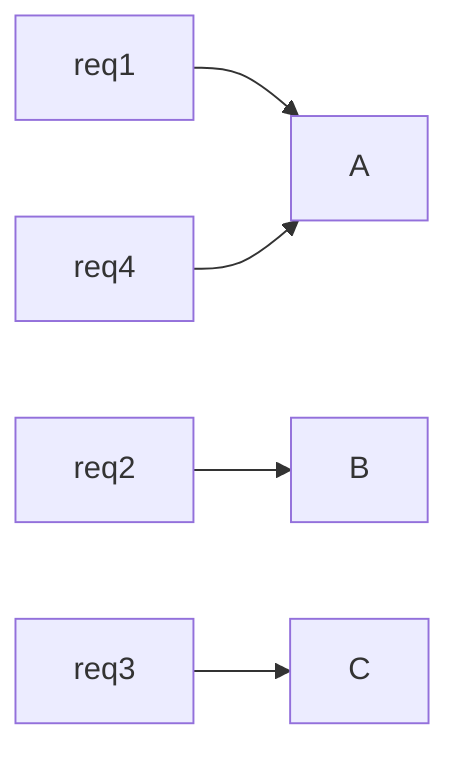
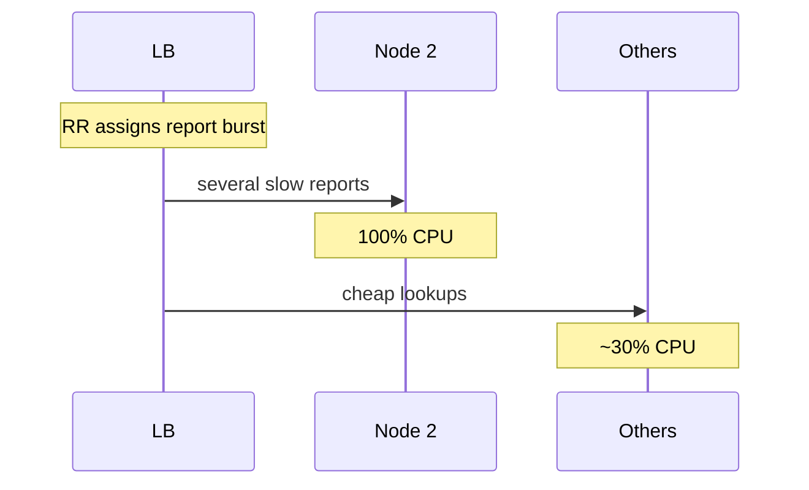
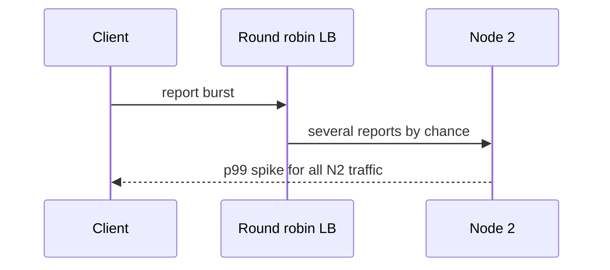

# Lesson 03: Round Robin vs Weighted Round Robin — When Taking Turns Fails

> **Prerequisites:** [Lesson 02: Layer 4 vs Layer 7](../02-layer-4-vs-layer-7-load-balancing/README.md).  
> **Estimated Reading Time:** 28–32 minutes  
> **Target Audience:** Backend engineers configuring simple, fair algorithms for similar short requests.  
> **Free PDF Notes:** [Download SD-G-003.pdf](https://backendroadmap.com/notes/system-design/SD-G-003.pdf)

> [!NOTE]
> **In one line:** Round robin hands requests to backends in turn — simple and fair for similar servers and short requests. Weighted round robin gives bigger servers a bigger share. Both count **requests**, not **work**, so use load-aware algorithms when requests vary.

> [!TIP]
> **The Golden Rule of Round Robin:** Equal request counts ≠ equal load. If work duration varies (reports, streams, uploads), switch to least connections / P2C (lesson 4).

---

## 1. Core Definition & Taxonomic Comparison

| Term | Precise Meaning | Production Example |
| :--- | :--- | :--- |
| **Round robin (RR)** | Next healthy backend in cyclic order | HAProxy `balance roundrobin` |
| **Weighted RR (WRR)** | Shares proportional to weights | NGINX `weight=` |
| **Smooth WRR** | Interleaves heavy picks to avoid bursts | NGINX default WRR |
| **Pointer** | Index of next backend | Per-LB-node state |
| **Canary weight** | Small share for a new version | weight 5 vs 95 |

---

## 2. Component Breakdown, Anatomy & Observability Gap

Plain RR keeps a pointer into the healthy list; each request advances and wraps.



**Weights example** (total weight 4):

| Backend | Cores | Weight | Share of 100 req |
| :--- | :--- | :--- | :--- |
| A | 4 | 1 | 25 |
| B | 4 | 1 | 25 |
| C | 8 | 2 | 50 |

Naive WRR may burst `A,B,C,C`; **smooth WRR** interleaves `C,A,C,B`.

> [!WARNING]
> **The Observability Gap:** Pool-level RPS looks even under RR while **one** node’s CPU is 100% (it drew the slow reports). Chart **per-backend active requests and CPU**, not only request counts.

---

## 3. Mathematical Model & Saturation

With weight $w_i$ and total $W = \sum w_i$:

$$
\text{share}_i = \frac{w_i}{W}
$$

Smooth WRR (NGINX-style): each turn add $w_i$ to `current_i`, pick max, subtract $W$.

If request service times are i.i.d. with mean $\mathbb{E}[S]$ but high variance, equal counts still yield unequal concurrent work:

$$
L_i \approx \lambda_i \mathbb{E}[S] \quad\text{but}\quad \text{Var}(L_i)\ \text{grows with Var}(S)
$$

| Situation | Pick |
| :--- | :--- |
| Similar servers, short uniform requests | Round robin |
| Mixed instance sizes | Weighted RR |
| Variable duration / streaming | Least connections |
| Same key → same server | Consistent / IP hash |

---

## 4. Metrics, Percentiles & Distributions

| Metric | Use |
| :--- | :--- |
| Requests per backend | Confirms RR fairness of **counts** |
| CPU / active conns per backend | Detects unequal **work** |
| Weight config drift | Stale weights after resize |
| Canary error rate | Weighted rollout safety |

---

## 5. Compounding Effects at Scale

$M$ independent LB nodes each with their own pointer can **synchronize** and hit the same backend in the same slot:

$$
P(\text{clump}) \text{ rises if all start at index } 0
$$

Mitigation: randomize start index, or use P2C.

| LB nodes | Algorithm | Risk |
| :--- | :--- | :--- |
| 1 | RR | Fine if work uniform |
| Many | Synchronized RR | Lumpy spikes |
| Many | P2C | Near-optimal, anti-herd |

---

## 6. Numbers Every Backend Engineer Must Know

| Fact | Value |
| :--- | :--- |
| 2×4-core + 1×8-core | Weights 1,1,2 → 25/25/50 |
| 5% canary | Weights 5 and 95 |
| Drain | Set weight → 0 |
| Backup server | NGINX `backup` — only if others down |

---

## 7. Protocol & Network Deep Dive

Long-lived WebSocket/gRPC: RR only decides at **open**. Hours later, counts of *connections opened* look fair while *work* has drifted.



---

## 8. Hierarchical Budgets & Capacity Sizing

| Knob | Budget |
| :--- | :--- |
| Weights | Match load-test throughput, not marketing vCPU labels |
| Canary | Start ≤5%, raise on error budget |
| Drain | Weight 0 → wait in-flight → stop |
| Heterogeneous pool | Revisit weights after instance type changes |

---

## 9. Top Engineering Mitigation Techniques

1. RR only for similar short requests.
2. Smooth WRR for mixed sizes / canaries.
3. Skip unhealthy backends always.
4. Randomize pointer start across LB nodes.
5. Move to least connections when cost varies.

---

## 10. Production War Story (SEV-1 Post-Mortem)

**Impact:** API with cheap lookups + expensive report endpoint, RR across 4 nodes. Report bursts landed on node 2 → 100% CPU; others ~30%; latency spiked for everything on that node.



**Fix:** Least connections; separate report pool; per-endpoint concurrency limit.  
**Lesson:** Equal counts ≠ equal load.

---

## 11. Multi-Language Production Code

````carousel
```go
package wrr

type Backend struct {
	Name    string
	Weight  int
	Current int
	Healthy bool
}

func SmoothWRR(backends []*Backend) *Backend {
	total := 0
	var best *Backend
	for _, b := range backends {
		if !b.Healthy {
			continue
		}
		b.Current += b.Weight
		total += b.Weight
		if best == nil || b.Current > best.Current {
			best = b
		}
	}
	if best == nil {
		return nil
	}
	best.Current -= total
	return best
}
```
<!-- slide -->
```typescript
export type Backend = { name: string; weight: number; current: number; healthy: boolean };

export function smoothWrr(backends: Backend[]): Backend | undefined {
  let total = 0;
  let best: Backend | undefined;
  for (const b of backends) {
    if (!b.healthy) continue;
    b.current += b.weight;
    total += b.weight;
    if (!best || b.current > best.current) best = b;
  }
  if (!best) return undefined;
  best.current -= total;
  return best;
}
```
<!-- slide -->
```python
class Backend:
    def __init__(self, name: str, weight: int):
        self.name, self.weight = name, weight
        self.current = 0
        self.healthy = True

def smooth_wrr(backends: list[Backend]) -> Backend | None:
    total = 0
    best = None
    for b in backends:
        if not b.healthy:
            continue
        b.current += b.weight
        total += b.weight
        if best is None or b.current > best.current:
            best = b
    if best is None:
        return None
    best.current -= total
    return best
```
<!-- slide -->
```csharp
public sealed class Backend
{
    public required string Name { get; init; }
    public int Weight { get; init; }
    public int Current { get; set; }
    public bool Healthy { get; set; } = true;
}

public static class SmoothWrr
{
    public static Backend? Pick(IList<Backend> backends)
    {
        var total = 0;
        Backend? best = null;
        foreach (var b in backends)
        {
            if (!b.Healthy) continue;
            b.Current += b.Weight;
            total += b.Weight;
            if (best is null || b.Current > best.Current) best = b;
        }
        if (best is null) return null;
        best.Current -= total;
        return best;
    }
}
```
````

---

## 12. Hands-On CLI Verification Workflows

```bash
python -c "
class B:
  def __init__(s,n,w): s.name=n; s.weight=w; s.current=0; s.healthy=True
bs=[B('A',1),B('B',1),B('C',2)]
from collections import Counter
c=Counter()
def pick():
  total=0; best=None
  for b in bs:
    b.current+=b.weight; total+=b.weight
    if best is None or b.current>best.current: best=b
  best.current-=total; return best.name
for _ in range(100): c[pick()]+=1
print(dict(c))  # expect ~25,25,50
"
```

```text
upstream api {
    server 10.0.1.11:8000 weight=2;
    server 10.0.1.12:8000 weight=1;
    server 10.0.1.13:8000 backup;
}
```

---

## 13. Common Mistakes to Avoid

- RR for wildly different request costs.
- Stale weights after instance resize.
- Not skipping unhealthy backends.
- Expecting RR to rebalance long-lived connections over time.
- Many LB nodes with synchronized pointers.
- Weights set without a load test.

---

## 14. Key Terms Glossary

| Term | Definition |
| :--- | :--- |
| **Round robin** | Rotate through backends |
| **Weighted RR** | Shares proportional to weights |
| **Smooth WRR** | Interleaves weighted picks |
| **Weight** | Relative capacity share |
| **Canary weight** | Small share for a new version |
| **Drain** | Reduce weight to zero new traffic |
| **Healthy set** | Backends eligible for traffic |
| **Load-aware** | Uses live load to choose |

---

## 15. Complete 12 System Design Interview Q&As

<details>
<summary><strong>Q1. How does round robin work? [BASIC]</strong></summary>

Cycle through healthy backends in order, sending each request to the next one.

</details>

<details>
<summary><strong>Q2. What is weighted round robin? [BASIC]</strong></summary>

Round robin where each backend gets a share proportional to its weight, reflecting capacity.

</details>

<details>
<summary><strong>Q3. Why use smooth weighted round robin? [BASIC]</strong></summary>

It interleaves picks so a heavy server does not receive its whole share in a burst.

</details>

<details>
<summary><strong>Q4. When is round robin a good choice? [BASIC]</strong></summary>

Similar servers and short, uniform requests.

</details>

<details>
<summary><strong>Q5. Pool has two 4-core and one 8-core server. Configure it. [SCENARIO]</strong></summary>

Weights 1, 1, and 2 so shares are 25%, 25%, and 50%.

</details>

<details>
<summary><strong>Q6. Send 5% of traffic to a new version. [SCENARIO]</strong></summary>

New version weight 5, old weight 95 (or weighted target groups).

</details>

<details>
<summary><strong>Q7. One node overloaded under RR. Why, and what next? [SCENARIO]</strong></summary>

Requests vary in cost or connections are long-lived. Move to least connections or P2C.

</details>

<details>
<summary><strong>Q8. A backend is slow but passes health checks. What happens? [SCENARIO]</strong></summary>

RR still sends an equal share. Use least response time, outlier detection, or tighter checks.

</details>

<details>
<summary><strong>Q9. Does RR guarantee equal load? [TRICKY]</strong></summary>

Only equal request counts; load depends on work per request.

</details>

<details>
<summary><strong>Q10. Do WebSockets stay balanced under RR? [TRICKY]</strong></summary>

No — balanced only when opened; can drift for hours.

</details>

<details>
<summary><strong>Q11. Several LB nodes all use RR? [TRICKY]</strong></summary>

Each has its own pointer; they can synchronize/clump — randomize start or use P2C.

</details>

<details>
<summary><strong>Q12. How do you drain a server with weights? [TRICKY]</strong></summary>

Set weight to 0 so it gets no new requests, then wait for in-flight ones.

</details>

---

## 16. One-Page Master Cheat Sheet

```text
====================================================================================================
               ROUND ROBIN / WEIGHTED RR (SD-G-003)  —  MASTER CHEAT SHEET
====================================================================================================
RR         Next healthy backend in turn
WRR        share_i = w_i / Σw · Smooth WRR interleaves (avoid C,C bursts)
MATH       Counts REQUESTS not WORK · Var(S) → unequal CPU under equal counts
USE        Similar servers + short uniform APIs · Canary via weights · Drain = weight 0
SWITCH     Variable work → least connections / P2C (SD-G-004)
ANTI       X RR for reports/streams   X stale weights   X synced LB pointers
====================================================================================================
```

---

## Free PDF notes

[SD-G-003.pdf](https://backendroadmap.com/notes/system-design/SD-G-003.pdf)

---

## Sources

- [NGINX: Smooth weighted round-robin](https://nginx.org/en/docs/http/ngx_http_upstream_module.html)
- [HAProxy: balance](https://www.haproxy.com/documentation/)

---

## Next

Next: [Lesson 04: Least Connections, EWMA & Power of Two Choices](../04-least-connections-ewma-power-of-two-choices-explained/README.md). Track: [Load Balancing overview](../README.md).
