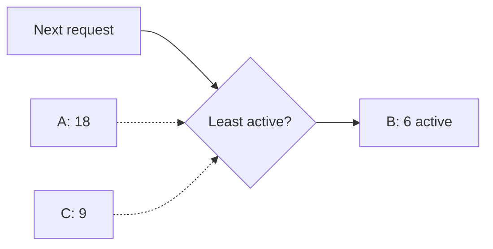
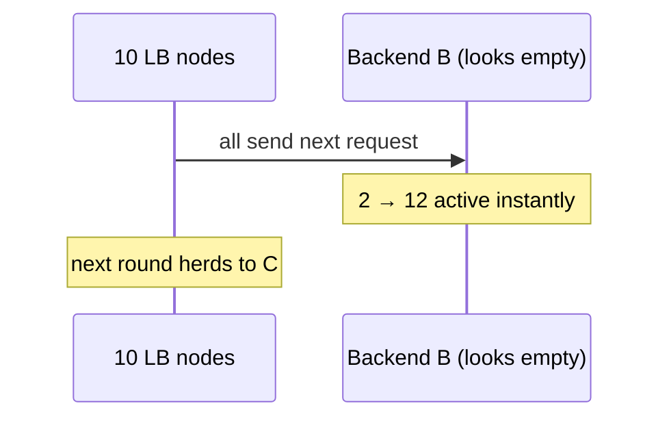
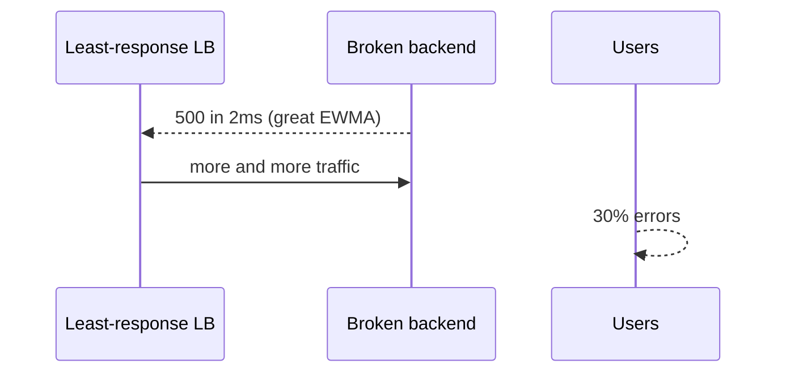

# Lesson 04: Least Connections, EWMA & Power of Two Choices

> **Prerequisites:** [Lesson 03: Round Robin vs Weighted Round Robin](../03-round-robin-vs-weighted-round-robin/README.md).  
> **Estimated Reading Time:** 30–35 minutes  
> **Target Audience:** Backend engineers balancing variable-duration work and multi-proxy fleets.  
> **Free PDF Notes:** [Download SD-G-004.pdf](https://backendroadmap.com/notes/system-design/SD-G-004.pdf)

> [!NOTE]
> **In one line:** Least connections sends each request to the backend with the fewest active requests; least response time uses measured latency (often EWMA). Both adapt to uneven work. Use **power of two choices (P2C)** so many LB nodes do not herd onto one idle server.

> [!TIP]
> **The Golden Rule of Load-Aware Balancing:** Never score on latency alone — a backend that fails in 2 ms looks “fast.” Combine with health checks, error counting, and outlier ejection.

---

## 1. Core Definition & Taxonomic Comparison

| Term | Precise Meaning | Production Example |
| :--- | :--- | :--- |
| **Least connections** | Pick fewest active in-flight requests | NGINX `least_conn` |
| **Weighted least conn** | `active / weight` | Mixed 4-core / 16-core pools |
| **Least response time** | Prefer best recent latency (+ load) | Envoy / Finagle / Linkerd |
| **EWMA** | Exponentially weighted moving average | $\alpha\cdot x + (1-\alpha)\cdot\text{ewma}$ |
| **P2C** | Sample 2 random backends, take lighter | Envoy `LEAST_REQUEST` default |
| **Herd problem** | Many LBs all pick the same “empty” host | New node gets flooded |

---

## 2. Component Breakdown, Anatomy & Observability Gap



**EWMA update:**

$$
\text{ewma} \leftarrow \alpha \cdot x + (1-\alpha)\cdot\text{ewma}
$$

Typical pick cost: $(\text{active}+1)\times\text{ewma}$.

> [!WARNING]
> **The Observability Gap:** Each LB node’s connection counters are **local**. Pool dashboards that average across proxies hide herding. Alert on **max−min active connections across backends** and per-backend error rate.

---

## 3. Mathematical Model & Saturation

**P2C imbalance:** With random placement, worst-bin load is about $\frac{\log n}{\log\log n}$. With two choices it falls to about $\log\log n$ (Mitzenmacher).

| Policy | Rough worst-case imbalance |
| :--- | :--- |
| Pure random | $\sim \log n / \log\log n$ |
| P2C | $\sim \log\log n$ |
| Full least-conn (global) | Near optimal, needs global view |

Weighted least connections:

$$
\text{score}_i = \frac{\text{active}_i}{w_i}
$$

Keep backends under ~70% concurrent capacity; herding can push one node past 95% instantly.

---

## 4. Metrics, Percentiles & Distributions

| Metric | Use |
| :--- | :--- |
| Active requests per backend | Least-conn input |
| EWMA latency p50/p99 | Least-response input |
| Error rate per backend | Catch fast failures |
| Skew (max−min active) | Herd detector |
| Slow-start weight | Protect cold nodes |

---

## 5. Compounding Effects at Scale

$M$ LB nodes each independently choosing $\arg\min$ active:

$$
P(\text{all pick same empty backend}) \approx 1 \text{ when views are stale and synchronized}
$$

That empty backend jumps from $0$ to $\approx M$ in one RTT round.

| LB nodes | Algorithm | Effect |
| :--- | :--- | :--- |
| 1 | Least conn | Good |
| 10 | Global least | Herd risk |
| 10 | P2C | Anti-herd, near-optimal |

---

## 6. Numbers Every Backend Engineer Must Know

| Fact | Value |
| :--- | :--- |
| Envoy least-request | P2C (`choice_count: 2`) by default |
| EWMA $\alpha$ | Often ~0.2–0.3 (tune to noise) |
| Slow start | Gradually raise weight for new nodes |
| Fast 500 in 2 ms | Looks “best” without error scoring |

---

## 7. Protocol & Network Deep Dive

LLM / streaming: request duration 2 s–2 min. RR piles long streams on unlucky nodes. Least connections (gateway→inference) + P2C across gateway replicas avoids synchronized herding.



---

## 8. Hierarchical Budgets & Capacity Sizing

| Knob | Budget |
| :--- | :--- |
| Active concurrency per node | Cap near 60–70% of safe max |
| Outlier ejection | Consecutive 5xx / timeout thresholds |
| Panic / fail-open | Avoid zero healthy hosts (lesson 7) |
| Weights | Capacity-proportional for mixed fleets |

---

## 9. Top Engineering Mitigation Techniques

1. Least connections for variable duration.
2. P2C whenever many LB nodes exist.
3. Score failures, not only latency.
4. Outlier ejection + real health checks.
5. Slow-start new backends.

---

## 10. Production War Story (SEV-1 Post-Mortem)

**Impact:** Least response time pool. One backend lost DB connectivity and returned **500 in 2 ms**. EWMA became best in pool → LB fed it more traffic → **service error rate 30%**.



**Fix:** Count failures in score; eject on consecutive 5xx; health check exercises DB; alert on per-backend errors.  
**Lesson:** Speed is not health — a quick error is still an error.

---

## 11. Multi-Language Production Code

````carousel
```go
package p2c

import (
	"math/rand"
	"sync/atomic"
)

type Backend struct {
	Name   string
	Active atomic.Int64
	EWMA   atomic.Uint64 // ms * 1000
	Weight int64
}

func LeastConn(backends []*Backend) *Backend {
	var best *Backend
	for _, b := range backends {
		score := b.Active.Load()
		if b.Weight > 0 {
			score /= b.Weight
		}
		if best == nil || score < best.Active.Load()/max64(best.Weight, 1) {
			best = b
		}
	}
	return best
}

func P2C(backends []*Backend) *Backend {
	if len(backends) < 2 {
		return backends[0]
	}
	i := rand.Intn(len(backends))
	j := rand.Intn(len(backends) - 1)
	if j >= i {
		j++
	}
	a, b := backends[i], backends[j]
	if a.Active.Load() <= b.Active.Load() {
		return a
	}
	return b
}

func max64(a, b int64) int64 {
	if a > b {
		return a
	}
	return b
}
```
<!-- slide -->
```typescript
export type Backend = { name: string; active: number; weight: number; ewma: number };

export function leastConn(backends: Backend[]): Backend {
  return backends.reduce((best, b) =>
    b.active / b.weight < best.active / best.weight ? b : best,
  );
}

export function p2c(backends: Backend[]): Backend {
  const i = Math.floor(Math.random() * backends.length);
  let j = Math.floor(Math.random() * (backends.length - 1));
  if (j >= i) j++;
  const a = backends[i], b = backends[j];
  return a.active <= b.active ? a : b;
}

export function recordEwma(b: Backend, latencyMs: number, alpha = 0.3) {
  b.ewma = alpha * latencyMs + (1 - alpha) * b.ewma;
}
```
<!-- slide -->
```python
import random

def least_connections(backends):
    return min(backends, key=lambda b: b.active / max(b.weight, 1))

def p2c(backends):
    a, b = random.sample(backends, 2)
    return a if a.active <= b.active else b

def record_ewma(b, latency_ms: float, alpha: float = 0.3):
    b.ewma = alpha * latency_ms + (1 - alpha) * b.ewma

def pick_latency(backends):
    return min(backends, key=lambda b: (b.active + 1) * b.ewma)
```
<!-- slide -->
```csharp
public sealed class Backend
{
    public required string Name { get; init; }
    public int Active;
    public int Weight = 1;
    public double Ewma = 50;
}

public static class LoadAware
{
    public static Backend LeastConn(IReadOnlyList<Backend> backends) =>
        backends.MinBy(b => b.Active / (double)Math.Max(b.Weight, 1))!;

    public static Backend P2C(IReadOnlyList<Backend> backends)
    {
        var i = Random.Shared.Next(backends.Count);
        var j = Random.Shared.Next(backends.Count - 1);
        if (j >= i) j++;
        var a = backends[i]; var b = backends[j];
        return a.Active <= b.Active ? a : b;
    }

    public static void RecordEwma(Backend b, double latencyMs, double alpha = 0.3) =>
        b.Ewma = alpha * latencyMs + (1 - alpha) * b.Ewma;
}
```
````

---

## 12. Hands-On CLI Verification Workflows

```bash
python -c "
import random
from collections import Counter
# herd vs P2C toy: 10 choosers, 8 backends
active=[0]*8
def herd():
  i=min(range(8), key=lambda k: active[k]); active[i]+=1; return i
def p2c():
  a,b=random.sample(range(8),2)
  i=a if active[a]<=active[b] else b; active[i]+=1; return i
for fn,label in [(herd,'herd'),(p2c,'p2c')]:
  active[:]=[0]*8
  for _ in range(200):
    for __ in range(10): fn()
  print(label, active, 'max', max(active))
"
```

```text
# NGINX
upstream llm { least_conn; server 10.0.1.11:9000; server 10.0.1.12:9000; }
# Envoy: lb_policy: LEAST_REQUEST  (choice_count: 2 = P2C)
```

---

## 13. Common Mistakes to Avoid

- Least response time without failure handling (rewards fast errors).
- Assuming per-LB counters are global.
- Herding when many LBs pick the same least-loaded server.
- Ignoring weights on mixed sizes.
- Counting idle keep-alives as “active work.”
- EWMA too slow to follow sudden slowdowns.

---

## 14. Key Terms Glossary

| Term | Definition |
| :--- | :--- |
| **Least connections** | Fewest active requests |
| **Weighted least conn** | Active divided by weight |
| **Least response time** | Best recent latency |
| **EWMA** | Exponentially weighted moving average |
| **Herd problem** | Many clients pick the same target |
| **P2C** | Two random picks, take the lighter |
| **Outlier ejection** | Temporarily remove misbehaving backends |
| **Slow start** | Gradually raise a new backend’s weight |
| **Fast failure** | Errors returned quickly |

---

## 15. Complete 12 System Design Interview Q&As

<details>
<summary><strong>Q1. What is least connections? [BASIC]</strong></summary>

Send each request to the backend with the fewest active requests, optionally scaled by weight.

</details>

<details>
<summary><strong>Q2. How does least response time work? [BASIC]</strong></summary>

It tracks recent latency (EWMA) per backend and prefers the fastest, often combined with active requests.

</details>

<details>
<summary><strong>Q3. What does power of two choices do? [BASIC]</strong></summary>

Pick two backends at random and use the less loaded one — avoids herding and gives near-optimal balance cheaply.

</details>

<details>
<summary><strong>Q4. When prefer it over round robin? [BASIC]</strong></summary>

When request duration varies, or requests are long-lived (streams, uploads, heavy queries).

</details>

<details>
<summary><strong>Q5. Many LB nodes all send traffic to one new empty server. Why? [SCENARIO]</strong></summary>

Each node sees it as least loaded — the herd effect. Use P2C or slow-start the new server.

</details>

<details>
<summary><strong>Q6. A backend returns errors instantly and attracts traffic. Fix? [SCENARIO]</strong></summary>

Include errors in the score, eject on consecutive failures, and strengthen health checks.

</details>

<details>
<summary><strong>Q7. Balance an LLM streaming gateway. [SCENARIO]</strong></summary>

Least connections (or least-request with P2C), since stream length varies from seconds to minutes.

</details>

<details>
<summary><strong>Q8. Pool mixes 4- and 16-core servers. [SCENARIO]</strong></summary>

Weighted least connections so each is loaded in proportion to capacity.

</details>

<details>
<summary><strong>Q9. Why is P2C nearly as good as full least connections? [TRICKY]</strong></summary>

Sampling two removes the worst imbalances; worst-case load falls from $\log n/\log\log n$ to $\log\log n$.

</details>

<details>
<summary><strong>Q10. Is least connections stateless? [TRICKY]</strong></summary>

No — it needs live per-backend counts, local to each LB node unless shared.

</details>

<details>
<summary><strong>Q11. What is slow start? [TRICKY]</strong></summary>

Gradually raising a new backend’s weight so cold caches and connection pools warm up.

</details>

<details>
<summary><strong>Q12. Why EWMA instead of an average? [TRICKY]</strong></summary>

It weights recent samples, so the score follows sudden changes instead of lagging.

</details>

---

## 16. One-Page Master Cheat Sheet

```text
====================================================================================================
               LEAST CONN / EWMA / P2C (SD-G-004)  —  MASTER CHEAT SHEET
====================================================================================================
LEAST      Pick min active (weighted: active/weight)
LATENCY    EWMA: αx+(1-α)ewma · score ≈ (active+1)*ewma · GUARD fast errors
HERD       Many LBs → same empty host; fix with P2C or slow-start
P2C        Sample 2, take lighter · worst load ~ log log n
PAIR       Outlier ejection + real health checks + slow start
ANTI       X latency-only scoring   X idle keepalives as active   X global view assumed
====================================================================================================
```

---

## Free PDF notes

[SD-G-004.pdf](https://backendroadmap.com/notes/system-design/SD-G-004.pdf)

---

## Sources

- [Mitzenmacher: The Power of Two Choices in Randomized Load Balancing](https://www.eecs.harvard.edu/~michaelm/postscripts/mythesis.pdf)
- [Envoy: Load balancers](https://www.envoyproxy.io/docs/envoy/latest/intro/arch_overview/upstream/load_balancing/load_balancers)
- [Finagle documentation](https://twitter.github.io/finagle/)

---

## Next

Next: [Lesson 05: Consistent Hashing Explained](../05-consistent-hashing-explained/README.md). Track: [Load Balancing overview](../README.md).
