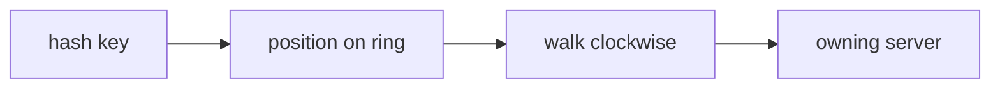
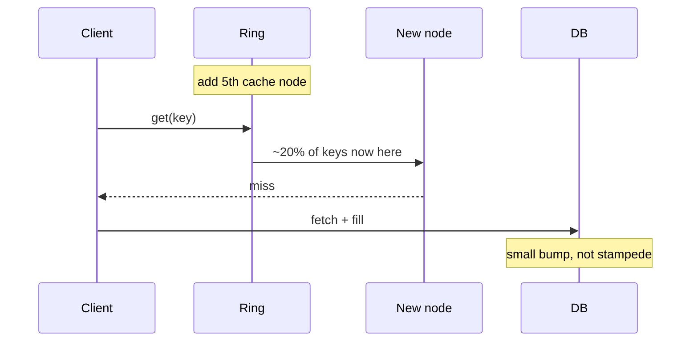
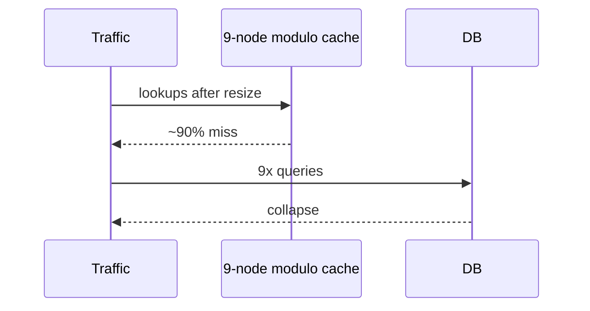

# Lesson 05: Consistent Hashing Explained — Hash Ring, Virtual Nodes, Rendezvous

> **Prerequisites:** [Lesson 04: Least Connections, EWMA & P2C](../04-least-connections-ewma-power-of-two-choices-explained/README.md).  
> **Estimated Reading Time:** 30–35 minutes  
> **Target Audience:** Backend engineers scaling caches, shards, and sticky-by-key load balancers.  
> **Free PDF Notes:** [Download SD-G-005.pdf](https://backendroadmap.com/notes/system-design/SD-G-005.pdf)

> [!NOTE]
> **In one line:** With `hash(key) % N`, changing $N$ remaps almost every key. Consistent hashing puts servers and keys on a ring, so adding or removing a node moves only about $1/N$ of the keys. Virtual nodes even out the load.

> [!TIP]
> **The Golden Rule of Consistent Hashing:** Design for **minimum key movement** on resize — never scale a hot cache with modulo hashing at peak. Virtual nodes (≥100) are not optional for even arcs.

---

## 1. Core Definition & Taxonomic Comparison

| Term | Precise Meaning | Production Example |
| :--- | :--- | :--- |
| **Modulo hashing** | `hash(key) % N` | Breaks on every resize |
| **Consistent hashing** | Ring; next clockwise owns key | Memcached ketama, Cassandra |
| **Virtual node** | Many ring positions per server | 100–200 vnodes typical |
| **Rendezvous (HRW)** | Highest score(server,key) wins | No ring; $O(N)$ lookup |
| **Jump / Maglev** | Bucket/table consistent hashes | Jump append-only; Maglev LBs |

---

## 2. Component Breakdown, Anatomy & Observability Gap

1. Hash the space onto a circle.
2. Place each server (many times via vnodes) on the ring.
3. Hash the key; walk clockwise to the first server point.



Going $4 \to 5$ servers: modulo remaps ~**80%**; consistent hashing ~**20%** ($1/N$).

> [!WARNING]
> **The Observability Gap:** Overall hit ratio can look “OK” while a resize causes a **miss stampede** for remapped keys. Track **miss rate and origin QPS during membership changes**, not only steady-state hit %.

---

## 3. Mathematical Model & Saturation

Expected fraction of keys that move when adding one node to $N$ nodes:

$$
\mathbb{E}[\text{moved}] \approx \frac{1}{N+1}
$$

(For remove: about $1/N$.) Modulo when going $N \to N+1$ leaves roughly $1/(N+1)$ unmoved — so ~$N/(N+1)$ move.

| $N \to N+1$ | Modulo moved | Consistent moved |
| :--- | :--- | :--- |
| 4 → 5 | ~80% | ~20% |
| 8 → 9 | ~89% | ~11% |
| 100 → 101 | ~99% | ~1% |

Replication: next $R$ distinct physical nodes clockwise (Dynamo/Cassandra).

---

## 4. Metrics, Percentiles & Distributions

| Metric | Use |
| :--- | :--- |
| Keys / vnode arc size | Detect lopsided ring |
| Miss rate during resize | Stampede detector |
| Per-node key ownership share | Weight/vnode health |
| Hot-key QPS | Hashing does not fix popularity |

---

## 5. Compounding Effects at Scale

Cache miss → DB. If fraction $f$ remaps at once:

$$
\lambda_{\text{DB}} \approx \lambda_{\text{cache}} \cdot f \quad\text{(plus normal misses)}
$$

At peak $\lambda$, $f=0.9$ can mean ~**9×** origin load → outage.

| Keys | Remap $f$ | Origin multiplier (approx) |
| :--- | :--- | :--- |
| Steady | 0.05 miss | 1× baseline misses |
| Modulo 8→9 | ~0.89 | Near full traffic to DB |
| Ring add 5th | ~0.20 | Modest bump |

---

## 6. Numbers Every Backend Engineer Must Know

| Fact | Value |
| :--- | :--- |
| Virtual nodes / server | Often 100–200 |
| Ketama | Popular Memcached ring client |
| Maglev | Google LB preference tables |
| Hot key | Still one node — replicate/split |

---

## 7. Protocol & Network Deep Dive

Clients must agree on **membership + hash function**. Divergent node lists ⇒ different owners ⇒ phantom misses and duplicates.



---

## 8. Hierarchical Budgets & Capacity Sizing

| Knob | Budget |
| :--- | :--- |
| Vnodes | Enough for even arcs; more for weight |
| Resize window | Off-peak; gradual add |
| Origin protection | Request coalescing / singleflight |
| Replication $R$ | Distinct racks/AZs for copies |

---

## 9. Top Engineering Mitigation Techniques

1. Consistent hashing (not modulo) for scalable caches.
2. Virtual nodes for balance + failure spread + weights.
3. Gradual membership changes off-peak.
4. Coalesce thundering herds on miss.
5. Separate strategy for hot keys (replicate, local cache, shard key).

---

## 10. Production War Story (SEV-1 Post-Mortem)

**Impact:** Cache scaled **8 → 9** with modulo at peak. ~90% keys remapped → DB QPS **9×** → site down **20 minutes**.



**Fix:** Ketama-style consistent hashing + vnodes; add nodes gradually off-peak; request coalescing.  
**Lesson:** Schemes that move most keys on resize turn scaling into an outage.

---

## 11. Multi-Language Production Code

````carousel
```go
package chash

import (
	"crypto/md5"
	"encoding/binary"
	"fmt"
	"sort"
)

type Ring struct {
	points []uint32
	nodes  []string
}

func hash(s string) uint32 {
	sum := md5.Sum([]byte(s))
	return binary.BigEndian.Uint32(sum[:4])
}

func NewRing(nodes []string, vnodes int) *Ring {
	r := &Ring{}
	for _, n := range nodes {
		for i := 0; i < vnodes; i++ {
			r.points = append(r.points, hash(fmt.Sprintf("%s#%d", n, i)))
			r.nodes = append(r.nodes, n)
		}
	}
	sort.Slice(r.points, func(i, j int) bool {
		if r.points[i] == r.points[j] {
			return r.nodes[i] < r.nodes[j]
		}
		return r.points[i] < r.points[j]
	})
	// keep nodes aligned: rebuild via pairs for clarity in production
	type pair struct {
		p uint32
		n string
	}
	ps := make([]pair, 0, len(nodes)*vnodes)
	for _, n := range nodes {
		for i := 0; i < vnodes; i++ {
			ps = append(ps, pair{hash(fmt.Sprintf("%s#%d", n, i)), n})
		}
	}
	sort.Slice(ps, func(i, j int) bool { return ps[i].p < ps[j].p })
	r.points = r.points[:0]
	r.nodes = r.nodes[:0]
	for _, p := range ps {
		r.points = append(r.points, p.p)
		r.nodes = append(r.nodes, p.n)
	}
	return r
}

func (r *Ring) Get(key string) string {
	h := hash(key)
	i := sort.Search(len(r.points), func(i int) bool { return r.points[i] >= h })
	if i == len(r.points) {
		i = 0
	}
	return r.nodes[i]
}
```
<!-- slide -->
```typescript
import { createHash } from "crypto";

function h(s: string): number {
  return parseInt(createHash("md5").update(s).digest("hex").slice(0, 8), 16);
}

export class Ring {
  private points: { p: number; n: string }[];
  constructor(nodes: string[], vnodes = 100) {
    this.points = [];
    for (const n of nodes)
      for (let i = 0; i < vnodes; i++) this.points.push({ p: h(`${n}#${i}`), n });
    this.points.sort((a, b) => a.p - b.p);
  }
  get(key: string): string {
    const x = h(key);
    let lo = 0, hi = this.points.length;
    while (lo < hi) {
      const mid = (lo + hi) >> 1;
      if (this.points[mid].p < x) lo = mid + 1;
      else hi = mid;
    }
    return this.points[lo % this.points.length].n;
  }
}
```
<!-- slide -->
```python
import bisect, hashlib

def h(s: str) -> int:
    return int(hashlib.md5(s.encode()).hexdigest()[:8], 16)

class Ring:
    def __init__(self, nodes: list[str], vnodes: int = 100):
        self.ring = sorted((h(f"{n}#{i}"), n) for n in nodes for i in range(vnodes))
        self.points = [p for p, _ in self.ring]

    def get(self, key: str) -> str:
        i = bisect.bisect(self.points, h(key)) % len(self.ring)
        return self.ring[i][1]
```
<!-- slide -->
```csharp
using System.Buffers.Binary;
using System.Security.Cryptography;
using System.Text;

public sealed class Ring
{
    private readonly List<(uint Point, string Node)> _ring = new();

    public Ring(IEnumerable<string> nodes, int vnodes = 100)
    {
        foreach (var n in nodes)
            for (var i = 0; i < vnodes; i++)
                _ring.Add((Hash($"{n}#{i}"), n));
        _ring.Sort((a, b) => a.Point.CompareTo(b.Point));
    }

    static uint Hash(string s)
    {
        var bytes = MD5.HashData(Encoding.UTF8.GetBytes(s));
        return BinaryPrimitives.ReadUInt32BigEndian(bytes.AsSpan(0, 4));
    }

    public string Get(string key)
    {
        var x = Hash(key);
        var lo = 0;
        var hi = _ring.Count;
        while (lo < hi)
        {
            var mid = (lo + hi) / 2;
            if (_ring[mid].Point < x) lo = mid + 1;
            else hi = mid;
        }
        if (lo == _ring.Count) lo = 0;
        return _ring[lo].Node;
    }
}
```
````

---

## 12. Hands-On CLI Verification Workflows

```bash
python -c "
import hashlib, bisect
from collections import Counter
def h(s): return int(hashlib.md5(s.encode()).hexdigest()[:8],16)
def ring(nodes,v=50):
  r=sorted((h(f'{n}#{i}'),n) for n in nodes for i in range(v))
  pts=[p for p,_ in r]
  def get(k):
    i=bisect.bisect(pts,h(k))%len(r); return r[i][1]
  return get
keys=[f'user:{i}' for i in range(10000)]
g4=ring(['a','b','c','d'])
g5=ring(['a','b','c','d','e'])
moved=sum(g4(k)!=g5(k) for k in keys)/len(keys)
print('fraction moved 4->5', round(moved,3))
print('ownership', Counter(g5(k) for k in keys))
"
```

---

## 13. Common Mistakes to Avoid

- Modulo hashing for a cache that must scale.
- Too few virtual nodes → lopsided arcs.
- Weak/unstable hashes or different client libraries.
- Clients with divergent node lists.
- Assuming hashing fixes hot keys.
- No plan to move stored (not just cached) data on ownership change.

---

## 14. Key Terms Glossary

| Term | Definition |
| :--- | :--- |
| **Consistent hashing** | Ring-based key placement with minimal remaps |
| **Ring** | Circular hash space |
| **Virtual node** | One of many ring positions per server |
| **Rendezvous hashing** | Highest random weight |
| **Jump hash** | Bucket function; append-only $N$ |
| **Maglev** | Table-based consistent hashing |
| **Key movement** | Keys that change owner on resize |
| **Ketama** | Popular Memcached ring client |
| **Arc** | Ring segment owned by a node |

---

## 15. Complete 12 System Design Interview Q&As

<details>
<summary><strong>Q1. Explain consistent hashing. [BASIC]</strong></summary>

Servers and keys are hashed onto a ring; each key belongs to the next server clockwise, so adding/removing a server only moves about $1/N$ of the keys.

</details>

<details>
<summary><strong>Q2. Why not hash(key) % N? [BASIC]</strong></summary>

Changing $N$ remaps almost all keys, wiping the cache and flooding the database.

</details>

<details>
<summary><strong>Q3. Why virtual nodes? [BASIC]</strong></summary>

Many positions even out load, spread a failed node’s keys across many servers, and allow weights.

</details>

<details>
<summary><strong>Q4. Where is consistent hashing used? [BASIC]</strong></summary>

Distributed caches, DynamoDB, Cassandra, CDNs, sharded databases, and load balancers.

</details>

<details>
<summary><strong>Q5. Add a fifth cache node safely. [SCENARIO]</strong></summary>

Use consistent hashing (~20% keys move); add off-peak; protect the DB with request coalescing.

</details>

<details>
<summary><strong>Q6. A cache node dies. What happens to its keys? [SCENARIO]</strong></summary>

They move to next clockwise nodes (spread across many with vnodes); those keys miss once and refill.

</details>

<details>
<summary><strong>Q7. Make bigger servers take more load. [SCENARIO]</strong></summary>

Give them more virtual nodes in proportion to weight.

</details>

<details>
<summary><strong>Q8. One key is extremely hot. Does hashing help? [SCENARIO]</strong></summary>

No — it lands on one node. Replicate it, use local caches, or split the key.

</details>

<details>
<summary><strong>Q9. How much data moves when adding a node? [TRICKY]</strong></summary>

About $1/N$ of keys on average — the theoretical minimum.

</details>

<details>
<summary><strong>Q10. Rendezvous versus ring? [TRICKY]</strong></summary>

Rendezvous needs no ring and is very even but costs $O(N)$ per lookup; a ring is $O(\log N)$.

</details>

<details>
<summary><strong>Q11. Why can jump hash not remove an arbitrary node? [TRICKY]</strong></summary>

Buckets are numbered $0..N-1$, so you can only grow or shrink at the end.

</details>

<details>
<summary><strong>Q12. What if clients disagree on the node list? [TRICKY]</strong></summary>

They compute different owners → misses and duplicates; distribute membership consistently.

</details>

---

## 16. One-Page Master Cheat Sheet

```text
====================================================================================================
               CONSISTENT HASHING (SD-G-005)  —  MASTER CHEAT SHEET
====================================================================================================
PROBLEM    hash%N resize remaps ~all keys → cache stampede
RING       next clockwise owns key · add/remove moves ~1/N
VNODES     100–200/server · even load · failure spread · weights
ALTS       Rendezvous O(N) · Jump append-only · Maglev tables
ANTI       X modulo at peak   X few vnodes   X divergent membership   X ignore hot keys
====================================================================================================
```

---

## Free PDF notes

[SD-G-005.pdf](https://backendroadmap.com/notes/system-design/SD-G-005.pdf)

---

## Sources

- [Karger et al.: Consistent Hashing and Random Trees](https://www.cs.princeton.edu/courses/archive/fall09/cos518/papers/chash.pdf)
- [DeCandia et al.: Dynamo](https://www.allthingsdistributed.com/files/amazon-dynamo-sosp2007.pdf)
- [Eisenbud et al.: Maglev](https://research.google/pubs/pub44824/)

---

## Next

Next: [Lesson 06: Sticky Sessions & IP Hash](../06-sticky-sessions-ip-hash/README.md). Track: [Load Balancing overview](../README.md).
