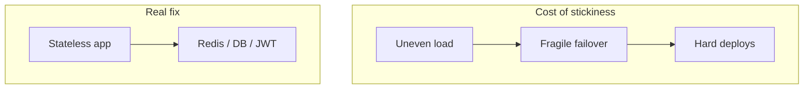
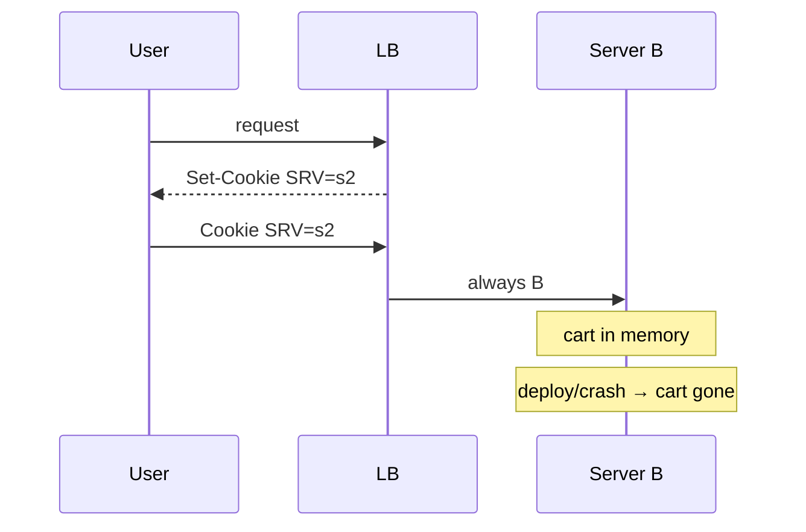
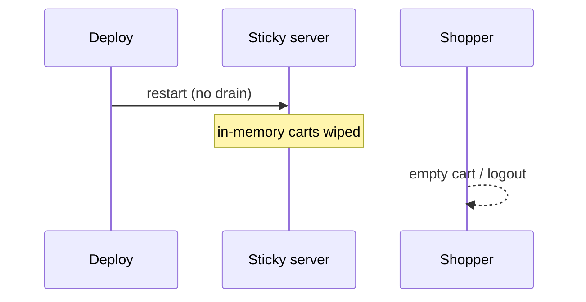

# Lesson 06: Sticky Sessions & IP Hash — Why Session Affinity Bites

> **Prerequisites:** [Lesson 05: Consistent Hashing](../05-consistent-hashing-explained/README.md).  
> **Estimated Reading Time:** 28–32 minutes  
> **Target Audience:** Backend engineers dealing with in-memory sessions, WebSockets, and affinity trade-offs.  
> **Free PDF Notes:** [Download SD-G-006.pdf](https://backendroadmap.com/notes/system-design/SD-G-006.pdf)

> [!NOTE]
> **In one line:** Sticky sessions route all of a client’s requests to one backend, by source IP or by cookie. They rescue apps that keep state in server memory, but cost you even load, easy failover, and easy deploys. The real fix is **stateless servers** with externalized state.

> [!TIP]
> **The Golden Rule of Affinity:** Affinity may help **speed** (warm local caches); **correctness** must never depend on it. If a restart loses user state, state lives in the wrong place.

---

## 1. Core Definition & Taxonomic Comparison

| Term | Precise Meaning | Production Example |
| :--- | :--- | :--- |
| **Session affinity / stickiness** | Same client → same backend | ALB sticky sessions |
| **IP hash** | Backend from hashed client IP | NGINX `ip_hash` |
| **Cookie stickiness** | Cookie names the backend | HAProxy `cookie SRV insert` |
| **Session store** | Shared external state | Redis `sess:{id}` |
| **Stateless server** | No per-user state in process memory | JWT or Redis-backed sessions |

---

## 2. Component Breakdown, Anatomy & Observability Gap

**Why stickiness exists:** cart/session in process memory → next request on another server looks empty.

| Method | How | Strengths | Weaknesses |
| :--- | :--- | :--- | :--- |
| IP hash | Hash client IP | No cookie state; any protocol | NAT / mobile IP changes → hot servers |
| Cookie | LB or app cookie | Precise per user; survives IP change | L7 only; expiry / Secure flags |



> [!WARNING]
> **The Observability Gap:** Autoscaling “worked” (new nodes up) while **CPU stays skewed** — sticky users never leave old nodes. Watch **per-backend active sessions / RPS vs node age**, not only desired replica count.

---

## 3. Mathematical Model & Saturation

Under IP hash with a corporate NAT of size $U$ users sharing one public IP:

$$
\text{all } U \text{ users} \mapsto \text{one backend}
$$

Cookie stickiness with long TTL: after scale-out from $N$ to $N+k$, new capacity receives only **new** sessions until TTL expires:

$$
\text{traffic to new nodes} \approx \lambda_{\text{new sessions}} \ll \lambda_{\text{total}}
$$

| Affinity TTL | Scale-out effectiveness |
| :--- | :--- |
| None (stateless) | Immediate |
| Minutes | Gradual |
| Hours / indefinite | New nodes idle |

---

## 4. Metrics, Percentiles & Distributions

| Metric | Use |
| :--- | :--- |
| Sessions per backend | Skew / NAT hotspot |
| New vs sticky request ratio | Scale-out lag |
| Logout / empty-cart rate on deploy | State-in-memory smell |
| Cookie size | Oversized JWT/cookie risk |

---

## 5. Compounding Effects at Scale

$N$ servers, sticky deploy without drain: fraction of users hit per rolling restart ≈ $1/N$ per step; over a full roll ≈ large share lose in-memory carts.

| Servers | Restart without drain | Typical user impact |
| :--- | :--- | :--- |
| 6 | One-by-one | ~30%+ lose carts during sale (incident) |
| Many + NAT IP hash | Steady state | Thousands pinned to one box |

---

## 6. Numbers Every Backend Engineer Must Know

| Fact | Value |
| :--- | :--- |
| Redis session TTL example | 30 min (`SETEX`) |
| ALB stickiness | Duration-based or app-cookie |
| Cookie flags | `Secure`, `HttpOnly`, sensible expiry |
| WebSockets | Inherently sticky for connection life |

---

## 7. Protocol & Network Deep Dive



**When stickiness is fine:** warm local caches (losing affinity harmless); WebSockets; temporary legacy bridge. Rule: affinity for speed only.

---

## 8. Hierarchical Budgets & Capacity Sizing

| Instead of | Do |
| :--- | :--- |
| In-memory sessions | Redis/DB or signed JWT |
| IP hash | Avoid behind shared NAT; prefer cookie or no affinity |
| Stickiness for cache locality | Prefer consistent hashing on a key (lesson 5) |
| Legacy app | Cookie stickiness short-term + migrate state out |

---

## 9. Top Engineering Mitigation Techniques

1. Externalize sessions (Redis) or use tokens.
2. Prefer cookie over IP hash when affinity is temporary.
3. Drain sticky sessions on deploy.
4. Short affinity TTL if used as a hint.
5. Pub/sub backplane for WebSocket fan-out across nodes.

---

## 10. Production War Story (SEV-1 Post-Mortem)

**Impact:** E-commerce with sticky in-memory carts on six servers. Deploy restarted without draining → each restart dropped pinned sessions → **~30% of shoppers lost carts** during a sale; conversions fell.



**Fix:** Carts/sessions to Redis; stickiness off; connection draining; kill-test during peak.  
**Lesson:** If a restart can lose user state, state lives in the wrong place.

---

## 11. Multi-Language Production Code

````carousel
```go
package session

import (
	"crypto/rand"
	"crypto/sha1"
	"encoding/binary"
	"encoding/hex"
	"encoding/json"
	"sync"
	"time"
)

func IPHashBackend(ip string, backends []string) string {
	sum := sha1.Sum([]byte(ip))
	idx := binary.BigEndian.Uint32(sum[:4]) % uint32(len(backends))
	return backends[idx]
}

// In-memory stand-in for Redis SETEX — swap for a real store in production.
type Store struct {
	mu   sync.Mutex
	data map[string][]byte
	exp  map[string]time.Time
}

func NewStore() *Store {
	return &Store{data: map[string][]byte{}, exp: map[string]time.Time{}}
}

func (s *Store) Create(userID string) string {
	b := make([]byte, 16)
	_, _ = rand.Read(b)
	sid := hex.EncodeToString(b)
	body, _ := json.Marshal(map[string]string{"user": userID})
	s.mu.Lock()
	s.data[sid] = body
	s.exp[sid] = time.Now().Add(30 * time.Minute)
	s.mu.Unlock()
	return sid
}
```
<!-- slide -->
```typescript
import { createHash, randomBytes } from "crypto";

export function ipHashBackend(ip: string, backends: string[]): string {
  const h = createHash("sha1").update(ip).digest();
  const idx = h.readUInt32BE(0) % backends.length;
  return backends[idx];
}

export async function createSession(
  redis: { set: (k: string, v: string, opts: object) => Promise<unknown> },
  userId: string,
) {
  const sid = randomBytes(16).toString("hex");
  await redis.set(`sess:${sid}`, JSON.stringify({ user: userId }), { EX: 1800 });
  return sid;
}
```
<!-- slide -->
```python
import hashlib, json, uuid
import redis

r = redis.Redis()

def ip_hash_backend(ip: str, backends: list[str]) -> str:
    h = int(hashlib.sha1(ip.encode()).hexdigest()[:8], 16)
    return backends[h % len(backends)]

def create_session(user_id: str) -> str:
    sid = uuid.uuid4().hex
    r.setex(f"sess:{sid}", 1800, json.dumps({"user": user_id}))
    return sid

def load_session(sid: str):
    raw = r.get(f"sess:{sid}")
    return json.loads(raw) if raw else None
```
<!-- slide -->
```csharp
using System.Security.Cryptography;
using System.Text;
using System.Text.Json;

public static class Affinity
{
    public static string IpHashBackend(string ip, string[] backends)
    {
        var hash = SHA1.HashData(Encoding.UTF8.GetBytes(ip));
        var idx = BitConverter.ToUInt32(hash, 0) % (uint)backends.Length;
        return backends[idx];
    }
}

public sealed class RedisSessionStore
{
    private readonly IDatabase _db;
    public RedisSessionStore(IDatabase db) => _db = db;

    public async Task<string> CreateAsync(string userId)
    {
        var sid = Convert.ToHexString(RandomNumberGenerator.GetBytes(16));
        var json = JsonSerializer.Serialize(new { user = userId });
        await _db.StringSetAsync($"sess:{sid}", json, TimeSpan.FromMinutes(30));
        return sid;
    }
}
```
````

---

## 12. Hands-On CLI Verification Workflows

```bash
# NAT hotspot: 5000 users, 50 public IPs (100 users/IP), 6 backends via IP hash
python -c "
import hashlib
from collections import Counter
backends=[f's{i}' for i in range(6)]
def pick(ip):
  h=int(hashlib.sha1(ip.encode()).hexdigest()[:8],16)
  return backends[h%6]
c=Counter()
for pub in range(50):
  ip=f'203.0.113.{pub}'
  for _ in range(100): c[pick(ip)]+=1
print(dict(c))
"
```

```text
# NGINX IP hash
upstream app { ip_hash; server 10.0.1.11:8000; server 10.0.1.12:8000; }

# HAProxy cookie stickiness
cookie SRV insert indirect nocache httponly secure
server app1 10.0.1.11:8000 check cookie s1
```

---

## 13. Common Mistakes to Avoid

- Relying on stickiness for correctness.
- IP hash behind shared NAT.
- Sticky cookies without expiry / `Secure` / `HttpOnly`.
- Deploying without draining sticky sessions.
- Autoscaling that adds idle servers because users stay pinned.
- Huge objects in cookies or JWTs.

---

## 14. Key Terms Glossary

| Term | Definition |
| :--- | :--- |
| **Session affinity** | Same client to same backend |
| **Sticky session** | Stickiness by cookie or IP |
| **IP hash** | Backend from hashed client IP |
| **Cookie stickiness** | Cookie names the backend |
| **NAT** | Many clients behind one public IP |
| **Session store** | External shared state |
| **JWT** | Signed token carried by the client |
| **Draining** | Finish sessions before removal |
| **Stateless server** | Keeps no per-user state locally |

---

## 15. Complete 12 System Design Interview Q&As

<details>
<summary><strong>Q1. What are sticky sessions? [BASIC]</strong></summary>

The LB sends all requests from a client to the same backend, using source IP or a cookie.

</details>

<details>
<summary><strong>Q2. How does IP hash work? [BASIC]</strong></summary>

Hash the client IP to pick a backend; same IP gives the same server without extra cookie state.

</details>

<details>
<summary><strong>Q3. Why are sticky sessions problematic? [BASIC]</strong></summary>

Uneven load, lost sessions on failure, harder deploys/autoscaling; IP hash also breaks with shared or changing IPs.

</details>

<details>
<summary><strong>Q4. What is the better approach? [BASIC]</strong></summary>

Store session state in Redis, a database, or a signed token so any server can handle any request.

</details>

<details>
<summary><strong>Q5. Users lose carts after every deploy. Why and fix? [SCENARIO]</strong></summary>

Sessions are in server memory. Externalize to Redis and drain connections on deploy.

</details>

<details>
<summary><strong>Q6. Many users from one company hit one server. [SCENARIO]</strong></summary>

IP hash behind a shared NAT. Switch to cookie stickiness or remove the need for affinity.

</details>

<details>
<summary><strong>Q7. Add servers but they stay idle. [SCENARIO]</strong></summary>

Existing users are pinned; only new users reach new nodes. Shorten affinity or externalize state.

</details>

<details>
<summary><strong>Q8. Keep WebSockets working across scaling. [SCENARIO]</strong></summary>

Connections are inherently sticky; use a shared pub/sub backplane so any node can reach any client.

</details>

<details>
<summary><strong>Q9. Is stickiness ever good? [TRICKY]</strong></summary>

As an optimization (warm local caches) if losing it is harmless.

</details>

<details>
<summary><strong>Q10. JWT sessions versus server sessions? [TRICKY]</strong></summary>

JWTs avoid a store but are hard to revoke and grow with claims; server sessions revoke easily but need a store.

</details>

<details>
<summary><strong>Q11. Can consistent hashing give stickiness? [TRICKY]</strong></summary>

Yes — hash a session ID on a ring so affinity survives most scaling events.

</details>

<details>
<summary><strong>Q12. Does a cookie work for non-HTTP traffic? [TRICKY]</strong></summary>

No — use source IP or a connection-level key at layer 4.

</details>

---

## 16. One-Page Master Cheat Sheet

```text
====================================================================================================
               STICKY SESSIONS / IP HASH (SD-G-006)  —  MASTER CHEAT SHEET
====================================================================================================
WHAT       Same client → same server via IP hash or cookie
COST       Uneven load · lost state on failure · hard deploys · slow scale-out
IP HASH    Breaks behind NAT / mobile IP changes
FIX        Redis/DB sessions or JWT · drain on deploy · affinity for SPEED only
ANTI       X stickiness for correctness   X no cookie flags   X scale-out while pinned forever
====================================================================================================
```

---

## Free PDF notes

[SD-G-006.pdf](https://backendroadmap.com/notes/system-design/SD-G-006.pdf)

---

## Sources

- [AWS: Sticky sessions for your ALB](https://docs.aws.amazon.com/elasticloadbalancing/latest/application/sticky-sessions.html)
- [NGINX: ip_hash](https://nginx.org/en/docs/http/ngx_http_upstream_module.html#ip_hash)
- [The Twelve-Factor App: Processes](https://12factor.net/processes)

---

## Next

Next: [Lesson 07: Health Checks](../07-health-checks/README.md). Track: [Load Balancing overview](../README.md).
