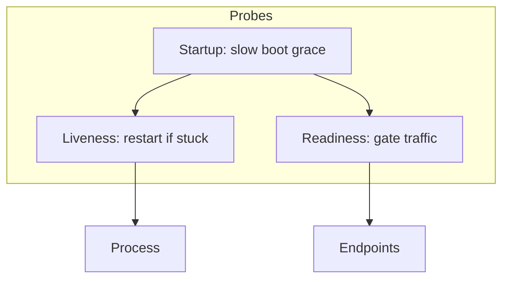
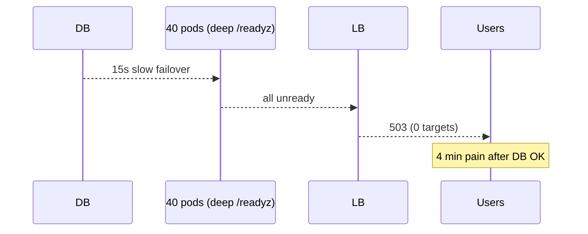
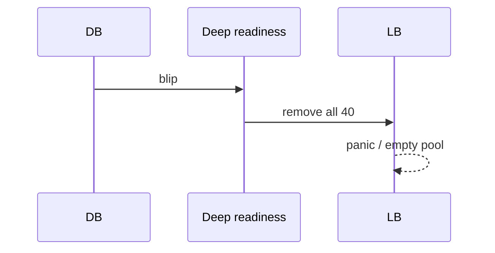

# Lesson 07: Health Checks — Liveness vs Readiness & Why Deep Checks Are Dangerous

> **Prerequisites:** [Lesson 06: Sticky Sessions & IP Hash](../06-sticky-sessions-ip-hash/README.md).  
> **Estimated Reading Time:** 30–35 minutes  
> **Target Audience:** Backend and platform engineers wiring LB and Kubernetes probes without cascading outages.  
> **Free PDF Notes:** [Download SD-G-007.pdf](https://backendroadmap.com/notes/system-design/SD-G-007.pdf)

> [!NOTE]
> **In one line:** Health checks decide which servers receive traffic. Use active probes plus passive outlier detection, separate **liveness** from **readiness**, keep liveness shallow, and be careful with deep checks of shared dependencies — they can take every server out at once.

> [!TIP]
> **The Golden Rule of Health Checks:** Health should answer “can **this instance** help?” — not “is the whole world perfect?” Fail open when too many hosts look bad (panic threshold).

---

## 1. Core Definition & Taxonomic Comparison

| Term | Precise Meaning | Production Example |
| :--- | :--- | :--- |
| **Active check** | LB probes `/health` on a schedule | ALB target health; HAProxy `httpchk` |
| **Passive / outlier** | Eject on real traffic errors/timeouts | Envoy outlier detection |
| **Liveness** | Process alive? Fail → **restart** | K8s `livenessProbe` → `/livez` |
| **Readiness** | Can serve now? Fail → **remove from rotation** | K8s `readinessProbe` → `/readyz` |
| **Startup probe** | Grace before other probes | Slow JVM / cache warm |
| **Panic / fail-open** | If too many unhealthy, send to all | Envoy panic threshold |

---

## 2. Component Breakdown, Anatomy & Observability Gap



| Depth | Checks | Risk |
| :--- | :--- | :--- |
| Shallow | Process returns 200 | Misses broken deps |
| Deep | Also queries DB/cache/deps | Shared dep blip → **all** instances fail |

> [!WARNING]
> **The Observability Gap:** LB “0 healthy targets” looks like an app outage while the real event was a **15 s DB blip**. Correlate readiness fail counts with dependency latency — and prefer **degraded responses** over mass removal.

---

## 3. Mathematical Model & Saturation

With probe period $T$, failure threshold $F$:

$$
t_{\text{detect}} \approx F \times T
$$

Example: $T=5\text{s}$, $F=2$ → ~10 s to go unready.

If each of $N$ instances independently fails readiness with probability $p$ during a shared dep blip (highly correlated in practice → $p\to 1$):

$$
P(\text{zero healthy}) \approx p^{N}_{\text{indep}} \quad\text{but correlated}\Rightarrow \approx 1
$$

| Interval | Threshold | Detect time | Flap risk |
| :--- | :--- | :--- | :--- |
| 10 s | 1 | ~10 s | High |
| 5 s | 2 | ~10 s | Medium |
| 10 s | 3 | ~30 s | Lower |

Aim for a few seconds + thresholds **2–3**.

---

## 4. Metrics, Percentiles & Distributions

| Metric | Use |
| :--- | :--- |
| Healthy host count | Panic / zero-target alert |
| Readiness fail rate | Warmup vs dep coupling |
| Outlier ejections | Passive-but-bad backends |
| Probe latency | Expensive `/health` smell |
| 503 during dep blips | Deep-check cascade |

---

## 5. Compounding Effects at Scale

$N=40$ pods, deep readiness on shared DB. DB failover 15 s slow queries → all fail readiness → LB **no targets** → users 503 for minutes **after** DB recovers (re-add needs rise threshold).

| Instances | Deep check on shared DB | Outcome on blip |
| :--- | :--- | :--- |
| 1 | Fails | Partial |
| 40 | All fail together | Total outage |

---

## 6. Numbers Every Backend Engineer Must Know

| Fact | Value |
| :--- | :--- |
| Typical period | Few seconds |
| Failure threshold | 2–3 (avoid flap) |
| Startup example | `failureThreshold: 30` × 5 s = 150 s |
| Cache warm example | Ready fails 40 s; live passes |
| Exclude `/livez` `/readyz` | From rate limits |

---

## 7. Protocol & Network Deep Dive

**Safe rollout:**

1. New pod starts; readiness fails while warming.
2. Service sends nothing until ready.
3. Joins rotation; old pod drains.
4. Later DB down → readiness may fail (if local) **without** killing the pod.



---

## 8. Hierarchical Budgets & Capacity Sizing

| Probe | Budget |
| :--- | :--- |
| Liveness | Process only — **no dependencies** |
| Readiness | Instance-local (warm cache, config); careful with shared deps |
| Shutdown | Fail readiness → drain → exit |
| Panic threshold | Fail open before zero targets |

---

## 9. Top Engineering Mitigation Techniques

1. Active + passive checks together.
2. Shallow liveness; scoped readiness.
3. Startup probe for slow boots.
4. Fail open / panic threshold.
5. Graceful shutdown: fail readiness first.
6. Cheap health endpoints, not rate-limited.

---

## 10. Production War Story (SEV-1 Post-Mortem)

**Impact:** Every instance checked the database in readiness. DB failover → 15 s slow queries → **all 40 instances** removed → **0 targets**, users 503 for **4 minutes** after DB recovered.



**Fix:** Remove DB from readiness; app returns degraded errors; enable panic threshold; dependency dashboards instead of coupling health.  
**Lesson:** Checks should reflect whether an instance can help, not whether the world is perfect.

---

## 11. Multi-Language Production Code

````carousel
```go
package health

import (
	"encoding/json"
	"net/http"
	"sync/atomic"
)

type State struct {
	CacheReady atomic.Bool
	Draining   atomic.Bool
}

func (s *State) Livez(w http.ResponseWriter, _ *http.Request) {
	_ = json.NewEncoder(w).Encode(map[string]bool{"ok": true})
}

func (s *State) Readyz(w http.ResponseWriter, _ *http.Request) {
	ok := s.CacheReady.Load() && !s.Draining.Load()
	if !ok {
		w.WriteHeader(http.StatusServiceUnavailable)
	}
	_ = json.NewEncoder(w).Encode(map[string]bool{"ready": ok})
}
```
<!-- slide -->
```typescript
export type HealthState = { cacheReady: boolean; draining: boolean };

export function livez(): { ok: true } {
  return { ok: true };
}

export function readyz(state: HealthState): { status: number; body: { ready: boolean } } {
  const ready = state.cacheReady && !state.draining;
  return { status: ready ? 200 : 503, body: { ready } };
}
```
<!-- slide -->
```python
from fastapi import FastAPI, Response

app = FastAPI()
state = {"cache_ready": False, "draining": False}

@app.get("/livez")
def livez():
    return {"ok": True}  # process up; no dependencies

@app.get("/readyz")
def readyz(resp: Response):
    ok = state["cache_ready"] and not state["draining"]
    if not ok:
        resp.status_code = 503
    return {"ready": ok}
```
<!-- slide -->
```csharp
public sealed class HealthState
{
    public bool CacheReady;
    public bool Draining;
}

public static class HealthEndpoints
{
    public static IResult Livez() => Results.Json(new { ok = true });

    public static IResult Readyz(HealthState state)
    {
        var ready = state.CacheReady && !state.Draining;
        return ready
            ? Results.Json(new { ready = true })
            : Results.Json(new { ready = false }, statusCode: 503);
    }
}
```
````

---

## 12. Hands-On CLI Verification Workflows

```bash
# Detect time budget
python -c "
for T,F in [(5,2),(10,3),(2,1)]:
 print(f'period={T}s thr={F} → detect≈{T*F}s')
"

# kubectl-shaped probe math: startup 30 * 5s
python -c "print('startup grace', 30*5, 'seconds')"
```

```yaml
livenessProbe:
  httpGet: { path: /livez, port: 8000 }
  periodSeconds: 10
  failureThreshold: 3
readinessProbe:
  httpGet: { path: /readyz, port: 8000 }
  periodSeconds: 5
  failureThreshold: 2
startupProbe:
  httpGet: { path: /livez, port: 8000 }
  failureThreshold: 30
  periodSeconds: 5
```

---

## 13. Common Mistakes to Avoid

- Deep checks that fail every instance when a shared dependency slows.
- Using liveness for slow startup → restart forever.
- Always-200 checks that hide real failure.
- Threshold of one → flapping.
- Expensive or rate-limited health endpoints.
- Not failing readiness before shutdown (drops in-flight requests).

---

## 14. Key Terms Glossary

| Term | Definition |
| :--- | :--- |
| **Active check** | LB probes an endpoint |
| **Passive check** | Judges real traffic (outlier detection) |
| **Liveness probe** | Is the process alive |
| **Readiness probe** | Can it serve traffic now |
| **Startup probe** | Grace period for slow starts |
| **Flapping** | Rapid healthy/unhealthy toggling |
| **Panic threshold** | Fail open when too many hosts look bad |
| **Outlier ejection** | Temporarily remove bad hosts |
| **Graceful shutdown** | Fail readiness, drain, stop |

---

## 15. Complete 12 System Design Interview Q&As

<details>
<summary><strong>Q1. Active versus passive health checks? [BASIC]</strong></summary>

Active probes call an endpoint on a schedule; passive checks watch real traffic and eject backends with too many errors.

</details>

<details>
<summary><strong>Q2. Liveness versus readiness? [BASIC]</strong></summary>

Liveness asks if the process is alive and restarts it if not; readiness asks if it can serve traffic and removes it from rotation without restarting.

</details>

<details>
<summary><strong>Q3. What is a startup probe? [BASIC]</strong></summary>

It gives a slow-starting app time before liveness and readiness begin.

</details>

<details>
<summary><strong>Q4. How often should you check? [BASIC]</strong></summary>

Every few seconds with thresholds of 2 or 3, balancing speed against flapping.

</details>

<details>
<summary><strong>Q5. Should a health check verify the database? [SCENARIO]</strong></summary>

Usually not for liveness, and only carefully for readiness, because the database is shared by every instance.

</details>

<details>
<summary><strong>Q6. All pods were removed during a database blip. Why? [SCENARIO]</strong></summary>

Deep readiness checks on a shared dependency failed everywhere. Make readiness local and degrade gracefully.

</details>

<details>
<summary><strong>Q7. A service needs 40 s to load a cache. [SCENARIO]</strong></summary>

Use readiness (or a startup probe) so traffic waits; do not let liveness restart it.

</details>

<details>
<summary><strong>Q8. A server is up but returns errors. [SCENARIO]</strong></summary>

Passive outlier detection ejects it; make the active check exercise a real path.

</details>

<details>
<summary><strong>Q9. What is fail open? [TRICKY]</strong></summary>

When too many hosts look unhealthy, send traffic to all of them instead of none, as Envoy’s panic threshold does.

</details>

<details>
<summary><strong>Q10. Why exclude health endpoints from rate limits? [TRICKY]</strong></summary>

Probes are frequent and from many sources; throttling them would mark healthy servers unhealthy.

</details>

<details>
<summary><strong>Q11. How do you shut down gracefully? [TRICKY]</strong></summary>

Fail readiness first, wait for the LB to stop sending traffic, finish in-flight requests, then exit.

</details>

<details>
<summary><strong>Q12. Why not make liveness deep? [TRICKY]</strong></summary>

A failing dependency would restart healthy processes, worsening the outage.

</details>

---

## 16. One-Page Master Cheat Sheet

```text
====================================================================================================
               HEALTH CHECKS (SD-G-007)  —  MASTER CHEAT SHEET
====================================================================================================
KINDS      Active probes + passive outlier detection
K8s        Liveness = restart · Readiness = gate traffic · Startup = slow boot grace
DEPTH      Liveness SHALLOW · Readiness local · shared-dep deep checks → total outage
MATH       detect ≈ period × failureThreshold · use thr 2–3
OPS        Fail open (panic) · cheap /health · exclude from rate limits · ready-fail then drain
ANTI       X always-200   X liveness for warmup   X DB in every readiness   X threshold=1
====================================================================================================
```

---

## Free PDF notes

[SD-G-007.pdf](https://backendroadmap.com/notes/system-design/SD-G-007.pdf)

---

## Sources

- [Kubernetes: Liveness, Readiness and Startup Probes](https://kubernetes.io/docs/tasks/configure-pod-container/configure-liveness-readiness-startup-probes/)
- [Envoy: Outlier detection](https://www.envoyproxy.io/docs/envoy/latest/intro/arch_overview/upstream/outlier)
- [Envoy: Panic threshold](https://www.envoyproxy.io/docs/envoy/latest/intro/arch_overview/upstream/load_balancing/panic_threshold)

---

## Next

Next: [Lesson 08: Service Discovery](../08-service-discovery/README.md). Track: [Load Balancing overview](../README.md).
