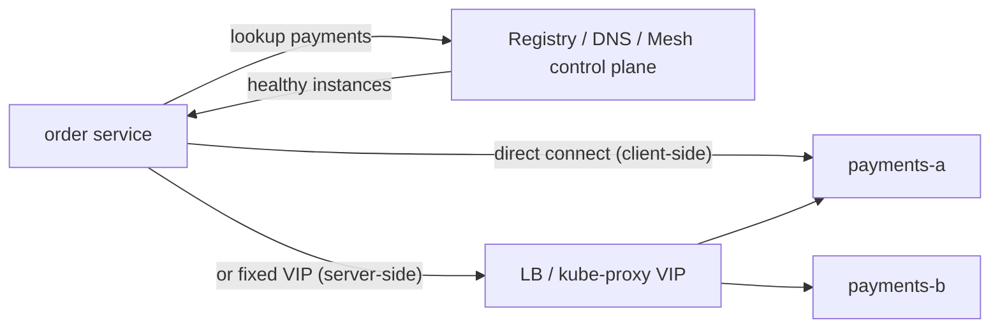
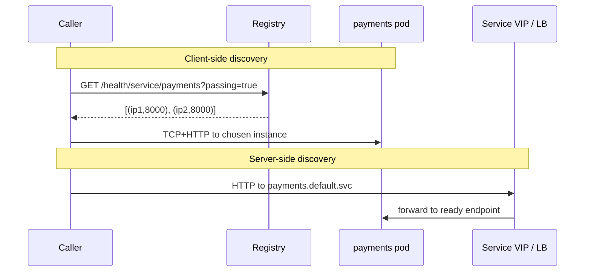

# Lesson 08: Service Discovery — Client-Side vs Server-Side, DNS & Kubernetes

> **Prerequisites:** [Lesson 07: Health Checks](../07-health-checks/README.md), [Lesson 01: Load Balancer Fundamentals](../01-load-balancer-fundamentals/README.md), and [Load Balancing Overview](../README.md) (Lesson 08 of 14).  
> **Estimated Reading Time:** 28–35 minutes  
> **Target Audience:** Backend and platform engineers wiring microservices whose IPs change on every deploy, choosing between client-side, server-side, DNS, and mesh discovery, and debugging stale endpoints after scaling events.  
> **Free PDF Notes:** [Download SD-G-008.pdf](https://backendroadmap.com/notes/system-design/SD-G-008.pdf) · [Phase 3 Notes (PDF)](https://backendroadmap.com/notes/system-design/Phase3_Notes.pdf)

> [!NOTE]
> **In one line:** service discovery keeps a live directory of healthy instances so callers can find them by name. Choose client-side, server-side, DNS, or a service mesh depending on where you want the lookup and balancing to happen.

> [!TIP]
> **The Golden Rule of Service Discovery:** Discovery is only as fresh as the **slowest cache** on the path—registry TTLs, DNS resolvers, JVM/runtime DNS caches, and long-lived connection pools. Prefer heartbeats plus health-gated registration, re-resolve on connection failure, cap connection lifetime, and never hard-code instance IPs.

---

## Words You'll Meet Today

| Word | In Plain Words | Role in a Live Backend System |
| :--- | :--- | :--- |
| **Service registry** | Live directory of healthy instance addresses. | Consul, etcd, Eureka, ZooKeeper, or Kubernetes Endpoints. |
| **Client-side discovery** | Caller queries the registry and picks an instance. | Eureka + Ribbon, gRPC xDS, Consul client—no middle hop. |
| **Server-side discovery** | Caller hits a fixed router/LB that looks up backends. | Kubernetes Service VIP, AWS ALB target groups. |
| **DNS TTL** | How long a resolver may cache an answer. | Stale A/SRV records keep dead IPs in rotation. |
| **Headless Service** | Kubernetes Service with `clusterIP: None`. | DNS returns pod IPs directly (StatefulSet peers). |
| **Heartbeat** | Periodic "I'm alive" signal to the registry. | Silent deaths get deregistered without waiting for deploy. |
| **Sidecar / mesh** | Proxy next to each pod with control-plane endpoints. | Istio/Linkerd: code calls a name; sidecar balances + mTLS. |
| **SRV record** | DNS record carrying host **and** port. | Useful when ports are dynamic, not just IPs. |

---

## Visual Mental Models & Architecture

### The Question: Why Can't We Hard-Code Payment Service Addresses?

The order service must call payments. Payments runs as twelve containers whose IPs change on every deploy, and autoscaling adds and removes them all day. Hard-coding addresses is impossible—services need a **live phone directory** for machines.

### Everyday Picture: A Company Directory That Updates Itself

Imagine a company badge system: when someone badges in, their desk phone number appears in the directory; when they leave or badge out, it disappears. Callers dial by name (`payments`), never by yesterday's extension. That is the registry.

### Registry Anatomy

```text
 payments #1 ──register/heartbeat──┐
 payments #2 ──register/heartbeat──┼──► Registry (Consul / etcd / Eureka / K8s API)
 payments #3 ──register/heartbeat──┘         ▲
                                             │ query healthy list
                                      order service
```

In Kubernetes, the API server and its Endpoints / EndpointSlice objects play the registry role; only **Ready** pods are included.



*Figure 1. Client-side picks an instance; server-side hits a stable VIP that spreads across ready backends.*

---

## Core Definition & Taxonomic Comparison

**Service discovery is the mechanism that maps a logical service name to the current set of healthy network endpoints.** Without it, every deploy and scale event becomes a manual host-file edit.

| Term | Precise Meaning | Production Example |
| :--- | :--- | :--- |
| **Client-side** vs **Server-side** | *Client-side:* caller queries registry and balances (P2C, RR). *Server-side:* caller dials a fixed address; router/LB queries registry. | Eureka client picks pods; K8s Service VIP hides pod IPs. |
| **DNS-based** vs **Registry API** | DNS returns A/AAAA/SRV answers (language-universal) but lags by TTL/caches. Registry APIs push or poll near-real-time. | Consul DNS vs Consul HTTP health API. |
| **ClusterIP Service** vs **Headless** | ClusterIP = stable VIP + kube-proxy/eBPF load balancing. Headless = DNS returns pod IPs. | Stateless API vs StatefulSet peer discovery. |
| **Mesh sidecar** vs **App library** | Mesh: policy in sidecar (retries, mTLS, LB). Library: balancing code in every language. | Istio VirtualService vs Netflix Ribbon. |

**Business impact.** Stale discovery sends traffic to dead or wrong IPs → intermittent `5xx`, connection errors, and—worst—wrong service when an IP is reused. Freshness and deregistration on shutdown are revenue-critical.

---

## Component Anatomy & The Observability Gap

### Anatomy of One Lookup

```text
 START → register(address,port,meta) → heartbeat loop
 CALLER → resolve("payments") → filter healthy → pick instance → connect
 STOP / crash → deregister (graceful) OR missed heartbeats (forced)
```

### Observability Gap: Where Discovery Metrics Lie

| Vantage Point | What It Captures | What It Hides |
| :--- | :--- | :--- |
| **Registry UI** (`consul members`) | Currently registered instances. | Client-side DNS/JVM caches still holding old IPs. |
| **Caller connection errors** | Failures to dial a target. | Whether the IP was correct at lookup time vs reused after recycle. |
| **DNS dig from laptop** | One resolver's answer right now. | Every runtime's private DNS cache (Golang `DefaultResolver`, JVM `networkaddress.cache.ttl`). |
| **K8s Endpoints ready count** | Pods passing readiness. | Clients that resolved before a pod became NotReady and kept the connection open. |
| **Metrics to add** | Registry size, heartbeat lag, DNS TTL histogram, connect-error rate **per target IP**, pool re-resolve count. | Nothing useful if you only watch overall error rate. |

**Operational rule:** treat "discovery healthy" as true only when **registry view + client re-resolve behavior + connection lifetime** all agree.

---

## Mathematical Model: Freshness Lag & Stale Hit Probability

If an instance dies at time $t_0$ and the slowest cache on the path has TTL $T$:

$$\text{worst-case stale window} \approx T_{\text{DNS}} + T_{\text{runtime}} + T_{\text{pool}}$$

Example: DNS TTL $60\text{s}$ + JVM infinite cache (effectively unbounded until restart) + pool holding connections $10\text{min}$ → **minutes of stale traffic**.

Probability that a random request after death still hits a stale endpoint (uniform over a window $W$):

$$P(\text{stale}) \approx \frac{\min(W, T_{\text{eff}})}{W}$$

| Cache layer | Typical $T$ | Architectural implication |
| :--- | :--- | :--- |
| Registry push / watch | $< 1\text{s}$ | Near-real-time (Consul, etcd watch, K8s informer) |
| Short DNS TTL | $5$–$30\text{s}$ | Acceptable for many services if clients re-resolve |
| Default DNS TTL | $60$–$300\text{s}$ | Failover feels "stuck" |
| Runtime DNS forever | $\infty$ | Classic JVM/pool trap—must configure |
| Sticky TCP pool | connection lifetime | Re-resolve on failure; cap `MaxConnAge` |

**Headroom rule:** for dynamic backends, aim for effective freshness $\le 5\text{–}15\text{s}$, or use a watch-based client/mesh.

---

## Metrics, Percentiles & Worked Example

| Metric | Who it describes | Alert idea |
| :--- | :--- | :--- |
| **Registry members healthy** | Fleet truth | Drop when $<$ min replicas |
| **Connect errors / target IP** | Stale or bad endpoint | Spike after scale-in → discovery lag |
| **DNS lookup p99** | Control-plane latency | Rarely the bottleneck vs stale answers |
| **Average "looks fine"** | Fleet mean | Hides one pod with reused IP |

**Worked example (the average lies):** 11 of 12 payments pods healthy. Mean "health" = $91.7\%$. But the caller's pool still holds the **one recycled IP** now owned by a debug sidecar. $8\%$ of checkout calls fail intermittently while dashboards look "mostly green."

---

## Compounding Effects at Scale

With $N$ downstream dependencies each resolved independently, probability that **at least one** resolution is stale:

$$P(\ge 1\text{ stale}) = 1 - (1 - p)^N$$

| $N$ deps | $p=0.01$ stale | $p=0.05$ stale |
| :--- | :--- | :--- |
| 1 | $1\%$ | $5\%$ |
| 5 | $5\%$ | $23\%$ |
| 10 | $10\%$ | $40\%$ |
| 20 | $18\%$ | $64\%$ |
| 50 | $39\%$ | $92\%$ |

Microservices with large fan-out feel discovery lag as **mysterious intermittent failures**, not clean outages.

---

## Numbers Every Backend Engineer Must Know

| Operation | Layer | Typical latency / behavior | Implication |
| :--- | :--- | :--- | :--- |
| etcd/Consul watch notify | Control plane | $\sim 10$–$100\text{ms}$ | Near-live endpoint updates |
| K8s EndpointSlice propagate | Cluster | $\sim 1$–$5\text{s}$ | Brief blackhole after pod delete |
| DNS with TTL $30\text{s}$ | Resolver | up to $30\text{s}$ stale | Too slow for aggressive scale-in |
| JVM DNS default (old) | Runtime | cache forever | Must set `networkaddress.cache.ttl` |
| TCP connect to dead IP | Network | $\sim 1$–$30\text{s}$ timeout | User-visible hang if pool keeps it |
| IP recycle in cloud | Infra | seconds–minutes | Stale IP may hit **wrong** service |

---

## Protocol & Network Deep Dive

### Client-Side vs Server-Side Sequence



### DNS Caveats

1. Resolvers cache until TTL expires—removed instances keep receiving traffic.
2. Some runtimes cache DNS forever unless configured.
3. Use short TTLs for dynamic services **and** clients that re-resolve on connection failure.
4. A service mesh combines both: sidecar does client-side work; your code makes a plain call.

---

## Hierarchical Budgets & Capacity Sizing

| Tier | Freshness / timeout budget | Notes |
| :--- | :--- | :--- |
| Registry HA | Quorum write $< 100\text{ms}$ p99 | Raft/Zab; clients cache last-known list |
| Lookup path | $< 50\text{ms}$ p99 | Prefer watches over polling every request |
| Connect timeout | $1$–$2\text{s}$ | Fail fast on stale IP |
| Connection max age | $30$–$120\text{s}$ | Forces re-resolve even if no error |
| Heartbeat interval | $5$–$10\text{s}$, miss $3\times$ | Deregister silent deaths |

Derive caller timeouts so a stale IP fails **before** the user-facing deadline expires.

---

## Top Engineering Mitigation Techniques

1. **Watch-based clients / mesh** — push endpoint updates instead of waiting on DNS TTL.
2. **Re-resolve on failure + MaxConnAge** — kill sticky stale sockets.
3. **Health-gated registration** — only Ready/passing instances enter the directory ([lesson 07](../07-health-checks/README.md)).
4. **Graceful deregister on SIGTERM** — remove before connections drain finishes.
5. **HA registry** — Raft quorum; never a single VM "Consul."
6. **Headless + StatefulSet** — stable per-pod DNS for stateful peers.

---

## Production War Story (SEV-1): Stale DNS + Connection Pool

**Severity & Impact:** Intermittent DB query failures for ~10 minutes after a replica replacement; customer checkout error rate spiked to `4%`. Detected via connect-error-by-target alerts; resolved after pod restarts.

**What Happened:** A service resolved a database replica set by DNS with a `60 s` TTL and a connection pool that cached the answer.

```python
# Anti-pattern: resolve once, pool forever
addrs = socket.getaddrinfo("db-replica.internal", 5432)  # cached by runtime
pool = create_pool(addrs[0])  # never re-resolves
```

```mermaid
sequenceDiagram
    participant App
    participant DNS
    participant OldIP as Old replica IP (recycled)
    participant NewSvc as Unrelated service now on IP

    App->>DNS: resolve db-replica (TTL 60s)
    DNS-->>App: 10.0.4.88
    Note over App: Pool holds 10.0.4.88 for 10 min
    Note over OldIP,NewSvc: Replica replaced; IP reused
    App->>OldIP: query via pooled connection
    OldIP-->>App: wrong service / RST / garbage
```

**RCA:** Discovery freshness limited by the **slowest** cache (pool lifetime ≫ DNS TTL). IP reuse made failures look "random."

**The Fix:**
1. Re-resolve DNS on connection failure; set max connection lifetime.
2. Move dynamic backends to a registry-aware client.
3. Alert on connection errors **per target address**.

---

## Multi-Language Production Code Tabs

Client-side discovery: fetch healthy instances from Consul, pick one (random / P2C-ready), and re-resolve when dialing fails.

````carousel
```go
package discovery

import (
	"encoding/json"
	"fmt"
	"math/rand"
	"net/http"
	"time"
)

type Instance struct {
	Address string
	Port    int
}

func HealthyInstances(consulURL, name string) ([]Instance, error) {
	client := &http.Client{Timeout: time.Second}
	resp, err := client.Get(fmt.Sprintf("%s/v1/health/service/%s?passing=true", consulURL, name))
	if err != nil {
		return nil, err
	}
	defer resp.Body.Close()
	var raw []struct {
		Service struct {
			Address string `json:"Address"`
			Port    int    `json:"Port"`
		} `json:"Service"`
	}
	if err := json.NewDecoder(resp.Body).Decode(&raw); err != nil {
		return nil, err
	}
	out := make([]Instance, 0, len(raw))
	for _, e := range raw {
		out = append(out, Instance{Address: e.Service.Address, Port: e.Service.Port})
	}
	return out, nil
}

func Pick(instances []Instance) (Instance, error) {
	if len(instances) == 0 {
		return Instance{}, fmt.Errorf("no healthy instances")
	}
	return instances[rand.Intn(len(instances))], nil
}
```
<!-- slide -->
```typescript
type Instance = { address: string; port: number };

export async function healthyInstances(
  consulUrl: string,
  name: string,
  signal?: AbortSignal
): Promise<Instance[]> {
  const res = await fetch(
    `${consulUrl}/v1/health/service/${encodeURIComponent(name)}?passing=true`,
    { signal }
  );
  if (!res.ok) throw new Error(`consul ${res.status}`);
  const raw = (await res.json()) as Array<{ Service: { Address: string; Port: number } }>;
  return raw.map((e) => ({ address: e.Service.Address, port: e.Service.Port }));
}

export function pick(instances: Instance[]): Instance {
  if (!instances.length) throw new Error("no healthy instances");
  return instances[Math.floor(Math.random() * instances.length)]!;
}
```
<!-- slide -->
```python
import random
import requests

def healthy_instances(consul_url: str, name: str) -> list[tuple[str, int]]:
    r = requests.get(
        f"{consul_url}/v1/health/service/{name}?passing=true",
        timeout=1,
    )
    r.raise_for_status()
    return [(e["Service"]["Address"], e["Service"]["Port"]) for e in r.json()]

def pick(instances: list[tuple[str, int]]) -> tuple[str, int]:
    if not instances:
        raise RuntimeError("no healthy instances")
    return random.choice(instances)

# Usage: addr, port = pick(healthy_instances("http://consul:8500", "payments"))
```
<!-- slide -->
```csharp
using System.Net.Http.Json;
using System.Text.Json.Serialization;

public sealed record Instance(string Address, int Port);

public static class ConsulDiscovery
{
    public static async Task<IReadOnlyList<Instance>> HealthyInstancesAsync(
        HttpClient http, string consulUrl, string name, CancellationToken ct = default)
    {
        var url = $"{consulUrl.TrimEnd('/')}/v1/health/service/{Uri.EscapeDataString(name)}?passing=true";
        var raw = await http.GetFromJsonAsync<List<ConsulEntry>>(url, ct)
                  ?? throw new InvalidOperationException("empty consul response");
        return raw.Select(e => new Instance(e.Service.Address, e.Service.Port)).ToList();
    }

    public static Instance Pick(IReadOnlyList<Instance> instances) =>
        instances.Count == 0
            ? throw new InvalidOperationException("no healthy instances")
            : instances[Random.Shared.Next(instances.Count)];

    private sealed class ConsulEntry
    {
        [JsonPropertyName("Service")] public ServiceInfo Service { get; set; } = new();
    }
    private sealed class ServiceInfo
    {
        [JsonPropertyName("Address")] public string Address { get; set; } = "";
        [JsonPropertyName("Port")] public int Port { get; set; }
    }
}
```
````

---

## Hands-On CLI Verification Workflows

### 1. Inspect Kubernetes Service endpoints

```bash
kubectl get svc payments -o wide
kubectl get endpointslices -l kubernetes.io/service-name=payments -o yaml
```

Only Ready pods should appear. Delete a pod and watch EndpointSlices drop it within seconds.

### 2. Dig cluster DNS (from a debug pod)

```bash
kubectl run -it --rm dig --image=busybox:1.36 --restart=Never -- \
  nslookup payments.default.svc.cluster.local
```

ClusterIP Service → one VIP. Headless (`clusterIP: None`) → multiple pod A records.

### 3. Simulate stale-cache math locally

```bash
python3 -c "N=10; p=0.05; print(1-(1-p)**N)"
```

Expected ≈ `0.40` — 40% chance at least one of ten deps is stale at $p=5\%$.

---

## Common Mistakes to Avoid

- Hard-coded IPs or manually edited host lists.
- Registry that is a single point of failure.
- Relying on DNS without understanding TTL **and** client caching.
- No health checks, so dead instances stay registered.
- Mixing discovery styles in one system without a plan.
- Forgetting to deregister on graceful shutdown.
- Connection pools that never re-resolve.

---

## Key Terms Glossary

| Term | Interview-ready definition |
| :--- | :--- |
| **Service registry** | Live directory of instances with address, port, and health. |
| **Client-side discovery** | Caller queries the registry and picks an instance itself. |
| **Server-side discovery** | Router/LB does the lookup; clients dial a fixed name/VIP. |
| **DNS TTL** | Maximum time resolvers may reuse an answer. |
| **SRV record** | DNS record that includes host and port. |
| **Headless Service** | K8s Service that returns pod IPs via DNS. |
| **kube-proxy / eBPF** | Programs Service routing on each node. |
| **Service mesh** | Sidecars + control plane for discovery, LB, retries, mTLS. |

---

## Interview Practice Questions

<details>
<summary><strong>1. What is service discovery? [BASIC]</strong></summary>

<strong>What a strong answer covers:</strong>
A way for services to find healthy instances of other services by name, using a registry, DNS, or a platform such as Kubernetes.
</details>

<details>
<summary><strong>2. Name some registries. [BASIC]</strong></summary>

<strong>What a strong answer covers:</strong>
Consul, etcd, ZooKeeper, Eureka, and Kubernetes Endpoints / EndpointSlices.
</details>

<details>
<summary><strong>3. Client-side versus server-side discovery? [BASIC]</strong></summary>

<strong>What a strong answer covers:</strong>
Client-side: the caller queries the registry and balances itself—no extra hop, but needs a per-language library. Server-side: the caller hits a router that does the lookup—simple clients, extra hop, router must be HA.
</details>

<details>
<summary><strong>4. What does a Kubernetes Service give you? [BASIC]</strong></summary>

<strong>What a strong answer covers:</strong>
A stable DNS name and virtual IP that kube-proxy (or eBPF) spreads across Ready pods. Clients never see pod IPs for a normal ClusterIP Service.
</details>

<details>
<summary><strong>5. Instances come and go constantly. How do callers stay up to date? [SCENARIO]</strong></summary>

<strong>What a strong answer covers:</strong>
Registry with heartbeats and health checks (or platform Endpoints), plus clients that refresh, re-resolve on failure, and cap connection lifetime—or a mesh that watches the control plane.
</details>

<details>
<summary><strong>6. DNS keeps returning removed instances. [SCENARIO]</strong></summary>

<strong>What a strong answer covers:</strong>
Lower TTLs, fix client/runtime caching, re-resolve on failure, or switch to a registry-aware client or mesh. Lesson: discovery freshness = slowest cache.
</details>

<details>
<summary><strong>7. Choose discovery for a polyglot company. [SCENARIO]</strong></summary>

<strong>What a strong answer covers:</strong>
Server-side (K8s Service, ALB) or mesh-based discovery so no per-language client library is required.
</details>

<details>
<summary><strong>8. Stateful pods need individual addresses. [SCENARIO]</strong></summary>

<strong>What a strong answer covers:</strong>
A headless Service returns each pod's IP, often with stable names through a StatefulSet (`pod-0.svc…`).
</details>

<details>
<summary><strong>9. Can the registry be a SPOF? [TRICKY]</strong></summary>

<strong>What a strong answer covers:</strong>
Yes. Run it clustered (Raft/Zab quorum) and let clients cache the last-known list so a brief registry outage does not halt all RPC.
</details>

<details>
<summary><strong>10. AP or CP registry? [TRICKY]</strong></summary>

<strong>What a strong answer covers:</strong>
Eureka favors availability and may serve stale data (AP). Consul, etcd, and ZooKeeper favor consistency (CP) via quorum.
</details>

<details>
<summary><strong>11. What does a mesh add over plain DNS? [TRICKY]</strong></summary>

<strong>What a strong answer covers:</strong>
Per-request balancing, retries, timeouts, mTLS, and metrics in the sidecar—policy in config, not application code.
</details>

<details>
<summary><strong>12. Is DNS discovery real-time? [TRICKY]</strong></summary>

<strong>What a strong answer covers:</strong>
No. It follows TTLs and resolver/runtime caches, so it lags behind instance changes. Treat it as eventually consistent unless you add watches or short TTL + aggressive re-resolve.
</details>

---

## One-Page Master Cheat Sheet

```text
====================================================================================================
                         SERVICE DISCOVERY  —  CHEAT SHEET (SD-G-008)
====================================================================================================
IN ONE LINE   Live directory of healthy instances; callers find them by name

PATTERNS      Client-side: caller queries + balances (Eureka, gRPC xDS)
              Server-side: fixed VIP/LB looks up (K8s Service, ALB)
              DNS-based: A/SRV answers — lags by TTL + client caches
              Mesh: sidecar does client-side work; app dials a name

KUBERNETES    Service = stable DNS + VIP; kube-proxy/eBPF spreads to Ready pods
              Headless (clusterIP: None) = DNS returns pod IPs (StatefulSet)

FRESHNESS     stale window ≈ DNS TTL + runtime cache + pool lifetime
              Re-resolve on failure · MaxConnAge · short TTL for dynamic backends

MATH          P(≥1 stale among N deps) = 1 − (1−p)^N

REGISTRY HA   Raft/Zab quorum; clients cache last-known list
HEARTBEATS    register on start, deregister on SIGTERM, miss N heartbeats → remove

OBSERVE       healthy count, connect errors per target IP, pool re-resolve rate
ANTI-PATTERNS X hard-coded IPs  X single-node registry  X DNS without TTL awareness
              X no health gating  X pools that never re-resolve  X skip deregister
====================================================================================================
```

---

## Free PDF notes

Download these notes as a printable PDF: [SD-G-008.pdf](https://backendroadmap.com/notes/system-design/SD-G-008.pdf).

---

## Sources

- [Chris Richardson — Pattern: Service Registry](https://microservices.io/patterns/service-registry.html)
- [Consul Docs — Service Discovery](https://developer.hashicorp.com/consul/docs/discovery/services)
- [Kubernetes Docs — Service](https://kubernetes.io/docs/concepts/services-networking/service/)
- [etcd Docs — Learning etcd](https://etcd.io/docs/)

---

## Next

Next comes [Lesson 09: Reverse Proxy Config in Production](../09-reverse-proxy-config-in-production/README.md): timeouts, buffering, bounded retries, and why defaults are not production settings. See [the track overview](../README.md) for the whole series.
