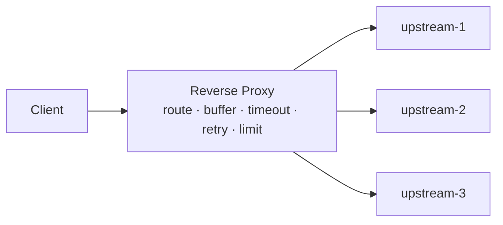
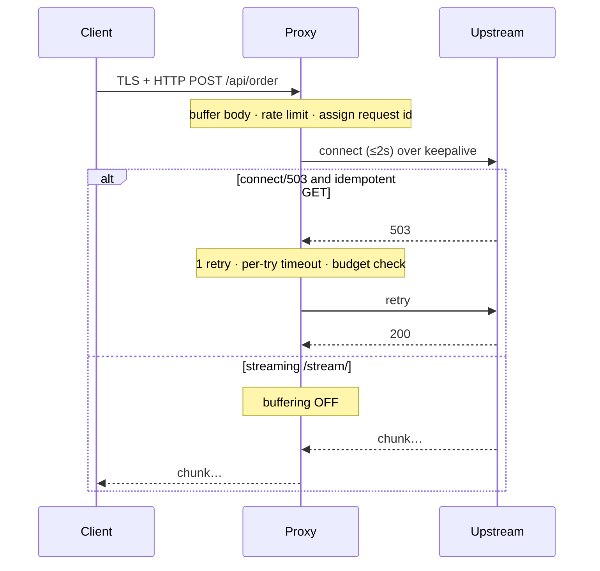
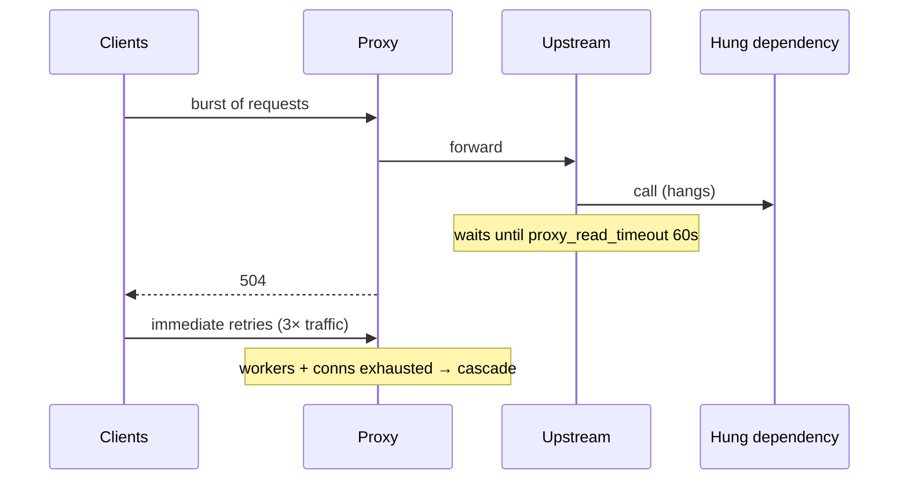

# Lesson 09: Reverse Proxy Config in Production — Timeouts, Retries, Buffering

> **Prerequisites:** [Lesson 08: Service Discovery](../08-service-discovery/README.md), [Lesson 02: Layer 4 vs Layer 7](../02-layer-4-vs-layer-7-load-balancing/README.md), and [Load Balancing Overview](../README.md) (Lesson 09 of 14).  
> **Estimated Reading Time:** 30–35 minutes  
> **Target Audience:** Backend and platform engineers shipping NGINX/Envoy/HAProxy in production, tuning timeouts and retries without causing storms, and protecting upstreams from slow clients and huge uploads.  
> **Free PDF Notes:** [Download SD-G-009.pdf](https://backendroadmap.com/notes/system-design/SD-G-009.pdf) · [Phase 3 Notes (PDF)](https://backendroadmap.com/notes/system-design/Phase3_Notes.pdf)

> [!NOTE]
> **In one line:** a reverse proxy is only as good as its config. Set routing, buffering, timeouts, bounded retries for idempotent requests, connection and rate limits, body-size limits, compression, and logging. Default timeouts are too long and unlimited retries can cause a storm.

> [!TIP]
> **The Golden Rule of Reverse Proxy Config:** Every timeout must be **shorter than the caller's timeout upstream of it**, and retries must be **bounded, idempotent-only, and budgeted**. Defaults (`60 s` read, unlimited `proxy_next_upstream`) are laptop settings—production adds slow clients, hung dependencies, and nested retry amplification ($3^3 = 27\times$).

---

## Words You'll Meet Today

| Word | In Plain Words | Role in a Live Backend System |
| :--- | :--- | :--- |
| **Reverse proxy** | Front-end server that accepts client requests and forwards to backends. | NGINX, Envoy, HAProxy terminate TLS, route, buffer, limit. |
| **Upstream** | Named pool of backend servers. | `upstream api { … }` / Envoy cluster. |
| **Buffering** | Proxy holds full request/response before forwarding. | Protects workers from slow clients; must be off for streaming. |
| **Connect timeout** | Max wait to establish upstream TCP. | `1–2 s` so dead backends fail fast. |
| **Read / response timeout** | Max wait for upstream bytes. | Fit slowest *normal* request—not the `60 s` default. |
| **Retry budget** | Cap on share of traffic that may be retries. | Keeps retries ≤ ~20% so outages do not amplify. |
| **Idempotent** | Safe to repeat without changing meaning. | GET, PUT with keys; not bare POST `/charge`. |
| **Circuit breaker** | Stops sending to a failing target. | Caps pending requests / consecutive 5xx. |

---

## Visual Mental Models & Architecture

### The Question: Why Did a 200 ms API Melt Behind a "Healthy" Proxy?

A proxy kept the default `60 s` read timeout in front of an API with `200 ms` normal latency. One hung dependency made every request wait a full minute, filled workers, and client retries tripled traffic until the proxy itself fell over.

### Everyday Picture: A Hotel Concierge

The reverse proxy is the concierge: guests never wander the back corridors. The concierge decides which desk handles the request, refuses endless waiting, will not re-ask the kitchen three times for a non-refundable order, and turns away guests who dump a truckload of luggage in the lobby (`client_max_body_size`).

```text
 client ──► reverse proxy (routing, limits, timeouts, TLS)
                │
                ▼
           upstream pool (healthy servers + keepalive)
```



*Figure 1. The proxy shields backends from slow clients, bad traffic, and cascading waits.*

---

## Core Definition & Taxonomic Comparison

**A reverse proxy sits in front of your servers and handles requests on their behalf.** It routes by host/path, picks a healthy upstream, and forwards. Production config turns that into a reliability boundary.

| Term | Precise Meaning | Production Example |
| :--- | :--- | :--- |
| **Reverse** vs **Forward** proxy | *Reverse:* inbound, fronts your servers. *Forward:* outbound, fronts clients leaving a network. | NGINX in front of API vs corporate egress proxy. |
| **Buffering on** vs **off** | On: absorb slow clients. Off: stream SSE/LLM tokens byte-by-byte. | `/api/` buffered; `/stream/` `proxy_buffering off`. |
| **Retry** vs **hedge** | Retry = sequential re-attempt after failure. Hedge = speculative parallel copy. | Retry `503` once; hedge rare for fan-out p99. |
| **Timeout budget** | Nested deadlines shrink inward. | Client `10 s` → gateway `8 s` → service `5 s` → DB `2 s`. |

**Business impact.** One mis-set timeout turns a single slow dependency into a fleet-wide outage. One unbounded retry policy turns a blip into a retry storm.

---

## Component Anatomy & The Observability Gap

### Anatomy of One Proxied Request

```text
 client → (TLS) → proxy accept
   → route by host/path → apply rate/body limits
   → buffer request (unless streaming)
   → pick upstream (least_conn / RR) via keepalive pool
   → connect ≤ 2s · read ≤ budget · optional 1 retry on connect/503
   → buffer or stream response → access log with upstream timing
```

### Observability Gap

| Vantage Point | What It Captures | What It Hides |
| :--- | :--- | :--- |
| **Proxy access log** (`upstream_response_time`) | Time waiting on backend. | Whether client already timed out and abandoned. |
| **Backend APM** | Handler duration. | Time spent in proxy queue / buffering before the request arrived. |
| **Client RUM** | End-to-end latency. | Which hop ate the budget (need `Server-Timing` / request IDs). |
| **Default metrics** | 5xx rate. | Retry amplification (`upstream_rq_retry` in Envoy). |
| **Metrics to add** | Connect timeouts, read timeouts, retry count, breaker opens, body-size rejects, keepalive reuse %. | CPU alone during a hang. |

**Operational rule:** every production proxy emits **request ID**, **upstream address**, and **connect/header/response timings**.

---

## Mathematical Model: Retry Amplification & Timeout Nesting

### Retry Multiplication Across Layers

If each of $L$ layers retries up to $R$ attempts (including the first try):

$$\text{worst-case fan-out} = R^{L}$$

| Layers $L$ | Attempts $R$ | Fan-out |
| :--- | :--- | :--- |
| 1 | 1 (no retry) | $1\times$ |
| 1 | 3 | $3\times$ |
| 2 | 3 | $9\times$ |
| 3 | 3 | $27\times$ |

**Rule:** retry at **one** layer; others fail fast or use budgets.

### Utilization While Waiting

With offered rate $\lambda$ and mean service $W$ including wait-on-timeout:

$$L = \lambda W \quad (\text{Little's Law})$$

If hung requests wait $W = 60\text{s}$ instead of $0.2\text{s}$, concurrency jumps $300\times$ for the same $\lambda$—pools and file descriptors exhaust long before CPU looks busy.

### Timeout Nesting

$$T_{\text{inner}} < T_{\text{outer}} - \text{slack}$$

Otherwise the caller gives up while inner work continues → wasted capacity + duplicate retries.

---

## Metrics, Percentiles & Worked Example

| Percentile | Who it describes | Proxy implication |
| :--- | :--- | :--- |
| **p50** | Typical healthy path | Often fine while p99 melts |
| **p95 / p99** | Tail users / SLOs | Size `proxy_read_timeout` from p99 + headroom, not from mean |
| **Timeout rate** | Hung upstreams | Rising timeouts with flat CPU → dependency hang |
| **Retry rate** | Amplification | >10–20% of requests retried → budget / breaker needed |

**Worked example:** Mean latency `200 ms`, but 1% hang until `60 s`. Among 10,000 requests: 9,900 × 0.2 s + 100 × 60 s → average $\approx 0.8\text{s}$—already 4×—while **concurrency** and FD usage track the hung tail, not the mean.

---

## Compounding Effects at Scale

Nested retries with $R=3$ at gateway, service, and DB driver:

$$P(\text{storm}) \propto R^{L} \times \text{failure fraction}$$

| Depth | Attempts | Relative load on failing leaf |
| :--- | :--- | :--- |
| 1 | 1 | $1\times$ |
| 1 | 3 | $3\times$ |
| 3 | 3 | $27\times$ |

During a partial outage, $27\times$ turns "10% of pods unhealthy" into "**270%** of normal traffic at the survivors."

---

## Numbers Every Backend Engineer Must Know

| Setting | Laptop default | Production guidance |
| :--- | :--- | :--- |
| Connect timeout | often `60 s` | `1–2 s` |
| Read timeout | `60 s` | Fit slowest normal request (e.g. `5–30 s`) |
| Client header/body idle | generous | `10–15 s` (cut Slowloris) |
| `proxy_next_upstream_tries` | unlimited risk | `2` (one retry) |
| Retry budget | none | ≤ ~20% of traffic |
| `client_max_body_size` | `1m` or unlimited | Explicit (e.g. `5–10m`) |
| Keepalive to upstream | off | `keepalive 32–128` |
| Streaming | buffering on | `proxy_buffering off` for SSE/LLM |

---

## Protocol & Network Deep Dive



**Buffering** protects app workers from slow clients but must be off for SSE and LLM token streams. **Keepalive** pools reuse upstream TCP/TLS so every API call does not pay a fresh handshake.

---

## Hierarchical Budgets & Capacity Sizing

| Tier | Timeout budget example | Notes |
| :--- | :--- | :--- |
| Browser / mobile | 15 s | User-visible |
| Edge / API gateway | 10 s | Slack for TLS + queue |
| Service reverse proxy | 8 s | `proxy_read_timeout` |
| Per-try (Envoy) | 2 s × ≤2 retries | Inside 6–8 s parent |
| Downstream RPC | 3–5 s | Shorter than proxy read |
| DB | 1–2 s | Innermost |

Derive: if gateway budget is $10\text{s}$ and you allow one retry with $2\text{s}$ per-try, parent route timeout ≈ $6\text{s}$ leaves room for scheduling.

---

## Top Engineering Mitigation Techniques

1. **Short connect + sized read timeouts** — fail fast on dead backends.
2. **Idempotent-only bounded retries** — `error/timeout/503`, `tries ≤ 2`, per-try timeout.
3. **Retry budgets + circuit breakers** — cap amplification.
4. **Request buffering + client timeouts** — free workers from slow phones.
5. **Disable buffering on stream paths** — correct SSE/LLM behavior.
6. **Body size, rate, connection limits** — protect memory and noisy neighbors.
7. **Upstream keepalive + request IDs** — efficiency and traceability.

---

## Production War Story (SEV-1): Default 60 s Timeouts

**Severity & Impact:** Full API brownout ~18 minutes; error budget burned for the month. Detection via rising upstream timeouts + FD exhaustion.

**What Happened:** Default `60 s` read timeout; hung dependency; workers filled; clients retried.

```nginx
# Anti-pattern
location /api/ {
    proxy_pass http://api;
    # proxy_read_timeout defaults to 60s
    # proxy_next_upstream unlimited-ish retries on error
}
```



**RCA:** Unbounded waiting + nested retries converted a slow dependency into a full outage (queueing collapse).

**The Fix:**
1. `proxy_read_timeout 5s`; per-try timeouts below client budget.
2. Cap retries with budget + circuit breaking.
3. Alert on upstream timeouts and proxy queue depth.

---

## Multi-Language Production Code Tabs

Policy helpers: validate timeout nesting, allow retries only for safe methods, and enforce a simple retry budget.

````carousel
```go
package proxypolicy

import (
	"fmt"
	"strings"
	"sync/atomic"
)

type Budgets struct {
	OuterMs, InnerMs, PerTryMs int
	MaxRetries                 int
}

func ValidateNesting(b Budgets) error {
	if b.InnerMs >= b.OuterMs {
		return fmt.Errorf("inner %dms must be < outer %dms", b.InnerMs, b.OuterMs)
	}
	need := b.PerTryMs * (b.MaxRetries + 1)
	if need > b.InnerMs {
		return fmt.Errorf("per-try×attempts %dms exceeds inner %dms", need, b.InnerMs)
	}
	return nil
}

func IdempotentMethod(method string) bool {
	switch strings.ToUpper(method) {
	case "GET", "HEAD", "PUT", "DELETE", "OPTIONS":
		return true
	default:
		return false
	}
}

type RetryBudget struct {
	MaxPct int64
	total  atomic.Int64
	retried atomic.Int64
}

func (r *RetryBudget) Allow() bool {
	t := r.total.Add(1)
	if t < 100 {
		return true
	}
	return (r.retried.Load()*100)/t < r.MaxPct
}

func (r *RetryBudget) RecordRetry() { r.retried.Add(1) }
```
<!-- slide -->
```typescript
export type Budgets = {
  outerMs: number;
  innerMs: number;
  perTryMs: number;
  maxRetries: number;
};

export function validateNesting(b: Budgets): void {
  if (b.innerMs >= b.outerMs) {
    throw new Error(`inner ${b.innerMs}ms must be < outer ${b.outerMs}ms`);
  }
  const need = b.perTryMs * (b.maxRetries + 1);
  if (need > b.innerMs) {
    throw new Error(`per-try×attempts ${need}ms exceeds inner ${b.innerMs}ms`);
  }
}

const IDEMPOTENT = new Set(["GET", "HEAD", "PUT", "DELETE", "OPTIONS"]);

export function canRetry(method: string, status: number): boolean {
  if (!IDEMPOTENT.has(method.toUpperCase())) return false;
  return status === 502 || status === 503 || status === 504;
}

export class RetryBudget {
  constructor(private maxPct: number) {}
  private total = 0;
  private retried = 0;
  allow(): boolean {
    this.total += 1;
    if (this.total < 100) return true;
    return (this.retried * 100) / this.total < this.maxPct;
  }
  recordRetry(): void {
    this.retried += 1;
  }
}
```
<!-- slide -->
```python
from dataclasses import dataclass
from threading import Lock

IDEMPOTENT = frozenset({"GET", "HEAD", "PUT", "DELETE", "OPTIONS"})

@dataclass(frozen=True)
class Budgets:
    outer_ms: int
    inner_ms: int
    per_try_ms: int
    max_retries: int

def validate_nesting(b: Budgets) -> None:
    if b.inner_ms >= b.outer_ms:
        raise ValueError(f"inner {b.inner_ms}ms must be < outer {b.outer_ms}ms")
    need = b.per_try_ms * (b.max_retries + 1)
    if need > b.inner_ms:
        raise ValueError(f"per-try×attempts {need}ms exceeds inner {b.inner_ms}ms")

def can_retry(method: str, status: int) -> bool:
    return method.upper() in IDEMPOTENT and status in {502, 503, 504}

class RetryBudget:
    def __init__(self, max_pct: int = 20) -> None:
        self.max_pct = max_pct
        self.total = 0
        self.retried = 0
        self._lock = Lock()

    def allow(self) -> bool:
        with self._lock:
            self.total += 1
            if self.total < 100:
                return True
            return (self.retried * 100) / self.total < self.max_pct

    def record_retry(self) -> None:
        with self._lock:
            self.retried += 1
```
<!-- slide -->
```csharp
public sealed record Budgets(int OuterMs, int InnerMs, int PerTryMs, int MaxRetries);

public static class ProxyPolicy
{
    private static readonly HashSet<string> Idempotent = new(StringComparer.OrdinalIgnoreCase)
        { "GET", "HEAD", "PUT", "DELETE", "OPTIONS" };

    public static void ValidateNesting(Budgets b)
    {
        if (b.InnerMs >= b.OuterMs)
            throw new InvalidOperationException($"inner {b.InnerMs}ms must be < outer {b.OuterMs}ms");
        var need = b.PerTryMs * (b.MaxRetries + 1);
        if (need > b.InnerMs)
            throw new InvalidOperationException($"per-try×attempts {need}ms exceeds inner {b.InnerMs}ms");
    }

    public static bool CanRetry(string method, int status) =>
        Idempotent.Contains(method) && status is 502 or 503 or 504;
}

public sealed class RetryBudget
{
    private long _total, _retried;
    private readonly int _maxPct;
    private readonly object _gate = new();
    public RetryBudget(int maxPct = 20) => _maxPct = maxPct;

    public bool Allow()
    {
        lock (_gate)
        {
            _total++;
            if (_total < 100) return true;
            return (_retried * 100) / _total < _maxPct;
        }
    }

    public void RecordRetry() { lock (_gate) { _retried++; } }
}
```
````

### Production-minded NGINX sketch

```nginx
upstream api {
    least_conn;
    server 10.0.1.11:8000 max_fails=3 fail_timeout=10s;
    server 10.0.1.12:8000 max_fails=3 fail_timeout=10s;
    keepalive 64;
}
limit_req_zone $binary_remote_addr zone=perip:10m rate=20r/s;
server {
    listen 443 ssl http2;
    client_max_body_size 5m;
    client_header_timeout 10s;
    client_body_timeout 15s;
    gzip on; gzip_types application/json text/css;
    location /api/ {
        limit_req zone=perip burst=40 nodelay;
        proxy_pass http://api;
        proxy_http_version 1.1;
        proxy_set_header Connection "";
        proxy_connect_timeout 2s;
        proxy_read_timeout 15s;
        proxy_next_upstream error timeout http_503;
        proxy_next_upstream_tries 2;
        proxy_set_header X-Request-Id $request_id;
    }
    location /stream/ { proxy_pass http://api; proxy_buffering off; }
}
```

---

## Hands-On CLI Verification Workflows

### 1. Prove connect timeout fails fast

```bash
# Dead IP should fail in ~2s if connect timeout is set (example with curl --connect-timeout)
curl -sS -o /dev/null -w "code:%{http_code} time:%{time_total}\n" --connect-timeout 2 http://203.0.113.1:9/ || true
```

### 2. Check retry amplification math

```bash
python3 -c "print('3 layers × 3 attempts =', 3**3, 'x')"
```

### 3. Inspect timing breakdown against a live edge

```bash
curl -sS -o /dev/null -w "dns:%{time_namelookup} tcp:%{time_connect} tls:%{time_appconnect} ttfb:%{time_starttransfer} total:%{time_total}\n" https://example.com/
```

---

## Common Mistakes to Avoid

- Keeping default `60 s` timeouts.
- Retrying non-idempotent requests (`POST` payments) without idempotency keys.
- Unlimited or nested retries that multiply load.
- Buffering streaming responses.
- No body size limit → huge uploads exhaust memory.
- Not setting keepalive to upstreams.
- Inner timeouts longer than outer caller deadlines.

---

## Key Terms Glossary

| Term | Interview-ready definition |
| :--- | :--- |
| **Reverse proxy** | Server in front of backends that routes, terminates TLS, buffers, and limits. |
| **Upstream** | Named group of backend servers. |
| **Retry budget** | Cap on the fraction of traffic that may be retries. |
| **Circuit breaker** | Stops sending to targets that are clearly failing. |
| **Keepalive pool** | Reused upstream connections. |
| **Retry storm** | Retries amplifying load during an outage. |

---

## Interview Practice Questions

<details>
<summary><strong>1. What is a reverse proxy? [BASIC]</strong></summary>

<strong>What a strong answer covers:</strong>
A server in front of backends that accepts client requests, routes them to upstreams, and returns responses; it adds routing, TLS, buffering, and limits.
</details>

<details>
<summary><strong>2. Why buffer requests? [BASIC]</strong></summary>

<strong>What a strong answer covers:</strong>
So slow clients do not occupy backend workers; the proxy absorbs the slow transfer. Turn buffering off for streaming.
</details>

<details>
<summary><strong>3. Which timeouts should you set? [BASIC]</strong></summary>

<strong>What a strong answer covers:</strong>
Connect, read/response, and client header/body/idle timeouts—each shorter than the caller's timeout upstream of it.
</details>

<details>
<summary><strong>4. What should you configure in production? [BASIC]</strong></summary>

<strong>What a strong answer covers:</strong>
Routing, buffering, timeouts, bounded retries for idempotent requests, connection/rate/body limits, compression, and logging with request IDs.
</details>

<details>
<summary><strong>5. Why not leave the defaults? [SCENARIO]</strong></summary>

<strong>What a strong answer covers:</strong>
Default timeouts are too long and retries can multiply load, so a slow dependency can take down everything.
</details>

<details>
<summary><strong>6. Stream LLM tokens through NGINX. [SCENARIO]</strong></summary>

<strong>What a strong answer covers:</strong>
Disable proxy buffering for that location, use HTTP/1.1 or HTTP/2, and set long enough read timeouts for the stream duration.
</details>

<details>
<summary><strong>7. Prevent a retry storm. [SCENARIO]</strong></summary>

<strong>What a strong answer covers:</strong>
Retry only idempotent calls, cap attempts, per-try timeout, ~20% retry budget, jittered backoff, circuit breaker, and retry at one layer only.
</details>

<details>
<summary><strong>8. A slow client ties up workers. [SCENARIO]</strong></summary>

<strong>What a strong answer covers:</strong>
Enable request buffering and client timeouts, or put an event-driven proxy in front so workers are not blocked on slow networks.
</details>

<details>
<summary><strong>9. Why must inner timeouts be shorter than outer ones? [TRICKY]</strong></summary>

<strong>What a strong answer covers:</strong>
Otherwise the caller gives up while inner work continues, wasting capacity and causing duplicate retries when the client retries the whole call.
</details>

<details>
<summary><strong>10. Is retrying a POST safe? [TRICKY]</strong></summary>

<strong>What a strong answer covers:</strong>
Only with an idempotency key (or equivalent dedupe); otherwise it can create duplicate charges or orders.
</details>

<details>
<summary><strong>11. How does a retry budget work? [TRICKY]</strong></summary>

<strong>What a strong answer covers:</strong>
It limits retries to a fraction of recent requests so under failure retries stay bounded instead of doubling or tripling load.
</details>

<details>
<summary><strong>12. Reverse proxy versus forward proxy? [TRICKY]</strong></summary>

<strong>What a strong answer covers:</strong>
A reverse proxy fronts servers for inbound client requests; a forward proxy fronts clients for outbound requests (egress).
</details>

---

## One-Page Master Cheat Sheet

```text
====================================================================================================
                    REVERSE PROXY CONFIG  —  CHEAT SHEET (SD-G-009)
====================================================================================================
IN ONE LINE   Defaults ≠ production: timeouts, bounded retries, limits, buffering policy

TIMEOUTS      Connect 1–2s · Read = slowest normal + headroom · Client idle short
              Inner < Outer always (nested deadline budget)

RETRIES       Idempotent only · tries≤2 · per-try timeout · budget ~20% · one layer
              Fan-out = R^L  (3^3 = 27×)

BUFFERING     ON for APIs (protect workers) · OFF for SSE / LLM streams
LIMITS        rate · connections · client_max_body_size · circuit breaker
KEEPALIVE     upstream keepalive pools · HTTP/1.1 Connection "" clear
LOGS          X-Request-Id · upstream_addr · upstream_response_time

ANTI-PATTERNS X 60s defaults  X retry POST  X nested unlimited retries
              X buffer streams  X no body limit  X no upstream keepalive
====================================================================================================
```

---

## Free PDF notes

Download these notes as a printable PDF: [SD-G-009.pdf](https://backendroadmap.com/notes/system-design/SD-G-009.pdf).

---

## Sources

- [NGINX Docs — ngx_http_proxy_module](https://nginx.org/en/docs/http/ngx_http_proxy_module.html)
- [Envoy Docs — Retries & Circuit Breaking](https://www.envoyproxy.io/docs/envoy/latest/configuration/http/http_filters/router_filter#x-envoy-retry-on)
- [Google SRE Book — Handling Overload](https://sre.google/sre-book/handling-overload/)

---

## Next

Next comes [Lesson 10: Load Shedding & Traffic Shaping](../10-load-shedding-traffic-shaping/README.md): how to reject some work on purpose so critical work survives Black Friday. See [the track overview](../README.md).
