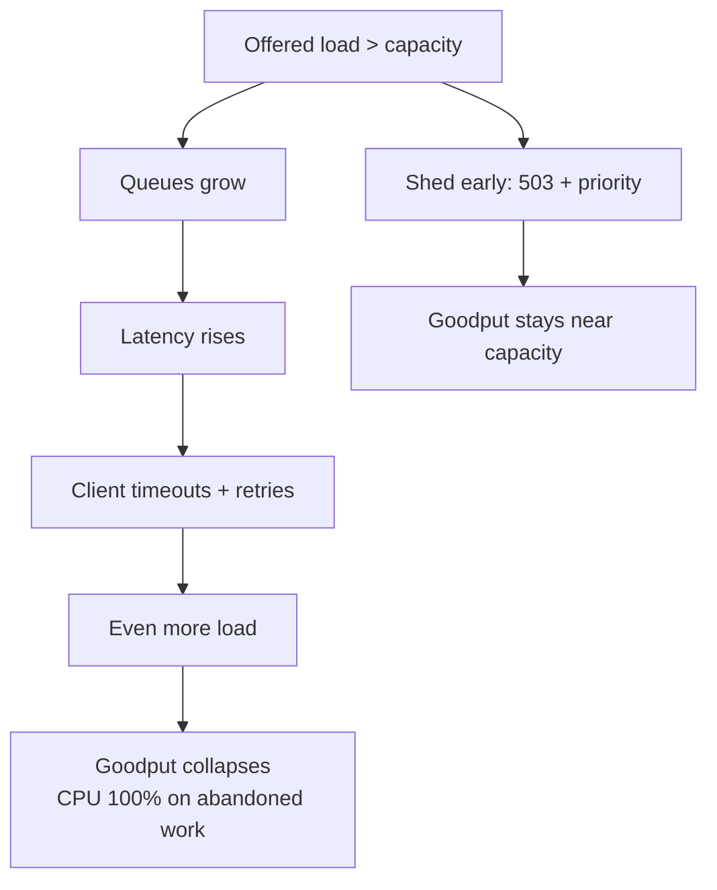
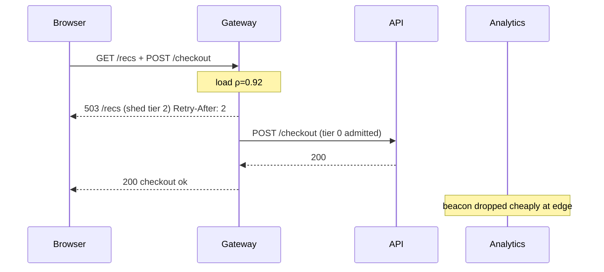

# Lesson 10: Load Shedding & Traffic Shaping — Survive Overload (Black Friday)

> **Prerequisites:** [Lesson 09: Reverse Proxy Config in Production](../09-reverse-proxy-config-in-production/README.md), [Lesson 01: Load Balancer Fundamentals](../01-load-balancer-fundamentals/README.md), and [Load Balancing Overview](../README.md) (Lesson 10 of 14).  
> **Estimated Reading Time:** 28–35 minutes  
> **Target Audience:** Backend engineers and SREs preparing for traffic peaks, designing admission control and priority tiers, and explaining why accepting everything under overload collapses goodput.  
> **Free PDF Notes:** [Download SD-G-010.pdf](https://backendroadmap.com/notes/system-design/SD-G-010.pdf) · [Phase 3 Notes (PDF)](https://backendroadmap.com/notes/system-design/Phase3_Notes.pdf)

> [!NOTE]
> **In one line:** under overload, accepting everything makes everything fail. Shed load early with fast rejections, prioritize critical traffic, cap in-flight work and queues, use adaptive concurrency limits, and make clients back off with jitter.

> [!TIP]
> **The Golden Rule of Load Shedding:** A fast `503`/`429` with `Retry-After` is kinder than a slow nothing. Prefer **admission control at the edge**, shed analytics before checkout, prefer **newest-first** under overload (old requests are abandoned), and never run unbounded queues into a peak you have not load-tested.

---

## Words You'll Meet Today

| Word | In Plain Words | Role in a Live Backend System |
| :--- | :--- | :--- |
| **Load shedding** | Deliberately rejecting excess work early. | Fast `503` so accepted work still finishes. |
| **Admission control** | Decide before accepting work. | In-flight caps, queue limits, waiting rooms. |
| **Goodput** | Useful completed throughput (not just CPU busy). | Collapses when servers work for departed clients. |
| **Adaptive concurrency** | Limit that shrinks when latency rises. | Like TCP congestion control for RPCs. |
| **Priority tier** | Importance class of a request. | Checkout > search > analytics. |
| **Retry-After** | Header telling clients when to retry. | Turns stampede into staggered return. |
| **Retry budget** | Cap on retry share of traffic. | Stops clients from doubling load. |
| **Waiting room** | Queue in front of a hot flow. | Ticket on-sales, flash checkout. |

---

## Visual Mental Models & Architecture

### The Question: Why Does 2× Traffic Yield 0.3× Useful Throughput?

When a server gets more work than it can do, requests wait in queues. Latency grows, clients time out and retry, and retries add more load. The server spends its time on requests whose clients have already given up. Throughput collapses even though CPU is at 100%.

### Everyday Picture: A Restaurant at Capacity

A restaurant does not seat everyone and serve nothing. It turns some guests away at the door so those inside get food. Load shedding is the same: reject some requests early and cheaply so the rest still succeed.

```text
 overload → queues grow → latency ↑ → timeouts + retries → extra load → collapse (wasted work)
```



*Figure 1. The overload spiral versus intentional shedding.*

---

## Core Definition & Taxonomic Comparison

**Load shedding rejects excess work early with a cheap error so the system keeps useful throughput near capacity.** Traffic shaping (rate limits, queues, backoff) reduces the chance of reaching that cliff.

| Term | Precise Meaning | Production Example |
| :--- | :--- | :--- |
| **Load shedding** vs **Rate limiting** | Shedding protects the **server** when total demand exceeds capacity. Rate limits cap **each client** fairly. | Drop `/track` at 80% load vs 100 req/s per API key. |
| **Admission control** vs **Backpressure** | Admission = refuse at the door. Backpressure = slow producers (queues, TCP window). | Gateway `503` vs Kafka consumer lag. |
| **Goodput** vs **Throughput** | Goodput = completions clients still care about. Throughput can be busywork. | Processing timed-out carts ≠ revenue. |
| **Static limit** vs **Adaptive** | Fixed concurrency vs limit that follows latency. | Semaphore(200) vs Netflix concurrency-limits. |

**Business impact (Black Friday):** Shedding analytics while protecting checkout keeps revenue flowing; accepting everything can zero purchases while CPUs scream.

---

## Component Anatomy & The Observability Gap

### Anatomy of Admission

```text
 request → classify priority → measure load (inflight / queue / p99)
        → admit? → yes: process · no: 503/429 + Retry-After (cheap)
```

### Priority Tiers

| Tier | Examples | Under pressure |
| :--- | :--- | :--- |
| **Critical (0)** | checkout, payments, login | Protect to the end |
| **Important (1)** | search, product pages | Shed second |
| **Sheddable (2)** | analytics beacons, recommendations, prefetch | Shed first |

### Observability Gap

| Vantage Point | What It Captures | What It Hides |
| :--- | :--- | :--- |
| **CPU %** | Busy cores. | Queue time; abandoned-request waste. |
| **RPS accepted** | Offered work taken. | Whether clients already left (goodput). |
| **Error rate** | Includes intentional `503`s. | Need SLO by **priority tier**. |
| **Metrics to add** | In-flight, queue depth, shed count by tier, goodput, p99 latency, Retry-After compliance. | "Green CPU" during collapse. |

---

## Mathematical Model: Goodput Under Overload

Let capacity be $C$ useful completions/s. Without shedding, as offered load $\lambda$ grows past $C$, queues and retries drive **goodput** $G$ down:

$$G(\lambda) \xrightarrow{\lambda \gg C} 0 \quad \text{(congestion collapse)}$$

With shedding that admits at most $C$:

$$G(\lambda) \approx \min(\lambda, C)$$

| Offered load | With shedding | Without shedding (illustrative) |
| :--- | :--- | :--- |
| $1.0\times C$ | $\approx 1000$ | $\approx 1000$ |
| $2.0\times C$ | $\approx 1000$ | $\approx 300$ |
| $3.0\times C$ | $\approx 1000$ | $\to$ collapse |

**Priority admit rule (load $\rho$ as fraction of capacity):**

$$\text{admit}(p,\rho) = \rho < L_p \quad L_0{=}1.20,\; L_1{=}0.95,\; L_2{=}0.80$$

Tier 2 sheds first; critical traffic can briefly use headroom.

---

## Metrics, Percentiles & Worked Example

| Signal | Role under overload |
| :--- | :--- |
| **Queue depth / age** | Best early warning |
| **In-flight concurrency** | Direct admission knob |
| **p99 latency** | Drives adaptive limits |
| **Shed rate by tier** | Proves policy works |
| **Checkout success %** | Business goodput |

**Worked example:** Capacity $1000$ rps. At $2000$ rps with no shedding, mean queue wait hits $40\text{s}$; browsers time out at $30\text{s}$; servers finish work nobody receives → useful purchases near zero until a hard restart clears the backlog.

---

## Compounding Effects at Scale

Retries without jitter synchronize clients:

$$N_{\text{retry wave}} \approx N_{\text{clients}} \quad \text{at the same instant}$$

With full jitter over backoff $B$:

$$\text{instantaneous rate} \approx \frac{N}{B}$$

| Clients | Immediate retry | Jitter over $2\text{s}$ |
| :--- | :--- | :--- |
| 10,000 | 10,000 at $t_0$ | ~5,000/s spread |

Nested client + gateway retries multiply further ($R^L$).

---

## Numbers Every Backend Engineer Must Know

| Concept | Number / rule |
| :--- | :--- |
| Reject cost vs process cost | `503` ≪ full handler + DB |
| Retry-After | `1–5 s` typical for shed |
| Retry budget | ≤ 10–20% |
| Critical headroom | Keep ~20% for tier 0 |
| LIFO / newest-first | Prefer under overload |
| Test before peak | Chaos/load test shedding paths |

---

## Protocol & Network Deep Dive



Clients must honor `Retry-After`, use exponential backoff with **full jitter**, and keep a retry budget.

---

## Hierarchical Budgets & Capacity Sizing

| Layer | Control | Budget idea |
| :--- | :--- | :--- |
| Edge / waiting room | Cap entries to purchase flow | Protect origin from stampede |
| Gateway | Priority shed + concurrency limit | Reject before app CPU |
| Service | Semaphore / adaptive concurrency | Last line of defense |
| Downstream | Timeouts shorter inward | Don't hold seats for dead callers |
| Clients | Backoff + budget | Cooperative recovery |

---

## Top Engineering Mitigation Techniques

1. **Shed early and cheaply** at the edge (`503`/`429` + `Retry-After`).
2. **Priority tiers** — protect checkout/login; shed analytics first.
3. **Cap in-flight + queue size** — never wait forever.
4. **Adaptive concurrency** — shrink limits when latency rises (Netflix / Envoy).
5. **Newest-first under overload** — old requests are likely abandoned.
6. **Client cooperation** — jittered backoff, retry budgets.
7. **Waiting rooms** for flash sales.

---

## Production War Story (SEV-1): Accept Everything On-Sale

**Severity & Impact:** Ticketing on-sale; purchases failed for ~25 minutes; recovery required turning the service off to clear backlog.

**What Happened:** Site accepted every request. Queues reached `40 s` delay; browsers timed out and users mashed refresh; servers processed requests nobody was waiting for.

```mermaid
sequenceDiagram
    participant Users
    participant Site
    participant Queue

    Users->>Site: 5× peak traffic
    Site->>Queue: enqueue everything
    Note over Queue: age → 40s
    Users->>Users: timeout + refresh
    Site->>Site: process abandoned work
    Note over Site: goodput → ~0; hard restart needed
```

**RCA:** Unbounded queues + synchronized retries → congestion collapse.

**The Fix:**
1. Admission control with queue cap and `503` + `Retry-After`.
2. Virtual waiting room in front of purchase flow.
3. Priority for payment calls over browsing.

---

## Multi-Language Production Code Tabs

Concurrency-limit shedding with priority-aware admission and full-jitter backoff.

````carousel
```go
package shedding

import (
	"math/rand"
	"net/http"
	"sync"
	"time"
)

var priority = map[string]int{"/checkout": 0, "/search": 1, "/track": 2, "/recs": 2}
var limits = map[int]float64{0: 1.20, 1: 0.95, 2: 0.80}

func Admit(path string, load float64) bool {
	p, ok := priority[path]
	if !ok {
		p = 1
	}
	return load < limits[p]
}

type Limiter struct {
	limit int
	n     int
	mu    sync.Mutex
}

func (l *Limiter) Acquire() bool {
	l.mu.Lock()
	defer l.mu.Unlock()
	if l.n >= l.limit {
		return false
	}
	l.n++
	return true
}

func (l *Limiter) Release() {
	l.mu.Lock()
	l.n--
	l.mu.Unlock()
}

func ShedMiddleware(limit int) func(http.Handler) http.Handler {
	l := &Limiter{limit: limit}
	return func(next http.Handler) http.Handler {
		return http.HandlerFunc(func(w http.ResponseWriter, r *http.Request) {
			if !l.Acquire() {
				w.Header().Set("Retry-After", "1")
				http.Error(w, "busy", http.StatusServiceUnavailable)
				return
			}
			defer l.Release()
			next.ServeHTTP(w, r)
		})
	}
}

func SleepFullJitter(attempt int, base, capDur time.Duration) {
	max := base * time.Duration(1<<attempt)
	if max > capDur {
		max = capDur
	}
	time.Sleep(time.Duration(rand.Int63n(int64(max) + 1)))
}
```
<!-- slide -->
```typescript
const PRIORITY: Record<string, number> = { "/checkout": 0, "/search": 1, "/track": 2, "/recs": 2 };
const LIMITS: Record<number, number> = { 0: 1.2, 1: 0.95, 2: 0.8 };

export function admit(path: string, load: number): boolean {
  const p = PRIORITY[path] ?? 1;
  return load < (LIMITS[p] ?? 0.95);
}

export class Limiter {
  private n = 0;
  constructor(private limit: number) {}
  tryAcquire(): boolean {
    if (this.n >= this.limit) return false;
    this.n += 1;
    return true;
  }
  release(): void {
    this.n = Math.max(0, this.n - 1);
  }
}

export async function withBackoff<T>(
  fn: () => Promise<T>,
  tries = 5,
  baseMs = 200,
  capMs = 5000
): Promise<T> {
  for (let i = 0; i < tries; i++) {
    try {
      return await fn();
    } catch {
      const max = Math.min(capMs, baseMs * 2 ** i);
      await new Promise((r) => setTimeout(r, Math.random() * max));
    }
  }
  throw new Error("retries exhausted");
}
```
<!-- slide -->
```python
import asyncio
import random
import time
from fastapi import Request
from fastapi.responses import JSONResponse

PRIORITY = {"/checkout": 0, "/search": 1, "/track": 2, "/recs": 2}
LIMITS = {0: 1.20, 1: 0.95, 2: 0.80}

def admit(path: str, load: float) -> bool:
    p = PRIORITY.get(path, 1)
    return load < LIMITS[p]

LIMIT = asyncio.Semaphore(200)

async def shed_middleware(request: Request, call_next):
    if LIMIT.locked():
        return JSONResponse({"error": "busy"}, status_code=503, headers={"Retry-After": "2"})
    async with LIMIT:
        return await call_next(request)

def call_with_backoff(fn, tries=5, base=0.2, cap=5.0):
    for i in range(tries):
        try:
            return fn()
        except Exception:
            time.sleep(random.uniform(0, min(cap, base * 2**i)))  # full jitter
    raise RuntimeError("retries exhausted")
```
<!-- slide -->
```csharp
public static class Shedding
{
    private static readonly Dictionary<string, int> Priority = new()
    {
        ["/checkout"] = 0, ["/search"] = 1, ["/track"] = 2, ["/recs"] = 2
    };
    private static readonly Dictionary<int, double> Limits = new()
    {
        [0] = 1.20, [1] = 0.95, [2] = 0.80
    };

    public static bool Admit(string path, double load)
    {
        var p = Priority.GetValueOrDefault(path, 1);
        return load < Limits[p];
    }
}

public sealed class ConcurrencyLimiter
{
    private readonly SemaphoreSlim _sem;
    public ConcurrencyLimiter(int limit) => _sem = new(limit, limit);

    public async Task<bool> TryEnterAsync(TimeSpan wait = default)
        => await _sem.WaitAsync(wait);

    public void Exit() => _sem.Release();
}

public static class Backoff
{
    public static async Task<T> WithFullJitterAsync<T>(Func<Task<T>> fn, int tries = 5,
        double baseSec = 0.2, double capSec = 5)
    {
        for (var i = 0; i < tries; i++)
        {
            try { return await fn(); }
            catch
            {
                var max = Math.Min(capSec, baseSec * Math.Pow(2, i));
                await Task.Delay(TimeSpan.FromSeconds(Random.Shared.NextDouble() * max));
            }
        }
        throw new InvalidOperationException("retries exhausted");
    }
}
```
````

---

## Hands-On CLI Verification Workflows

### 1. Goodput thought experiment

```bash
python3 -c "C=1000; print('shed@2C', C); print('collapse illustrative', 300)"
```

### 2. Full jitter spread

```bash
python3 -c "import random; print(sorted(random.uniform(0,2) for _ in range(5)))"
```

### 3. Curl a shed response shape

```bash
curl -sS -D - -o /dev/null -X GET https://httpbin.org/status/503 | head -n 15
```

Expect `503`; in production also assert `Retry-After`.

---

## Common Mistakes to Avoid

- Unbounded queues.
- Retrying immediately without jitter.
- Shedding critical traffic with low-value traffic.
- Not testing overload behavior before the peak.
- Measuring CPU only, not queue time and latency.
- Slow rejections that still consume resources.
- Counting intentional `503`s against undifferentiated SLOs.

---

## Key Terms Glossary

| Term | Interview-ready definition |
| :--- | :--- |
| **Load shedding** | Reject excess work early to protect capacity. |
| **Admission control** | Check capacity before accepting work. |
| **Goodput** | Useful completed throughput. |
| **Adaptive concurrency** | Limit that follows latency like TCP. |
| **Waiting room** | Controlled queue in front of a hot flow. |

---

## Interview Practice Questions

<details>
<summary><strong>1. How do you keep a system alive under overload? [BASIC]</strong></summary>

<strong>What a strong answer covers:</strong>
Shed load early with fast rejections, prioritize critical traffic, cap in-flight requests and queues, use adaptive concurrency limits, and have clients back off with jitter.
</details>

<details>
<summary><strong>2. Why not just accept everything? [BASIC]</strong></summary>

<strong>What a strong answer covers:</strong>
Queues grow, requests time out, retries add load, and useful throughput collapses for everyone.
</details>

<details>
<summary><strong>3. What is load shedding? [BASIC]</strong></summary>

<strong>What a strong answer covers:</strong>
Deliberately rejecting some requests with a quick error to protect capacity for the rest.
</details>

<details>
<summary><strong>4. What is admission control? [BASIC]</strong></summary>

<strong>What a strong answer covers:</strong>
Checking capacity before accepting work, using in-flight caps and queue limits.
</details>

<details>
<summary><strong>5. Black Friday traffic is 5×. What do you do first? [SCENARIO]</strong></summary>

<strong>What a strong answer covers:</strong>
Shed sheddable tiers (analytics), degrade features, protect checkout with priority, scale out, and use a waiting room if needed.
</details>

<details>
<summary><strong>6. Clients hammer a struggling service with retries. [SCENARIO]</strong></summary>

<strong>What a strong answer covers:</strong>
Return `503` with `Retry-After`, require exponential backoff with jitter, and cap retries with a budget.
</details>

<details>
<summary><strong>7. Choose a concurrency limit. [SCENARIO]</strong></summary>

<strong>What a strong answer covers:</strong>
Start from load-tested capacity, then use adaptive limits driven by latency.
</details>

<details>
<summary><strong>8. CPU is low but latency high. [SCENARIO]</strong></summary>

<strong>What a strong answer covers:</strong>
I/O wait or queueing; limit concurrency and inspect downstream dependencies—not just CPU autoscaling.
</details>

<details>
<summary><strong>9. Why serve newest requests first under overload? [TRICKY]</strong></summary>

<strong>What a strong answer covers:</strong>
Older ones have likely timed out; serving them is wasted work that steals capacity from live users.
</details>

<details>
<summary><strong>10. Does a 503 hurt reliability metrics? [TRICKY]</strong></summary>

<strong>What a strong answer covers:</strong>
It counts as an error, but protects overall availability and goodput; define SLOs by priority tier.
</details>

<details>
<summary><strong>11. Rate limiting versus load shedding? [TRICKY]</strong></summary>

<strong>What a strong answer covers:</strong>
Rate limits cap each client fairly; shedding protects the server when total demand exceeds capacity.
</details>

<details>
<summary><strong>12. How does adaptive concurrency resemble TCP? [TRICKY]</strong></summary>

<strong>What a strong answer covers:</strong>
It increases the limit while latency is flat and decreases it when latency rises—congestion control for in-flight RPCs.
</details>

---

## One-Page Master Cheat Sheet

```text
====================================================================================================
                 LOAD SHEDDING & TRAFFIC SHAPING  —  CHEAT SHEET (SD-G-010)
====================================================================================================
IN ONE LINE   Reject some work early so critical work survives; goodput > busy CPU

SPIRAL        overload → queues → latency → timeouts/retries → collapse
FIX           shed early (503/429 + Retry-After) · priority tiers · cap inflight/queues

PRIORITY      0 checkout/login  1 search  2 analytics/recs (shed first)
ADAPTIVE      shrink concurrency when p99 rises (TCP-like)
CLIENTS       full jitter backoff · retry budget · honor Retry-After
SERVE         newest-first under overload (abandon old work)

MATH          with shed: G≈min(λ,C)   without: G→0 as λ≫C

ANTI-PATTERNS X unbounded queues  X sync retries  X shed checkout with beacons
              X CPU-only signals  X untested peak behavior
====================================================================================================
```

---

## Free PDF notes

Download these notes as a printable PDF: [SD-G-010.pdf](https://backendroadmap.com/notes/system-design/SD-G-010.pdf).

---

## Sources

- [Google SRE Book — Handling Overload](https://sre.google/sre-book/handling-overload/)
- [Netflix — concurrency-limits](https://github.com/Netflix/concurrency-limits)
- [Envoy — Adaptive Concurrency](https://www.envoyproxy.io/docs/envoy/latest/configuration/http/http_filters/adaptive_concurrency_filter)

---

## Next

Next comes [Lesson 11: Global Server Load Balancing](../11-global-server-load-balancing/README.md): GSLB, anycast, and regional failover. See [the track overview](../README.md).
