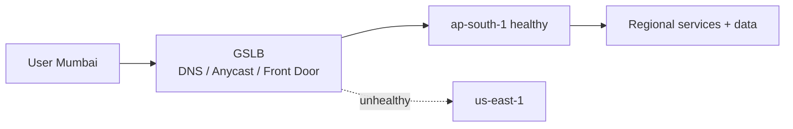
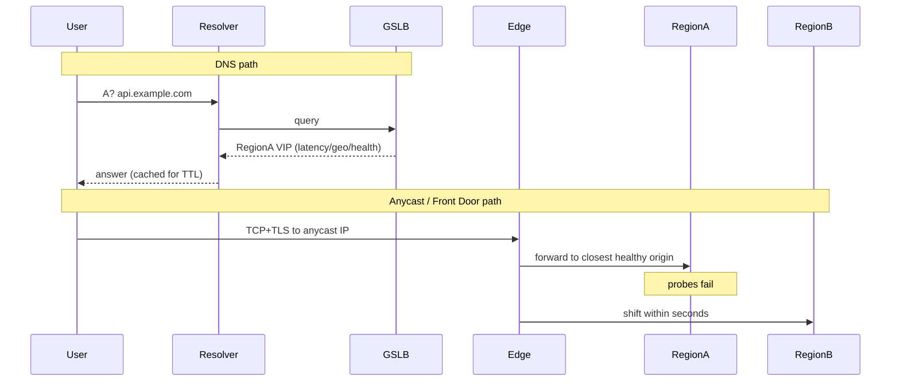
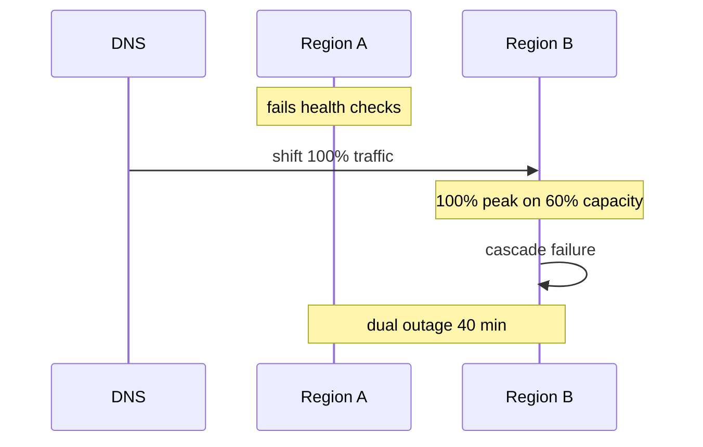

# Lesson 11: Global Server Load Balancing — GSLB, Anycast & Regional Failover

> **Prerequisites:** [Lesson 10: Load Shedding & Traffic Shaping](../10-load-shedding-traffic-shaping/README.md), [Lesson 08: Service Discovery](../08-service-discovery/README.md), and [Load Balancing Overview](../README.md) (Lesson 11 of 14).  
> **Estimated Reading Time:** 30–35 minutes  
> **Target Audience:** Backend and platform engineers designing multi-region APIs, choosing DNS vs anycast steering, sizing N−1 regional capacity, and respecting data-residency constraints.  
> **Free PDF Notes:** [Download SD-G-011.pdf](https://backendroadmap.com/notes/system-design/SD-G-011.pdf) · [Phase 3 Notes (PDF)](https://backendroadmap.com/notes/system-design/Phase3_Notes.pdf)

> [!NOTE]
> **In one line:** a GSLB chooses which region serves each user—by location, latency, health, load, and data-residency rules. Use DNS-based routing (simple, limited by TTL) or anycast (fast failover). Remember capacity in the surviving regions, and where the data lives.

> [!TIP]
> **The Golden Rule of GSLB:** Failover only works if survivors can carry the load **and** serve the data. Size for N−1 (with 3 regions, each ≈ 50% of peak), stage shifts to avoid failover storms, and never route EU personal data out of the EU just because another region is 20 ms faster.

---

## Words You'll Meet Today

| Word | In Plain Words | Role in a Live Backend System |
| :--- | :--- | :--- |
| **GSLB** | Global server load balancer above regional LBs. | Picks region before any regional balancer sees the request. |
| **Geo routing** | Choose region by user/resolver location. | Data residency, regional content. |
| **Latency routing** | Choose lowest measured latency region. | Best performance when law allows. |
| **Anycast** | Same IP announced from many places. | BGP steers to nearest edge; failover in seconds. |
| **TTL** | DNS cache lifetime. | Bounds how fast DNS failover completes. |
| **Data residency** | Legal rules on where data may live. | Constrains routing independently of latency. |
| **Home region** | Region holding a user's authoritative data. | Writes may must go home or replicate first. |
| **Failover storm** | Mass shift overloading survivors. | Stage traffic; shed; warm capacity. |

---

## Visual Mental Models & Architecture

### Why Go Multi-Region?

1. **Latency:** Mumbai → Virginia ≈ `200 ms` RTT per round trip.
2. **Availability:** A single region outage should not take everyone offline.
3. **Data rules:** Some users' data must stay in a given geography.

### Everyday Picture: Airline Hubs

A GSLB is an airline hub system: send each traveler to the nearest working airport; if one closes, reroute to the next best—**only if that airport has gates and the passenger's bags (data) can get there**.

```text
 User (Mumbai) → GSLB (DNS or anycast) → regional LB → services in closest healthy region
```



*Figure 1. Global layer above regional load balancers.*

---

## Core Definition & Taxonomic Comparison

**A global server load balancer decides which region or data center serves each user**, considering location, health, load, and legal rules.

| Term | Precise Meaning | Production Example |
| :--- | :--- | :--- |
| **DNS GSLB** vs **Anycast** | DNS answers differ by policy but cache by TTL. Anycast uses one IP; BGP fails over in seconds. | Route 53 latency policy vs Cloudflare anycast. |
| **Geo** vs **Latency** vs **Weighted** vs **Failover** | Location / measured RTT / % split / primary→secondary. | GDPR geo; performance; canary migrate; DR. |
| **GSLB** vs **CDN** | GSLB steers to dynamic origins; CDN caches at edge—many products do both. | Front Door origin routing vs static asset POP cache. |
| **Edge terminate** vs **Regional only** | Edge terminates TLS near user, proxies over backbone. | Azure Front Door / Cloudflare → origin region. |

---

## Component Anatomy & The Observability Gap

### DNS-Based Routing

User resolver asks for your domain; GSLB answers with the IP of the chosen region (Route 53, Azure Traffic Manager).

| Policy | Chooses | Use for |
| :--- | :--- | :--- |
| **Geo** | Region by location | Data residency, regional content |
| **Latency** | Lowest measured latency | Best performance |
| **Weighted** | Percentage splits | Migrations, canaries |
| **Failover** | Primary → secondary on health fail | Disaster recovery |

**Catch:** DNS caching—failover waits for TTL; some resolvers ignore low TTLs. Geo sees **resolver** location, not always the user (EDNS Client Subnet helps but is not universal).

### Anycast

Every region/edge announces the same IP; internet routing carries each user to the nearest PoP. Route withdrawal shifts traffic within seconds—no DNS cache wait.

### Observability Gap

| Vantage Point | Captures | Hides |
| :--- | :--- | :--- |
| **DNS query logs** | Which answer was given. | Resolvers still serving old TTL answers. |
| **Regional RPS** | Where traffic landed. | Whether shift was staged or a storm. |
| **Single health check** | One probe path. | False flaps from one broken monitor network. |
| **Metrics to add** | Multi-location health, per-region capacity headroom, failover shift %, residency violations, RUM latency by geo. | "DNS looks updated" from one laptop `dig`. |

---

## Mathematical Model: N−1 Regional Capacity

To survive losing one of $N$ equal regions while still serving 100% of peak $P$:

$$\text{capacity per region} \ge \frac{P}{N-1}$$

| Regions $N$ | Per-region share of peak | Notes |
| :--- | :--- | :--- |
| 2 | $100\%$ | Each must hold full peak |
| 3 | $50\%$ | Classic N−1 |
| 4 | $\approx 33\%$ | Still need warm capacity + data |

**Failover storm:** if each region is sized only for its steady share ($P/N$), losing one overloads survivors:

$$\text{load on survivor} = \frac{P}{N-1} > \frac{P}{N}\times\text{provisioned}$$

---

## Metrics, Percentiles & Worked Example

| Metric | Why |
| :--- | :--- |
| RUM p95 by metro | Validates latency routing |
| Health probe success from ≥3 locations | Avoid false failover |
| Per-region CPU/RPS headroom | Predict storm risk |
| DNS TTLremaining estimates | Bound failover SLA |

**Worked example:** Two regions each at 60% of global peak. Region A fails → B receives 100% on 60% capacity → B fails too → 40 minutes dual outage. Fix: size for full peak or planned shedding + staged shift (50% then rest).

---

## Compounding Effects at Scale

DNS failover delay ≈ effective TTL across resolvers (often tens of seconds to minutes even if you set TTL=10).

$$T_{\text{DNS failover}} \gtrsim \text{TTL}_{\text{configured}} \times \text{resolver obedience factor}$$

Anycast / global HTTP proxy: $T_{\text{failover}} \sim$ seconds (probe interval + BGP).

| Technique | Failover speed | Note |
| :--- | :--- | :--- |
| DNS-based | TTL-bound | Simple, any backend |
| Anycast | Seconds | Needs provider/network control |
| Global HTTP proxy | Seconds | Rules, WAF, caching |

---

## Numbers Every Backend Engineer Must Know

| Fact | Number |
| :--- | :--- |
| Mumbai↔Virginia RTT | ~200 ms |
| DNS TTL "low" ignored | many resolvers floor ~30–60 s |
| Anycast shift | seconds |
| 3-region N−1 size | 50% peak each |
| Staged failover | 25→50→100% |

---

## Protocol & Network Deep Dive



Many products combine them: **anycast at the edge**, DNS for finer policy.

---

## Hierarchical Budgets & Capacity Sizing

| Concern | Budget / plan |
| :--- | :--- |
| Latency SLO | Prefer regional stack within residency rules |
| Failover RTO | DNS vs anycast choice |
| Capacity | N−1 sizing + shed plan |
| Data | Replication lag ≤ RPO; promotion runbook |
| Shift | Staged weights to avoid storms |

---

## Top Engineering Mitigation Techniques

1. **Multi-location health probes** with hysteresis—no single-flap failover.
2. **N−1 capacity** or explicit load shedding on failover.
3. **Staged traffic shift** (50% then 100%).
4. **Geo rules for residency** even when another region is faster.
5. **Anycast or global proxy** when DNS TTL is too slow.
6. **Weighted DNS** for gradual region migrations.
7. **Game-day failover** with real traffic fractions.

---

## Production War Story (SEV-1): Failover Storm

**Severity & Impact:** Both regions down ~40 minutes after Region A failure.

**What Happened:** Two regions each sized at 60% of global peak. DNS shifted 100% to B; B melted; total outage.



**RCA:** Failover planned for routing, not for survivor capacity.

**The Fix:** Size each region for full peak **or** planned shedding; practice staged shifts in game days.

---

## Multi-Language Production Code Tabs

Health-aware region picker with N−1 capacity check and staged weight helper (control-plane style).

````carousel
```go
package gslb

import "fmt"

type Region struct {
	Name            string
	Healthy         bool
	CapacityPeakPct float64 // provisioned as fraction of global peak
	LatencyMs       float64
	ResidencyOK     bool
}

func Pick(regions []Region, needResidency bool) (Region, error) {
	var best *Region
	for i := range regions {
		r := &regions[i]
		if !r.Healthy || (needResidency && !r.ResidencyOK) {
			continue
		}
		if best == nil || r.LatencyMs < best.LatencyMs {
			best = r
		}
	}
	if best == nil {
		return Region{}, fmt.Errorf("no eligible region")
	}
	return *best, nil
}

func SurvivesOneFailure(regions []Region) bool {
	healthyCap := 0.0
	for _, r := range regions {
		if r.Healthy {
			healthyCap += r.CapacityPeakPct
		}
	}
	// After losing the largest healthy region, remaining ≥ 1.0 peak?
	max := 0.0
	for _, r := range regions {
		if r.Healthy && r.CapacityPeakPct > max {
			max = r.CapacityPeakPct
		}
	}
	return healthyCap-max >= 1.0-1e-9
}

func StageWeights(from, to string, pct int) map[string]int {
	if pct < 0 {
		pct = 0
	}
	if pct > 100 {
		pct = 100
	}
	return map[string]int{from: 100 - pct, to: pct}
}
```
<!-- slide -->
```typescript
export type Region = {
  name: string;
  healthy: boolean;
  capacityPeakPct: number;
  latencyMs: number;
  residencyOk: boolean;
};

export function pick(regions: Region[], needResidency: boolean): Region {
  const eligible = regions.filter((r) => r.healthy && (!needResidency || r.residencyOk));
  if (!eligible.length) throw new Error("no eligible region");
  return eligible.reduce((a, b) => (a.latencyMs <= b.latencyMs ? a : b));
}

export function survivesOneFailure(regions: Region[]): boolean {
  const healthy = regions.filter((r) => r.healthy);
  const total = healthy.reduce((s, r) => s + r.capacityPeakPct, 0);
  const max = Math.max(0, ...healthy.map((r) => r.capacityPeakPct));
  return total - max >= 1;
}

export function stageWeights(from: string, to: string, pct: number): Record<string, number> {
  const p = Math.max(0, Math.min(100, pct));
  return { [from]: 100 - p, [to]: p };
}
```
<!-- slide -->
```python
from dataclasses import dataclass

@dataclass
class Region:
    name: str
    healthy: bool
    capacity_peak_pct: float
    latency_ms: float
    residency_ok: bool

def pick(regions: list[Region], need_residency: bool) -> Region:
    eligible = [
        r for r in regions
        if r.healthy and (r.residency_ok if need_residency else True)
    ]
    if not eligible:
        raise RuntimeError("no eligible region")
    return min(eligible, key=lambda r: r.latency_ms)

def survives_one_failure(regions: list[Region]) -> bool:
    healthy = [r for r in regions if r.healthy]
    total = sum(r.capacity_peak_pct for r in healthy)
    max_cap = max((r.capacity_peak_pct for r in healthy), default=0.0)
    return total - max_cap >= 1.0

def stage_weights(frm: str, to: str, pct: int) -> dict[str, int]:
    pct = max(0, min(100, pct))
    return {frm: 100 - pct, to: pct}
```
<!-- slide -->
```csharp
public sealed record Region(string Name, bool Healthy, double CapacityPeakPct,
    double LatencyMs, bool ResidencyOk);

public static class Gslb
{
    public static Region Pick(IEnumerable<Region> regions, bool needResidency)
    {
        var eligible = regions.Where(r => r.Healthy && (!needResidency || r.ResidencyOk)).ToList();
        if (eligible.Count == 0) throw new InvalidOperationException("no eligible region");
        return eligible.OrderBy(r => r.LatencyMs).First();
    }

    public static bool SurvivesOneFailure(IEnumerable<Region> regions)
    {
        var healthy = regions.Where(r => r.Healthy).ToList();
        var total = healthy.Sum(r => r.CapacityPeakPct);
        var max = healthy.Count == 0 ? 0 : healthy.Max(r => r.CapacityPeakPct);
        return total - max >= 1.0;
    }

    public static Dictionary<string, int> StageWeights(string from, string to, int pct)
    {
        pct = Math.Clamp(pct, 0, 100);
        return new Dictionary<string, int> { [from] = 100 - pct, [to] = pct };
    }
}
```
````

Terraform-shaped Route 53 latency record (from the PDF):

```hcl
resource "aws_route53_record" "api_us" {
  zone_id        = var.zone
  name           = "api.example.com"
  type           = "A"
  set_identifier = "us-east"
  latency_routing_policy { region = "us-east-1" }
  health_check_id = aws_route53_health_check.us.id
  alias {
    name                   = aws_lb.us.dns_name
    zone_id                = aws_lb.us.zone_id
    evaluate_target_health = true
  }
}
```

---

## Hands-On CLI Verification Workflows

### 1. Dig from different resolvers (coarse geo)

```bash
dig +short api.example.com @8.8.8.8
dig +short api.example.com @1.1.1.1
```

### 2. N−1 math

```bash
python3 -c "P=1.0; N=3; print('each region >=', P/(N-1))"
```

### 3. Measure cross-region RTT

```bash
curl -sS -o /dev/null -w "ttfb:%{time_starttransfer}\n" https://example.com/
```

Compare from multiple geos (CI runners / RUM) not one laptop.

---

## Common Mistakes to Avoid

- Counting on low DNS TTLs that resolvers ignore.
- Regions without spare capacity for failover.
- Routing EU users out of the EU.
- Single global health check that flaps traffic.
- Ignoring where data and primaries live.
- No test of the failover path.
- Instant 0→100% shifts (failover storms).

---

## Key Terms Glossary

| Term | Interview-ready definition |
| :--- | :--- |
| **GSLB** | Global layer choosing which region serves a user. |
| **Anycast** | Same IP from many places; network routes to nearest. |
| **Data residency** | Rules requiring data to stay in a region. |
| **Failover storm** | Mass traffic shift overloading survivors. |
| **Home region** | Region holding a user's authoritative data. |

---

## Interview Practice Questions

<details>
<summary><strong>1. How do you route users to the nearest region? [BASIC]</strong></summary>

<strong>What a strong answer covers:</strong>
A global load balancer using DNS geo or latency routing, or anycast IPs that send users to the nearest edge, which forwards to the closest healthy region.
</details>

<details>
<summary><strong>2. What happens when a region fails? [BASIC]</strong></summary>

<strong>What a strong answer covers:</strong>
Health checks mark it down and traffic shifts to other regions—quickly with anycast, after the TTL with DNS. Survivors need spare capacity and available data.
</details>

<details>
<summary><strong>3. DNS versus anycast? [BASIC]</strong></summary>

<strong>What a strong answer covers:</strong>
DNS answers differ per location but are cached; anycast announces one IP everywhere and fails over in seconds.
</details>

<details>
<summary><strong>4. What is data residency? [BASIC]</strong></summary>

<strong>What a strong answer covers:</strong>
Legal or policy rules requiring data to stay in a region, which constrains routing even when another region is faster.
</details>

<details>
<summary><strong>5. Design routing for users in the US, EU, and India. [SCENARIO]</strong></summary>

<strong>What a strong answer covers:</strong>
Anycast edge or latency routing to regional stacks, with geo rules keeping EU data in the EU and health-based failover.
</details>

<details>
<summary><strong>6. Region A fails. What else breaks? [SCENARIO]</strong></summary>

<strong>What a strong answer covers:</strong>
Capacity in B, write primaries for A's data, caches and cold starts. Plan promotion and load shedding.
</details>

<details>
<summary><strong>7. Failover is slow with DNS. [SCENARIO]</strong></summary>

<strong>What a strong answer covers:</strong>
Lower TTL (knowing resolvers may ignore), use anycast or a global proxy, or client retry to alternate endpoints.
</details>

<details>
<summary><strong>8. Migrate to a new region gradually. [SCENARIO]</strong></summary>

<strong>What a strong answer covers:</strong>
Weighted routing: send 1%, 5%, 25%, … watching metrics.
</details>

<details>
<summary><strong>9. Why is DNS geo routing approximate? [TRICKY]</strong></summary>

<strong>What a strong answer covers:</strong>
It sees the resolver's location, not the user's; EDNS Client Subnet helps but is not universal.
</details>

<details>
<summary><strong>10. How much spare capacity do N regions need? [TRICKY]</strong></summary>

<strong>What a strong answer covers:</strong>
For one failure, each must carry $1/(N-1)$ of peak (e.g. 50% each for $N=3$).
</details>

<details>
<summary><strong>11. Can anycast break TCP connections? [TRICKY]</strong></summary>

<strong>What a strong answer covers:</strong>
Rarely, when routes change mid-connection; edges handle this with short-lived connections or connection pinning.
</details>

<details>
<summary><strong>12. GSLB versus CDN? [TRICKY]</strong></summary>

<strong>What a strong answer covers:</strong>
A CDN caches content at the edge; a GSLB steers traffic to dynamic origins—though many products do both.
</details>

---

## One-Page Master Cheat Sheet

```text
====================================================================================================
                    GSLB / REGIONAL ROUTING  —  CHEAT SHEET (SD-G-011)
====================================================================================================
IN ONE LINE   Steer users by location, latency, health, load, law — survivors need capacity + data

DNS           Geo / Latency / Weighted / Failover · simple · TTL-bound failover
ANYCAST       One IP everywhere · BGP nearest · failover in seconds
EDGE PROXY    Terminate near user · forward to healthy origin (Front Door)

N-1 MATH      capacity/region ≥ P/(N−1)   N=3 → 50% peak each
STORMS        Stage shifts · shed · warm pools — don't dump 100% onto 60% box

DATA          Residency & home region constrain routing; writes need promotion plan
HEALTH        Probe from several locations · hysteresis · avoid flaps

ANTI-PATTERNS X trust TTL=5s everywhere  X no spare capacity  X ignore GDPR geo
              X single probe  X untested failover  X instant full shift
====================================================================================================
```

---

## Free PDF notes

Download these notes as a printable PDF: [SD-G-011.pdf](https://backendroadmap.com/notes/system-design/SD-G-011.pdf).

---

## Sources

- [AWS Route 53 routing policies](https://docs.aws.amazon.com/Route53/latest/DeveloperGuide/routing-policy.html)
- [Azure Front Door documentation](https://learn.microsoft.com/en-us/azure/frontdoor/)
- [Cloudflare — What is anycast?](https://www.cloudflare.com/learning/cdn/glossary/anycast-network/)

---

## Next

Next comes [Lesson 12: Failover Strategies](../12-failover-strategies/README.md): active-active vs active-passive, hot/warm/cold, RTO/RPO, and split brain. See [the track overview](../README.md).
