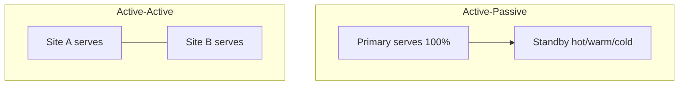
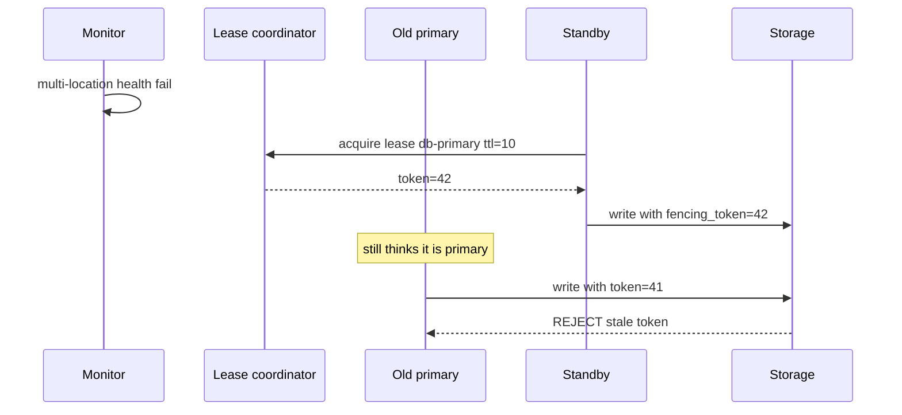
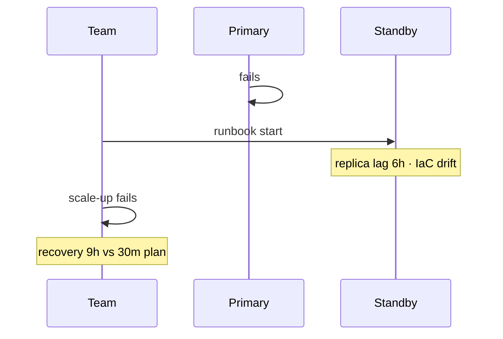

# Lesson 12: Failover Strategies — Active-Active vs Active-Passive, Hot/Warm/Cold

> **Prerequisites:** [Lesson 11: Global Server Load Balancing](../11-global-server-load-balancing/README.md), [Lesson 07: Health Checks](../07-health-checks/README.md), and [Load Balancing Overview](../README.md) (Lesson 12 of 14).  
> **Estimated Reading Time:** 28–35 minutes  
> **Target Audience:** Backend and SRE engineers setting RTO/RPO targets, choosing active-active vs active-passive, preventing split brain with fencing, and rehearsing failovers on game days.  
> **Free PDF Notes:** [Download SD-G-012.pdf](https://backendroadmap.com/notes/system-design/SD-G-012.pdf) · [Phase 3 Notes (PDF)](https://backendroadmap.com/notes/system-design/Phase3_Notes.pdf)

> [!NOTE]
> **In one line:** active-active serves from every site and fails over almost instantly but needs conflict handling for data; active-passive with a hot, warm, or cold standby is simpler but slower and riskier. Detect carefully, avoid split brain, know your RPO, fail back slowly, and rehearse.

> [!TIP]
> **The Golden Rule of Failover:** An untested standby gives you **confidence, not recovery**. Require multi-location detection, fencing tokens/leases so only one primary can write, monitor replica lag (your real RPO), and run scheduled game days that measure actual RTO—not the slide-deck number.

---

## Words You'll Meet Today

| Word | In Plain Words | Role in a Live Backend System |
| :--- | :--- | :--- |
| **Failover** | Switch traffic/writes to a standby when primary fails. | DNS, anycast, LB, or floating IP cutover. |
| **Active-passive** | One site serves; standby waits. | Simple single-writer data model. |
| **Active-active** | All sites serve continuously. | Near-instant absorb of a lost site's share. |
| **Hot / warm / cold** | Standby readiness levels. | Seconds vs minutes vs hours recovery. |
| **RTO** | Recovery Time Objective—how long you may be down. | Drives hot vs warm vs cold choice. |
| **RPO** | Recovery Point Objective—how much data you may lose. | Sync vs async replication. |
| **Split brain** | Two primaries accept writes at once. | Corrupts data; prevent with quorum/fencing. |
| **Fencing token** | Monotonic token storage rejects stale writers. | Stale primary cannot write after lease loss. |

---

## Visual Mental Models & Architecture

### Everyday Picture: Fire Drill

Failover is a fire drill. The plan on paper does not count; what counts is whether people, tools, and data behave at 3 a.m. Questions are always: how fast must we recover (**RTO**), how much data can we lose (**RPO**), and how much does the standby cost?



*Figure 1. Two ways to be ready—idle capacity vs multi-writer complexity.*

---

## Core Definition & Taxonomic Comparison

| Term | Precise Meaning | Production Example |
| :--- | :--- | :--- |
| **Active-passive** | One writer/site; failover promotes standby. | Primary us-east + hot standby us-west. |
| **Active-active** | All sites serve; others absorb share. | Reads everywhere; writes partitioned by user home. |
| **Hot standby** | Full size, data continuously replicated. | Seconds–minutes takeover; highest cost. |
| **Warm standby** | Reduced size; scale up on failover. | Minutes; medium cost. |
| **Cold standby** | Backups + IaC only. | Hours; lowest cost. |

**Trade-off:** Cheaper means slower recovery. Active-active avoids idle capacity but demands conflict handling or data partitioning.

---

## Component Anatomy & The Observability Gap

### Detection

- Health checks from **several locations** confirm failure.
- Thresholds and time windows avoid flapping.
- Distinguish a dead site from a broken monitor or network path.

### Moving Traffic

| Method | Speed | Note |
| :--- | :--- | :--- |
| DNS failover | TTL-bound | Simple; coarse |
| Anycast withdrawal | Seconds | Needs network/provider |
| LB / Front Door probes | Seconds–minute | Managed health routing |

### Observability Gap

| Vantage | Captures | Hides |
| :--- | :--- | :--- |
| Primary green dashboard | Local health | Replica lag → unknown RPO |
| Single probe | One path | False positive failover |
| "Standby exists" billing | Capacity paid | Drifted IaC, untested scale-up |
| Metrics to add | Replica lag, lease owner, fencing rejects, game-day RTO/RPO, split-brain alarms | Slide RTO without measurement |

---

## Mathematical Model: RTO, RPO & Standby Cost

$$\text{RTO}_{\text{actual}} = T_{\text{detect}} + T_{\text{decide}} + T_{\text{promote}} + T_{\text{scale}} + T_{\text{shift}} + T_{\text{verify}}$$

$$\text{RPO}_{\text{async}} \approx \text{replication lag at failover}$$

Zero RPO requires **synchronous** replication (higher write latency, availability coupling).

| Strategy | Illustrative recovery | Relative cost |
| :--- | :--- | :--- |
| Active-active | ~1 min absorb | High (always-on) but no idle |
| Hot standby | ~5 min | ~2× stack |
| Warm standby | ~30 min | Medium |
| Cold standby | ~240 min | Low |

---

## Metrics, Percentiles & Worked Example

**East US planned failover:**
1. Monitoring confirms outage from three locations.
2. Promote West US DB replica to primary.
3. Scale warm app tier up.
4. Switch traffic with Front Door or DNS.
5. Writes resume; data not yet replicated may be lost—know RPO.

If lag was `90 s` at cutover, RPO ≈ `90 s` regardless of a "zero data loss" slide.

---

## Compounding Effects at Scale

Automatic failover without fencing:

$$P(\text{split brain}) > 0 \text{ under network partitions}$$

Two writers → divergent datasets → expensive reconciliation or permanent corruption.

Failback too fast without resync:

$$\text{lost writes}_{\text{new primary}} \quad\text{if traffic flips back while old primary still writable}$$

---

## Numbers Every Backend Engineer Must Know

| Item | Rule of thumb |
| :--- | :--- |
| Detection window | Several consecutive failed intervals |
| Lease TTL | Seconds (e.g. 10 s) with renew |
| Hot RTO target | Seconds–minutes |
| Warm RTO | Tens of minutes |
| Cold RTO | Hours |
| Game day cadence | Quarterly minimum |

---

## Protocol & Network Deep Dive



Automate where you can, but guard split brain with **quorum, fencing token, or lease**.

---

## Hierarchical Budgets & Capacity Sizing

| Objective | Design choice |
| :--- | :--- |
| RTO ≤ 5 min | Hot standby or active-active |
| RPO = 0 | Sync replication |
| RPO ≤ 1 min | Async OK if lag monitored/alerted |
| Cost floor | Warm/cold + longer RTO |
| Failback | Resync → verify → gradual shift |

---

## Top Engineering Mitigation Techniques

1. Multi-location detection with hysteresis.
2. Leases + fencing tokens for single primary.
3. Monitor replica lag continuously.
4. Size standby for full load (or shed on failover).
5. Fail back deliberately after resync.
6. Treat standby IaC as production—apply every change.
7. Quarterly game days measuring real RTO/RPO.

---

## Production War Story (SEV-1): Untested Warm Standby

**Severity & Impact:** Planned 30-minute RTO became **9 hours**.

**What Happened:** Warm standby paid for two years. On primary failure, replica was **6 hours behind**; infrastructure code had drifted so scale-up failed.



**RCA:** Untested standby + unmonitored lag + config drift.

**The Fix:** Quarterly failover tests; lag alerts; apply standby infra on every change.

---

## Multi-Language Production Code Tabs

Leader lease with fencing token pattern (conceptual coordinator + storage check).

````carousel
```go
package failover

import (
	"errors"
	"sync"
	"time"
)

type Lease struct {
	Token int64
	Exp   time.Time
}

type Coordinator struct {
	mu     sync.Mutex
	owner  string
	lease  Lease
	next   int64
}

func (c *Coordinator) Acquire(owner string, ttl time.Duration) (Lease, bool) {
	c.mu.Lock()
	defer c.mu.Unlock()
	now := time.Now()
	if c.owner != "" && c.owner != owner && now.Before(c.lease.Exp) {
		return Lease{}, false
	}
	c.next++
	c.owner = owner
	c.lease = Lease{Token: c.next, Exp: now.Add(ttl)}
	return c.lease, true
}

type FencedStorage struct {
	mu        sync.Mutex
	minToken  int64
	lastValue string
}

func (s *FencedStorage) Write(value string, token int64) error {
	s.mu.Lock()
	defer s.mu.Unlock()
	if token < s.minToken {
		return errors.New("stale fencing token rejected")
	}
	s.minToken = token
	s.lastValue = value
	return nil
}
```
<!-- slide -->
```typescript
export type Lease = { token: number; exp: number };

export class Coordinator {
  private owner = "";
  private lease: Lease = { token: 0, exp: 0 };
  private next = 0;

  acquire(owner: string, ttlMs: number): Lease | null {
    const now = Date.now();
    if (this.owner && this.owner !== owner && now < this.lease.exp) return null;
    this.next += 1;
    this.owner = owner;
    this.lease = { token: this.next, exp: now + ttlMs };
    return this.lease;
  }
}

export class FencedStorage {
  private minToken = 0;
  private lastValue = "";

  write(value: string, token: number): void {
    if (token < this.minToken) throw new Error("stale fencing token rejected");
    this.minToken = token;
    this.lastValue = value;
  }
}
```
<!-- slide -->
```python
import threading
import time
from dataclasses import dataclass

@dataclass
class Lease:
    token: int
    exp: float

class Coordinator:
    def __init__(self) -> None:
        self._lock = threading.Lock()
        self.owner = ""
        self.lease = Lease(0, 0.0)
        self._next = 0

    def acquire(self, owner: str, ttl: float) -> Lease | None:
        with self._lock:
            now = time.time()
            if self.owner and self.owner != owner and now < self.lease.exp:
                return None
            self._next += 1
            self.owner = owner
            self.lease = Lease(self._next, now + ttl)
            return self.lease

class FencedStorage:
    def __init__(self) -> None:
        self._lock = threading.Lock()
        self.min_token = 0
        self.last_value = ""

    def write(self, value: str, token: int) -> None:
        with self._lock:
            if token < self.min_token:
                raise PermissionError("stale fencing token rejected")
            self.min_token = token
            self.last_value = value
```
<!-- slide -->
```csharp
public sealed record Lease(long Token, DateTimeOffset Exp);

public sealed class Coordinator
{
    private readonly object _gate = new();
    private string _owner = "";
    private Lease _lease = new(0, DateTimeOffset.MinValue);
    private long _next;

    public Lease? Acquire(string owner, TimeSpan ttl)
    {
        lock (_gate)
        {
            var now = DateTimeOffset.UtcNow;
            if (_owner.Length > 0 && _owner != owner && now < _lease.Exp) return null;
            _next++;
            _owner = owner;
            _lease = new Lease(_next, now + ttl);
            return _lease;
        }
    }
}

public sealed class FencedStorage
{
    private readonly object _gate = new();
    private long _minToken;
    private string _lastValue = "";

    public void Write(string value, long token)
    {
        lock (_gate)
        {
            if (token < _minToken) throw new InvalidOperationException("stale fencing token rejected");
            _minToken = token;
            _lastValue = value;
        }
    }
}
```
````

---

## Hands-On CLI Verification Workflows

### 1. Simulate RTO sum

```bash
python3 -c "print('RTO', 30+60+120+300+60+60, 'sec')"
```

### 2. Check replica lag (example Postgres)

```bash
# psql -c "SELECT now()-pg_last_xact_replay_timestamp() AS lag;"
echo "Monitor lag continuously; alert before failover"
```

### 3. Game-day checklist print

```bash
printf '%s\n' "1 detect" "2 promote" "3 scale" "4 shift" "5 verify" "6 fence old primary"
```

---

## Common Mistakes to Avoid

- Standby never tested.
- Split brain from automatic promotion without fencing.
- Replica lag unmonitored → unknown RPO.
- Failing over on one noisy health check.
- Failing back in a hurry and losing writes.
- Standby sized too small for full load.

---

## Key Terms Glossary

| Term | Interview-ready definition |
| :--- | :--- |
| **RTO** | Max acceptable downtime. |
| **RPO** | Max acceptable data-loss window. |
| **Split brain** | Two primaries writing at once. |
| **Fencing token** | Stops stale writers after lease loss. |
| **Failback** | Return to the original site deliberately. |
| **Game day** | Rehearsed failure with measured outcomes. |

---

## Interview Practice Questions

<details>
<summary><strong>1. Compare active-active and active-passive. [BASIC]</strong></summary>

<strong>What a strong answer covers:</strong>
Active-active serves from every site—no idle capacity, near-instant absorb—but multi-site writes need conflict handling or partitioning. Active-passive keeps a hot/warm/cold standby—simpler data, but wasteful and slower/riskier to fail over.
</details>

<details>
<summary><strong>2. What are RTO and RPO? [BASIC]</strong></summary>

<strong>What a strong answer covers:</strong>
RTO is how long you can be down; RPO is how much recent data you can afford to lose.
</details>

<details>
<summary><strong>3. Hot, warm, and cold standby? [BASIC]</strong></summary>

<strong>What a strong answer covers:</strong>
Hot: full size and replicated, seconds to take over. Warm: reduced, must scale up. Cold: backups and code, hours.
</details>

<details>
<summary><strong>4. How do you fail back safely? [BASIC]</strong></summary>

<strong>What a strong answer covers:</strong>
Resync data, verify, shift traffic gradually, and rehearse failovers regularly—or keep the new primary and demote the old site.
</details>

<details>
<summary><strong>5. Primary region down at 3 a.m. What do you do? [SCENARIO]</strong></summary>

<strong>What a strong answer covers:</strong>
Confirm from several locations, promote the replica, scale the standby, move traffic, check RPO loss, communicate, fence the old primary, and fail back later.
</details>

<details>
<summary><strong>6. Two nodes both think they are primary. [SCENARIO]</strong></summary>

<strong>What a strong answer covers:</strong>
Split brain—prevent with quorum, leases, and fencing tokens; storage must reject stale tokens.
</details>

<details>
<summary><strong>7. Choose a strategy for a payments API. [SCENARIO]</strong></summary>

<strong>What a strong answer covers:</strong>
Active-active reads with single-writer per account/region, or hot standby with synchronous replication for zero RPO.
</details>

<details>
<summary><strong>8. DNS failover is too slow. [SCENARIO]</strong></summary>

<strong>What a strong answer covers:</strong>
Lower TTL, use anycast or a global proxy, and make clients retry alternate endpoints.
</details>

<details>
<summary><strong>9. How do you get zero RPO? [TRICKY]</strong></summary>

<strong>What a strong answer covers:</strong>
Synchronous replication to the standby, at the cost of write latency and availability coupling.
</details>

<details>
<summary><strong>10. Why is active-active not just double capacity? [TRICKY]</strong></summary>

<strong>What a strong answer covers:</strong>
Data consistency, conflict resolution, and routing complexity increase—capacity alone is not the hard part.
</details>

<details>
<summary><strong>11. Can automatic failover be harmful? [TRICKY]</strong></summary>

<strong>What a strong answer covers:</strong>
Yes—on false positives or without fencing. Require multi-location confirmation and guard rails.
</details>

<details>
<summary><strong>12. How do you know the plan works? [TRICKY]</strong></summary>

<strong>What a strong answer covers:</strong>
Game days with real failovers, measuring RTO and RPO against targets.
</details>

---

## One-Page Master Cheat Sheet

```text
====================================================================================================
                      FAILOVER STRATEGIES  —  CHEAT SHEET (SD-G-012)
====================================================================================================
IN ONE LINE   Active-active vs active-passive (hot/warm/cold); detect, fence, know RPO, rehearse

RTO / RPO     RTO = downtime budget · RPO = data-loss budget
STANDY        Hot seconds · Warm minutes · Cold hours — cheaper ⇒ slower

DETECT        Multi-location · thresholds · avoid flaps
SPLIT BRAIN   Quorum + lease + fencing token · storage rejects stale writers
TRAFFIC       DNS (TTL) · anycast · LB/Front Door
FAILBACK      Resync → verify → gradual · don't rush

ANTI-PATTERNS X untested standby  X unknown lag  X single probe failover
              X auto-promote without fencing  X tiny standby  X hasty failback
====================================================================================================
```

---

## Free PDF notes

Download these notes as a printable PDF: [SD-G-012.pdf](https://backendroadmap.com/notes/system-design/SD-G-012.pdf).

---

## Sources

- [AWS Well-Architected — Reliability / DR](https://docs.aws.amazon.com/wellarchitected/latest/reliability-pillar/welcome.html)
- [Azure Architecture Center — Multi-region](https://learn.microsoft.com/en-us/azure/architecture/guide/)
- Kleppmann, *Designing Data-Intensive Applications*, ch. 8–9

---

## Next

Next comes [Lesson 13: Blue-Green & Canary Releases](../13-blue-green-deployments-canary-releases-with-weighted-traffic/README.md): weighted traffic, progressive delivery, and safe rollbacks. See [the track overview](../README.md).
