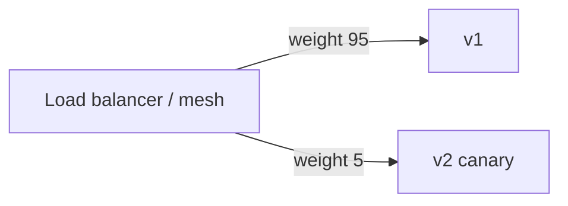
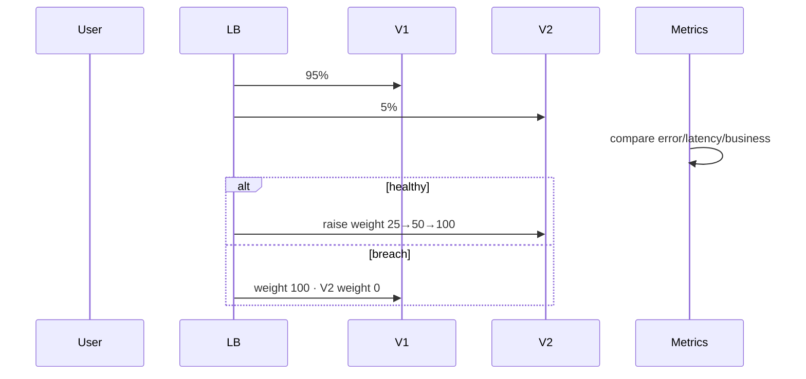
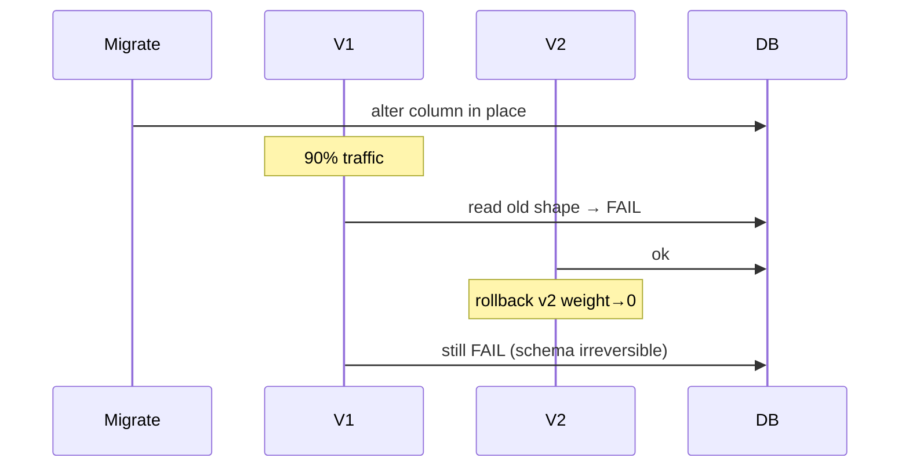

# Lesson 13: Blue-Green Deployments & Canary Releases with Weighted Traffic

> **Prerequisites:** [Lesson 12: Failover Strategies](../12-failover-strategies/README.md), [Lesson 03: Round Robin vs Weighted Round Robin](../03-round-robin-vs-weighted-round-robin/README.md), and [Load Balancing Overview](../README.md) (Lesson 13 of 14).  
> **Estimated Reading Time:** 28–35 minutes  
> **Target Audience:** Backend and platform engineers shipping with ALB weighted target groups, Istio/Argo Rollouts canaries, and expand/contract schema migrations so rollback stays a routing change.  
> **Free PDF Notes:** [Download SD-G-013.pdf](https://backendroadmap.com/notes/system-design/SD-G-013.pdf) · [Phase 3 Notes (PDF)](https://backendroadmap.com/notes/system-design/Phase3_Notes.pdf)

> [!NOTE]
> **In one line:** a load balancer makes safe releases cheap—blue-green flips all traffic between two environments; weighted splitting moves traffic gradually (canary). Rollback becomes a routing change, not a redeploy. Automate the steps and watch real metrics.

> [!TIP]
> **The Golden Rule of Progressive Delivery:** Rollback is only as safe as your **data changes are reversible**. Use expand→migrate→contract for schemas, keep sticky sessions from bouncing users between versions, gate each weight step on error/latency/**business** metrics, and never trust a 5% canary with too little traffic.

---

## Words You'll Meet Today

| Word | In Plain Words | Role in a Live Backend System |
| :--- | :--- | :--- |
| **Blue-green** | Two full environments; LB flips 100%. | Instant rollback by flipping back. |
| **Canary** | Small share of traffic to the new version. | Bug hits few users first. |
| **Weighted target group** | LB targets with percentage weights. | ALB/NLB/Istio 95/5 splits. |
| **Progressive delivery** | Gradual, metric-gated rollout. | Argo Rollouts / Flagger. |
| **Traffic mirroring** | Copy requests to new system; ignore responses. | Shadow test migrations. |
| **Expand/contract** | Backward-compatible schema change pattern. | Both versions work during rollout. |
| **Analysis** | Automatic metric check between steps. | Auto-rollback on threshold breach. |
| **Drain** | Finish in-flight requests before removing targets. | Avoid cut-off during flips. |

---

## Visual Mental Models & Architecture

### Everyday Pictures

- **Blue-green:** Two identical stages—audience watches blue while you set up green; switching is one action.
- **Canary:** A canary in a coal mine—tiny share of real users first; trouble harms few.

```text
 Blue (v1) 100% ──LB flip──► Green (v2) 100%     rollback = flip back
 Canary: 95/5 → 75/25 → 50/50 → 0/100            rollback = weight 0
```



---

## Core Definition & Taxonomic Comparison

| Term | Precise Meaning | Production Example |
| :--- | :--- | :--- |
| **Blue-green** | Flip all traffic between two full stacks. | Swap ALB listener to green TG. |
| **Weighted canary** | Gradually increase weight to new version. | Istio 5→25→50→100. |
| **Rolling update** | Replace pods in place by surge. | K8s Deployment default—less precise traffic %. |
| **Shadow / mirror** | Duplicate traffic; responses unused. | Test new service with prod shape. |

| Dimension | Blue-green | Weighted canary |
| :--- | :--- | :--- |
| Exposure | All users after flip | Small share first |
| Rollback | Instant flip back | Set weight to 0 |
| Cost | Two full environments | Canary needs small slice |
| Risk | Bug hits everyone after flip | Bug hits few |

---

## Component Anatomy & The Observability Gap

### Canary Step Anatomy

```text
 deploy v2 (0%) → setWeight 5 → pause/analyze → 25 → 50 → 100 → retire v1
```

Compare at each step: **error rate, latency percentiles, business metric** (checkout success).

### Observability Gap

| Vantage | Captures | Hides |
| :--- | :--- | :--- |
| Overall error rate | Fleet mix | Canary 5% regression drowned in 95% baseline |
| Deploy "success" | Pods Ready | Schema already broke v1 |
| Sticky session users | Stable UX | Version flip-flop if affinity broken |
| Metrics to add | Per-version RED + business KPIs, canary sample size, auto-rollback events | Judging on 12 requests |

---

## Mathematical Model: Canary Sample Size & Risk

For baseline error rate $p_0$ and canary rate $p_1$, approximate detections need enough canary requests $n$:

$$\text{SE} \approx \sqrt{\frac{p(1-p)}{n}}$$

If canary gets $\alpha$ fraction of traffic at rate $\lambda$ for duration $T$:

$$n = \alpha \lambda T$$

| $\alpha$ | $\lambda$ | $T$ | $n$ |
| :--- | :--- | :--- | :--- |
| 5% | 10 rps | 5 min | 150 — often too small |
| 5% | 100 rps | 15 min | 9,000 — useful |
| 25% | 100 rps | 10 min | 15,000 |

**Rule:** wait for meaningful $n$, or raise weight / add synthetics—avoid false confidence.

---

## Metrics, Percentiles & Worked Example

Checkout v2 rollout: 5% (15 min) → 25% → 50% → 100%. At each gate compare errors, latency, and checkout success. If errors spike, weight → 0.

Istio sketch from the PDF:

```yaml
apiVersion: networking.istio.io/v1
kind: VirtualService
metadata: { name: checkout }
spec:
  hosts: [checkout]
  http:
  - route:
    - destination: { host: checkout, subset: v1 }
      weight: 95
    - destination: { host: checkout, subset: v2 }
      weight: 5
```

---

## Compounding Effects at Scale

Incompatible migration during canary:

1. Migration changes column in place before canary.
2. v1 (90% traffic) fails on reads.
3. Rolling back v2 does **not** help—schema already changed.

Risk compounds across **code + data + cache formats + sticky sessions**.

---

## Numbers Every Backend Engineer Must Know

| Practice | Number / rule |
| :--- | :--- |
| First canary weight | 1–5% |
| Analyze window | 10–30 min (traffic-dependent) |
| Steps | 5 → 25 → 50 → 100 |
| Blue-green cost | ~2× during overlap |
| Drain timeout | ≥ p99 in-flight duration |

---

## Protocol & Network Deep Dive



**Traps:** sticky sessions pinning/flapping versions; shared caches written in a format old code cannot read; low traffic canaries.

---

## Hierarchical Budgets & Capacity Sizing

| Phase | Capacity note |
| :--- | :--- |
| Blue-green prep | Green sized like blue before flip |
| Canary 5% | Small replica count OK if CPU allows |
| Ramp | Scale canary replicas with weight |
| Post-success | Scale blue/v1 down; keep briefly for rollback |

---

## Top Engineering Mitigation Techniques

1. Weighted LB / mesh splits with automated analysis (Argo Rollouts, Flagger).
2. Expand/contract schema migrations.
3. Externalize sessions (or consistent affinity to one version).
4. Drain in-flight before removing blue.
5. Mirror traffic before cutover for migrations.
6. Gate on business metrics, not only HTTP 5xx.
7. Keep old version warm until confident.

---

## Production War Story (SEV-1): Incompatible Migration

**Severity & Impact:** 90% of traffic failed during a "safe" 10% canary.

**What Happened:** v2 required a new column type; migration altered the column in place; v1 broke; rolling back v2 left the bad schema.



**RCA:** Rollback assumed code-only reversibility.

**The Fix:** Expand/contract; test rollbacks including schema; gate canary on compatibility checks.

---

## Multi-Language Production Code Tabs

Weighted picker + canary gate evaluating error rate vs baseline (control-plane helper).

````carousel
```go
package canary

import (
	"fmt"
	"math/rand"
)

func PickVersion(weightV2 int) string {
	if weightV2 < 0 {
		weightV2 = 0
	}
	if weightV2 > 100 {
		weightV2 = 100
	}
	if rand.Intn(100) < weightV2 {
		return "v2"
	}
	return "v1"
}

type Stats struct{ Requests, Errors int }

func ShouldRollback(base, canary Stats, maxErrorLift float64, minN int) (bool, string) {
	if canary.Requests < minN {
		return false, "insufficient canary sample"
	}
	br := float64(base.Errors) / float64(max(1, base.Requests))
	cr := float64(canary.Errors) / float64(canary.Requests)
	if cr > br+maxErrorLift {
		return true, fmt.Sprintf("canary err %.3f > base %.3f + %.3f", cr, br, maxErrorLift)
	}
	return false, "ok"
}

func max(a, b int) int {
	if a > b {
		return a
	}
	return b
}
```
<!-- slide -->
```typescript
export function pickVersion(weightV2: number): "v1" | "v2" {
  const w = Math.max(0, Math.min(100, weightV2));
  return Math.random() * 100 < w ? "v2" : "v1";
}

export type Stats = { requests: number; errors: number };

export function shouldRollback(
  base: Stats,
  canary: Stats,
  maxErrorLift: number,
  minN: number
): { rollback: boolean; reason: string } {
  if (canary.requests < minN) return { rollback: false, reason: "insufficient canary sample" };
  const br = base.errors / Math.max(1, base.requests);
  const cr = canary.errors / canary.requests;
  if (cr > br + maxErrorLift) {
    return { rollback: true, reason: `canary ${cr} > base ${br} + ${maxErrorLift}` };
  }
  return { rollback: false, reason: "ok" };
}
```
<!-- slide -->
```python
import random

def pick_version(weight_v2: int) -> str:
    w = max(0, min(100, weight_v2))
    return "v2" if random.randrange(100) < w else "v1"

def should_rollback(base: dict, canary: dict, max_error_lift: float, min_n: int) -> tuple[bool, str]:
    if canary["requests"] < min_n:
        return False, "insufficient canary sample"
    br = base["errors"] / max(1, base["requests"])
    cr = canary["errors"] / canary["requests"]
    if cr > br + max_error_lift:
        return True, f"canary {cr:.3f} > base {br:.3f} + {max_error_lift:.3f}"
    return False, "ok"
```
<!-- slide -->
```csharp
public static class Canary
{
    public static string PickVersion(int weightV2)
    {
        var w = Math.Clamp(weightV2, 0, 100);
        return Random.Shared.Next(100) < w ? "v2" : "v1";
    }

    public readonly record struct Stats(int Requests, int Errors);

    public static (bool Rollback, string Reason) ShouldRollback(
        Stats baseline, Stats canary, double maxErrorLift, int minN)
    {
        if (canary.Requests < minN) return (false, "insufficient canary sample");
        var br = (double)baseline.Errors / Math.Max(1, baseline.Requests);
        var cr = (double)canary.Errors / canary.Requests;
        if (cr > br + maxErrorLift)
            return (true, $"canary {cr:F3} > base {br:F3} + {maxErrorLift:F3}");
        return (false, "ok");
    }
}
```
````

Argo Rollouts sketch:

```yaml
strategy:
  canary:
    steps:
    - setWeight: 5
    - pause: { duration: 15m }
    - analysis:
        templates: [{ templateName: success-rate }]
    - setWeight: 25
    - pause: { duration: 10m }
    - setWeight: 50
    - pause: { duration: 10m }
```

AWS ALB weight flip:

```bash
aws elbv2 modify-listener --listener-arn "$LISTENER" \
  --default-actions '[{"Type":"forward","ForwardConfig":{"TargetGroups":[
    {"TargetGroupArn":"'"$TG_BLUE"'","Weight":95},
    {"TargetGroupArn":"'"$TG_GREEN"'","Weight":5}]}}]'
```

---

## Hands-On CLI Verification Workflows

### 1. Canary sample size

```bash
python3 -c "alpha=0.05; lam=100; T=15*60; print('n=', int(alpha*lam*T))"
```

### 2. Simulate weights

```bash
python3 -c "import random; w=5; print(sum(random.randrange(100)<w for _ in range(10000))/10000)"
```

### 3. Verify both versions still up

```bash
curl -sS -H "Host: checkout" http://v1/healthz
curl -sS -H "Host: checkout" http://v2/healthz
```

---

## Common Mistakes to Avoid

- Schema changes incompatible with the old version.
- Judging a canary on too little traffic.
- No automatic rollback criteria.
- Switching blue/green without draining in-flight requests.
- Sticky sessions sending users back and forth between versions.
- Forgetting to decommission the old environment (cost + drift).

---

## Key Terms Glossary

| Term | Interview-ready definition |
| :--- | :--- |
| **Blue-green** | Two environments; switch traffic entirely. |
| **Canary** | Small share to the new version first. |
| **Expand/contract** | Add new schema, dual-write/read, remove old later. |
| **Traffic mirroring** | Copy of traffic to a new system without affecting users. |
| **Progressive delivery** | Gradual, metric-gated rollout. |

---

## Interview Practice Questions

<details>
<summary><strong>1. How do load balancers support canary releases? [BASIC]</strong></summary>

<strong>What a strong answer covers:</strong>
By splitting traffic between target groups with weights like 95/5, comparing metrics, then shifting gradually to 100 or back to 0.
</details>

<details>
<summary><strong>2. Blue-green versus canary? [BASIC]</strong></summary>

<strong>What a strong answer covers:</strong>
Blue-green flips all traffic between two full environments at once; canaries move gradually.
</details>

<details>
<summary><strong>3. Why is rollback fast? [BASIC]</strong></summary>

<strong>What a strong answer covers:</strong>
It is only a routing change; the old version is still running.
</details>

<details>
<summary><strong>4. What metrics decide a canary? [BASIC]</strong></summary>

<strong>What a strong answer covers:</strong>
Error rate, latency percentiles, and business metrics versus the baseline—per version, not fleet-averaged only.
</details>

<details>
<summary><strong>5. Release a risky checkout change safely. [SCENARIO]</strong></summary>

<strong>What a strong answer covers:</strong>
Canary at 5%, compare metrics for 15 minutes, step to 25/50/100, auto-rollback on thresholds.
</details>

<details>
<summary><strong>6. The new version needs a schema change. [SCENARIO]</strong></summary>

<strong>What a strong answer covers:</strong>
Expand and contract: both versions work with the schema during rollout; remove old columns later.
</details>

<details>
<summary><strong>7. Migrate from a monolith to a service. [SCENARIO]</strong></summary>

<strong>What a strong answer covers:</strong>
Route one path or a small weight to the new service, grow as confidence builds, mirror traffic first.
</details>

<details>
<summary><strong>8. Canary shows no errors, but traffic is tiny. [SCENARIO]</strong></summary>

<strong>What a strong answer covers:</strong>
Wait for more data, raise the weight, or use synthetic load—avoid false confidence.
</details>

<details>
<summary><strong>9. Does blue-green double your cost? [TRICKY]</strong></summary>

<strong>What a strong answer covers:</strong>
Briefly during the switch; many teams scale blue down afterward while keeping a rollback window.
</details>

<details>
<summary><strong>10. What happens to sessions during a flip? [TRICKY]</strong></summary>

<strong>What a strong answer covers:</strong>
Drain in-flight requests; sessions must be externalized or users may be logged out / see flip-flopping features.
</details>

<details>
<summary><strong>11. Why mirror traffic? [TRICKY]</strong></summary>

<strong>What a strong answer covers:</strong>
Tests the new system with real request shapes without affecting users—writes need careful dedupe/side-effect isolation.
</details>

<details>
<summary><strong>12. Who rolls back, a human or automation? [TRICKY]</strong></summary>

<strong>What a strong answer covers:</strong>
Prefer automation on clear thresholds, with human override for ambiguous judgment calls.
</details>

---

## One-Page Master Cheat Sheet

```text
====================================================================================================
               BLUE-GREEN & WEIGHTED CANARY  —  CHEAT SHEET (SD-G-013)
====================================================================================================
IN ONE LINE   LB makes releases safe: flip (blue-green) or ramp weights (canary); rollback = routing

BLUE-GREEN    Two envs · flip 100% · flip back · drain in-flight
CANARY        95/5 → 25 → 50 → 100 · analyze each step · weight 0 on breach
AUTOMATE      Argo Rollouts / Flagger · business + RED metrics

DATA          Expand → migrate → contract · never break old version mid-canary
SAMPLES       n = α·λ·T · tiny n ⇒ false confidence
OTHER USES    Monolith path split · region migrate · traffic mirror/shadow

ANTI-PATTERNS X incompatible schema  X no auto criteria  X sticky flip-flop
              X no drain  X skip decommission  X judge on 12 requests
====================================================================================================
```

---

## Free PDF notes

Download these notes as a printable PDF: [SD-G-013.pdf](https://backendroadmap.com/notes/system-design/SD-G-013.pdf).

---

## Sources

- Humble & Farley, *Continuous Delivery*
- [Argo Rollouts](https://argo-rollouts.readthedocs.io/) · [Flagger](https://docs.flagger.app/)
- [Martin Fowler — BlueGreenDeployment](https://martinfowler.com/bliki/BlueGreenDeployment.html)

---

## Next

Next comes [Lesson 14: Autoscaling Explained](../14-autoscaling-explained/README.md): which metric to scale on, and why CPU alone fails for I/O-bound APIs. See [the track overview](../README.md).
