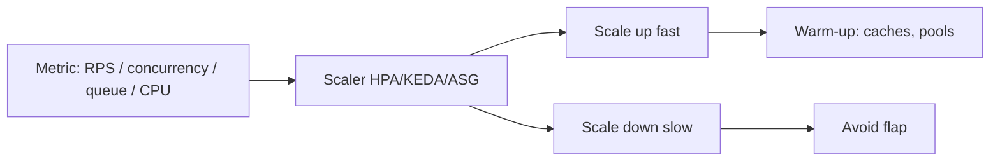
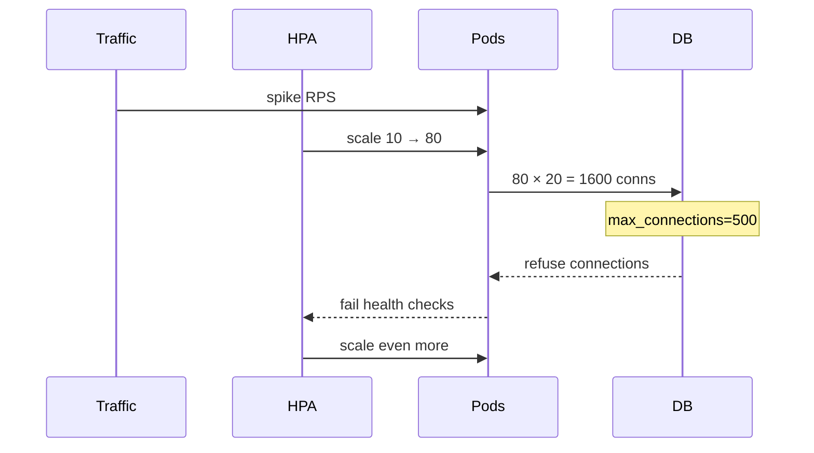

# Lesson 14: Autoscaling Explained — Which Metric? (CPU vs RPS vs Queue Depth)

> **Prerequisites:** [Lesson 13: Blue-Green & Canary Releases](../13-blue-green-deployments-canary-releases-with-weighted-traffic/README.md), [Lesson 10: Load Shedding & Traffic Shaping](../10-load-shedding-traffic-shaping/README.md), and [Load Balancing Overview](../README.md) (Lesson 14 of 14).  
> **Estimated Reading Time:** 28–35 minutes  
> **Target Audience:** Backend and platform engineers configuring HPA/KEDA/AWS target tracking, choosing scale signals for I/O-bound APIs vs queue workers, and avoiding scale-into-the-database-wall outages.  
> **Free PDF Notes:** [Download SD-G-014.pdf](https://backendroadmap.com/notes/system-design/SD-G-014.pdf) · [Phase 3 Notes (PDF)](https://backendroadmap.com/notes/system-design/Phase3_Notes.pdf)

> [!NOTE]
> **In one line:** autoscaling adds and removes capacity automatically. Scale on the right signal (requests or concurrency per instance, latency, queue depth—not CPU alone), combine reactive, scheduled, and predictive scaling, scale up fast and down slowly, and remember that it can only add more of what you already have.

> [!TIP]
> **The Golden Rule of Autoscaling:** Pick the metric that reflects the **bottleneck**, set **min/max**, scale **up fast / down slow**, and load-test the scale-out path end-to-end—including downstream connection limits. Autoscaling cannot fix a slow query; it can multiply the damage.

---

## Words You'll Meet Today

| Word | In Plain Words | Role in a Live Backend System |
| :--- | :--- | :--- |
| **Autoscaling** | Automatic add/remove of instances/pods. | Match capacity to demand. |
| **Target tracking** | Keep a metric near a target. | 60% CPU or 50 RPS/pod. |
| **HPA** | Kubernetes Horizontal Pod Autoscaler. | `desired = ceil(current × metric/target)`. |
| **Scheduled scaling** | Scale at known times. | Pre-warm before 9 a.m. peak. |
| **Predictive scaling** | Forecast-based pre-scale. | Learns weekly patterns. |
| **Cooldown / stabilization** | Wait before reversing a scale action. | Stops flapping. |
| **KEDA** | Event-driven autoscaler. | Scale workers on queue depth; scale to zero. |
| **Warm pool** | Pre-initialized spare instances. | Cuts boot lag. |

---

## Visual Mental Models & Architecture

### Everyday Picture: Checkout Lanes

Autoscaling adds checkout lanes when the queue gets long. Choose the right signal (queue length, not how tired cashiers look), accept that lanes take time to open, and do not open/close so often you waste more than you save.



---

## Core Definition & Taxonomic Comparison

| Service type | Best signal | Why |
| :--- | :--- | :--- |
| **CPU-bound compute** | CPU utilization | CPU tracks work (image resize) |
| **I/O-bound API** | RPS or concurrent requests/instance, or latency | CPU stays low while waiting on DB |
| **Queue workers** | Queue depth per worker | Directly measures backlog |
| **Memory-heavy** | Memory or custom | CPU may not rise before OOM |

| Mode | Meaning | Weakness |
| :--- | :--- | :--- |
| **Reactive** | React after metric moves | Lag: boot + warm-up minutes |
| **Scheduled** | Fixed times for known peaks | Misses surprises |
| **Predictive** | Learns patterns, scales ahead | Needs history; still keep reactive safety net |

---

## Component Anatomy & The Observability Gap

### Target Tracking Loop

1. Pick target (e.g. 60% CPU or 100 req/instance).
2. Compute desired replicas.
3. Respect min, max, cooldown.
4. New instances boot and warm—scale earlier or pre-scale for known events.

### Observability Gap

| Vantage | Captures | Hides |
| :--- | :--- | :--- |
| CPU average | Easy HPA signal | I/O saturation with low CPU |
| Replica count rising | "Scaling works" | DB connection storms |
| Scale-to-zero idle | Cost win | Cold-start on first request |
| Metrics to add | RPS/pod, concurrency/pod, queue lag, scale actions, downstream pool waits, boot time | CPU-only dashboards |

---

## Mathematical Model: HPA Desired Replicas

$$\text{desired} = \left\lceil \text{current} \times \frac{\text{metric}}{\text{target}} \right\rceil$$

**Example:** 10 pods at 90% CPU, target 60%:

$$\text{desired} = \lceil 10 \times 90/60 \rceil = \lceil 15 \rceil = 15$$

For queue workers with target depth $d$ messages/pod and backlog $Q$:

$$\text{desired} = \left\lceil \frac{Q}{d} \right\rceil$$

| $Q$ | $d=20$ | desired |
| :--- | :--- | :--- |
| 0 | 20 | 0 (if scale-to-zero allowed) |
| 200 | 20 | 10 |
| 1000 | 20 | 50 |

---

## Metrics, Percentiles & Worked Example

KEDA + Celery: target 20 jobs/worker. 1000 jobs arrive → scale toward 50 workers; drain → scale down; empty → zero.

```yaml
apiVersion: autoscaling/v2
kind: HorizontalPodAutoscaler
metadata: { name: api }
spec:
  scaleTargetRef: { apiVersion: apps/v1, kind: Deployment, name: api }
  minReplicas: 4
  maxReplicas: 60
  metrics:
  - type: Pods
    pods:
      metric: { name: http_requests_per_second }
      target: { type: AverageValue, averageValue: "50" }
  behavior:
    scaleUp:   { stabilizationWindowSeconds: 0 }
    scaleDown: { stabilizationWindowSeconds: 300 }
```

---

## Compounding Effects at Scale

App tier scales $N \to kN$ while each pod opens $c$ DB connections:

$$\text{DB connections} \approx kN \cdot c$$

If this exceeds `max_connections`, health checks fail → scaler adds **more** pods → death spiral.

Latency-based scaling without stabilization oscillates: high latency → add pods → overshoot → remove → latency spike → repeat (**flapping**).

---

## Numbers Every Backend Engineer Must Know

| Rule | Value |
| :--- | :--- |
| Scale up | Fast (stabilization ~0) |
| Scale down | Slow (e.g. 300 s window) |
| Min replicas | ≥ 2–4 for HA even at night |
| Max replicas | Hard cap vs cost/DB |
| Boot + warm | Often 1–5+ minutes |
| CPU target | ~50–70% if CPU-bound |

---

## Protocol & Network Deep Dive



Remember the whole system: scale-to-zero means cold start; new instances need warm caches and pools; autoscaling cannot fix a bottleneck elsewhere.

---

## Hierarchical Budgets & Capacity Sizing

| Tier | Scaling constraint |
| :--- | :--- |
| Edge / LB | Target group registration lag |
| App pods | HPA metric + min/max |
| Connection pooler | Caps DB fan-out |
| Database | Vertical / read replicas / sharding—often the real limit |
| Workers | KEDA queue depth; scale to zero OK for async |

Derive `maxReplicas` from downstream capacity: $\max \le \lfloor \text{DB_conn_budget} / c_{\text{per_pod}} \rfloor$.

---

## Top Engineering Mitigation Techniques

1. Scale on RPS/concurrency/queue—not CPU alone for I/O APIs.
2. Combine reactive + scheduled + predictive.
3. Fast up, slow down; cooldowns against flap.
4. Warm pools / prebaked images.
5. Connection poolers + max replica caps.
6. Load-test scale-out path end-to-end.
7. Pair with load shedding for spikes faster than boot time ([lesson 10](../10-load-shedding-traffic-shaping/README.md)).

---

## Production War Story (SEV-1): Scaling Into a Wall

**Severity & Impact:** API outage during traffic spike; autoscaling amplified failure.

**What Happened:** Scaled on CPU from 10→80 instances; each opened 20 DB connections → 1600 against limit 500; DB refused; health checks failed; scaler added more.

**RCA:** Scaling one tier moved the bottleneck; no max tied to DB capacity.

**The Fix:** Connection pooler; max instance count from DB budget; scale on concurrency/pod; load-test scale-out.

---

## Multi-Language Production Code Tabs

Desired-replica calculator + DB-aware max cap + simple flap-resistant controller sketch.

````carousel
```go
package autoscaling

import "math"

func Desired(current int, metric, target float64) int {
	if target <= 0 || current <= 0 {
		return current
	}
	return int(math.Ceil(float64(current) * metric / target))
}

func Clamp(n, min, max int) int {
	if n < min {
		return min
	}
	if n > max {
		return max
	}
	return n
}

func MaxReplicasFromDB(dbConnBudget, connsPerPod int) int {
	if connsPerPod <= 0 {
		return 0
	}
	return dbConnBudget / connsPerPod
}

func DesiredFromQueue(backlog, perPod int) int {
	if perPod <= 0 {
		return 0
	}
	return int(math.Ceil(float64(backlog) / float64(perPod)))
}
```
<!-- slide -->
```typescript
export function desired(current: number, metric: number, target: number): number {
  if (target <= 0 || current <= 0) return current;
  return Math.ceil(current * (metric / target));
}

export function clamp(n: number, min: number, max: number): number {
  return Math.max(min, Math.min(max, n));
}

export function maxReplicasFromDb(dbConnBudget: number, connsPerPod: number): number {
  if (connsPerPod <= 0) return 0;
  return Math.floor(dbConnBudget / connsPerPod);
}

export function desiredFromQueue(backlog: number, perPod: number): number {
  if (perPod <= 0) return 0;
  return Math.ceil(backlog / perPod);
}
```
<!-- slide -->
```python
import math

def desired(current: int, metric: float, target: float) -> int:
    if target <= 0 or current <= 0:
        return current
    return math.ceil(current * metric / target)

def clamp(n: int, min_n: int, max_n: int) -> int:
    return max(min_n, min(max_n, n))

def max_replicas_from_db(db_conn_budget: int, conns_per_pod: int) -> int:
    if conns_per_pod <= 0:
        return 0
    return db_conn_budget // conns_per_pod

def desired_from_queue(backlog: int, per_pod: int) -> int:
    if per_pod <= 0:
        return 0
    return math.ceil(backlog / per_pod)

# Example: 10 pods @ 90% vs target 60% → 15
assert desired(10, 90, 60) == 15
```
<!-- slide -->
```csharp
public static class AutoScaling
{
    public static int Desired(int current, double metric, double target)
    {
        if (target <= 0 || current <= 0) return current;
        return (int)Math.Ceiling(current * (metric / target));
    }

    public static int Clamp(int n, int min, int max) => Math.Max(min, Math.Min(max, n));

    public static int MaxReplicasFromDb(int dbConnBudget, int connsPerPod)
        => connsPerPod <= 0 ? 0 : dbConnBudget / connsPerPod;

    public static int DesiredFromQueue(int backlog, int perPod)
        => perPod <= 0 ? 0 : (int)Math.Ceiling(backlog / (double)perPod);
}
```
````

KEDA Redis list trigger (from PDF):

```yaml
spec:
  scaleTargetRef: { name: celery-worker }
  minReplicaCount: 0
  maxReplicaCount: 100
  triggers:
  - type: redis
    metadata: { address: redis:6379, listName: jobs, listLength: "20" }
```

---

## Hands-On CLI Verification Workflows

### 1. HPA math

```bash
python3 -c "import math; print(math.ceil(10*90/60))"
```

Expected: `15`.

### 2. Create a CPU HPA (cluster)

```bash
kubectl autoscale deployment api --cpu-percent=60 --min=4 --max=40
kubectl get hpa api -w
```

### 3. DB-aware max

```bash
python3 -c "print('max pods', 500//20)"
```

Expected: `25` if each pod uses 20 conns against a 500 budget.

---

## Common Mistakes to Avoid

- Scaling on CPU for I/O-bound services.
- Scaling down too fast → flapping.
- No maximum → cost/DB explosion.
- Ignoring boot and warm-up time.
- Scaling the app while the database is the bottleneck.
- Never load-testing the scaling path.
- Scale-to-zero on latency-critical synchronous APIs without mitigation.

---

## Key Terms Glossary

| Term | Interview-ready definition |
| :--- | :--- |
| **Target tracking** | Keep a metric near a target by adding/removing capacity. |
| **HPA** | Kubernetes controller computing desired replicas from metrics. |
| **KEDA** | Event-driven autoscaler (queues, lag, scale to zero). |
| **Cooldownization window** | Smooths scale-down decisions to prevent flap. |
| **Warm pool** | Pre-initialized capacity to cut boot lag. |
| **Scale to zero** | No instances when idle; first request pays cold start. |

---

## Interview Practice Questions

<details>
<summary><strong>1. Which metric would you autoscale an API on? [BASIC]</strong></summary>

<strong>What a strong answer covers:</strong>
Usually requests per second or concurrency per instance, or latency—rather than CPU alone.
</details>

<details>
<summary><strong>2. Why is CPU not always right? [BASIC]</strong></summary>

<strong>What a strong answer covers:</strong>
I/O-bound services wait on databases and downstream calls, so they can be overloaded with low CPU; for queue workers, queue depth is better.
</details>

<details>
<summary><strong>3. What is target tracking? [BASIC]</strong></summary>

<strong>What a strong answer covers:</strong>
Keeping a metric near a target by adding instances when above and removing when below.
</details>

<details>
<summary><strong>4. Scheduled versus predictive scaling? [BASIC]</strong></summary>

<strong>What a strong answer covers:</strong>
Scheduled uses fixed times for known peaks; predictive learns patterns and scales ahead—keep reactive as a safety net.
</details>

<details>
<summary><strong>5. Spike hits faster than scaling reacts. What do you do? [SCENARIO]</strong></summary>

<strong>What a strong answer covers:</strong>
Keep headroom, use scheduled/predictive scaling, warm pools, load shedding, and queues to absorb bursts.
</details>

<details>
<summary><strong>6. Instances keep being added and removed. [SCENARIO]</strong></summary>

<strong>What a strong answer covers:</strong>
Flapping—add stabilization windows, scale down slowly, widen the target band.
</details>

<details>
<summary><strong>7. Scale workers for a job queue. [SCENARIO]</strong></summary>

<strong>What a strong answer covers:</strong>
Scale on queue depth per worker (e.g. KEDA with 20 jobs/worker), with min and max limits; scale to zero if async.
</details>

<details>
<summary><strong>8. Autoscaling made the outage worse. [SCENARIO]</strong></summary>

<strong>What a strong answer covers:</strong>
A downstream limit such as database connections was hit—cap instances, pool connections, and scale the real bottleneck.
</details>

<details>
<summary><strong>9. Compute desired replicas. [TRICKY]</strong></summary>

<strong>What a strong answer covers:</strong>
$\lceil\text{current}\times\text{metric}/\text{target}\rceil$; 10 pods at 90% vs 60% target → 15.
</details>

<details>
<summary><strong>10. Why scale down slowly? [TRICKY]</strong></summary>

<strong>What a strong answer covers:</strong>
Traffic can return quickly; removing early causes flapping and cold-start penalties.
</details>

<details>
<summary><strong>11. What is the risk of scale-to-zero? [TRICKY]</strong></summary>

<strong>What a strong answer covers:</strong>
The first request pays a cold start, which may be seconds—often unacceptable for sync user APIs.
</details>

<details>
<summary><strong>12. Can autoscaling fix a slow database query? [TRICKY]</strong></summary>

<strong>What a strong answer covers:</strong>
No—it adds more of the same app instances and may even add database load. Fix the query/index or scale the data tier.
</details>

---

## One-Page Master Cheat Sheet

```text
====================================================================================================
                         AUTOSCALING  —  CHEAT SHEET (SD-G-014)
====================================================================================================
IN ONE LINE   Scale on the bottleneck signal; fast up / slow down; min+max; mind the DB

SIGNALS       CPU (CPU-bound) · RPS/concurrency (I/O API) · queue depth (workers) · latency (noisy)
MODES         Reactive + scheduled + predictive · warm pools cut lag

MATH          desired = ceil(current × metric/target)
              queue: desired = ceil(Q / per_pod)
              maxPods ≤ DB_conn_budget / conns_per_pod

BEHAVIOR      scaleUp stabilization ~0 · scaleDown ~300s · avoid flap
KEDA          event-driven · scale to zero for async workers

LIMITS        Autoscaling adds more of what you have — cannot fix slow queries
ANTI-PATTERNS X CPU-only for I/O APIs  X no max  X ignore warm-up
              X scale into DB wall  X untested scale path  X sync API scale-to-zero
====================================================================================================
```

---

## Free PDF notes

Download these notes as a printable PDF: [SD-G-014.pdf](https://backendroadmap.com/notes/system-design/SD-G-014.pdf).

---

## Sources

- [Kubernetes HPA](https://kubernetes.io/docs/tasks/run-application/horizontal-pod-autoscale/)
- [AWS target tracking scaling](https://docs.aws.amazon.com/autoscaling/ec2/userguide/as-scaling-target-tracking.html)
- [KEDA documentation](https://keda.sh/docs/)

---

## Next

This completes the Load Balancing track's progressive-delivery and capacity lessons. Continue into caching with the Phase 3 playlist, or return to [the track overview](../README.md) and the [System Design course index](../../README.md).
