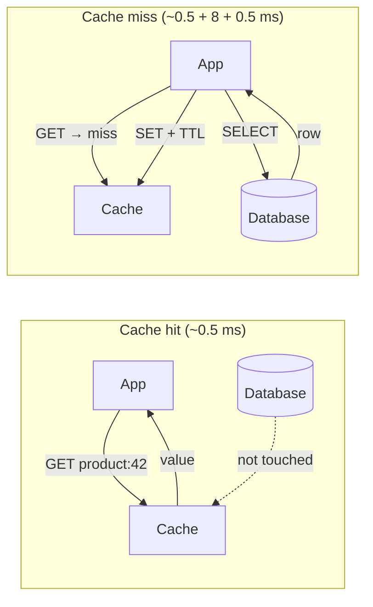
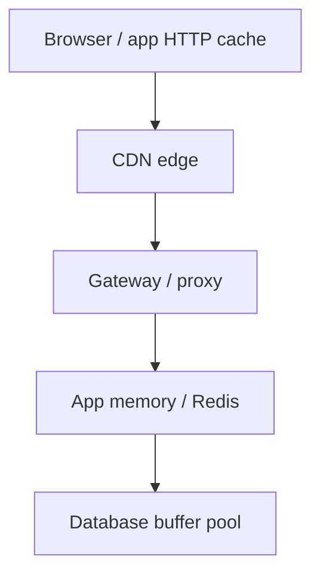
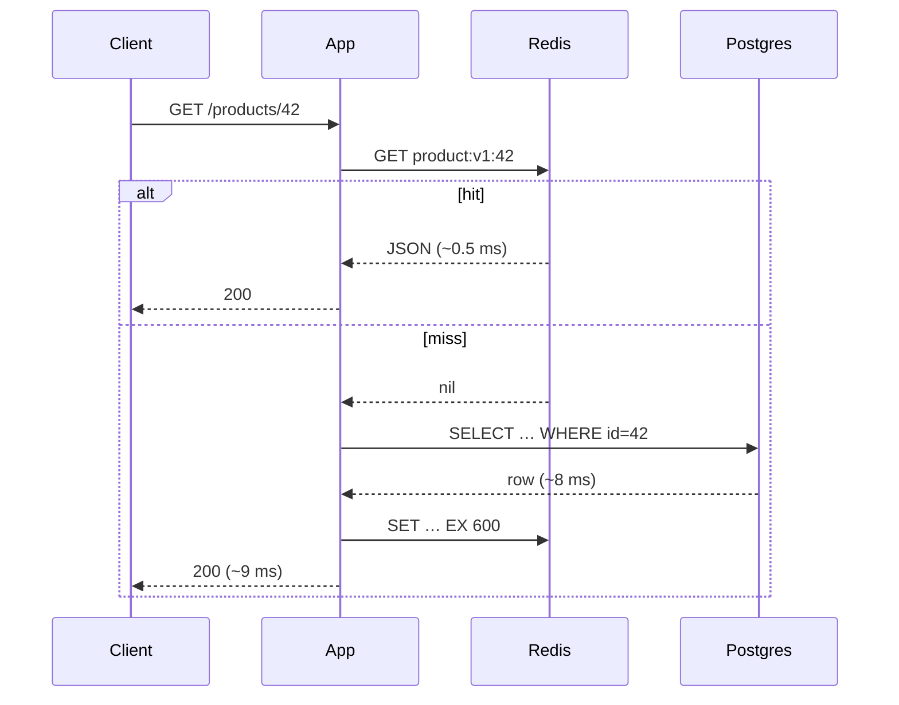
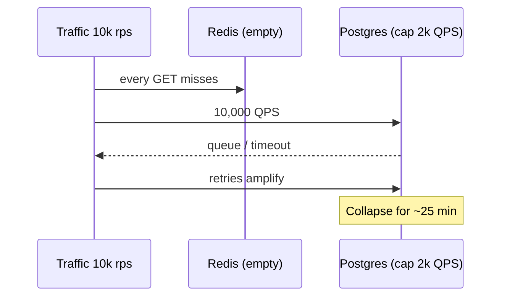

# Lesson 01: Why Cache and Where — Hit Ratio, Cache Layers & What Not to Cache

> **Prerequisites:** [Track: Load Balancing](../../06-load-balancing/README.md) (optional) and a solid grip on latency budgets from Core Fundamentals.  
> **Estimated Reading Time:** 28–35 minutes  
> **Target Audience:** Backend engineers adding Redis “because the DB is hot,” SREs sizing cold-cache capacity, and interview candidates who must defend *where* and *what* to cache.  
> **Free PDF Notes:** [Download SD-F-001.pdf](https://backendroadmap.com/notes/system-design/SD-F-001.pdf)

> [!NOTE]
> **In one line:** A cache is a fast copy of data that is slow to fetch or compute. It works because a small hot set receives most requests, so the hit ratio decides how much load disappears; caching can sit at every layer from browser to database, and it costs you freshness, an extra system, and new ways to fail.

> [!TIP]
> **The Golden Rule of Caching:** *Cache what is read often, slow to get, and safe to be N seconds stale — and always plan for the day the cache is empty.* Hit ratio is the dial; cold-start capacity is the safety net.

---

## Words You'll Meet Today

| Word | In Plain Words | Role in a Live Backend System |
| :--- | :--- | :--- |
| **Cache** | Fast disposable copy of expensive data | Redis, Memcached, CDN edge, browser |
| **Source of truth** | Authoritative store the cache copies | Postgres, DynamoDB, object store |
| **Hit / miss** | Found in cache / must go to source | Every lookup ends as one or the other |
| **Hit ratio** | $\text{hits} / (\text{hits} + \text{misses})$ | Controls DB load and average latency |
| **Working set** | Hot data that receives most requests | What you actually need to keep in memory |
| **Locality** | Recently / popularly used data is reused | Why a small cache removes most load |
| **TTL** | How long an entry stays valid | Bounds staleness (Lesson 05) |
| **Cold cache** | Empty cache; every request misses | Restart / flush spike on the database |

---

## Visual Mental Models & Architecture

### The Same Query, Thousands of Times a Second

Your shop’s product page runs the same database query for the same product thousands of times a second on data that changes once a day. The database sits at 90% CPU, pages take half a second, and every new customer makes it worse. A cache remembers the answer: the first request pays full price; the next thousand get the stored copy in a fraction of a millisecond.



*Figure 1. A miss is slower than having no cache at all — you pay for the cache check plus the database round trip.*

### Layers Along One Request



*Figure 2. Closer to the user = faster and less load behind, but harder to invalidate. Most system-design discussions focus on the application cache (Redis).*

---

## Core Definition & Taxonomic Comparison

**What it is:** A fast, disposable copy of data that is expensive to fetch or compute. **What it isn’t:** A source of truth, a durability guarantee, or a fix for an unindexed 4-second query.

| Term | Precise Meaning | Production Example |
| :--- | :--- | :--- |
| **Cache** | Fast copy; system must stay correct if it vanishes | Redis product JSON for 10 minutes |
| **Source of truth** | Authoritative durable store | `products` table in Postgres |
| **Buffer pool** | DB’s own page cache | Postgres shared buffers |
| **CDN edge** | Shared HTTP cache near users | CloudFront / Fastly for `/static/*` |
| **Working set** | Hot subset that receives most traffic | Top 10% of SKUs ≈ 80% of views |
| **Hit ratio** | Share of lookups served from cache | Redis `keyspace_hits / (hits+misses)` |

| Layer | What is cached | Who controls it | Shared by users? | Typical lifetime |
| :--- | :--- | :--- | :--- | :--- |
| Browser / app | Responses, images, scripts | `Cache-Control` (browser decides) | No | minutes–year (versioned files) |
| CDN edge | Static files, some API | Headers + purge APIs | Yes, per region | seconds–days |
| Gateway / proxy | Whole HTTP responses | Your config | Yes | seconds–minutes |
| App (in-process) | Objects, config, computed values | Your code | One process | seconds–minutes |
| Redis / Memcached | Objects, sessions, query results | Your code | All app servers | seconds–hours |
| DB buffer pool | Hot disk pages | Database engine | Yes | automatic (LRU-like) |

---

## Component Breakdown & Anatomy

### Why It Is Faster

Speed comes from *where* the data lives. Memory is built for fast random access; a database parses, plans, finds pages, locks, reads, and sends over the network.

| Operation | Typical latency | Relative to local RAM |
| :--- | :--- | :--- |
| Local process memory | ~100 ns | $1\times$ |
| Redis GET, same zone | ~0.5 ms | ~$5{,}000\times$ |
| Simple indexed Postgres query | 1–10 ms | ~$10{,}000$–$100{,}000\times$ |
| Call to another service | 10–100 ms | orders of magnitude more |
| Heavy join / report | 50–500 ms | even worse |

A single Redis node handles well over 100,000 simple reads/s; a typical Postgres instance doing real queries handles a few thousand.

### Locality and Skewed Popularity

Caching pays off only if the same data is asked for again:

1. **Temporal locality** — what was used a moment ago is likely used again.
2. **Skewed popularity (Zipf / 80–20)** — a small part of the data receives most requests.

Illustrative catalogue of 1,000,000 products: top 1% ≈ 50% of views, next 9% ≈ 30%, remaining 90% ≈ 20%. Keep the hottest 10% (~100,000 products) in memory and ~80% of reads never touch the database.

### The Observability Gap

| Signal | Captures | Hides |
| :--- | :--- | :--- |
| Redis `INFO stats` hit/miss | Global keyspace ratio | One useless key family drowning in a healthy global ratio |
| App `product_cache.hit` / `.miss` | Per-cache, per-key-type ratio | Cross-region / multi-replica skew |
| Average latency alone | Blended hit+miss | That p99 is all misses |
| DB QPS | Miss traffic | That cache is about to restart empty |
| Cache memory used | Capacity pressure | Working-set size vs cache size |

Measure hit ratio **per cache and per key type** in the application, not only Redis globals.

---

## Mathematical Model & Worked Example

Average latency with hit ratio $h$, cache time $t_c$, database time $t_{db}$:

$$
L_{\text{avg}} = h \cdot t_c + (1 - h) \cdot (t_c + t_{db})
$$

Database load at traffic $\lambda$:

$$
\lambda_{db} = (1 - h) \cdot \lambda
$$

| Hit ratio | Reads reaching DB (10,000/s) | Avg latency ($t_c{=}1$ ms, $t_{db}{=}20$ ms) | Comment |
| :--- | :--- | :--- | :--- |
| 50% | 5,000/s | 11 ms | Barely worth the extra system |
| 80% | 2,000/s | 5 ms | Good start |
| 90% | 1,000/s | 3 ms | Typical target for read-heavy data |
| 95% | 500/s | 2 ms | DB load $\div$ 20 vs uncached |
| 99% | 100/s | 1.2 ms | Great — watch staleness & stampedes |

Going from 90% → 99% does **not** make the cache “10% better”; it cuts database traffic **ten times**.

### Sizing a Product Cache

1. 1,000,000 products × ~2 KB JSON ⇒ whole catalogue ≈ 2 GB.
2. Top 10% (100,000 products, 200 MB) gets ~80% of reads.
3. Redis overhead ~50–100 bytes/key ⇒ ~220 MB for the hot set.
4. Cache **300 MB** for headroom → ~80–85% hit ratio in week one; 1 GB pushes past 90%.

Hit ratio rises quickly for the first few percent of data and flattens: the last 60% of memory often adds only a couple of hit-ratio points.

---

## Metrics, Percentiles & Statistical Distributions

| Percentile | Who it describes in a cached path | What it often reveals |
| :--- | :--- | :--- |
| $p_{50}$ | Mostly hits | Cache health under normal load |
| $p_{95}$ | Mix of hits and occasional misses | Working-set fit |
| $p_{99}$ | Almost all misses / slow fills | Stampede risk, cold keys |
| $p_{99.9}$ | Worst miss path + queueing | Connection-pool exhaustion |

**How averages lie:** 9,500 requests at 0.5 ms (hits) and 500 at 20 ms (misses) → average ≈ 1.5 ms, but the miss cohort still sees 20 ms and the database still sees 500 QPS. Report hit ratio **and** miss latency separately.

---

## Compounding Effects & System Scale

With $N$ independent cacheable lookups on a page, each with miss probability $m = 1 - h$:

$$
P(\text{at least one miss}) = 1 - h^{N}
$$

| $N$ lookups | $h = 0.99$ | $h = 0.95$ | $h = 0.90$ |
| :--- | :--- | :--- | :--- |
| 1 | 1.0% miss chance | 5% | 10% |
| 5 | 4.9% | 23% | 41% |
| 10 | 9.6% | 40% | 65% |
| 20 | 18% | 64% | 88% |
| 50 | 39% | 92% | 99.5% |

A “99% hit ratio” still leaves almost 40% of 50-key pages paying at least one miss. Multi-key pages need coalescing and budgets, not only a global hit ratio.

---

## Numbers Every Backend Engineer Must Know

| Operation | Hardware layer | Typical cost | Architectural implication |
| :--- | :--- | :--- | :--- |
| L1/L2 cache line | CPU | 1–10 ns | In-process caches win for tiny hot objects |
| DRAM random read | Memory | ~100 ns | Ideal for working set |
| Redis same-AZ RTT | Network + process | ~0.2–1 ms | Shared cache across fleet |
| Postgres indexed row | Disk/cache + CPU | 1–10 ms | Miss path cost |
| Cross-AZ Redis | Network | +1–2 ms | Prefer same zone for L2 |
| Cross-region | WAN | 50–150 ms+ | CDN / regional caches |

---

## Protocol & Network Deep Dive



*Figure 3. Cold Redis connection (DNS + TCP + AUTH) adds another RTT on first use — pool and keep-alive Redis clients the same way you pool DB connections.*

---

## Hierarchical Budgets & Capacity Sizing

| Tier | Latency budget (example p99) | Role |
| :--- | :--- | :--- |
| Gateway | 5 ms | Auth, routing |
| Cache hit path | 1–2 ms | Redis + deserialize |
| Cache miss + DB | 15–30 ms | Fill + return |
| Headroom | 20–30% | Queueing under load |

**Cold-cache capacity:** if peak traffic is 10,000 rps at 95% hit ratio, the DB sees 500 QPS normally. Size the DB (and connection pools) for a realistic **cache-down** scenario (partial or full miss), not only the happy path. Load-test “Redis empty at peak.”

---

## Top Engineering Mitigation Techniques

1. **Cache the working set first** — hottest 10% often delivers most of the win.
2. **Measure hit ratio per key family** — kill caches that sit at 10% hits.
3. **TTL + invalidation plan before launch** — never “cache forever.”
4. **Warm before traffic** — preload top keys after restart; roll replicas one at a time.
5. **Protect the source** — connection limits, circuit breakers, load shedding when the cache fails.

---

## Production War Story (SEV-1 Post-Mortem)

**Severity & Impact:** Black Friday peak, 10,000 rps, 95% hit ratio → DB sized for ~2,000 QPS with normal miss load ~500 QPS. Routine Redis config restart at noon → ~25 minutes near-total outage.

**What Happened:** Cache emptied → hit ratio 0% → DB received ~10,000 QPS (5× capacity). Queues filled, pages went from 20 ms to 30 s, clients retried and amplified load. Even as the cache tried to refill, the DB was too busy to answer the misses that would warm it.



**Root Cause:** Database sized for misses only; no warm-up; restart at peak; no miss coalescing.

**The Fix & Hardening:**
1. Never restart/flush cache at peak; roll clustered nodes one at a time in a quiet window.
2. Warm top keys from a list or replica before taking traffic.
3. Coalesce misses (Lesson 10); circuit-break and shed when DB saturates.
4. Document and load-test **cache-down** capacity.

---

## Multi-Language Production Code

````carousel
```go
// Go: cache-aside product lookup with hit/miss metrics
package cache

import (
	"context"
	"encoding/json"
	"fmt"
	"time"

	"github.com/redis/go-redis/v9"
)

type Product struct {
	ID    int64   `json:"id"`
	Name  string  `json:"name"`
	Price float64 `json:"price"`
}

func GetProduct(ctx context.Context, rdb *redis.Client, id int64, fetch func(context.Context, int64) (*Product, error)) (*Product, error) {
	key := fmt.Sprintf("product:v1:%d", id)
	raw, err := rdb.Get(ctx, key).Bytes()
	if err == nil {
		metricsIncr("product_cache.hit")
		var p Product
		if err := json.Unmarshal(raw, &p); err != nil {
			return nil, err
		}
		return &p, nil
	}
	if err != redis.Nil {
		// Prefer failing open: treat cache errors as misses.
	}
	metricsIncr("product_cache.miss")
	p, err := fetch(ctx, id)
	if err != nil || p == nil {
		return p, err
	}
	b, _ := json.Marshal(p)
	_ = rdb.Set(ctx, key, b, 10*time.Minute).Err()
	return p, nil
}
```

<!-- slide -->

```typescript
// TypeScript / Node: cache-aside with Redis and counters
import Redis from "ioredis";

const redis = new Redis({ host: "cache", port: 6379, connectTimeout: 50 });

export async function getProduct(
  productId: number,
  fetchFromDb: (id: number) => Promise<Record<string, unknown> | null>,
  metrics: { incr: (k: string) => void }
) {
  const key = `product:v1:${productId}`;
  try {
    const raw = await redis.get(key);
    if (raw != null) {
      metrics.incr("product_cache.hit");
      return JSON.parse(raw);
    }
  } catch {
    /* fail open */
  }
  metrics.incr("product_cache.miss");
  const row = await fetchFromDb(productId);
  if (row) {
    try {
      await redis.set(key, JSON.stringify(row), "EX", 600);
    } catch {
      /* never fail the request because cache failed */
    }
  }
  return row;
}
```

<!-- slide -->

```python
# Python: product lookup with Redis (cache-aside), counting hits and misses
import json
import redis

r = redis.Redis(host="cache", port=6379)

def get_product(product_id: int, db, metrics) -> dict | None:
    key = f"product:v1:{product_id}"  # namespace + version + id
    raw = r.get(key)
    if raw is not None:
        metrics.incr("product_cache.hit")
        return json.loads(raw)  # hit: about 0.5 ms
    metrics.incr("product_cache.miss")
    row = db.fetch_one(
        "SELECT id, name, price FROM products WHERE id = %s", product_id
    )
    if row is not None:
        r.set(key, json.dumps(row), ex=600)  # keep for 10 minutes
    return row  # miss: DB time + small extra cost
```

<!-- slide -->

```csharp
// C#: cache-aside with StackExchange.Redis
using System.Text.Json;
using StackExchange.Redis;

public static class ProductCache
{
    public static async Task<Product?> GetAsync(
        IDatabase redis, long id, Func<long, Task<Product?>> fetch, IMetrics metrics)
    {
        var key = $"product:v1:{id}";
        var raw = await redis.StringGetAsync(key);
        if (raw.HasValue)
        {
            metrics.Incr("product_cache.hit");
            return JsonSerializer.Deserialize<Product>((string)raw!);
        }
        metrics.Incr("product_cache.miss");
        var row = await fetch(id);
        if (row is not null)
            await redis.StringSetAsync(key, JsonSerializer.Serialize(row), TimeSpan.FromMinutes(10));
        return row;
    }
}

public record Product(long Id, string Name, decimal Price);
```
````

---

## Hands-On CLI Verification Workflows

```bash
# 1. Hit-ratio math: 10k rps, h=0.95, tc=1ms, tdb=20ms
python -c "h,tc,tdb,lam=0.95,1,20,10000; print('Lavg', h*tc+(1-h)*(tc+tdb), 'ms'); print('DBqps', (1-h)*lam)"

# 2. Redis keyspace hits/misses (after traffic)
redis-cli INFO stats | findstr keyspace

# 3. Simulate cold cache impact
python -c "print('normal DB', 0.05*10000); print('cold DB', 1.0*10000)"

# 4. Working-set size estimate
python -c "print('hot 10% MB', 100_000*2/1024, 'plus overhead ~220 MB')"
```

---

## Common Mistakes to Avoid

1. Adding a cache before measuring — unknown reachable hit ratio and unknown real bottleneck.
2. Caching one-off / unique-per-request data (hit ratio stuck near 10%).
3. No expiry or invalidation plan — stale forever.
4. Keys that omit user, language, currency, or version — wrong or private data.
5. Sizing the database for the cached hit ratio with no cold-cache plan.
6. Treating the cache as a database — only copy of important data lives in Redis.
7. Not monitoring hit ratio, evictions, memory, and cache latency itself.
8. Using a cache to hide a 4-second unindexed query instead of fixing the query first.

---

## Key Terms Glossary

| Term | Definition |
| :--- | :--- |
| Cache | Fast copy of data that is costly to get |
| Source of truth | Original data the cache copies |
| Hit / miss | Found in cache / not found |
| Hit ratio | $\text{hits} \div (\text{hits}+\text{misses})$ |
| Working set | Hot data receiving most requests |
| Locality | Recently or popularly used data is used again |
| TTL | Time to live — how long an entry stays valid |
| Staleness | How out of date a copy is |
| Cold cache | Empty cache; every request misses |
| Warm-up | Preloading hot data before traffic arrives |
| Eviction | Removing entries to free memory |
| Buffer pool | Database’s own in-memory page cache |

---

## Interview Practice Questions

### Basic (Q1–Q4)

<details>
<summary><strong>Q1: What is a cache, and why does it make a system faster? [BASIC]</strong></summary>

A fast copy of data that is expensive to fetch or compute, kept in a faster place (usually memory). Requests that hit it skip the slow path, and because a small hot set gets most traffic, a small cache removes most of the load.

</details>

<details>
<summary><strong>Q2: Where can caching happen in a request path? [BASIC]</strong></summary>

In the browser or app, the CDN, the API gateway or reverse proxy, the application (in-process or Redis/Memcached), and the database’s own buffer pool.

</details>

<details>
<summary><strong>Q3: What is the hit ratio, and why does it matter? [BASIC]</strong></summary>

The share of requests served from the cache. The database only sees the misses, so going from 90% to 99% cuts database traffic by ten times.

</details>

<details>
<summary><strong>Q4: What data should not be cached? [BASIC]</strong></summary>

Data that must be exactly current (balances, checkout stock), data with low reuse, one-off personalised results, and sensitive data without per-user scoping.

</details>

### Scenario (Q5–Q8)

<details>
<summary><strong>Q5: Your hit ratio is 80%. How much database load do you save by reaching 98%? [SCENARIO]</strong></summary>

Misses fall from 20% to 2%, so the database does ten times fewer reads.

</details>

<details>
<summary><strong>Q6: 10,000 reads/s, 95% hit ratio, 1 ms cache and 20 ms database. What is average latency and DB load? [SCENARIO]</strong></summary>

Average $\approx 0.95\times1 + 0.05\times21 = 2$ ms. The database receives 5% of 10,000 = 500 QPS.

</details>

<details>
<summary><strong>Q7: You have 1M products of 2 KB each. How much memory would a cache need? [SCENARIO]</strong></summary>

The whole catalogue is 2 GB, but with skewed traffic the hottest 10% (~200 MB plus overhead) gives about 80% of the hits. Start with a few hundred MB and tune using measured hit ratio.

</details>

<details>
<summary><strong>Q8: Should you cache a user's account balance? [SCENARIO]</strong></summary>

Not for decisions such as transfers or payments, which must read the source of truth. A display-only balance could be cached for a few seconds and invalidated on every transaction.

</details>

### Tricky (Q9–Q12)

<details>
<summary><strong>Q9: Why can adding a cache make an outage worse? [TRICKY]</strong></summary>

The database is sized for the misses only. If the cache fails or restarts empty, all traffic reaches the database at once. Warm-up, miss coalescing, rate limits, and not restarting at peak protect you.

</details>

<details>
<summary><strong>Q10: A teammate wants to cache a query that takes 4 seconds. What do you say? [TRICKY]</strong></summary>

Find out why it is slow first. A cache hides it for hot keys but every miss and cold start is still 4 seconds. Fix the index or query, then cache if the load still justifies it.

</details>

<details>
<summary><strong>Q11: Why is the closest cache to the user not always the best? [TRICKY]</strong></summary>

It is the fastest and removes the most load, but you cannot invalidate it on demand. Use long lifetimes only for data that never changes (versioned static files); short ones for the rest.

</details>

<details>
<summary><strong>Q12: Is a cache the same as a database? [TRICKY]</strong></summary>

No. A cache is disposable and can be wrong or empty at any time; the system must stay correct without it. A database is the source of truth and must be durable.

</details>

---

## One-Page Master Cheat Sheet

```text
====================================================================================================
                    WHY CACHE & WHERE — CHEAT SHEET (SD-F-001)
====================================================================================================
CACHE      = fast disposable copy of slow data; source of truth stays authoritative
WHY        = locality + skew: small working set gets most requests
LATENCY    L_avg = h*tc + (1-h)*(tc+tdb)     DB load = (1-h)*traffic
TARGETS    aim 90%+ hit ratio on read-heavy data; start by caching hottest ~10%
LAYERS     browser → CDN → gateway → app memory → Redis → DB buffer pool
           closer to user = faster, harder to invalidate
DON'T      must-be-fresh · low-reuse · one-off personal · unscoped sensitive · slow-query band-aid
COSTS      staleness · extra system · complexity · cold-start risk
MEASURE    hit ratio per key type · miss latency · evictions · plan for cache-down capacity
ANTI       restart Redis at peak · size DB for hits only · cache without TTL/invalidation
====================================================================================================
```

---

## Free PDF notes

[SD-F-001.pdf](https://backendroadmap.com/notes/system-design/SD-F-001.pdf)

---

## Sources

- Redis docs — client-side caching and `INFO` command.  
- AWS Whitepaper — *Database Caching Strategies Using Redis*.  
- Kleppmann, M. — *Designing Data-Intensive Applications* (replication & caching trade-offs).

---

## Next

Next: [Lesson 02: Cache-Aside (Lazy Loading)](../02-cache-aside/README.md).
