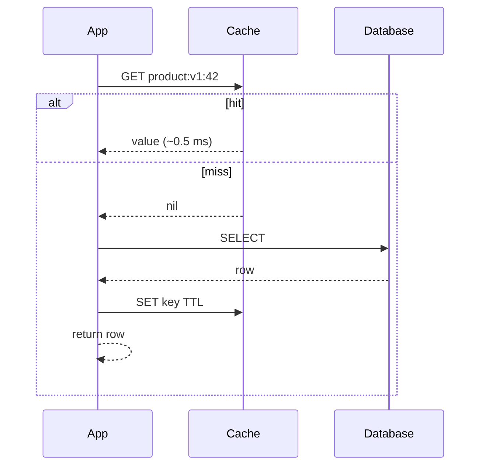
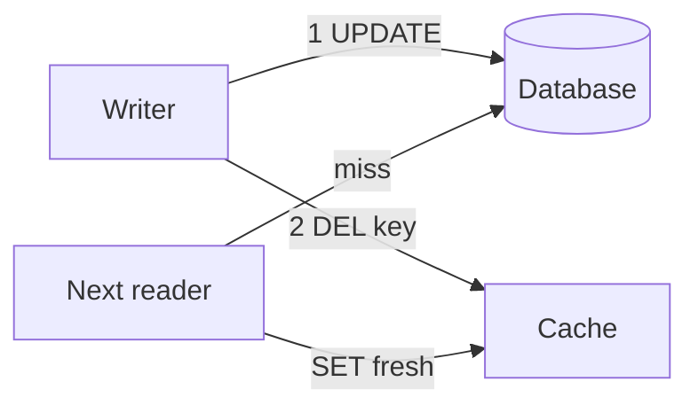

# Lesson 02: Cache-Aside (Lazy Loading) — Reads, Writes & Why Delete on Write

> **Prerequisites:** [Lesson 01: Why Cache and Where](../01-why-cache-and-where/README.md).  
> **Estimated Reading Time:** 28–35 minutes  
> **Target Audience:** Backend engineers wiring Redis beside Postgres, and interview candidates who must walk the read/write path and the delete-on-write race.  
> **Free PDF Notes:** [Download SD-F-002.pdf](https://backendroadmap.com/notes/system-design/SD-F-002.pdf)

> [!NOTE]
> **In one line:** In cache-aside the application owns the cache logic. On a read it checks the cache and, on a miss, loads from the database and stores the result with a TTL. On a write it updates the database and then deletes the cache key. It is the most common caching pattern; its traps are the stale window, races, and cold-start behaviour.

> [!TIP]
> **The Golden Rule of Cache-Aside:** *Database first, then DELETE the key — never SET the new value on write.* Always attach a TTL with jitter, and make every write path invalidate the same keys.

---

## Words You'll Meet Today

| Word | In Plain Words | Role in a Live Backend System |
| :--- | :--- | :--- |
| **Cache-aside** | App checks cache, fills on miss | Default Redis + Postgres pattern |
| **Lazy loading** | Only requested data is cached | Working set fills itself |
| **Invalidation** | Removing a stale entry | `DEL product:v1:42` after UPDATE |
| **Stale window** | Time cache can show old data | ms between DB write and delete |
| **Double delete** | Delete again after a short delay | Clears late write-backs |
| **Jitter** | Random spread on TTLs | Prevents synchronised expiry |
| **Fail open** | Fall back to DB if cache fails | Short Redis timeout + swallow errors |
| **CDC** | Change events from DB log | Invalidation when writers forget |

---

## Visual Mental Models & Architecture

### Read Path



*Figure 1. Lazy: only requested keys enter the cache. The first request for each key is slow.*

### Write Path: Update DB, Delete Key



*Figure 2. Never write the new value into the cache on the write path — remove the old one and let the next reader refill.*

---

## Core Definition & Taxonomic Comparison

**What it is:** Application-owned caching: the cache is a passive key-value store; the app talks to both cache and database. **What it isn’t:** Read-through (cache runs the loader), write-through (cache syncs writes), or a strongly consistent store.

| Term | Precise Meaning | Production Example |
| :--- | :--- | :--- |
| **Cache-aside** | App loads on miss, deletes on write | FastAPI + Redis products |
| **Read-through** | Cache provider runs loader | Caffeine `LoadingCache`, DAX |
| **Write-through** | Cache writes DB synchronously | DAX item writes |
| **Lazy loading** | Cache only what was requested | Hot SKUs fill; cold SKUs stay out |

| Pattern | Who talks to DB? | Cache contents | If cache dies |
| :--- | :--- | :--- | :--- |
| Cache-aside | Application | Only requested | App still works (slower) |
| Read-through | Cache on miss | Only requested | Depends on product |
| Write-through | Cache on write | Everything written | Writes may fail |

---

## Component Breakdown & Anatomy

### Why Delete Instead of Update

Concurrent writers can reach the cache in a different order than the database:

| Step | Who | Database | Cache |
| :--- | :--- | :--- | :--- |
| 1 | A UPDATE price=10 | 10 | old |
| 2 | B UPDATE price=12 | 12 | old |
| 3 | B SET cache=12 | 12 | 12 |
| 4 | A SET cache=10 (late) | 12 | **10** |

Deleting is safe: whatever the order of deletes, the next reader loads what the DB currently holds. Extra reasons: no wasted work caching unread keys; derived views rebuild only if needed.

### The Stale Window That Remains

1. **Small window** between DB write and cache delete (milliseconds) — readers can still see the old value.
2. **Rare race:** a slow reader SELECTs the old row before the update and SETs after the delete — stale until TTL.

How teams handle it: always set a TTL; delayed double delete (~500 ms); versioned values / refuse older sets; CDC when many services write.

### The Observability Gap

| Signal | Captures | Hides |
| :--- | :--- | :--- |
| Hit ratio | Lazy fill health | One write path that never deletes |
| Delete QPS | Invalidation volume | Jobs updating DB without helpers |
| Redis errors | Cache availability | Silent fail-open flooding the DB |
| TTL distribution | Expiry spread | Synchronised bulk warm without jitter |

---

## Mathematical Model & Worked Example

With traffic $\lambda$, hit ratio $h$, and write rate $w$:

$$
\lambda_{db,read} = (1-h)\lambda, \qquad \text{invalidations} \approx w
$$

TTL with jitter (base $T$, spread $s$, e.g. $0.15$):

$$
TTL = T + U(-sT,\, sT)
$$

Delayed double-delete delay $\delta$ should exceed fill-path $p_{99.9}$:

$$
\delta \ge p_{99.9}(\text{SELECT + serialize + SET})
$$

Typical: $\delta = 500$ ms when fill $p_{99.9} \approx 200$–$300$ ms.

| Situation | DB impact | Defence |
| :--- | :--- | :--- |
| Cache down | All traffic → DB | Short timeouts, fail open, rate limits |
| Cold cache | Burst of misses | Warm keys; roll replicas off-peak |
| Hot-key stampede | Many identical queries | Coalesce / lock (Lesson 10) |
| Synchronised expiry | Periodic miss walls | Jitter ±10–20% |

---

## Metrics, Percentiles & Statistical Distributions

| Metric | Good signal | Bad signal |
| :--- | :--- | :--- |
| Hit ratio | Stable 90%+ | Drops after deploys or every TTL |
| Miss latency $p_{99}$ | ≈ DB $p_{99}$ | Cache timeout hanging requests |
| Delete lag | Sub-ms after commit | Writers skipping delete |
| Redis timeout rate | Near zero | Fail-open → DB overload |

**How averages lie:** a healthy global hit ratio can hide one endpoint that never deletes, leaving a cohort of users on stale data for the full TTL.

---

## Compounding Effects & System Scale

With $N$ independent write paths, if each forgets invalidation with probability $p$:

$$
P(\text{at least one forgets}) = 1 - (1-p)^{N}
$$

Centralise `save_listing()` or invalidate from CDC. Without jitter, keys warmed together expire together — miss burst ≈ warmed_keys in one second at expiry.

---

## Numbers Every Backend Engineer Must Know

| Item | Typical value |
| :--- | :--- |
| Redis GET same zone | ~0.5 ms |
| Redis socket timeout (fail fast) | 20–50 ms |
| Product TTL | 5–10 min + jitter |
| Double-delete delay | 300–1000 ms |
| Jitter | ±10–20% of base TTL |

---

## Protocol & Network Deep Dive

```mermaid
sequenceDiagram
    participant R as Reader
    participant W as Writer
    participant C as Cache
    participant D as DB
    R->>C: GET → miss
    R->>D: SELECT (slow) reads 10
    W->>D: UPDATE → 12
    W->>C: DEL (nothing)
    R->>C: SET 10 (late)
    Note over C: Stale 10 until TTL; double-delete or versions fix
```

*Figure 3. The rare stale-write race. TTL bounds damage; delayed second delete removes most late write-backs.*

---

## Hierarchical Budgets & Capacity Sizing

| Path | Budget |
| :--- | :--- |
| Hit | ≤ 2 ms |
| Miss fill | DB budget + ~1 ms SET |
| Redis timeout | ≪ DB timeout (fail open) |
| Cold cache | Know DB cache-down QPS |

---

## Top Engineering Mitigation Techniques

1. **Delete-on-write, never SET-on-write.**
2. **TTL + jitter on every key.**
3. **Delayed double delete** for late write-backs.
4. **One helper owns miss + invalidate;** jobs call it or CDC deletes.
5. **Fail open** with short Redis timeouts; protect the DB with limits.

---

## Production War Story (SEV-1 Post-Mortem)

**Severity & Impact:** Marketplace listings with a 6-hour TTL. Web edits deleted keys correctly; a nightly bulk import updated Postgres directly and never touched the cache. Thousands of listings showed yesterday’s prices for up to 6 hours. Shortening TTL to 30 minutes cut staleness but raised DB load fivefold.

```mermaid
sequenceDiagram
    participant Job as Bulk import
    participant D as Postgres
    participant C as Redis
    participant U as Buyer
    Job->>D: UPDATE prices (no DEL)
    U->>C: GET → HIT old price
    Note over U,C: Stale up to 6h; DB was correct
```

**Root Cause:** Cache-aside only works if *every* write path invalidates.

**The Fix:**
1. Central `save_listing()` including cache invalidation for all writers.
2. CDC `listing_changed` for legacy jobs that cannot call the helper.
3. TTL returned to 6 hours as a safety net, not the fix.

---

## Multi-Language Production Code

````carousel
```go
// Go: cache-aside get + delete-on-write
package products

import (
	"context"
	"encoding/json"
	"fmt"
	"math/rand"
	"time"

	"github.com/redis/go-redis/v9"
)

type Product struct {
	ID    int64   `json:"id"`
	Name  string  `json:"name"`
	Price float64 `json:"price"`
}

func GetProduct(ctx context.Context, rdb *redis.Client, id int64, fetch func(context.Context, int64) (Product, error)) (Product, error) {
	key := fmt.Sprintf("product:v1:%d", id)
	if raw, err := rdb.Get(ctx, key).Bytes(); err == nil {
		var p Product
		_ = json.Unmarshal(raw, &p)
		return p, nil
	}
	p, err := fetch(ctx, id)
	if err != nil {
		return p, err
	}
	ttl := time.Duration(300+rand.Intn(61)) * time.Second
	b, _ := json.Marshal(p)
	_ = rdb.Set(ctx, key, b, ttl).Err()
	return p, nil
}

func UpdateProduct(ctx context.Context, rdb *redis.Client, id int64, price float64, update func(context.Context, int64, float64) error) error {
	if err := update(ctx, id, price); err != nil {
		return err
	}
	return rdb.Del(ctx, fmt.Sprintf("product:v1:%d", id)).Err() // delete, do not SET
}
```

<!-- slide -->

```typescript
// TypeScript: fail-open cache-aside
import Redis from "ioredis";

export async function getProduct(
  redis: Redis,
  id: number,
  fetch: (id: number) => Promise<object | null>
) {
  const key = `product:v1:${id}`;
  try {
    const raw = await redis.get(key);
    if (raw) return JSON.parse(raw);
  } catch {
    /* use DB */
  }
  const row = await fetch(id);
  if (!row) return null;
  const ttl = 300 + Math.floor(Math.random() * 61);
  try {
    await redis.set(key, JSON.stringify(row), "EX", ttl);
  } catch {
    /* never fail because cache failed */
  }
  return row;
}

export async function updateProduct(
  redis: Redis,
  id: number,
  price: number,
  updateDb: (id: number, price: number) => Promise<void>
) {
  await updateDb(id, price);
  await redis.del(`product:v1:${id}`);
}
```

<!-- slide -->

```python
# Python FastAPI + redis.asyncio: cache-aside
import json, random
import redis.asyncio as redis
from fastapi import FastAPI, HTTPException

app = FastAPI()
r = redis.Redis(host="cache", port=6379, socket_timeout=0.05)

def key(product_id: int) -> str:
    return f"product:v1:{product_id}"

@app.get("/products/{product_id}")
async def get_product(product_id: int):
    try:
        raw = await r.get(key(product_id))
        if raw is not None:
            return json.loads(raw)
    except redis.RedisError:
        pass
    row = await db.fetchrow(
        "SELECT id, name, price FROM products WHERE id = $1", product_id
    )
    if row is None:
        raise HTTPException(404)
    product = dict(row)
    ttl = 300 + random.randint(0, 60)
    try:
        await r.set(key(product_id), json.dumps(product), ex=ttl)
    except redis.RedisError:
        pass
    return product

@app.put("/products/{product_id}")
async def update_product(product_id: int, body: dict):
    await db.execute(
        "UPDATE products SET price=$2 WHERE id=$1", product_id, body["price"]
    )
    await r.delete(key(product_id))  # delete, do not update
    return {"ok": True}
```

<!-- slide -->

```csharp
// C#: delete-on-write with StackExchange.Redis
using System.Text.Json;
using StackExchange.Redis;

public static class ProductCacheAside
{
    public static async Task<Product?> GetAsync(
        IDatabase redis, long id, Func<long, Task<Product?>> fetch)
    {
        var key = $"product:v1:{id}";
        var raw = await redis.StringGetAsync(key);
        if (raw.HasValue)
            return JsonSerializer.Deserialize<Product>((string)raw!);
        var row = await fetch(id);
        if (row is null) return null;
        var ttl = TimeSpan.FromSeconds(300 + Random.Shared.Next(0, 61));
        await redis.StringSetAsync(key, JsonSerializer.Serialize(row), ttl);
        return row;
    }

    public static async Task UpdateAsync(
        IDatabase redis, long id, decimal price,
        Func<long, decimal, Task> updateDb)
    {
        await updateDb(id, price);
        await redis.KeyDeleteAsync($"product:v1:{id}");
    }
}

public record Product(long Id, string Name, decimal Price);
```
````

---

## Hands-On CLI Verification Workflows

```bash
# 1. Jittered TTL samples
python -c "import random; print([300+random.randint(0,60) for _ in range(5)])"

# 2. Redis delete-on-write simulation
redis-cli SET product:v1:42 "{\"price\":10}" EX 300
redis-cli DEL product:v1:42
redis-cli GET product:v1:42

# 3. Fail-fast timeout intuition
python -c "print('Redis timeout 50ms << DB p99; fail open')"
```

---

## Common Mistakes to Avoid

1. Updating the cache on write instead of deleting.
2. Deleting the cache before writing the database.
3. No TTL — one missed invalidation means forever stale.
4. Failing the request when Redis is slow instead of falling open.
5. One write path invalidates; jobs/scripts do not.
6. Copy-pasted miss logic in many endpoints.
7. Keys missing language, currency, or tenant.
8. No jitter → synchronised expiry spikes.

---

## Key Terms Glossary

| Term | Definition |
| :--- | :--- |
| Cache-aside | App reads and fills the cache itself |
| Lazy loading | Only requested data is cached |
| Cache miss | Key not found; load from DB |
| Invalidation | Removing or refreshing a stale entry |
| Stale window | Time during which cache can show old data |
| TTL | Expiry that bounds staleness |
| Jitter | Random variation added to TTLs |
| Double delete | Delete again after a short delay |
| Cold cache | Empty cache after a restart |
| Fail open | Fall back to DB when cache fails |
| CDC | Change data capture from DB log |
| Versioned key | Key with format version, e.g. `product:v1:42` |

---

## Interview Practice Questions

### Basic (Q1–Q4)

<details>
<summary><strong>Q1: Walk through cache-aside reads and writes. [BASIC]</strong></summary>

Read: check the cache; on a hit return it; on a miss read the database, store the result with a TTL and return it. Write: update the database, then delete the cache key.

</details>

<details>
<summary><strong>Q2: Why is it called lazy loading? [BASIC]</strong></summary>

Nothing is loaded in advance. Data enters the cache only when it is first requested, so the cache holds just the working set.

</details>

<details>
<summary><strong>Q3: Why delete the key on write rather than update it? [BASIC]</strong></summary>

Concurrent writers can reach the cache in a different order than the database and leave the older value cached. A delete always forces the next read to load current data, and it avoids caching data nobody reads.

</details>

<details>
<summary><strong>Q4: Why write the database before touching the cache? [BASIC]</strong></summary>

The database is the source of truth. If the app crashes between the steps you get a stale cache entry bounded by the TTL, not a lost write, and you avoid a reader refilling the old value before the update lands.

</details>

### Scenario (Q5–Q8)

<details>
<summary><strong>Q5: A user updates their profile and still sees the old one. Where do you look? [SCENARIO]</strong></summary>

Check that the write path deletes the key (and every other write path too), that the key matches what the read path uses, the TTL, and whether a late write-back or replica lag refilled the old value.

</details>

<details>
<summary><strong>Q6: Redis goes down during peak. What should happen? [SCENARIO]</strong></summary>

Reads fall through to the database with a short cache timeout so they don't hang. Protect the database with rate limits, a circuit breaker and shedding. Know that capacity in advance.

</details>

<details>
<summary><strong>Q7: You deploy and restart the cache. The site slows down for 10 minutes. Why? [SCENARIO]</strong></summary>

A cold cache: every key misses until it is reloaded, so the database gets the full load. Warm hot keys first, restart one node at a time, avoid peak hours and coalesce misses.

</details>

<details>
<summary><strong>Q8: A popular key with a 5-minute TTL causes a database spike every 5 minutes. What is going on? [SCENARIO]</strong></summary>

A stampede at expiry: many requests miss together. Use request coalescing or a lock, refresh early before the TTL ends, and add jitter.

</details>

### Tricky (Q9–Q12)

<details>
<summary><strong>Q9: Describe a race that still exists with delete-on-write. [TRICKY]</strong></summary>

A reader misses, reads the old row, then a writer updates and deletes, and then the reader writes the old value into the cache. A TTL bounds it; a delayed second delete or versioned values reduce it.

</details>

<details>
<summary><strong>Q10: Is cache-aside strongly consistent? [TRICKY]</strong></summary>

No. It is eventually consistent, with a short stale window after writes and rare races. Use the source of truth for data that must be exact.

</details>

<details>
<summary><strong>Q11: What is the downside of cache-aside compared with read-through? [TRICKY]</strong></summary>

The application contains the miss logic (and must keep every caller consistent), and the first request for each key always pays the full cost. Wrap the logic in one helper.

</details>

<details>
<summary><strong>Q12: Why add jitter to TTLs? [TRICKY]</strong></summary>

Keys loaded together expire together and cause a burst of misses. A random spread of ±10–20% smooths the load on the database.

</details>

---

## One-Page Master Cheat Sheet

```text
====================================================================================================
                    CACHE-ASIDE — CHEAT SHEET (SD-F-002)
====================================================================================================
READ       cache → (miss) DB → SET with TTL(+jitter) → return
WRITE      DB first, then DELETE key  |  never SET new value on write path
TTL        always; jitter ±10–20%; bounds every staleness mode
RACES      tiny stale window; late write-back → delayed double delete / versions / leases
WRITERS    every path must invalidate (web, jobs, scripts) or CDC
FAILURE    short Redis timeout; fail open to DB; know cold-cache / cache-down capacity
COMPARE    vs read-through: you own loader; works with plain Redis/Memcached
ANTI       SET-on-write · delete-before-DB · no TTL · hang on Redis · forgotten job writers
====================================================================================================
```

---

## Free PDF notes

[SD-F-002.pdf](https://backendroadmap.com/notes/system-design/SD-F-002.pdf)

---

## Sources

- AWS Whitepaper — *Database Caching Strategies Using Redis* (lazy loading).  
- Facebook — *Scaling Memcache at Facebook* (delete on write, leases).  
- Redis docs — key eviction and SET options.

---

## Next

Next: [Lesson 03: Read-Through vs Write-Through Caching](../03-read-through-vs-write-through-caching/README.md).
