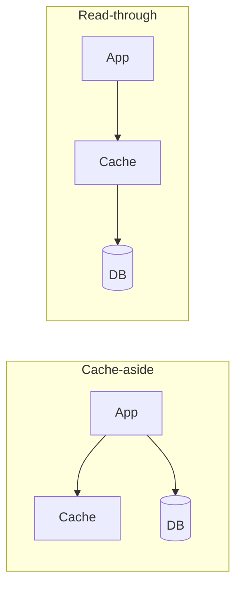
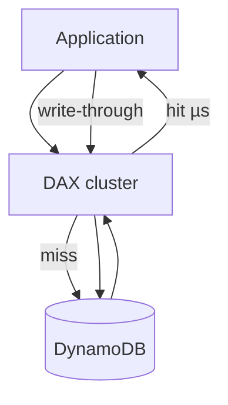
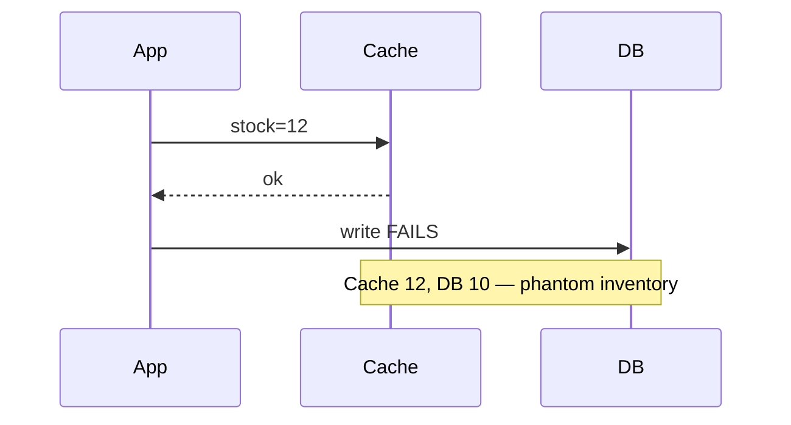

# Lesson 03: Read-Through vs Write-Through Caching (vs Cache-Aside, DAX)

> **Prerequisites:** [Lesson 02: Cache-Aside](../02-cache-aside/README.md).  
> **Estimated Reading Time:** 28–35 minutes  
> **Target Audience:** Engineers choosing between owning miss logic in the app vs a loader-capable cache (Caffeine, DAX, Hazelcast).  
> **Free PDF Notes:** [Download SD-F-003.pdf](https://backendroadmap.com/notes/system-design/SD-F-003.pdf)

> [!NOTE]
> **In one line:** In read-through the application only talks to the cache and the cache loads missing data from the database itself; in write-through every write goes to the cache, which writes it to the database synchronously before confirming. Together they keep cache logic out of application code and keep the cache in sync, at the cost of slower writes and a cache that must support loaders.

> [!TIP]
> **The Golden Rule of Read/Write-Through:** *Write the database first (or roll back the cache on failure), keep TTLs, and use read-through only when your cache actually supports a loader — plain Redis needs a wrapper.*

---

## Words You'll Meet Today

| Word | In Plain Words | Role in a Live Backend System |
| :--- | :--- | :--- |
| **Read-through** | Cache runs the loader on miss | Caffeine, Ehcache, Hazelcast, DAX |
| **Write-through** | Cache + DB updated synchronously | Fresh reads after writes |
| **Loader** | Function that fetches from the source | `id -> repository.findById(id)` |
| **Coalescing** | One load per key; others wait | Built into many LoadingCaches |
| **DAX** | DynamoDB Accelerator | Managed RT+WT with DynamoDB API |
| **Refresh-ahead** | Reload before hard expiry | Caffeine `refreshAfterWrite` |
| **Rollback** | Undo cache write if DB fails | Prevents phantom values |
| **Pairing** | RT + WT together | Classic managed-cache combo |

---

## Visual Mental Models & Architecture



*Figure 1. Same miss flow; ownership moves from every service into one loader.*

```mermaid
sequenceDiagram
    participant A as App
    participant C as Cache
    participant D as Database
    A->>C: write(value)
    C->>D: write(value)
    D-->>C: ok
    C-->>A: ok
    Note over A,D: Confirm only when both updated; prefer DB-first order
```

*Figure 2. Write-through: write latency ≈ cache write + DB write.*

---

## Core Definition & Taxonomic Comparison

**What it is:** Cache-owned loading (read-through) and synchronous dual write (write-through). **What it isn’t:** Free consistency across multi-node caches, or a reason to write-through rarely-read data.

| Term | Precise Meaning | Production Example |
| :--- | :--- | :--- |
| Cache-aside | App owns miss + invalidate | Redis helper in each service |
| Read-through | Cache runs loader on miss | Caffeine `LoadingCache` |
| Write-through | Sync write to cache and DB | DAX item put |
| Write-behind | Ack from cache; flush later | Lesson 04 |
| Write-around | Write DB only; skip cache | Bulk imports |

| Dimension | Cache-aside | Read-through |
| :--- | :--- | :--- |
| Who loads on miss | Application | Cache via loader |
| App code | Check / query / fill | `cache.get(key)` only |
| Needs loader support | No (Redis OK) | Yes |
| Coalescing | DIY | Often built-in |

---

## Component Breakdown & Anatomy

### Read-Through Benefits

- One loader, one place — no ten slightly different copies.
- Built-in coalescing: five concurrent misses → one DB query.
- Optional refresh-ahead so users rarely hit the cliff.

### Write-Through Trade-offs

| Gain | Cost |
| :--- | :--- |
| Fresh reads after writes | Write latency = sum of both writes |
| No delete-then-refill miss | Caches unread written data |
| Simpler app write path | Must handle DB failure after cache write |

Safer order: **write DB first**, then update/delete cache — or use a library with proper rollback.

### Observability Gap

| Signal | Captures | Hides |
| :--- | :--- | :--- |
| Loader latency | Miss fill time | App thinking cache is "magic" |
| Write latency p99 | Dual-write cost | Cache-first order leaving phantoms |
| DAX hit ratio | Item cache health | Query/scan cache stale until TTL |
| Cache size growth | Write-through pollution | Need for TTLs on rarely-read keys |

---

## Mathematical Model & Worked Example

Write-through latency:

$$
L_{write} = t_{cache} + t_{db}
$$

Read average with hit ratio $h$ (DAX-style):

$$
L_{read} = h \cdot t_{hit} + (1-h)\cdot t_{miss}
$$

Example: DynamoDB read ~5 ms, DAX hit ~0.3 ms, $h=0.95$:

$$
L_{read} \approx 0.95\times0.3 + 0.05\times5 \approx 0.54\ \text{{ms}}
$$

Provisioned read capacity falls roughly by $1/(1-h)$ for cacheable item gets (~20× at 95%).

---

## Metrics, Percentiles & Statistical Distributions

| Percentile | Read-through meaning | Write-through meaning |
| :--- | :--- | :--- |
| $p_{50}$ | Mostly loader-coalesced hits | Dual write on primary path |
| $p_{99}$ | Loader + DB under contention | DB failover / rollback path |
| Loader concurrency | Single-flight effectiveness | N/A |

---

## Compounding Effects & System Scale

Without coalescing, $N$ concurrent misses on one key ⇒ $N$ identical queries. With read-through single-flight ⇒ 1 query per process (still × servers unless a distributed lock). Write-through on write-heavy unread data: cache churn ∝ write rate, hit ratio collapses.

---

## Numbers Every Backend Engineer Must Know

| Item | Typical |
| :--- | :--- |
| DAX hit | hundreds of µs |
| DynamoDB read | single-digit ms |
| Caffeine in-process hit | sub-µs–µs |
| Write-through extra cost | +1 full DB write latency |

---

## Protocol & Network Deep Dive



*Figure 3. DAX: swap the DynamoDB client; no explicit cache code. Strongly consistent reads can bypass the cache.*

---

## Hierarchical Budgets & Capacity Sizing

| Workload | Prefer |
| :--- | :--- |
| Read-heavy, any cache | Cache-aside |
| Read-heavy, simple code + loader cache | Read-through |
| Read soon after write | Write-through (+ RT) |
| Write-heavy, read rarely | Write-around (next lesson) |

---

## Top Engineering Mitigation Techniques

1. Pair read-through with write-through when the product supports both.
2. Always **DB-first** or compensate/rollback on failure.
3. TTL every write-through entry — unread data must age out.
4. Coalesce loads (library or wrapper) for hot keys.
5. Bypass cache for strongly consistent reads when required (DAX pattern).

---

## Production War Story (SEV-1 Post-Mortem)

**Severity & Impact:** Warehouse write-through library wrote cache first, then DB. During a ~20 s DB failover, ~3,000 stock updates succeeded in cache and failed in DB. Orders accepted against stock that never existed. Restarting the cache "fixed" numbers by discarding cache-only updates.



**Fix:** DB first then cache; alert on failed writes + DLQ; sample compare cache vs DB for drift.

---

## Multi-Language Production Code

````carousel
```go
// Go: read-through wrapper with single-flight
package cache

import (
	"context"
	"encoding/json"
	"sync"
	"time"

	"github.com/redis/go-redis/v9"
	"golang.org/x/sync/singleflight"
)

type ReadThrough struct {
	rdb    *redis.Client
	loader func(context.Context, string) (any, error)
	ttl    time.Duration
	sf     singleflight.Group
}

func (rt *ReadThrough) Get(ctx context.Context, key string) (any, error) {
	if raw, err := rt.rdb.Get(ctx, key).Bytes(); err == nil {
		var v any
		_ = json.Unmarshal(raw, &v)
		return v, nil
	}
	v, err, _ := rt.sf.Do(key, func() (any, error) {
		val, err := rt.loader(ctx, key)
		if err != nil {
			return nil, err
		}
		b, _ := json.Marshal(val)
		_ = rt.rdb.Set(ctx, key, b, rt.ttl).Err()
		return val, nil
	})
	return v, err
}

// Write-through: DB first, then cache update
func WriteThrough(ctx context.Context, rdb *redis.Client, key string, val any, persist func() error, ttl time.Duration) error {
	if err := persist(); err != nil {
		return err
	}
	b, _ := json.Marshal(val)
	return rdb.Set(ctx, key, b, ttl).Err()
}

var _ = sync.Mutex{}
```

<!-- slide -->

```typescript
// TypeScript: read-through + write-through helpers
import Redis from "ioredis";

const inflight = new Map<string, Promise<unknown>>();

export async function readThrough<T>(
  redis: Redis,
  key: string,
  loader: () => Promise<T>,
  ttlSec = 300
): Promise<T> {
  const raw = await redis.get(key);
  if (raw) return JSON.parse(raw) as T;
  let p = inflight.get(key) as Promise<T> | undefined;
  if (!p) {
    p = (async () => {
      const value = await loader();
      await redis.set(key, JSON.stringify(value), "EX", ttlSec);
      return value;
    })().finally(() => inflight.delete(key));
    inflight.set(key, p);
  }
  return p;
}

export async function writeThrough<T>(
  redis: Redis,
  key: string,
  value: T,
  persist: () => Promise<void>,
  ttlSec = 300
) {
  await persist(); // DB first
  await redis.set(key, JSON.stringify(value), "EX", ttlSec);
}
```

<!-- slide -->

```python
# Python: read-through with single-flight + write-through (DB first)
import asyncio, json, random
import redis.asyncio as redis

class ReadThrough:
    def __init__(self, r, loader, ttl=300):
        self.r, self.loader, self.ttl = r, loader, ttl
        self.inflight: dict[str, asyncio.Future] = {}

    async def get(self, key: str):
        if (raw := await self.r.get(key)) is not None:
            return json.loads(raw)
        if key in self.inflight:
            return await self.inflight[key]
        fut = self.inflight[key] = asyncio.ensure_future(self._load(key))
        try:
            return await fut
        finally:
            self.inflight.pop(key, None)

    async def _load(self, key: str):
        value = await self.loader(key)
        await self.r.set(key, json.dumps(value), ex=self.ttl + random.randint(0, 30))
        return value

async def write_through(r, key, value, persist, ttl=300):
    await persist()  # database first
    await r.set(key, json.dumps(value), ex=ttl)
```

<!-- slide -->

```csharp
// C#: read-through coalesce + write-through
using System.Collections.Concurrent;
using System.Text.Json;
using StackExchange.Redis;

public sealed class ReadThroughCache
{
    private readonly IDatabase _redis;
    private readonly ConcurrentDictionary<string, Task<object?>> _inflight = new();

    public ReadThroughCache(IDatabase redis) => _redis = redis;

    public async Task<T?> GetAsync<T>(string key, Func<Task<T?>> loader, TimeSpan ttl)
    {
        var raw = await _redis.StringGetAsync(key);
        if (raw.HasValue) return JsonSerializer.Deserialize<T>((string)raw!);

        var task = _inflight.GetOrAdd(key, _ => LoadAsync(key, loader, ttl));
        try { return (T?)await task; }
        finally { _inflight.TryRemove(key, out _); }
    }

    private async Task<object?> LoadAsync<T>(string key, Func<Task<T?>> loader, TimeSpan ttl)
    {
        var value = await loader();
        if (value is not null)
            await _redis.StringSetAsync(key, JsonSerializer.Serialize(value), ttl);
        return value;
    }

    public static async Task WriteThroughAsync<T>(
        IDatabase redis, string key, T value, Func<Task> persist, TimeSpan ttl)
    {
        await persist();
        await redis.StringSetAsync(key, JsonSerializer.Serialize(value), ttl);
    }
}
```
````


---

## Hands-On CLI Verification Workflows

```bash
# Latency model for DAX-like hit ratio
python -c "h,th,tm=0.95,0.3,5; print(h*th+(1-h)*tm)"

# Coalescing intuition: 500 waiters → 1 load
python -c "print('without', 500, 'with single-flight', 1)"
```

---

## Common Mistakes to Avoid

1. Write-through for write-heavy rarely-read data.
2. Updating cache before DB with no rollback.
3. Assuming write-through ⇒ strong consistency across nodes.
4. Expecting plain Redis to be read-through without a wrapper.
5. No TTL on write-through caches.
6. Loader that is not concurrency-safe or returns inconsistent shapes.

---

## Key Terms Glossary

| Term | Definition |
| :--- | :--- |
| Read-through | Cache loads missing data itself |
| Write-through | Cache writes to DB synchronously |
| Loader | Function the cache calls on a miss |
| Coalescing | One load per key; the rest wait |
| Synchronous write | Caller waits until both stores updated |
| Rollback | Undo cache write when DB write fails |
| DAX | DynamoDB Accelerator |
| Refresh-ahead | Reload an entry before it expires |

---

## Interview Practice Questions

### Basic (Q1–Q4)

<details>
<summary><strong>Q1: Compare cache-aside with read-through. [BASIC]</strong></summary>

Same miss flow, different owner. Cache-aside: app checks cache, loads from DB, fills cache. Read-through: cache provider runs a loader; app talks only to the cache.

</details>

<details>
<summary><strong>Q2: What is write-through caching? [BASIC]</strong></summary>

Every write goes to the cache, which synchronously writes it to the database before confirming. The cache stays in sync and reads after writes are fresh.

</details>

<details>
<summary><strong>Q3: What is the cost of write-through? [BASIC]</strong></summary>

Higher write latency (two writes), caching data that may never be read, and handling a failed DB write after a cache write.

</details>

<details>
<summary><strong>Q4: Why are read-through and write-through usually used together? [BASIC]</strong></summary>

Reads fill via the loader while writes keep entries in sync, so the cache stays current without application-level cache code.

</details>


### Scenario (Q5–Q8)

<details>
<summary><strong>Q5: You use Redis and want read-through behaviour. What do you do? [SCENARIO]</strong></summary>

Redis has no loader — wrap it with a helper that checks Redis, calls your loader on miss, stores with TTL, and coalesces concurrent loads. Or use Caffeine/DAX.

</details>

<details>
<summary><strong>Q6: Your service writes 5,000 records/s that are almost never read. Which pattern? [SCENARIO]</strong></summary>

Not write-through. Write straight to the DB (write-around) and cache only what is read.

</details>

<details>
<summary><strong>Q7: The database write fails after the cache write in write-through. What do you do? [SCENARIO]</strong></summary>

Roll back or delete the cache entry and return the error. Prefer writing the database first and the cache second.

</details>

<details>
<summary><strong>Q8: Reads right after a write must show the new value. Which pattern helps? [SCENARIO]</strong></summary>

Write-through (or cache-aside with delete-on-write plus read-your-writes). Write-through updates the cache as part of the write.

</details>


### Tricky (Q9–Q12)

<details>
<summary><strong>Q9: Is write-through strongly consistent? [TRICKY]</strong></summary>

Between one cache and one DB it removes the stale window, but multi-node caches/replicas/concurrent writers can still diverge briefly. Not a substitute for transactions.

</details>

<details>
<summary><strong>Q10: Why can read-through protect against a stampede? [TRICKY]</strong></summary>

The cache owns the loader, so it can allow one load per key and make other callers wait for that result.

</details>

<details>
<summary><strong>Q11: When would you still prefer cache-aside? [TRICKY]</strong></summary>

When you use Redis/Memcached, need custom per-use-case handling, or want to avoid a hidden dependency in the cache layer.

</details>

<details>
<summary><strong>Q12: Why does write-through still need TTLs? [TRICKY]</strong></summary>

It caches everything written, including unread data. TTLs and eviction remove it and bound damage from missed updates.

</details>


---

## One-Page Master Cheat Sheet

```text
====================================================================================================
                    READ-THROUGH / WRITE-THROUGH — CHEAT SHEET (SD-F-003)
====================================================================================================
READ-THROUGH   app → cache only; cache runs loader on miss; often 1 load/key (coalesce)
WRITE-THROUGH  app → cache → DB (confirm both); prefer DB-first + TTL
PAIRING        RT + WT classic; needs loader-capable cache (Caffeine, Hazelcast, DAX)
REDIS          no native loader → wrapper / library
AVOID WT       write-heavy, rarely-read data → write-around
FAILURES       phantom cache values if cache-first without rollback
ANTI           no TTL · assume strong consistency · Redis "is" read-through
====================================================================================================
```

---

## Free PDF notes

[SD-F-003.pdf](https://backendroadmap.com/notes/system-design/SD-F-003.pdf)

---

## Sources

- AWS docs — Amazon DynamoDB Accelerator (DAX).  
- Ben Manes — Caffeine LoadingCache and refresh.  
- Hazelcast docs — MapLoader and MapStore.

---

## Next

Next: [Lesson 04: Write-Behind vs Write-Around Caching](../04-write-behind-vs-write-around-caching/README.md).
