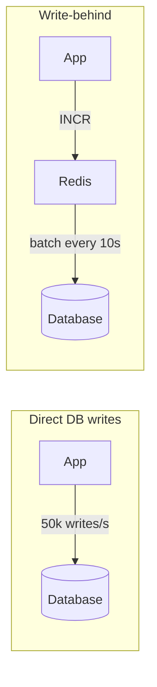
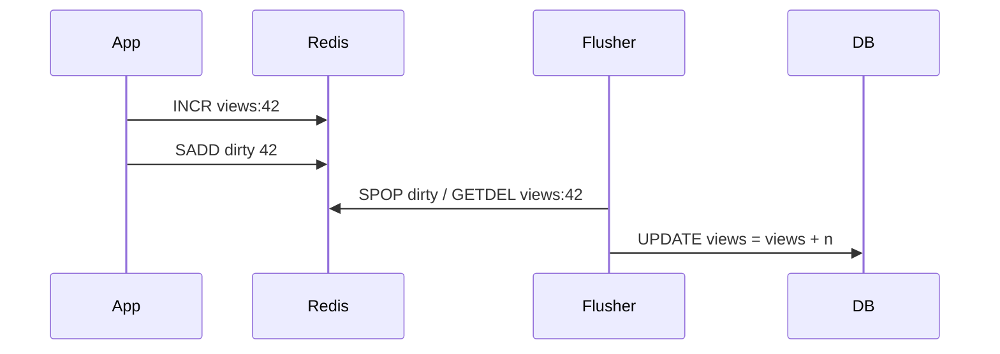
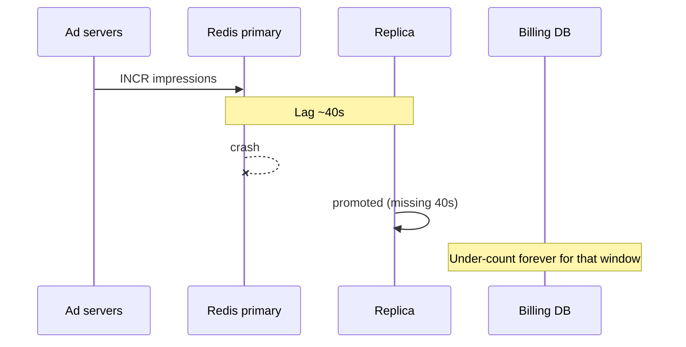

# Lesson 04: Write-Behind vs Write-Around Caching — Speed vs Durability

> **Prerequisites:** [Lesson 03: Read-Through vs Write-Through](../03-read-through-vs-write-through-caching/README.md).  
> **Estimated Reading Time:** 28–35 minutes  
> **Target Audience:** Engineers absorbing write spikes (counters, analytics) without melting the database — and knowing when loss is unacceptable.  
> **Free PDF Notes:** [Download SD-F-004.pdf](https://backendroadmap.com/notes/system-design/SD-F-004.pdf)

> [!NOTE]
> **In one line:** Write-behind acknowledges writes from the cache and flushes them to the database later in batches (very fast, can lose the last few seconds); write-around writes straight to the database and skips the cache so write-heavy, rarely-read data doesn't push hot data out.

> [!TIP]
> **The Golden Rule of Write Patterns:** *Write-behind for numbers people look at; never for numbers people are billed on. Write-around for cold writes that would pollute the cache.*

---

## Words You'll Meet Today

| Word | In Plain Words | Role in a Live Backend System |
| :--- | :--- | :--- |
| **Write-behind** | Ack from cache; flush DB later | Redis counters → batch UPDATE |
| **Write-around** | Write DB only; skip cache | Bulk imports, audit logs |
| **Flush** | Push buffered changes to DB | Every 5–30 s worker |
| **Coalescing** | Merge many updates to one key | 500k incr → 100 rows |
| **Risk window** | Data ack'd but not durable | Since last flush |
| **AOF** | Redis append-only persistence | everysec ≈ 1 s loss bound |
| **Cache pollution** | Unread data evicting hot data | Write-through on imports |
| **GETDEL** | Atomic take-and-reset | Safe counter flush |

---

## Visual Mental Models & Architecture



*Figure 1. Counting in Redis and flushing every 10 seconds turns 50k writes/s into a few thousand batched row updates.*

---

## Core Definition & Taxonomic Comparison

| Pattern | Write path | Durability on cache crash | Best for |
| :--- | :--- | :--- | :--- |
| Write-through | Cache + DB sync | Full | Read soon after write |
| Write-behind | Cache now, DB later | Loses unflushed | High rate, loss OK |
| Write-around | DB only (+ invalidate) | Full | Write-heavy, read-rare |
| Cache-aside delete | DB + DEL | Full | General default |

**Acceptable write-behind:** views, likes, analytics, rate limits, leaderboards. **Not acceptable:** payments, orders, inventory, balances, billing.

---

## Component Breakdown & Anatomy

### Write-Behind Mechanics

1. `INCR views:{{id}}` (+ mark dirty set).
2. Worker claims dirty IDs, **GETDEL** each counter, batch UPDATE.
3. On DB failure: INCRBY back + re-mark dirty.

### Write-Around Mechanics

Writes go to DB; invalidate any cached key. Cache fills only on later reads (cache-aside / read-through). First read after write misses.

### Observability Gap

| Signal | Captures | Hides |
| :--- | :--- | :--- |
| Flush lag | Risk window size | Silent dropped batches |
| Dirty-set size | Backlog | Double-flush without coordination |
| Hit ratio during import | Pollution | Write-through vs write-around choice |
| AOF status | Persistence mode | Async replica lag on failover |

---

## Mathematical Model & Worked Example

Views: $\lambda = 50{,}000$/s, flush interval $F = 10$ s, hot videos $K = 100$:

$$
\text{{increments per window}} = \lambda F = 500{,}000
$$

$$
\text{{DB row updates per flush}} \approx K = 100 \quad (\text{{one transaction}})
$$

Risk window length ≈ $F$ (or AOF `everysec` ≈ 1 s if persisted).

---

## Metrics, Percentiles & Statistical Distributions

Track flush duration $p_{99}$, dirty-set depth, lost-on-failover estimates, and dashboard staleness SLO (= flush interval).

---

## Compounding Effects & System Scale

Without coalescing, DB writes = view rate. With coalescing, DB writes ≈ unique dirty keys per interval. Unique order inserts cannot coalesce the same way — write-behind helps less.

---

## Numbers Every Backend Engineer Must Know

| Item | Typical |
| :--- | :--- |
| Redis INCR | ~50 µs |
| Flush interval | 5–30 s |
| AOF everysec loss | ~1 s |
| Replica lag on busy failover | tens of seconds |

---

## Protocol & Network Deep Dive



---

## Hierarchical Budgets & Capacity Sizing

| Goal | Knob |
| :--- | :--- |
| Lower loss | Shorter $F$, AOF, Kafka-first |
| Lower DB load | Longer $F$, more coalescing |
| Keep hit ratio in imports | Write-around |

---

## Top Engineering Mitigation Techniques

1. Atomic take-and-reset (GETDEL / Lua).
2. Retry + put-back on flush failure; single flusher or sharded ownership.
3. Kafka (or durable log) for anything billed.
4. Write-around bulk loads; warm hot keys after.
5. Label write-behind dashboards "approximate."

---

## Production War Story (SEV-1 Post-Mortem)

**Severity & Impact:** Ad impressions counted in Redis, flushed every 30 s. Redis primary failed; replica promoted with ~40 s replication lag. ~40 s of counters vanished; invoicing under-billed (~2% revenue gap). Week of reconciliation from raw logs.



**Fix:** Kafka as source of truth for billing; Redis counters for live "approximate" dashboard only; rebuild from log after failover.

---

## Multi-Language Production Code

````carousel
```go
// Go: write-behind view counter flush
package views

import (
	"context"
	"strconv"

	"github.com/redis/go-redis/v9"
)

func RecordView(ctx context.Context, rdb *redis.Client, videoID int64) error {
	pipe := rdb.TxPipeline()
	pipe.Incr(ctx, "views:"+strconv.FormatInt(videoID, 10))
	pipe.SAdd(ctx, "views:dirty", videoID)
	_, err := pipe.Exec(ctx)
	return err
}

func FlushViews(ctx context.Context, rdb *redis.Client, update func(id, n int64) error) error {
	ids, err := rdb.SPopN(ctx, "views:dirty", 5000).Result()
	if err != nil {
		return err
	}
	for _, idStr := range ids {
		key := "views:" + idStr
		n, err := rdb.GetDel(ctx, key).Int64() // atomic take-and-reset
		if err == redis.Nil || n == 0 {
			continue
		}
		if err != nil {
			return err
		}
		id, _ := strconv.ParseInt(idStr, 10, 64)
		if err := update(id, n); err != nil {
			_ = rdb.IncrBy(ctx, key, n).Err() // put back on failure
			_ = rdb.SAdd(ctx, "views:dirty", id).Err()
			return err
		}
	}
	return nil
}
```

<!-- slide -->

```typescript
// TypeScript: write-behind + write-around
import Redis from "ioredis";

export async function recordView(redis: Redis, videoId: number) {
  const pipe = redis.pipeline();
  pipe.incr(`views:${videoId}`);
  pipe.sadd("views:dirty", String(videoId));
  await pipe.exec();
}

export async function flushViews(
  redis: Redis,
  updateMany: (rows: [number, number][]) => Promise<void>
) {
  const ids = await redis.spop("views:dirty", 5000);
  const rows: [number, number][] = [];
  for (const id of ids ?? []) {
    const n = await redis.getdel(`views:${id}`);
    if (n) rows.push([Number(id), Number(n)]);
  }
  if (rows.length) await updateMany(rows);
}

/** Write-around: DB only, invalidate cache key */
export async function writeAround(
  redis: Redis,
  key: string,
  persist: () => Promise<void>
) {
  await persist();
  await redis.del(key);
}
```

<!-- slide -->

```python
# Python: write-behind view counter with Redis
import redis.asyncio as redis

r = redis.Redis()

async def record_view(video_id: int):
    await r.incr(f"views:{video_id}")
    await r.sadd("views:dirty", video_id)

async def flush_views(db):
    ids = await r.spop("views:dirty", count=5000)
    rows = []
    for vid in ids:
        n = await r.getdel(f"views:{int(vid)}")  # atomic take-and-reset
        if n:
            rows.append((int(vid), int(n)))
    if rows:
        await db.executemany(
            "UPDATE videos SET views = views + $2 WHERE id = $1", rows
        )

async def write_around(key: str, persist):
    await persist()
    await r.delete(key)
```

<!-- slide -->

```csharp
// C#: write-behind flush with GETDEL semantics
using StackExchange.Redis;

public static class WriteBehindViews
{
    public static async Task RecordAsync(IDatabase db, long videoId)
    {
        var t = db.CreateTransaction();
        _ = t.StringIncrementAsync($"views:{videoId}");
        _ = t.SetAddAsync("views:dirty", videoId);
        await t.ExecuteAsync();
    }

    public static async Task FlushAsync(IDatabase db, Func<long, long, Task> update)
    {
        var ids = await db.SetPopAsync("views:dirty", 5000);
        foreach (var idVal in ids)
        {
            var id = (long)idVal;
            var n = (long)await db.StringGetDeleteAsync($"views:{id}");
            if (n > 0) await update(id, n);
        }
    }
}
```
````


---

## Hands-On CLI Verification Workflows

```bash
python -c "print('increments', 50000*10); print('coalesced rows', 100)"
redis-cli INCR views:1
redis-cli GETDEL views:1
```

---

## Common Mistakes to Avoid

1. Write-behind for orders/payments/inventory.
2. Non-atomic read+reset of counters.
3. No retry when batch DB write fails.
4. Multiple flushers double-counting.
5. Not telling the business about flush lag.
6. Write-around for edit-then-immediately-view data.
7. Huge flush batches locking tables for seconds.

---

## Key Terms Glossary

| Term | Definition |
| :--- | :--- |
| Write-behind / write-back | Ack from cache; flush to DB later |
| Write-around | Write to DB only; skip the cache |
| Flush | Writing buffered changes to the DB |
| Batch | Many changes written together |
| Coalescing | Merging many updates to one key |
| Cache pollution | Unread data crowding out hot data |
| AOF | Redis append-only file persistence |
| Risk window | Data written but not yet flushed |

---

## Interview Practice Questions

### Basic (Q1–Q4)

<details>
<summary><strong>Q1: When is write-behind acceptable? [BASIC]</strong></summary>

When write volume is high and losing a few seconds of updates is tolerable: view counters, likes, analytics, rate-limit counters, leaderboards.

</details>

<details>
<summary><strong>Q2: What is write-around good for? [BASIC]</strong></summary>

Write-heavy, read-rarely data such as logs, audit records and bulk imports — writes skip the cache so hot data is not evicted.

</details>

<details>
<summary><strong>Q3: What is the main risk of write-behind? [BASIC]</strong></summary>

Durability: unflushed data lives only in the cache and is lost if the cache crashes. Other DB readers also see stale values until flush.

</details>

<details>
<summary><strong>Q4: Why can write-behind reduce database load so much? [BASIC]</strong></summary>

Many updates to the same key coalesce: 500,000 increments in 10 s across 100 videos become 100 row updates in one batch.

</details>


### Scenario (Q5–Q8)

<details>
<summary><strong>Q5: Design view counting for 50,000 views per second. [SCENARIO]</strong></summary>

INCR Redis per view, mark dirty, flush totals every few seconds with atomic take-and-reset. AOF everysec + approximate UI; Kafka for billing.

</details>

<details>
<summary><strong>Q6: Your Redis counter worker crashed mid-flush. What can go wrong? [SCENARIO]</strong></summary>

Counts taken but not written are lost, or double-counted on retry. Use atomic claims, one transaction + idempotency, re-add on failure.

</details>

<details>
<summary><strong>Q7: Would you use write-behind for shopping carts? [SCENARIO]</strong></summary>

Usually not alone — losing a cart is visible. Write DB first / write-through; cache for reads.

</details>

<details>
<summary><strong>Q8: A nightly import of 20M rows made the site slow all morning. Why? [SCENARIO]</strong></summary>

Import through write-through flooded the cache and evicted the working set. Write-around the import; warm hot keys after.

</details>


### Tricky (Q9–Q12)

<details>
<summary><strong>Q9: How do you make write-behind more durable without losing its speed? [TRICKY]</strong></summary>

AOF everysec, replicas, shorter flush, or Kafka in front so the log is source of truth and cache is a fast view.

</details>

<details>
<summary><strong>Q10: Why must the counter be read and reset atomically? [TRICKY]</strong></summary>

Increments between GET and reset would be erased. Use GETDEL, GETSET, or Lua.

</details>

<details>
<summary><strong>Q11: What is the downside of write-around? [TRICKY]</strong></summary>

First read after a write is a miss — slow first view for edit-then-read flows.

</details>

<details>
<summary><strong>Q12: Compare write-behind and a message queue for absorbing write spikes. [TRICKY]</strong></summary>

Both smooth bursts. A durable queue is safer; write-behind in cache is faster but can lose data.

</details>


---

## One-Page Master Cheat Sheet

```text
====================================================================================================
                    WRITE-BEHIND / WRITE-AROUND — CHEAT SHEET (SD-F-004)
====================================================================================================
WRITE-BEHIND  cache → ack → flush DB later (coalesce); risk = unflushed loss
GOOD FOR      views, likes, analytics, rate limits   | BAD FOR money/orders/balances
FLUSH         GETDEL/Lua atomic; retry+put-back; AOF/Kafka for durability ladder
WRITE-AROUND  DB only + invalidate; protects hit ratio from cold writes / imports
TRADE-OFF     first read after write misses
ANTI          write-behind billing · non-atomic reset · multi-flusher · WT bulk import
====================================================================================================
```

---

## Free PDF notes

[SD-F-004.pdf](https://backendroadmap.com/notes/system-design/SD-F-004.pdf)

---

## Sources

- Redis docs — Persistence and GETDEL.  
- Hazelcast docs — Write-Behind persistence.  
- Kleppmann — DDIA, stream processing chapter.

---

## Next

Next: [Lesson 05: Cache TTL & Expiration](../05-cache-ttl-expiration/README.md).
