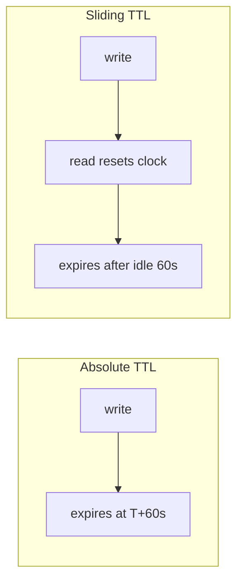

# Lesson 05: Cache TTL & Expiration — How to Choose a TTL and Why Add Jitter

> **Prerequisites:** [Lesson 02: Cache-Aside](../02-cache-aside/README.md).  
> **Estimated Reading Time:** 28–35 minutes  
> **Target Audience:** Engineers turning the freshness↔load dial on purpose — and eliminating the “heartbeat of pain” from synchronised expiry.  
> **Free PDF Notes:** [Download SD-F-005.pdf](https://backendroadmap.com/notes/system-design/SD-F-005.pdf)

> [!NOTE]
> **In one line:** A TTL (time to live) bounds how stale a cache entry can be. Choose it from a staleness budget (the longest your data may be old without causing harm), add jitter so keys don't all expire together, and use explicit invalidation for data that must change quickly.

> [!TIP]
> **The Golden Rule of TTLs:** *Longest TTL inside the business staleness budget, always with ±10–20% jitter on bulk loads, and delete-on-write when freshness must beat the TTL.*

---

## Words You'll Meet Today

| Word | In Plain Words | Role in a Live Backend System |
| :--- | :--- | :--- |
| **TTL** | How long an entry is valid | `SET key val EX 60` |
| **Absolute TTL** | Fixed from write time | Prices, feeds |
| **Sliding TTL** | Reset on each read | Sessions |
| **Staleness budget** | Max age before harm | Business decision |
| **Jitter** | Random TTL spread | Stops expiry cliffs |
| **Lazy expiry** | Check TTL on access | Redis default path |
| **Active expiry** | Background sampling | Redis ~10 Hz sampler |
| **Soft TTL** | Serve stale while refresh | SWR / early refresh |

---

## Visual Mental Models & Architecture



*Figure 1. Sliding TTLs can keep hot stale data forever — pair with a max absolute lifetime.*

---

## Core Definition & Taxonomic Comparison

| Data | Typical TTL | Invalidate on write? |
| :--- | :--- | :--- |
| Permissions / revoked tokens | seconds | Yes, immediately |
| Product price | 30–60 s + jitter | Yes |
| Product description | 10 min–1 h | Yes |
| Exchange rates / weather | 1–5 min | N/A (schedule) |
| Feeds / trending | 5–60 s | Often no |
| Config / reference | 5–60 min | Yes / on deploy |
| Negative cache | 10–60 s | On create |
| Versioned static file | 1 year | New filename |

---

## Component Breakdown & Anatomy

### Choosing the Number

1. Ask the staleness budget.
2. Pick the longest TTL inside it (more hits).
3. Invalidate on write when change must be faster than the TTL — TTL becomes the safety net.

### Redis Expiry

- **Lazy:** on access, delete if expired.
- **Active:** sample ~20 random TTL keys, 10×/s; repeat if >25% expired.
- Side effect: untouched expired keys can linger briefly until sampled.
- Eviction (memory full) is a **separate** policy from TTL.

### Observability Gap

| Signal | Captures | Hides |
| :--- | :--- | :--- |
| DB CPU sawtooth @ TTL period | Sync expiry | Missing jitter on warm job |
| `TTL key` | Remaining life | Plain SET clearing TTL |
| Hit ratio vs TTL | Sweet spot | Client/CDN adding more staleness |

---

## Mathematical Model & Worked Example

Jittered TTL:

$$
TTL = T + U(-sT, sT), \quad s \in [0.1, 0.2]
$$

Without jitter, $N$ keys warmed at once ⇒ miss spike ≈ $N$ at time $T$. With window $2sT$, peak rate ≈ $N / (2sT)$.

Example: $N=10{,}000$, $T=60$, $s=1/6$ (±10 s) ⇒ peak ≈ $10{,}000/20 = 500$ misses/s instead of 10,000 at once.

Prices: cache 60±10 s, delete on change; business budget 2 minutes — worst staleness ~70 s if delete missed.

---

## Metrics, Percentiles & Statistical Distributions

Watch expiry rate over time (should be smooth), hit ratio vs TTL experiments, and $p_{99}$ miss latency at expiry boundaries.

---

## Compounding Effects & System Scale

Warm $N$ keys with identical TTL → perpetual heartbeat every $T$. Raising $T$ without jitter makes spikes **rarer and larger**. Client + CDN + Redis TTLs **add** — end-to-end staleness is the sum.

---

## Numbers Every Backend Engineer Must Know

| Item | Value |
| :--- | :--- |
| Jitter | ±10–20% |
| Redis active expiry | ~10 Hz sampling |
| Soft/hard SWR example | soft 60 s / hard 5 min |
| `TTL` = -1 | no expiry; -2 = missing |

---

## Protocol & Network Deep Dive

```bash
SET price:42 "9.99" EX 60
EXPIRE price:42 120
TTL price:42
GETEX session:abc EX 1800
PERSIST price:42
```

Gotcha: plain `SET` removes TTL; `INCR`/`APPEND` keep it.

---

## Hierarchical Budgets & Capacity Sizing

| Tier | Staleness contribution |
| :--- | :--- |
| Redis TTL | Primary bound |
| App soft TTL | Extra SWR window |
| CDN max-age | Edge bound |
| Browser cache | Uncontrollable unless versioned |

---

## Top Engineering Mitigation Techniques

1. Staleness budget → longest TTL.
2. Jitter every bulk/warm TTL.
3. Delete-on-write for fast change.
4. Sliding + max absolute for sessions.
5. Soft TTL / early refresh for hot keys (Lesson 10).

---

## Production War Story (SEV-1 Post-Mortem)

**Severity & Impact:** Warm-up loaded 40,000 product pages with fixed 5-minute TTL. Every 5 minutes DB CPU jumped 20%→95% for ~20 s; page times tripled. Raising TTL to 30 min made spikes less frequent and bigger.

```mermaid
sequenceDiagram
    participant W as Warm job
    participant R as Redis
    participant D as DB
    W->>R: SET 40k keys TTL=300s (no jitter)
    Note over R: t+300s all expire
    R-->>D: 40k misses together
    D-->>D: CPU cliff; pattern repeats
```

**Fix:** ±20% jitter; spread warm writes over a minute; soft TTL on hottest keys; alert on DB CPU sawtooth matching TTL.

---

## Multi-Language Production Code

````carousel
```go
// Go: TTL with jitter + sliding session
package ttl

import (
	"math/rand"
	"time"

	"github.com/redis/go-redis/v9"
	"context"
)

func TTLWithJitter(base time.Duration, spread float64) time.Duration {
	delta := time.Duration(float64(base) * spread)
	return base + time.Duration(rand.Int63n(int64(2*delta)+1)) - delta
}

func SetPrice(ctx context.Context, rdb *redis.Client, sku, json string) error {
	return rdb.Set(ctx, "price:"+sku, json, TTLWithJitter(60*time.Second, 0.15)).Err()
}

func TouchSession(ctx context.Context, rdb *redis.Client, sid string) (string, error) {
	return rdb.GetEx(ctx, "session:"+sid, 30*time.Minute).Result() // sliding
}
```

<!-- slide -->

```typescript
// TypeScript: jittered absolute TTL + soft/hard sketch
export function ttlWithJitter(baseSeconds: number, spread = 0.15): number {
  const delta = Math.floor(baseSeconds * spread);
  return baseSeconds + Math.floor(Math.random() * (2 * delta + 1)) - delta;
}

export async function setPrice(redis: any, sku: string, priceJson: string) {
  await redis.set(`price:${sku}`, priceJson, "EX", ttlWithJitter(60));
}

export async function touchSession(redis: any, sid: string) {
  return redis.getex(`session:${sid}`, "EX", 1800); // sliding 30 min
}
```

<!-- slide -->

```python
# Python: TTL jitter + Redis expiry commands
import random, math, time

def ttl_with_jitter(base_seconds: int, spread: float = 0.15) -> int:
    delta = int(base_seconds * spread)
    return base_seconds + random.randint(-delta, delta)

# r.set(f"price:{sku}", price_json, ex=ttl_with_jitter(60))
# raw = r.getex(f"session:{sid}", ex=1800)  # sliding

def should_refresh(delta: float, expiry_ts: float, beta: float = 1.0) -> bool:
    # XFetch-style early refresh hint (Lesson 10)
    return time.time() - delta * beta * math.log(random.random()) >= expiry_ts
```

<!-- slide -->

```csharp
// C#: jitter + SET EX
using StackExchange.Redis;

public static class TtlHelpers
{
    public static TimeSpan WithJitter(TimeSpan baseTtl, double spread = 0.15)
    {
        var delta = TimeSpan.FromSeconds(baseTtl.TotalSeconds * spread);
        var offset = Random.Shared.NextDouble() * 2 * delta.TotalSeconds - delta.TotalSeconds;
        return baseTtl + TimeSpan.FromSeconds(offset);
    }

    public static Task SetPriceAsync(IDatabase db, string sku, string json) =>
        db.StringSetAsync($"price:{sku}", json, WithJitter(TimeSpan.FromSeconds(60)));
}
```
````


---

## Hands-On CLI Verification Workflows

```bash
python -c "import random; T,s=60,0.15; d=int(T*s); print(sorted(T+random.randint(-d,d) for _ in range(8)))"
python -c "N,T,s=10000,60,1/6; print('peak approx', N/(2*s*T), 'miss/s')"
redis-cli SET k v EX 10
redis-cli TTL k
redis-cli SET k v
redis-cli TTL k
```

---

## Common Mistakes to Avoid

1. One habitual TTL for everything.
2. Tiny TTL to hide missing invalidation.
3. No jitter on bulk-loaded keys.
4. Overwriting with SET and dropping TTL.
5. Sliding TTL with no max lifetime.
6. Relying on TTL alone for permissions.
7. Forgetting browser/CDN add more staleness.

---

## Key Terms Glossary

| Term | Definition |
| :--- | :--- |
| TTL | Time to live — how long an entry is valid |
| Absolute TTL | Fixed time after the write |
| Sliding TTL | Reset on every read |
| Staleness budget | How old data may be before harm |
| Jitter | Random variation added to a TTL |
| Synchronized expiry | Many keys expiring at once |
| Lazy expiry | Check TTL when accessed |
| Active expiry | Background sampling of TTL keys |
| Soft TTL | Serve stale while refreshing |
| Negative caching | Caching "not found" briefly |

---

## Interview Practice Questions

### Basic (Q1–Q4)

<details>
<summary><strong>Q1: How do you choose a TTL? [BASIC]</strong></summary>

Start from the staleness budget (how old before harm), pick the longest TTL within it, and add explicit invalidation on write for fast-changing data.

</details>

<details>
<summary><strong>Q2: Why add jitter to TTLs? [BASIC]</strong></summary>

Spread expirations randomly so many keys don't expire together and flood the database.

</details>

<details>
<summary><strong>Q3: What's the difference between an absolute and a sliding TTL? [BASIC]</strong></summary>

Absolute expires a fixed time after the write; sliding restarts on every read. Sessions suit sliding; schedule-driven data suits absolute.

</details>

<details>
<summary><strong>Q4: How does Redis expire keys? [BASIC]</strong></summary>

Lazily on access, and actively by sampling keys with TTLs ~10×/s and deleting expired ones.

</details>


### Scenario (Q5–Q8)

<details>
<summary><strong>Q5: Prices cached 1 hour but a sale must show immediately. What do you do? [SCENARIO]</strong></summary>

Delete/update the key on price change; keep a short TTL (~60 s + jitter) as safety net.

</details>

<details>
<summary><strong>Q6: Database CPU spikes every 5 minutes, exactly. First hypothesis? [SCENARIO]</strong></summary>

Synchronised expiry of keys loaded together with a 5-minute TTL. Add jitter; soft TTL / early refresh for hottest keys.

</details>

<details>
<summary><strong>Q7: How would you cache user sessions? [SCENARIO]</strong></summary>

Sliding TTL (e.g. 30 min idle) with a maximum absolute lifetime; delete on logout/password/permission changes.

</details>

<details>
<summary><strong>Q8: A permissions cache entry can be stale for how long? [SCENARIO]</strong></summary>

As short as risk requires: seconds, plus immediate invalidation on change — security, not just freshness.

</details>


### Tricky (Q9–Q12)

<details>
<summary><strong>Q9: What happens to a key's TTL when you overwrite it with SET? [TRICKY]</strong></summary>

Plain SET clears the TTL in Redis. Use SET with EX (or KEEPTTL) when overwriting.

</details>

<details>
<summary><strong>Q10: Is a longer TTL always better? [TRICKY]</strong></summary>

No — higher hit ratio but more staleness and slower healing from missed invalidation. Longest within budget.

</details>

<details>
<summary><strong>Q11: How is TTL different from eviction? [TRICKY]</strong></summary>

TTL removes by age regardless of memory. Eviction removes under memory pressure by policy (LRU/LFU).

</details>

<details>
<summary><strong>Q12: How can you avoid users waiting at the moment of expiry? [TRICKY]</strong></summary>

Soft TTL + stale-while-revalidate, or probabilistic early refresh, so one background reload happens while old value is still served.

</details>


---

## One-Page Master Cheat Sheet

```text
====================================================================================================
                    TTL & EXPIRATION — CHEAT SHEET (SD-F-005)
====================================================================================================
CHOOSE     staleness budget → longest TTL inside it; invalidate on write when needed
KINDS      absolute (from write) · sliding (reset on read + max lifetime)
JITTER     ±10–20% on every bulk/warm TTL  |  sync expiry = DB sawtooth at period T
REDIS      SET EX · EXPIRE · TTL · GETEX · KEEPTTL  |  plain SET clears TTL
EXPIRY     lazy on access + active sampling; eviction is a separate policy
BEYOND     soft TTL / SWR · probabilistic early refresh (Lesson 10)
ANTI       one TTL for all · no jitter · SET drops TTL · TTL-only security
====================================================================================================
```

---

## Free PDF notes

[SD-F-005.pdf](https://backendroadmap.com/notes/system-design/SD-F-005.pdf)

---

## Sources

- Redis docs — EXPIRE, GETEX, key expiration.  
- Vattani et al. — Optimal Probabilistic Cache Stampede Prevention (VLDB 2015).  
- RFC 5861 — HTTP stale-while-revalidate.

---

## Next

Next: [Lesson 06: LRU Cache Explained](../06-lru-cache-explained/README.md).
