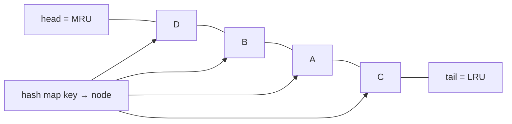
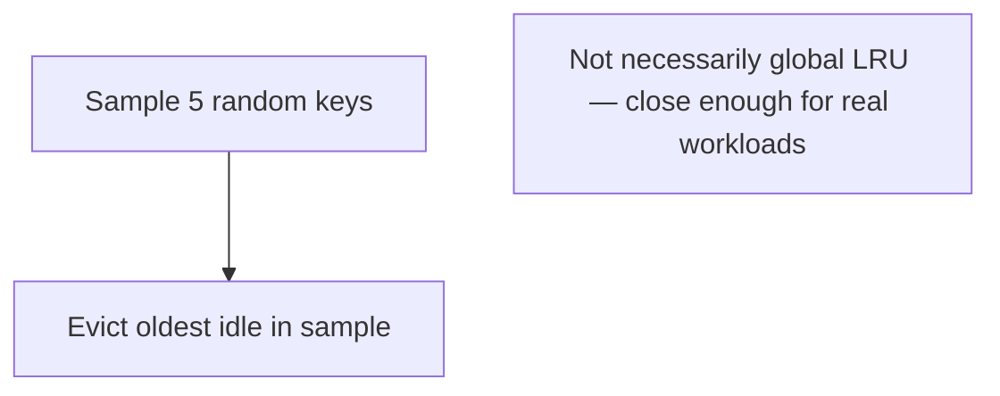
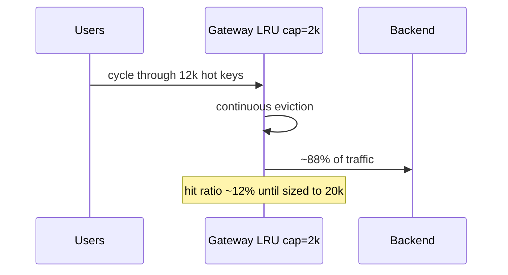

# Lesson 06: LRU Cache Explained — O(1) Hash Map + Doubly Linked List

> **Prerequisites:** [Lesson 01: Why Cache and Where](../01-why-cache-and-where/README.md) and [Track: Caching](../README.md) overview.  
> **Estimated Reading Time:** 28–35 minutes  
> **Target Audience:** Backend engineers implementing or sizing in-process caches, configuring Redis eviction, and interview candidates asked to code LRU on a whiteboard.  
> **Free PDF Notes:** [Download SD-F-006.pdf](https://backendroadmap.com/notes/system-design/SD-F-006.pdf)

> [!NOTE]
> **In one line:** LRU (least recently used) evicts the entry that hasn't been touched for the longest time, on the bet that recent use predicts near-future use. It is built from a hash map plus a doubly linked list so that both get and put run in $O(1)$, and it is the most common answer to "how do you evict?".

> [!TIP]
> **The Golden Rule of LRU:** Hash map for $O(1)$ lookup + doubly linked list for $O(1)$ recency updates — and size the cache above the working set, or thrashing makes a correct LRU look "useless."

---

## Words You'll Meet Today

| Word | In Plain Words | Role in a Live Backend System |
| :--- | :--- | :--- |
| **LRU** | Evict least recently used | Default interview answer + Redis cache policy |
| **Eviction** | Remove an entry to free space | Fired when the cache hits capacity |
| **Sentinel** | Dummy head/tail nodes | Removes empty-list edge cases |
| **Approximated LRU** | Sample keys; evict oldest of sample | Redis `maxmemory-samples` |
| **Thrashing** | Constant eviction of soon-needed items | Cache smaller than the working set |
| **Working set** | Data actually in active use | Sizing target for capacity |
| **OrderedDict** | Insertion-ordered map | Python LRU in a few lines |
| **allkeys-lru** | Evict any key by approx LRU | Redis cache-mode default |

---

## Visual Mental Models & Architecture

### The Question: Room for One Million — Then the Millionth-and-First Arrives

A cache has finite memory. Once it is full, every new entry forces a victim choice. A good policy throws away what you will not need soon; a bad one throws away hot data and sends traffic to the database. The most common answer, in interviews and in production, is LRU.



*Figure 1. Map jumps to any node; list gives eviction order. Evict = remove tail + delete map entry.*

### Capacity-3 Trace

| Operation | Result | List after (most → least) | What happened |
| :--- | :--- | :--- | :--- |
| `put(A)` | — | A | insert |
| `put(B)` | — | B A | insert |
| `put(C)` | — | C B A | full (capacity 3) |
| `get(A)` | hit | A C B | A moves to head |
| `put(D)` | — | D A C | evict tail B |
| `get(B)` | miss | D A C | B was evicted |
| `put(E)` | — | E D A | evict tail C |

Reading A rescues it from being the next victim, so B is evicted instead.

---

## Core Definition & Taxonomic Comparison

**What it is:** Recency-based eviction with $O(1)$ get/put via map + doubly linked list. Entries used recently are likely to be used again soon (temporal locality). **What it isn't:** frequency-aware (LFU), free under scans, or what Redis implements exactly (Redis approximates).

| Structure alone | Lookup | Know oldest |
| :--- | :--- | :--- |
| Hash map | $O(1)$ | No |
| List | $O(n)$ find | Yes |
| **Map + DLL** | **$O(1)$** | **$O(1)$** |

| Redis policy | Evicts | Use when |
| :--- | :--- | :--- |
| `noeviction` | nothing | Redis as DB/queue — writes fail when full |
| `allkeys-lru` | any key, approx LRU | Default cache choice |
| `volatile-lru` | TTL keys only | Mix permanent + cache keys |
| `allkeys-lfu` / `volatile-lfu` | approx LFU | Stable popularity (next lesson) |
| `volatile-ttl` | shortest remaining TTL | Prefer soon-to-expire keys |
| `*-random` | random | Uniform access; cheapest |

**Business impact.** Undersized LRU thrashing looks like "caching doesn't help" on hit-ratio dashboards — until you raise capacity above the working set and backend load collapses.

---

## Component Anatomy & The Observability Gap

### Anatomy of get / put

```text
 get(key):  map lookup → miss? return miss
            hit → unlink node → push front (MRU) → return value

 put(key,v): exists? update value, unlink, push front
             else: if len ≥ cap → unlink tail, delete map[tail.key]
                   insert new node at head + map entry
```

Sentinel head and tail nodes avoid special cases for empty or one-element lists. Forgetting to delete the evicted key from the map is the classic whiteboard bug.

### functools.lru_cache pitfalls

| Pitfall | Why it bites |
| :--- | :--- |
| Per-process | 8 workers ⇒ 8 copies; `cache_clear()` hits one |
| No TTL | Entries die by size only |
| Hashable args only | Args become part of the key (and stay alive) |
| Methods pin `self` | Can leak whole objects |
| No single-flight | Two threads can compute the same miss |

### Observability Gap

| Vantage Point | What It Captures | What It Hides |
| :--- | :--- | :--- |
| **Hit ratio** | Usefulness at current size | Whether the working set fits |
| **Evictions/min** | Memory pressure | Thrashing vs healthy long-tail churn |
| **Memory used** | Capacity footprint | Entry-size variance / big keys |
| **Metrics to add** | Distinct hot keys/day, hit ratio vs size curve, sample idle times | Averaged hit ratio alone |

**Operational rule:** high eviction + low hits ⇒ undersized. High eviction + high hits ⇒ healthy turnover of the long tail.

---

## Mathematical Model & Worked Scale

Complexity: get/put $O(1)$, memory $O(\text{capacity})$ plus a small overhead per entry for the node and two pointers.

### Gateway catalogue cache

- Each response ≈ 20 KB → 10,000 entries ≈ 200 MB.
- Working set ≈ 12,000 hot responses; capacity = 2,000 → hit ratio ≈ 12% (thrash).
- Raise to 20,000 → ≈ 400 MB → hit ratio ≈ 93%.

$$\text{hit ratio} \approx f\!\left(\frac{\text{capacity}}{\text{working set}}\right)$$

Doubling size past the working set buys almost nothing (Lesson 01 curve).

### Worst case

Loop of $N+1$ items with room for $N$: every item is evicted right before it is needed → hit ratio $\to 0$.

---

## Metrics, Percentiles & Numbers Engineers Must Know

| Metric / Number | Typical Value | Why It Matters |
| :--- | :--- | :--- |
| Redis `maxmemory-samples` | 5 (default) | More samples → closer to exact LRU, more CPU |
| Exact LRU cost | pointer update per hit | Expensive at millions of keys |
| Working-set sizing | distinct hot keys / day | Capacity target |
| Gateway example | 10k × 20 KB ≈ 200 MB | Concrete capacity math |
| Thrash signal | high eviction + low hit ratio | Undersized, not "useless" |

---

## Compounding Effects & System Scale

| Scenario | What Compounds | Result |
| :--- | :--- | :--- |
| 8 workers × `@lru_cache` | 8 copies of working set | Memory × N; clear is local |
| Exact LRU at huge N | pointer updates on every read | Prefer sampling (Redis) |
| Nightly scan into LRU | one-time keys become MRU | Pollutes favourites (Lesson 07) |
| Cyclic scan $N+1$ | always evict next needed | Hit ratio zero |

---

## Protocol & Network Deep Dive — Redis Approximated LRU

A perfect LRU list would cost memory and pointer updates on every read of every key. Redis keeps a small idle timestamp per key and, when it needs memory, samples a few keys (5 by default) and evicts the least recently used among them.



```text
# redis.conf
maxmemory 2gb
maxmemory-policy allkeys-lru
maxmemory-samples 5              # larger = closer to exact, more CPU
```

---

## Hierarchical Budgets & Capacity Sizing

| Step | Action | Example |
| :--- | :--- | :--- |
| 1 | Measure distinct hot keys / day | ~12,000 catalogue variants |
| 2 | Size above working set + headroom | 20,000 slots (~400 MB) |
| 3 | Raise until hit ratio flattens | Lesson 01 diminishing-returns curve |
| 4 | Isolate scans / bots | Separate path or LFU (next lesson) |

**Headroom rule:** size for the working set you measure under peak, not the average day.

---

## Top Engineering Mitigation Techniques

1. **Map + DLL** (or `OrderedDict` / `LinkedHashMap` access-order / Caffeine).
2. **Size > working set**; watch eviction rate before declaring caching useless.
3. **Isolate scans** from user LRU / switch to LFU or TinyLFU.
4. **Redis `allkeys-lru`** for shared caches; set `maxmemory`.
5. **Don't rely on `lru_cache`** across workers or for TTLs — use Redis / cachetools TTL.
6. **Avoid `volatile-lru`** when most keys lack TTLs (nothing evictable → OOM).

---

## Production War Story: The Gateway Cache That Never Warmed

**Severity & Impact:** Gateway LRU capped at 2,000 entries "to be safe with memory." Catalogue API had ~12,000 distinct hot responses. Hit ratio ~12%; backend carried ~88% of traffic. Team nearly removed the cache.

**What Happened:**

```text
capacity = 2,000 · working set ≈ 12,000 · traffic cycles through all day
→ each item evicted long before reuse → thrashing, not "caching fails"
```



**Root Cause:** Cache smaller than the working set. Eviction rate (thousands/min) showed thrashing; dashboards that only showed "low hit ratio" hid the cause.

**The Fix:**
1. Count distinct hot keys/day → size to 20,000 (~400 MB).
2. Hit ratio 12% → 93%; backend load fell ~80%.
3. Dashboards: hit ratio, evictions/min, memory used — for every cache.

**Lesson:** A cache smaller than the working set can look useless while the same cache slightly larger works great. Check the eviction rate before judging a cache.

---

## Multi-Language Production Implementation

O(1) LRU in Go, TypeScript, Python, and C#:

````carousel
```go
// Go: O(1) LRU with map + doubly linked list
package lru

type node struct {
	key, val   int
	prev, next *node
}

type LRUCache struct {
	cap        int
	m          map[int]*node
	head, tail *node
}

func New(cap int) *LRUCache {
	h, t := &node{}, &node{}
	h.next, t.prev = t, h
	return &LRUCache{cap: cap, m: map[int]*node{}, head: h, tail: t}
}

func (c *LRUCache) unlink(n *node) { n.prev.next, n.next.prev = n.next, n.prev }
func (c *LRUCache) pushFront(n *node) {
	n.next, n.prev = c.head.next, c.head
	c.head.next.prev, c.head.next = n, n
}

func (c *LRUCache) Get(key int) (int, bool) {
	n, ok := c.m[key]
	if !ok {
		return 0, false
	}
	c.unlink(n)
	c.pushFront(n)
	return n.val, true
}

func (c *LRUCache) Put(key, val int) {
	if n, ok := c.m[key]; ok {
		n.val = val
		c.unlink(n)
		c.pushFront(n)
		return
	}
	if len(c.m) >= c.cap {
		lru := c.tail.prev
		c.unlink(lru)
		delete(c.m, lru.key)
	}
	n := &node{key: key, val: val}
	c.m[key] = n
	c.pushFront(n)
}
```
<!-- slide -->
```typescript
// TypeScript: LRU with Map insertion order (oldest = keys().next())
export class LRUCache<K, V> {
  private map = new Map<K, V>();
  constructor(private cap: number) {}

  get(key: K): V | undefined {
    if (!this.map.has(key)) return undefined;
    const v = this.map.get(key)!;
    this.map.delete(key);
    this.map.set(key, v); // most recent at end
    return v;
  }

  put(key: K, val: V) {
    if (this.map.has(key)) this.map.delete(key);
    this.map.set(key, val);
    if (this.map.size > this.cap) {
      const oldest = this.map.keys().next().value as K;
      this.map.delete(oldest);
    }
  }
}
```
<!-- slide -->
```python
# Python: interview LRU + OrderedDict + functools
from collections import OrderedDict
from functools import lru_cache

class Node:
    __slots__ = ("key", "val", "prev", "next")
    def __init__(self, key=None, val=None):
        self.key, self.val, self.prev, self.next = key, val, None, None

class LRUCache:
    def __init__(self, capacity: int):
        self.cap, self.map = capacity, {}
        self.head, self.tail = Node(), Node()  # sentinels
        self.head.next, self.tail.prev = self.tail, self.head

    def _unlink(self, n):
        n.prev.next, n.next.prev = n.next, n.prev

    def _push_front(self, n):
        n.next, n.prev = self.head.next, self.head
        self.head.next.prev = n
        self.head.next = n

    def get(self, key):
        n = self.map.get(key)
        if n is None:
            return None
        self._unlink(n); self._push_front(n)
        return n.val

    def put(self, key, val):
        n = self.map.get(key)
        if n:
            n.val = val
            self._unlink(n); self._push_front(n)
            return
        if len(self.map) >= self.cap:
            lru = self.tail.prev
            self._unlink(lru)
            del self.map[lru.key]  # do not forget the map entry
        n = self.map[key] = Node(key, val)
        self._push_front(n)

class LRU:
    def __init__(self, cap):
        self.cap, self.d = cap, OrderedDict()
    def get(self, k):
        if k not in self.d: return None
        self.d.move_to_end(k); return self.d[k]
    def put(self, k, v):
        self.d[k] = v; self.d.move_to_end(k)
        if len(self.d) > self.cap: self.d.popitem(last=False)

@lru_cache(maxsize=10_000)
def category_page(category_id: int, page: int): ...
```
<!-- slide -->
```csharp
// C#: LinkedList + Dictionary LRU
public sealed class LruCache<TKey, TValue> where TKey : notnull
{
    private readonly int _cap;
    private readonly Dictionary<TKey, LinkedListNode<(TKey Key, TValue Val)>> _map = new();
    private readonly LinkedList<(TKey Key, TValue Val)> _list = new();

    public LruCache(int capacity) => _cap = capacity;

    public bool TryGet(TKey key, out TValue value)
    {
        if (!_map.TryGetValue(key, out var node)) { value = default!; return false; }
        _list.Remove(node); _list.AddFirst(node);
        value = node.Value.Val; return true;
    }

    public void Put(TKey key, TValue val)
    {
        if (_map.TryGetValue(key, out var node))
        {
            node.Value = (key, val);
            _list.Remove(node); _list.AddFirst(node);
            return;
        }
        if (_map.Count >= _cap)
        {
            var lru = _list.Last!;
            _list.RemoveLast();
            _map.Remove(lru.Value.Key);
        }
        var n = _list.AddFirst((key, val));
        _map[key] = n;
    }
}
```
````

---

## Practical Hands-On CLI Verification

### 1. Trace capacity-3 LRU in Python

```bash
python -c "
from collections import OrderedDict
class LRU:
    def __init__(self,c): self.c,self.d=c,OrderedDict()
    def get(self,k):
        if k not in self.d: return None
        self.d.move_to_end(k); return self.d[k]
    def put(self,k,v):
        self.d[k]=v; self.d.move_to_end(k)
        if len(self.d)>self.c: self.d.popitem(last=False)
c=LRU(3)
for k in 'ABC': c.put(k,1)
print('get A', c.get('A'))
c.put('D',1)
print('after D', list(c.d))
"
```

**Expected:** `get A` hits; after `D`, order is `B` gone → keys like `['C','A','D']` or `C A D` depending on OrderedDict order (oldest first).

### 2. Inspect Redis eviction policy

```bash
redis-cli CONFIG GET maxmemory
redis-cli CONFIG GET maxmemory-policy
redis-cli CONFIG GET maxmemory-samples
redis-cli INFO stats | findstr evicted
```

### 3. functools.lru_cache stats

```bash
python -c "from functools import lru_cache
@lru_cache(maxsize=3)
def f(x): return x*x
for i in [1,2,3,1,4]: f(i)
print(f.cache_info())"
```

---

## Common Mistakes to Avoid

- Forgetting to delete the evicted key from the hash map (leaks, wrong hits).
- Using a plain list or sorting by timestamp on every eviction ($O(n)$ / $O(n\log n)$).
- Updating order on put but not on get.
- Sizing below the working set and concluding caching doesn't help.
- Running LRU against scan-heavy workloads without protection (LFU / TinyLFU).
- Using `lru_cache` on methods or multi-worker apps expecting shared, expiring caches.
- Choosing `volatile-lru` when most keys have no TTL — nothing is evictable and writes fail.

---

## Key Terms Glossary

| Term | Interview-ready definition |
| :--- | :--- |
| **LRU** | Least recently used — evict the entry unused longest |
| **Eviction** | Removing an entry to free space under capacity pressure |
| **Hash map** | key → node lookup in $O(1)$ |
| **Doubly linked list** | prev/next pointers for $O(1)$ unlink from the middle |
| **Head / tail** | Most / least recently used ends |
| **Sentinel node** | Dummy head/tail removing empty-list edge cases |
| **Approximated LRU** | Sample a few keys; evict the oldest of the sample |
| **Thrashing** | Constant eviction of items needed soon |
| **Working set** | The data actually in active use |
| **maxmemory-policy** | Redis setting that picks the eviction policy |

---

## Interview Practice Questions

<details>
<summary><strong>Q1: Implement an LRU cache. [BASIC]</strong></summary>

Hash map from key to node plus a doubly linked list ordered by recency. get: move node to head. put: insert at head; if over capacity remove tail and its map entry. All $O(1)$.

</details>

<details>
<summary><strong>Q2: Why a doubly linked list and not a singly linked one? [BASIC]</strong></summary>

To unlink a middle node in $O(1)$ you need its predecessor. A doubly linked list provides that pointer; a singly linked list would need a scan.

</details>

<details>
<summary><strong>Q3: When would you choose LRU over LFU? [BASIC]</strong></summary>

When recent use predicts the next use (sessions, trending content). LFU fits long-term stable popularity.

</details>

<details>
<summary><strong>Q4: How does Redis implement LRU? [BASIC]</strong></summary>

Approximately: samples a few keys (5 by default) and evicts the least recently used among them (`allkeys-lru` / `volatile-lru`).

</details>

<details>
<summary><strong>Q5: Gateway cache has 15% hit ratio and thousands of evictions/min. What is happening? [SCENARIO]</strong></summary>

Thrashing: cache smaller than the working set. Estimate distinct hot keys and increase size; also check TTLs and key variation (query parameters).

</details>

<details>
<summary><strong>Q6: A nightly report scans every product once and the site is slow in the morning. Why? [SCENARIO]</strong></summary>

Scan filled LRU with one-time entries and pushed out hot ones. Isolate the scan, use LFU/TinyLFU, or warm hot keys after the job.

</details>

<details>
<summary><strong>Q7: How would you build a per-process cache for a pure function in Python? [SCENARIO]</strong></summary>

`functools.lru_cache` with `maxsize` — per worker, no TTL, hashable args, can pin `self` on methods. Use Redis for data that must be shared.

</details>

<details>
<summary><strong>Q8: Redis is full and writes fail with OOM. What do you check? [SCENARIO]</strong></summary>

`maxmemory-policy`: `noeviction` or `volatile-*` with keys lacking TTLs means nothing evictable. For a cache use `allkeys-lru`/`allkeys-lfu` and set TTLs.

</details>

<details>
<summary><strong>Q9: Why is the ordering of operations in put important? [TRICKY]</strong></summary>

Update existing keys by moving to head; evict only when adding a new key beyond capacity; remove from both list and map, or the structures drift apart.

</details>

<details>
<summary><strong>Q10: What is the worst case for LRU? [TRICKY]</strong></summary>

A cyclic scan over slightly more items than fit: every item is evicted right before it is needed — hit ratio zero.

</details>

<details>
<summary><strong>Q11: Is exact LRU worth it in a large cache? [TRICKY]</strong></summary>

Usually not — memory and pointer updates on every read. Sampling gives nearly the same hit ratio cheaper.

</details>

<details>
<summary><strong>Q12: How would you make an in-process LRU thread-safe? [TRICKY]</strong></summary>

Guard get/put with a lock, or shard by key hash into independent LRUs to reduce contention. Libraries such as Caffeine handle this.

</details>

---

## One-Page Master Cheat Sheet

```text
====================================================================================================
                         LRU CACHE  —  CHEAT SHEET (SD-F-006)
====================================================================================================
IN ONE LINE   Evict the entry unused longest; temporal locality; map + DLL → O(1) get/put

STRUCT        hash map (key→node) + DLL (head=MRU, tail=LRU)
OPS           get: move to head | put: insert head; over cap → drop tail + map entry
LANG          Python OrderedDict / lru_cache · JS Map · Java LinkedHashMap accessOrder · Go DIY
REDIS         allkeys-lru + sampling (maxmemory-samples 5); set maxmemory
WEAK          scans & loops > capacity → thrash; use LFU/TinyLFU (SD-F-007)
SIZE          measure working set; high eviction + low hits = too small
ANTI          forget map delete · no get-refresh · undersize · volatile-lru w/o TTLs
====================================================================================================
```

---

## Free PDF notes

Download these notes as a printable PDF with the capacity-3 trace, Redis sampling diagram, and interview answers: [SD-F-006.pdf](https://backendroadmap.com/notes/system-design/SD-F-006.pdf).

---

## Sources

- [Redis docs — Key eviction](https://redis.io/docs/latest/develop/reference/eviction/)
- [Python docs — functools.lru_cache](https://docs.python.org/3/library/functools.html#functools.lru_cache) · [collections.OrderedDict](https://docs.python.org/3/library/collections.html#collections.OrderedDict)
- [Ben Manes — Caffeine (W-TinyLFU)](https://github.com/ben-manes/caffeine)
- [backendroadmap.com — SD-F-007 LFU and FIFO Eviction](https://backendroadmap.com/notes/system-design/SD-F-007.pdf)

---

## Next

Next lesson: [LFU vs LRU vs FIFO Cache Eviction (and TinyLFU) Explained](../07-lfu-vs-lru-vs-fifo-cache-eviction-explained/README.md)

Track overview: [Track: Caching](../README.md)
