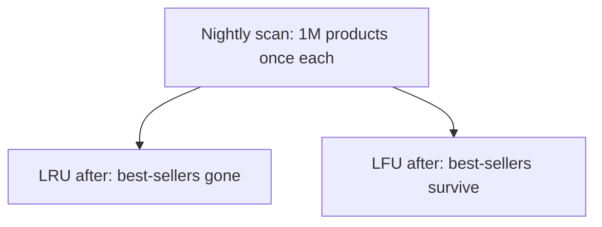
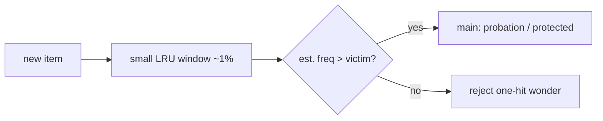
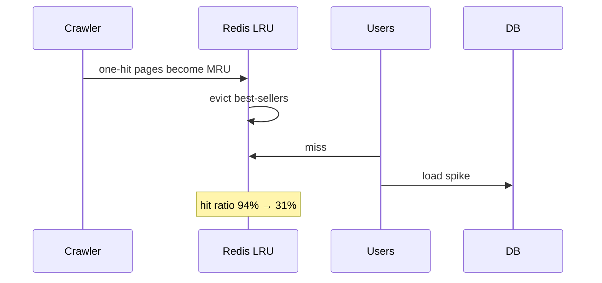

# Lesson 07: LFU vs LRU vs FIFO Cache Eviction (and TinyLFU) Explained

> **Prerequisites:** [Lesson 06: LRU Cache Explained](../06-lru-cache-explained/README.md) and [Track: Caching](../README.md) overview.  
> **Estimated Reading Time:** 28–35 minutes  
> **Target Audience:** Backend engineers fighting cache pollution from crawlers and batch jobs, choosing Redis/Caffeine eviction policies, and comparing LRU vs LFU in interviews.  
> **Free PDF Notes:** [Download SD-F-007.pdf](https://backendroadmap.com/notes/system-design/SD-F-007.pdf)

> [!NOTE]
> **In one line:** LFU evicts the least frequently used entry, so long-term popular items survive scans and one-off bursts (but needs decay so old popularity fades); FIFO evicts the oldest entry and is cheap but ignores use; modern caches such as TinyLFU combine frequency and recency to resist cache pollution.

> [!TIP]
> **The Golden Rule of Eviction:** Default to LRU; switch to LFU when scans/crawlers pollute a stable catalogue; prefer W-TinyLFU for in-process caches — and always measure hit ratio before and after changing a policy.

---

## Words You'll Meet Today

| Word | In Plain Words | Role in a Live Backend System |
| :--- | :--- | :--- |
| **LFU** | Evict least frequently used | Survives one-hit wonders from crawls |
| **FIFO** | Evict oldest inserted | Cheap; ignores hits entirely |
| **Cache pollution** | Unreused entries crowding hot data | Scans, bots, exports |
| **Counter decay** | Age frequency counts over idle time | Redis `lfu-decay-time` |
| **TinyLFU** | Frequency-sketch admission filter | Caffeine / Ristretto |
| **W-TinyLFU** | TinyLFU + small LRU window | Absorbs bursts / launches |
| **Count-Min** | Compact approximate frequency | Sketch bits per key |
| **Scan resistance** | Not flushed by one-time reads | Policy property you want |

---

## Visual Mental Models & Architecture

### The Nightly Scan That Emptied the Cache

A nightly batch job reads one million old products, once each. With LRU, every read makes its product the most recently used and best-sellers are pushed out. By morning the hit ratio is on the floor. Recency alone was fooled.



*Figure 1. One access looks hot to LRU; LFU needs repeated use.*

### W-TinyLFU Admission



*Figure 2. New items enter a window; the frequency sketch decides whether they replace something in the main area.*

---

## Core Definition & Taxonomic Comparison

**What it is:** Choosing *who* to throw out under memory pressure — by recency (LRU), frequency (LFU), age (FIFO), or frequency-aware admission (TinyLFU). **What it isn't:** TTL expiry (time-based removal regardless of memory).

| Policy | Evicts | Resists scans? | Adapts to change? | Cost | Best for |
| :--- | :--- | :--- | :--- | :--- | :--- |
| **LRU** | least recently used | No | Yes, fast | list update per hit | sessions, trending, general use |
| **LFU** | least frequently used | Yes | Slowly (needs decay) | counter per key | catalogues, home pages |
| **FIFO** | oldest inserted | No | n/a | almost none | uniform value, TTL-bound buffers |
| **Random** | random entry | Partial | n/a | none | uniform access, simplest |
| **W-TinyLFU** | by frequency + admission | Yes | Yes | small sketch | most in-process workloads |

**Business impact.** Eviction policy decides who survives a flood of one-time traffic. Wrong policy during a crawl can triple database CPU while bots happily fill the cache.

---

## Component Anatomy & The Observability Gap

### Pure LFU and the catch

Each entry keeps an access counter; when full, evict the lowest count. Top products stay; crawler hits (count = 1) leave first. **Flaw:** last month's viral item keeps a huge count forever and blocks this week's launch. **Fix:** decay — periodically halve counters or decrement on idle time.

### Redis LFU (logarithmic counter)

8-bit probabilistic counter per key; increments become less likely as the counter grows; decremented for every `lfu-decay-time` minute(s) of idleness. New keys start at 5 so they aren't instantly evicted. Counter saturates at 255.

```text
maxmemory-policy allkeys-lfu
lfu-log-factor 10                 # higher = counter grows slower
lfu-decay-time 1                  # minutes of idleness per decrement
```

| `lfu-log-factor` | ~after 100 hits | ~after 1,000 | ~after 100,000 | ~after 1,000,000 |
| :--- | :--- | :--- | :--- | :--- |
| 0 | 104 | 255 | 255 | 255 |
| 1 | 18 | 49 | 255 | 255 |
| **10 (default)** | **10** | **18** | **142** | **255** |
| 100 | 8 | 11 | 49 | 143 |

### FIFO

Queue: entries leave in insertion order regardless of usefulness. No bookkeeping on reads → cheap and easy to scale. Fine when entries have similar value or are TTL-bound. CLOCK / SIEVE approximate LRU with near-FIFO cost.

### Observability Gap

| Vantage Point | What It Captures | What It Hides |
| :--- | :--- | :--- |
| Hit ratio (average day) | Baseline health | Collapse under crawl |
| Hit ratio during crawl | Pollution resistance | Wrong policy for sessions |
| Counter distribution | Decay health | Mis-tuned log-factor |
| Admission reject rate | TinyLFU filter working | Window too small for launches |

**Operational rule:** A/B hit ratio *with and without* synthetic scan traffic before declaring a policy winner.

---

## Mathematical Model & Worked Scale

### Store catalogue under crawl

Top 2,000 products viewed all day. With `allkeys-lfu` they keep high counters; crawler one-hits leave first. Hit ratio stays near **95%** during a crawl where same-sized LRU dropped to about **40%**.

### Amplification under pollution

If useful working set fraction $w$ is displaced by one-hit keys:

$$\text{effective hit ratio} \approx h \cdot (1 - p_{\text{pollution}})$$

Separating crawler traffic (CDN / rate limit) multiplies LFU's benefit — policy and traffic isolation compound.

---

## Metrics, Percentiles & Numbers Engineers Must Know

| Metric / Number | Typical Value | Why It Matters |
| :--- | :--- | :--- |
| W-TinyLFU window | ~1% of cache | Absorbs bursts / new hot items |
| Main segments | ~20% probation / ~80% protected | Caffeine layout |
| Redis LFU counter | 8 bits, max 255 | Compact frequency |
| Default `lfu-log-factor` | 10 | Growth curve |
| Default `lfu-decay-time` | 1 minute | Aging idle keys |
| Crawl hit-ratio delta | 95% LFU vs ~40% LRU | Real incident scale |

---

## Compounding Effects & System Scale

| Scenario | What Compounds | Result |
| :--- | :--- | :--- |
| Bots + shared user LRU | millions of one-hits | Working set erased in minutes |
| LFU without decay | yesterday's winners stuck | New launches never cache |
| Undersized LFU | too few slots for hot set | Thrash among frequency leaders |
| Batch job on same Redis | pollution + eviction storm | Morning SEV for users |

---

## Protocol & Network Deep Dive

```text
# redis.conf — frequency-aware cache
maxmemory 4gb
maxmemory-policy allkeys-lfu
lfu-log-factor 10
lfu-decay-time 1

# shared instance with permanent keys:
# maxmemory-policy volatile-lfu   # only TTL keys are candidates
```

In-process: Caffeine (Java) defaults to W-TinyLFU; Ristretto (Go) uses a TinyLFU-style admission policy.

---

## Hierarchical Budgets & Capacity Sizing

| Layer | Role |
| :--- | :--- |
| Capacity | Size working set first (Lesson 06) — policy ≠ free lunch |
| Policy | LRU default; LFU for stable + scan-heavy; TinyLFU in-process |
| Traffic isolation | CDN / rate-limit bots; separate batch path |
| Admission | Second-chance or TinyLFU for long-tail keys |
| Measurement | Hit ratio A/B including scan + burst scenarios |

**Rule:** Policy choice is orthogonal to size — an undersized LFU still thrashes among too few slots.

---

## Top Engineering Mitigation Techniques

1. **Default LRU / `allkeys-lru`** for general web traffic.
2. **`allkeys-lfu`** when catalogue popularity is stable and crawlers/scans pollute.
3. **W-TinyLFU** (Caffeine / Ristretto) for in-process caches.
4. **Second-chance admission** — admit long-tail keys only on the second request.
5. **Isolate batch/bot paths** from the user-facing cache.
6. **Always measure** hit ratio on real traffic before and after a policy change.

---

## Production War Story: The Crawler That Halved the Hit Ratio

**Severity & Impact:** Marketplace Redis used `allkeys-lru` at a steady **94%** hit ratio. One afternoon a search-engine-style crawler fetched ~2 million long-tail product pages. Hit ratio fell **94% → 31%** for about an hour; database CPU tripled; real customers saw slow pages while bots filled the cache.

**What Happened:**

```text
each crawled page → cached → became MRU → favourites evicted
crawler never re-requests → pollution with zero reuse
```



**Root Cause:** LRU treats one access as hot. Eviction policy (not capacity alone) decided who survived one-time traffic.

**The Fix:**
1. Switch to `allkeys-lfu` so one-hit pages leave before popular ones.
2. Rate-limit known crawlers; serve them from CDN / separate path.
3. Admit long-tail keys only on the second request.

**Lesson:** Think about scans and bots when you pick an eviction policy.

---

## Multi-Language Production Implementation

Policy selection and LFU-style structures in Go, TypeScript, Python, and C#:

````carousel
```go
// Go: TinyLFU-style admission + Ristretto-oriented sketch
package admit

import (
	"sync"
)

// FreqSketch is a tiny Count-Min style counter map for admission decisions.
type FreqSketch struct {
	mu   sync.Mutex
	freq map[string]int
}

func NewFreqSketch() *FreqSketch {
	return &FreqSketch{freq: make(map[string]int)}
}

func (s *FreqSketch) Hit(key string) {
	s.mu.Lock()
	s.freq[key]++
	s.mu.Unlock()
}

func (s *FreqSketch) Estimate(key string) int {
	s.mu.Lock()
	defer s.mu.Unlock()
	return s.freq[key]
}

// ShouldAdmit: candidate enters only if more popular than the victim it would replace.
func ShouldAdmit(candidateFreq, victimFreq int) bool {
	return candidateFreq > victimFreq
}

// Decay halves all counters (periodic aging).
func (s *FreqSketch) Decay() {
	s.mu.Lock()
	defer s.mu.Unlock()
	for k, v := range s.freq {
		s.freq[k] = v / 2
		if s.freq[k] == 0 {
			delete(s.freq, k)
		}
	}
}
```
<!-- slide -->
```typescript
// TypeScript: choose policy by workload + simple LFU map
export type Policy = "lru" | "lfu" | "fifo" | "tinylfu";

export function pickPolicy(opts: {
  scanHeavy: boolean;
  stablePopularity: boolean;
  inProcess: boolean;
}): Policy {
  if (opts.inProcess) return "tinylfu"; // Caffeine / Ristretto equivalents
  if (opts.scanHeavy || opts.stablePopularity) return "lfu";
  return "lru";
}

export class LfuCache<K, V> {
  private map = new Map<K, { val: V; freq: number }>();
  constructor(private cap: number) {}

  get(key: K): V | undefined {
    const e = this.map.get(key);
    if (!e) return undefined;
    e.freq++;
    return e.val;
  }

  put(key: K, val: V) {
    const e = this.map.get(key);
    if (e) {
      e.val = val;
      e.freq++;
      return;
    }
    if (this.map.size >= this.cap) {
      let victim: K | undefined;
      let min = Infinity;
      for (const [k, v] of this.map) {
        if (v.freq < min) {
          min = v.freq;
          victim = k;
        }
      }
      if (victim !== undefined) this.map.delete(victim);
    }
    this.map.set(key, { val, freq: 1 });
  }
}
```
<!-- slide -->
```python
# Python: cachetools policies + second-chance admission + Redis LFU notes
from cachetools import LRUCache, LFUCache, FIFOCache, TTLCache
from collections import defaultdict

lru = LRUCache(maxsize=10_000)
lfu = LFUCache(maxsize=10_000)
fifo = FIFOCache(maxsize=10_000)
ttl = TTLCache(maxsize=10_000, ttl=300)  # LRU eviction + 5-minute expiry

# Admit long-tail keys only on the second request
_seen: dict[str, int] = defaultdict(int)

def should_cache(key: str) -> bool:
    _seen[key] += 1
    return _seen[key] >= 2

# redis.conf
# maxmemory-policy allkeys-lfu
# lfu-log-factor 10
# lfu-decay-time 1
```
<!-- slide -->
```csharp
// C#: LFU with optional periodic decay
public sealed class LfuCache<TKey, TValue> where TKey : notnull
{
    private readonly int _cap;
    private readonly Dictionary<TKey, (TValue Val, int Freq)> _map = new();

    public LfuCache(int capacity) => _cap = capacity;

    public bool TryGet(TKey key, out TValue value)
    {
        if (!_map.TryGetValue(key, out var e)) { value = default!; return false; }
        _map[key] = (e.Val, e.Freq + 1);
        value = e.Val; return true;
    }

    public void Put(TKey key, TValue val)
    {
        if (_map.ContainsKey(key)) { _map[key] = (val, _map[key].Freq + 1); return; }
        if (_map.Count >= _cap)
        {
            var victim = _map.OrderBy(kv => kv.Value.Freq).First().Key;
            _map.Remove(victim);
        }
        _map[key] = (val, 1);
    }

    public void Decay()
    {
        foreach (var key in _map.Keys.ToList())
        {
            var (val, freq) = _map[key];
            var next = freq / 2;
            if (next == 0) _map.Remove(key);
            else _map[key] = (val, next);
        }
    }
}
```
````

---

## Practical Hands-On CLI Verification

### 1. Contrast LRU vs LFU under a one-hit scan

```bash
python -c "
from cachetools import LRUCache, LFUCache
lru, lfu = LRUCache(maxsize=5), LFUCache(maxsize=5)
for k in ['P1','P2','P3']:
    lru[k]=1; lfu[k]=1
    _=lru[k]; _=lfu[k]; _=lru[k]; _=lfu[k]  # warm favourites
for i in range(100):  # one-hit scan
    k=f's{i}'; lru[k]=1; lfu[k]=1
print('LRU survivors', list(lru.keys()))
print('LFU survivors', list(lfu.keys()))
"
```

**Expected:** LFU more likely to keep `P1`–`P3`; LRU filled with late scan keys.

### 2. Inspect Redis LFU settings

```bash
redis-cli CONFIG GET maxmemory-policy
redis-cli CONFIG GET lfu-log-factor
redis-cli CONFIG GET lfu-decay-time
```

### 3. Second-chance admission sketch

```bash
python -c "
from collections import defaultdict
seen=defaultdict(int)
def admit(k):
    seen[k]+=1; return seen[k]>=2
print([admit(k) for k in ['a','b','a','c','a']])
"
```

**Expected:** `[False, False, True, False, True]` — first sightings rejected.

---

## Common Mistakes to Avoid

- Choosing LFU without decay (or with a very long decay) so yesterday's winners occupy the cache.
- Assuming LRU is always right, then suffering when a scan or crawler arrives.
- Using FIFO for data with strongly skewed popularity.
- Setting a policy and not measuring hit ratio before and after.
- Letting batch jobs and bots share the same cache as user traffic.
- Mixing up eviction (memory pressure) and expiry (TTL).
- Undersizing the cache and blaming the policy.

---

## Key Terms Glossary

| Term | Interview-ready definition |
| :--- | :--- |
| **LFU** | Least frequently used — evict the lowest access count |
| **FIFO** | First in, first out — oldest inserted leaves first |
| **Cache pollution** | Unreused entries crowding out useful ones |
| **Counter decay** | Aging counts so recent popularity wins |
| **Logarithmic counter** | 8-bit probabilistic counter (Redis LFU) |
| **TinyLFU** | Frequency-sketch admission filter |
| **W-TinyLFU** | TinyLFU with a small LRU window (Caffeine) |
| **Count-Min sketch** | Compact approximate frequency counter |
| **Admission policy** | Whether a new item is allowed into the cache |
| **Scan resistance** | Not being flushed by one-time reads |

---

## Interview Practice Questions

<details>
<summary><strong>Q1: When does LFU beat LRU? [BASIC]</strong></summary>

When popularity is stable over time (top products) and when scans or one-off accesses would push hot items out of an LRU — LFU needs repeated use to keep an item.

</details>

<details>
<summary><strong>Q2: What is cache pollution? [BASIC]</strong></summary>

Filling the cache with entries that won't be reused, evicting valuable ones. LFU and TinyLFU resist it better than LRU.

</details>

<details>
<summary><strong>Q3: What does FIFO do, and when is it acceptable? [BASIC]</strong></summary>

It evicts the oldest inserted entry regardless of use. It is cheap (no work on reads) and fine when entries have similar value or are TTL-bound.

</details>

<details>
<summary><strong>Q4: What problem does pure LFU have? [BASIC]</strong></summary>

Old popularity never fades: an item that was hot last month keeps a high count and blocks new hot items. Decay (halving counters over time) fixes it.

</details>

<details>
<summary><strong>Q5: A crawler hits your site and the cache hit ratio collapses. What do you change? [SCENARIO]</strong></summary>

Use LFU or a TinyLFU-based admission policy, rate-limit or separate crawler traffic, and admit long-tail keys only on a second request.

</details>

<details>
<summary><strong>Q6: Which policy would you pick for a cache of user sessions? [SCENARIO]</strong></summary>

LRU with a TTL — recently active sessions are the most likely to be used again, and idle ones should go.

</details>

<details>
<summary><strong>Q7: Which Redis policy for a cache sharing an instance with permanent keys? [SCENARIO]</strong></summary>

`volatile-lru` or `volatile-lfu` so only keys with a TTL can be evicted. Make sure the cache keys all have TTLs, or nothing can be evicted.

</details>

<details>
<summary><strong>Q8: How would you test an eviction change? [SCENARIO]</strong></summary>

Replay or shadow production traffic against both policies, compare hit ratio and tail latency, and include scan and burst scenarios — not just the average case.

</details>

<details>
<summary><strong>Q9: Why does Redis use a logarithmic counter? [TRICKY]</strong></summary>

To count to large numbers in 8 bits: increments become less likely as the counter grows, and decay lowers it over idle time.

</details>

<details>
<summary><strong>Q10: How does TinyLFU decide whether to admit a new item? [TRICKY]</strong></summary>

It compares the candidate's estimated frequency in a Count-Min sketch with the frequency of the entry that would be evicted, and only admits the candidate if it is higher.

</details>

<details>
<summary><strong>Q11: Is LFU always better than LRU? [TRICKY]</strong></summary>

No. It reacts slowly to changes in popularity and costs more bookkeeping. LRU adapts faster for workloads driven by recency.

</details>

<details>
<summary><strong>Q12: What is the difference between eviction and expiry? [TRICKY]</strong></summary>

Eviction removes entries because memory is full, by policy. Expiry removes them because their TTL ended, regardless of memory.

</details>

---

## One-Page Master Cheat Sheet

```text
====================================================================================================
                    LFU / LRU / FIFO / TinyLFU  —  CHEAT SHEET (SD-F-007)
====================================================================================================
IN ONE LINE   Recency (LRU) vs frequency (LFU) vs age (FIFO); TinyLFU admits by estimated freq

LRU           recency; fooled by scans
LFU           frequency; resists pollution; needs decay
FIFO          oldest inserted; no read bookkeeping; uniform/TTL-bound OK
POLLUTION     unreused entries (scans, bots, one-off reports)
REDIS         allkeys-lfu + lfu-log-factor 10 + lfu-decay-time 1
TinyLFU       Count-Min admission; W-TinyLFU = +~1% LRU window (Caffeine)
RULE          default LRU; LFU for stable+scans; measure hit ratio A/B
ANTI          LFU no decay · FIFO on skew · shared bot cache · eviction ≠ expiry
====================================================================================================
```

---

## Free PDF notes

Download these notes as a printable PDF with the policy comparison table, W-TinyLFU diagram, and interview answers: [SD-F-007.pdf](https://backendroadmap.com/notes/system-design/SD-F-007.pdf).

---

## Sources

- [Einziger, Friedman, Manes — TinyLFU: A Highly Efficient Cache Admission Policy](https://arxiv.org/abs/1512.00727)
- [Redis docs — Using Redis as an LRU/LFU cache](https://redis.io/docs/latest/develop/reference/eviction/)
- [Yang et al. — FIFO queues are all you need for cache eviction (SOSP 2023)](https://dl.acm.org/doi/10.1145/3600006.3613147)
- [backendroadmap.com — SD-F-008 Cache Invalidation Strategies](https://backendroadmap.com/notes/system-design/SD-F-008.pdf)

---

## Next

Next lesson: [Cache Invalidation Strategies: TTL, Delete, CDC, Versioned Keys](../08-cache-invalidation-strategies/README.md)

Track overview: [Track: Caching](../README.md)
