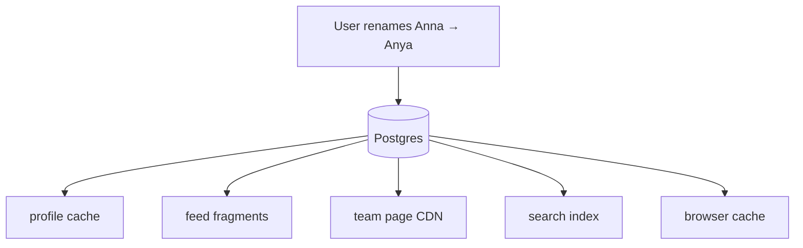
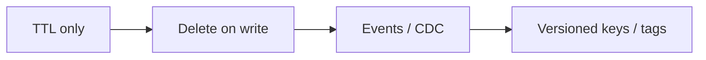
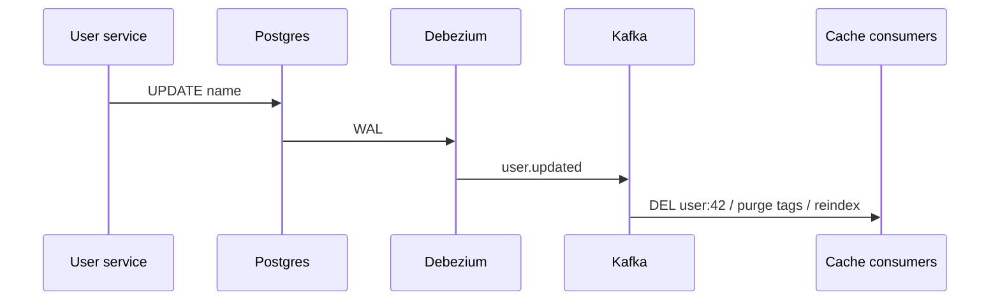
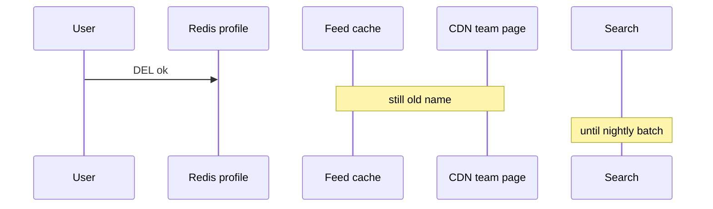

# Lesson 08: Cache Invalidation Strategies — TTL, Delete, CDC, Versioned Keys

> **Prerequisites:** [Lesson 02: Cache-Aside](../02-cache-aside/README.md), [Lesson 05: Cache TTL & Expiration](../05-cache-ttl-expiration/README.md), and [Track: Caching](../README.md) overview.  
> **Estimated Reading Time:** 30–38 minutes  
> **Target Audience:** Backend engineers keeping many derived copies fresh across Redis, CDN, and search — and interview candidates explaining why invalidation is hard.  
> **Free PDF Notes:** [Download SD-F-008.pdf](https://backendroadmap.com/notes/system-design/SD-F-008.pdf)

> [!NOTE]
> **In one line:** There are four main ways to keep a cache fresh: let entries expire (TTL), delete on write, publish change events (CDC) that invalidators consume, or avoid deleting with versioned keys and tags. It is hard because writes and reads race, messages can be late/duplicated/reordered, and one change affects many keys.

> [!TIP]
> **The Golden Rule of Invalidation:** Combine one precise mechanism (delete, CDC, or version bump) with a TTL safety net — and store references, not embedded copies, whenever you can.

---

## Words You'll Meet Today

| Word | In Plain Words | Role in a Live Backend System |
| :--- | :--- | :--- |
| **Invalidation** | Remove or refresh a stale entry | `DEL` / purge / version bump |
| **CDC** | Capture DB log changes | Debezium → Kafka |
| **Outbox** | Event in same TX as write | No lost emits |
| **Versioned key** | Version in the key name | `product:42:v8` |
| **Surrogate key / tag** | Label for group purge | CDN Fastly / Cloudflare |
| **Fan-out** | One change → many keys | Profile + feed + search |
| **Idempotent** | Safe to apply twice | DEL-based consumers |
| **TTL safety net** | Bounds missed invalidation | Every entry should have one |

---

## Visual Mental Models & Architecture

### "There Are Only Two Hard Things…"

A user changes their name, and three different caches keep showing the old one for hours: the browser, a CDN edge, Redis, plus the search index nobody remembered. Caching is easy to add; keeping the copies correct is the real work.



*Figure 1. One write, many copies — each is an invalidation obligation.*

### Four Families of Strategies



*Figure 2. Simple → precise. In practice: events or deletes for freshness + a TTL as the safety net.*

---

## Core Definition & Taxonomic Comparison

**What it is:** Keeping derived copies correct after the source of truth changes. **What it isn't:** Eviction under memory pressure (Lesson 06–07) — that frees space; invalidation restores freshness.

| Strategy | Freshness | Writer can forget? | Race-prone? | Complexity | Best for |
| :--- | :--- | :--- | :--- | :--- | :--- |
| **TTL only** | up to the TTL | no | no | lowest | generous budgets / safety net |
| **Delete on write** | fast | yes | yes | low | one service owns the data |
| **Events / CDC** | ms–s | no | less | highest | many services and caches |
| **Versioned keys** | immediate (new key) | yes (must bump) | no | medium | immutable objects / format changes |
| **Tags / purge** | fast | yes (must purge) | less | medium | CDN and page caches |

**Business impact.** Forgotten derived copies produce support tickets that look like "bugs in the profile page" when the real bug is an uninvalidated feed fragment or nightly search index.

---

## Component Anatomy & The Observability Gap

### Strategy 1: TTL-based expiry

Don't invalidate at all — entries expire. Self-healing; stale up to the TTL. Fine for generous staleness budgets; **should be present on every entry as a safety net**.

### Strategy 2: Explicit delete on write

App updates DB and deletes related keys (cache-aside). Fast and precise. Problems: every write path must remember; one change can affect many keys — know the dependency set. Tip: name keys so dependents can be found (`deps:user:42` set), never `KEYS` in production.

### Strategy 3: Event-driven / CDC

Debezium reads the WAL → `user.updated` on Kafka → each team deletes its keys. No write path can forget. At-least-once + idempotent DELs. Partition by key for order. Outbox: write event in the same TX as the data.

### Strategy 4: Versioned keys and tags

Bump `product:{id}:ver`; readers build `product:{id}:v{ver}`; old keys expire — no delete to lose. Tags purge groups of URLs at once (Fastly surrogate keys, Cloudflare cache tags).

### Anatomy of the classic stale-set race

```text
 Reader: GET miss → SELECT v1 (slow)
 Writer: UPDATE v2 → DEL x
 Reader: wakes → SET x = v1
 Result: cache serves v1 until TTL (or forever without TTL)
```

Defences in Lesson 09. Versioned keys dodge this race: the stale reader fills the old key, which nobody reads.

### Observability Gap

| Vantage Point | What It Captures | What It Hides |
| :--- | :--- | :--- |
| Consumer lag | CDC freshness | Embedded copies never invalidated |
| Delete QPS | Fan-out volume | Forgotten derived keys |
| Purge API errors | CDN path | Browser private cache |
| % keys without TTL | Safety-net coverage | Race windows still open |

**Operational rule:** list every copy of a value (Redis, CDN, browser, embeds, search) before promising freshness.

---

## Mathematical Model & Worked Scale

TTL $T$ caps damage from any missed invalidation:

$$t_{\text{stale}} \le T$$

With CDC lag $L$:

$$t_{\text{stale}} \le \max(L, \text{race window}) \quad\text{(still capped by } T\text{)}$$

Fan-out cost for one write touching $M$ derived keys across $N$ layers:

$$\text{invalidation obligations} \approx N \times M$$

Embedding author names in feed fragments multiplies copies; storing author id and joining at render collapses them toward $1$.

---

## Metrics, Percentiles & Numbers Engineers Must Know

| Metric / Number | Typical Value | Why It Matters |
| :--- | :--- | :--- |
| CDC lag healthy | ms–low seconds | Bound on event-driven freshness |
| TTL safety net | minutes–hours | Catches missed paths |
| CDN purge propagation | seconds (provider-specific) | Edge consistency budget |
| Stale-name tickets | support proxy | Detects forgotten copies |
| Keys without TTL | should → 0% for cache data | Forever-stale risk |

---

## Compounding Effects & System Scale

| Scenario | What Compounds | Result |
| :--- | :--- | :--- |
| $N$ layers × $M$ derived keys | obligations per write | Missed deletes everywhere |
| Embedded copies in fragments | each fragment is a copy | Hours of stale UX |
| Non-idempotent consumers | retries / duplicates | Wrong updates or skipped work |
| Out-of-order events | lagging partitions | Old overwrite after new |
| Browser + CDN + Redis | layers you don't control | "We deleted Redis" ≠ fresh |

---

## Protocol & Network Deep Dive



*Figure 3. Every committed change is in the log — no code path can skip it. Consumers own their invalidation.*

Partition events by object key so one consumer processes one object's events in order. Delete twice is harmless — ideal for at-least-once delivery.

---

## Hierarchical Budgets & Capacity Sizing

| Data class | Strategy stack | Staleness budget |
| :--- | :--- | :--- |
| Rarely changes | Long TTL + delete/CDC | minutes–hours OK |
| Must flip fast | Delete/CDC + short TTL | seconds |
| CDN pages | Tags + purge + short max-age | seconds–minutes |
| Format migrations | Versioned keys | ignore old versions |
| Money / inventory | Often skip cache or write-through | Lesson 09 |

---

## Top Engineering Mitigation Techniques

1. **TTL on every entry** — safety net for missed paths.
2. **Central writes or CDC** so no path forgets.
3. **Versioned keys** to dodge delete races and format migrations.
4. **Surrogate keys** for CDN fan-out.
5. **Prefer references over embedded copies**.
6. **Idempotent consumers** + partition by key + alert on lag.
7. **Outbox** when the app emits events (same TX as the write).

---

## Production War Story: Three Caches, One Old Name

**Severity & Impact:** Social product let users change display name. Postgres updated and Redis profile key deleted — profile pages looked right. Support tickets: old name on comment threads, team pages, and search.

**What Happened:**

```text
Comments embedded author name in cached feed fragment (6-hour TTL)
Team page cached member list at CDN for 1 hour
Search index updated by nightly batch
→ profile OK; three other copies stale for hours
```



**Root Cause:** Invalidated only the obvious key. Every copy of a value is an invalidation obligation.

**The Fix:**
1. Publish `user.updated` from the database log; feed, team, and search subscribe.
2. Cached fragments store author id and fetch the name at render from the profile cache.
3. CDN responses get surrogate key `user-42`, purged by the same event.

**Lesson:** Fewer copies (store references, not duplicates) and event-driven invalidation make it manageable.

---

## Multi-Language Production Implementation

Idempotent CDC consumers and versioned keys in Go, TypeScript, Python, and C#:

````carousel
```go
// Go: CDC-style invalidation consumer (idempotent deletes) + version bump
package invalidate

import (
	"context"
	"fmt"

	"github.com/redis/go-redis/v9"
)

func HandleUserUpdated(ctx context.Context, rdb *redis.Client, userID int64) error {
	keys := []string{
		fmt.Sprintf("user:v1:%d", userID),
		fmt.Sprintf("user:v1:%d:badges", userID),
	}
	deps, err := rdb.SMembers(ctx, fmt.Sprintf("deps:user:%d", userID)).Result()
	if err != nil {
		return err
	}
	keys = append(keys, deps...)
	return rdb.Del(ctx, keys...).Err() // deleting twice is harmless
}

func BumpVersion(ctx context.Context, rdb *redis.Client, productID int64) (int64, error) {
	return rdb.Incr(ctx, fmt.Sprintf("product:%d:ver", productID)).Result()
}

func GetProduct(ctx context.Context, rdb *redis.Client, load func(context.Context, int64) (string, error), pid int64) (string, error) {
	ver, _ := rdb.Get(ctx, fmt.Sprintf("product:%d:ver")).Result()
	if ver == "" {
		ver = "0"
	}
	key := fmt.Sprintf("product:%d:v%s", pid, ver)
	if raw, err := rdb.Get(ctx, key).Result(); err == nil {
		return raw, nil
	}
	row, err := load(ctx, pid)
	if err != nil {
		return "", err
	}
	_ = rdb.Set(ctx, key, row, 3600*1e9 /* use time.Hour in real code */).Err()
	return row, nil
}
```
<!-- slide -->
```typescript
// TypeScript: versioned keys + dependency deletes
export async function getProduct(redis: any, db: any, pid: number) {
  const ver = (await redis.get(`product:${pid}:ver`)) ?? "0";
  const key = `product:${pid}:v${ver}`;
  const raw = await redis.get(key);
  if (raw) return JSON.parse(raw);
  const row = await db.fetchProduct(pid);
  await redis.set(key, JSON.stringify(row), "EX", 3600);
  return row;
}

export async function updateProduct(redis: any, db: any, pid: number, fields: object) {
  await db.updateProduct(pid, fields);
  await redis.incr(`product:${pid}:ver`); // readers move to new key; old expires
}

export async function handleUserUpdated(redis: any, uid: number) {
  await redis.del(`user:v1:${uid}`, `user:v1:${uid}:badges`);
  const deps: string[] = await redis.smembers(`deps:user:${uid}`);
  if (deps.length) await redis.del(...deps);
}
```
<!-- slide -->
```python
# Python: event consumer + versioned product read
import json

async def handle(event: dict, r):
    if event["table"] != "users":
        return
    uid = event["after"]["id"]
    await r.delete(f"user:v1:{uid}", f"user:v1:{uid}:badges")
    for key in await r.smembers(f"deps:user:{uid}"):
        await r.delete(key)

async def get_product(r, db, pid: int):
    ver = await r.get(f"product:{pid}:ver") or b"0"
    key = f"product:{pid}:v{ver.decode()}"
    if (raw := await r.get(key)) is not None:
        return json.loads(raw)
    row = await db.fetchrow("SELECT * FROM products WHERE id = $1", pid)
    await r.set(key, json.dumps(dict(row)), ex=3600)
    return dict(row)

async def update_product(r, db, pid: int, fields: dict):
    await db.execute("UPDATE products SET ... WHERE id = $1", pid)
    await r.incr(f"product:{pid}:ver")
```
<!-- slide -->
```csharp
// C#: versioned keys + idempotent delete fan-out
using StackExchange.Redis;

public sealed class ProductCache
{
    private readonly IDatabase _db;
    public ProductCache(IConnectionMultiplexer mux) => _db = mux.GetDatabase();

    public async Task<string?> GetAsync(long pid, Func<long, Task<string>> load)
    {
        var ver = (string?)await _db.StringGetAsync($"product:{pid}:ver") ?? "0";
        var key = $"product:{pid}:v{ver}";
        var raw = await _db.StringGetAsync(key);
        if (raw.HasValue) return raw!;
        var row = await load(pid);
        await _db.StringSetAsync(key, row, TimeSpan.FromHours(1));
        return row;
    }

    public async Task UpdateAsync(long pid, Func<Task> persist)
    {
        await persist();
        await _db.StringIncrementAsync($"product:{pid}:ver");
    }

    public async Task OnUserUpdatedAsync(long uid)
    {
        await _db.KeyDeleteAsync(new RedisKey[] {
            $"user:v1:{uid}", $"user:v1:{uid}:badges"
        });
        var deps = await _db.SetMembersAsync($"deps:user:{uid}");
        if (deps.Length > 0)
            await _db.KeyDeleteAsync(deps.Select(x => (RedisKey)(string)x!).ToArray());
    }
}
```
````

---

## Practical Hands-On CLI Verification

### 1. Versioned key round-trip

```bash
redis-cli SET product:42:ver 7
redis-cli SET product:42:v7 '{"name":"old"}' EX 3600
redis-cli INCR product:42:ver
redis-cli GET product:42:ver
# readers now ask for product:42:v8 — old v7 ages out by TTL
```

### 2. Idempotent double delete

```bash
redis-cli SET user:v1:42 Anna
redis-cli DEL user:v1:42
redis-cli DEL user:v1:42
echo $?
```

**Expected:** second `DEL` returns 0 keys removed — harmless.

### 3. Dependency set fan-out

```bash
redis-cli SADD deps:user:42 feed:frag:1 team:7:members
redis-cli SMEMBERS deps:user:42
```

---

## Common Mistakes to Avoid

- Invalidating only the obvious key and forgetting derived and embedded copies.
- Relying on every developer to remember a delete in every code path.
- Using TTL as the only mechanism for data that must change quickly.
- Scanning with `KEYS` or hot `SCAN` loops to find keys to delete in production.
- Event consumers that are not idempotent, or that process one object's events out of order.
- Not monitoring consumer lag — a slow invalidator is a staleness bug.
- Forgetting layers you do not control (browser, CDN) when promising freshness.

---

## Key Terms Glossary

| Term | Interview-ready definition |
| :--- | :--- |
| **Invalidation** | Removing or refreshing a stale cache entry |
| **TTL expiry** | Entries die by age — self-healing safety net |
| **Delete on write** | Remove keys when the data changes |
| **CDC** | Change data capture from the database log |
| **Debezium** | CDC tool that streams database changes to Kafka |
| **Outbox pattern** | Write the event in the same transaction as the data |
| **Versioned key** | Key that includes a version number |
| **Surrogate key / tag** | Label used to purge groups of entries |
| **Idempotent** | Safe to apply twice |
| **Fan-out** | One change affecting many keys |

---

## Interview Practice Questions

<details>
<summary><strong>Q1: Why is cache invalidation hard? [BASIC]</strong></summary>

Caches and databases are updated separately, so concurrent reads and writes race; invalidation messages can be delayed, duplicated or reordered; and one change can affect many dependent keys.

</details>

<details>
<summary><strong>Q2: Name the main invalidation strategies. [BASIC]</strong></summary>

TTL expiry, delete on write, event-driven invalidation with CDC, and versioned keys or tag-based purges. Combine one precise strategy with a TTL safety net.

</details>

<details>
<summary><strong>Q3: What is the benefit of event-driven invalidation? [BASIC]</strong></summary>

It decouples writers from caches. The database log captures every change, so no write path can forget to invalidate, and each consumer owns its own caches.

</details>

<details>
<summary><strong>Q4: How do versioned keys work? [BASIC]</strong></summary>

The key includes a version (`product:42:v7`). A change bumps the version, readers use the new key, and old versions expire. No delete is needed.

</details>

<details>
<summary><strong>Q5: A user changes their name and some pages still show the old one. How do you find out why? [SCENARIO]</strong></summary>

List every copy: Redis, CDN, browser, embedded fragments and the search index. For each, check its TTL and which code path invalidates it, then add event-driven invalidation and remove embedded copies.

</details>

<details>
<summary><strong>Q6: Design invalidation for a product shown on pages, API responses and images. [SCENARIO]</strong></summary>

Tag every response with the product's surrogate key and purge by tag from a product-updated event; keep a short TTL as a safety net; use versioned URLs for immutable images.

</details>

<details>
<summary><strong>Q7: Your Kafka-based invalidator falls an hour behind. What do you do? [SCENARIO]</strong></summary>

Alert on consumer lag, scale consumers, and rely on TTLs to bound staleness meanwhile. For critical keys, add a reconciliation job that compares cache and database.

</details>

<details>
<summary><strong>Q8: Describe a race that leaves a stale value in the cache. [SCENARIO]</strong></summary>

A reader misses and reads the old value, a writer updates the database and deletes the key, then the slow reader writes the old value into the cache, where it stays until its TTL.

</details>

<details>
<summary><strong>Q9: Why are delete-based invalidations easy to make idempotent? [TRICKY]</strong></summary>

Deleting a key twice has the same result as deleting it once, so duplicates and retries are harmless.

</details>

<details>
<summary><strong>Q10: Why partition invalidation events by key? [TRICKY]</strong></summary>

So events for the same object are processed in order by one consumer; otherwise an old event could overwrite or follow a newer one.

</details>

<details>
<summary><strong>Q11: Update the cache on write, or delete? Which fits event-driven invalidation? [TRICKY]</strong></summary>

Delete: it is idempotent and order-insensitive. Updating from events requires version checks to avoid applying an old value after a new one.

</details>

<details>
<summary><strong>Q12: What does the outbox pattern add? [TRICKY]</strong></summary>

The event is written in the same database transaction as the data, so you never change data without emitting the event or the reverse. A relay then publishes it.

</details>

---

## One-Page Master Cheat Sheet

```text
====================================================================================================
                 CACHE INVALIDATION STRATEGIES  —  CHEAT SHEET (SD-F-008)
====================================================================================================
IN ONE LINE   TTL · delete-on-write · CDC/events · versioned keys/tags — combine precise + TTL

TTL           simplest, self-healing, stale ≤ TTL; put one on every entry
DELETE        precise but every writer must remember; one change → many keys
CDC           Debezium → Kafka; no path can forget; consumers DEL their keys
VERSION/TAGS  bump version / purge by tag; no lost delete; CDN surrogate keys
HARD BECAUSE  races · delayed/reordered messages · fan-out across copies
RULE          store references not copies; monitor consumer lag; outbox for app emits
ANTI          only obvious key · KEYS in prod · non-idempotent consumers · no TTL
====================================================================================================
```

---

## Free PDF notes

Download these notes as a printable PDF with the four-strategy comparison, CDC sequence, and interview answers: [SD-F-008.pdf](https://backendroadmap.com/notes/system-design/SD-F-008.pdf).

---

## Sources

- [Debezium docs — Change data capture and the outbox pattern](https://debezium.io/documentation/)
- [Facebook — Scaling Memcache at Facebook](https://www.usenix.org/conference/nsdi13/technical-sessions/presentation/nishtala)
- [Fastly docs — Surrogate keys](https://docs.fastly.com/en/guides/working-with-surrogate-keys)
- [backendroadmap.com — SD-F-009 Cache Consistency](https://backendroadmap.com/notes/system-design/SD-F-009.pdf)

---

## Next

Next lesson: [Cache Consistency: Stale Sets, Double Delete & Memcache Leases](../09-cache-consistency/README.md)

Track overview: [Track: Caching](../README.md)
