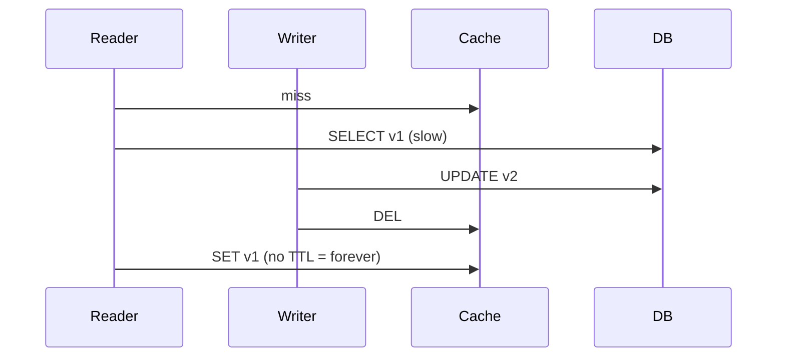
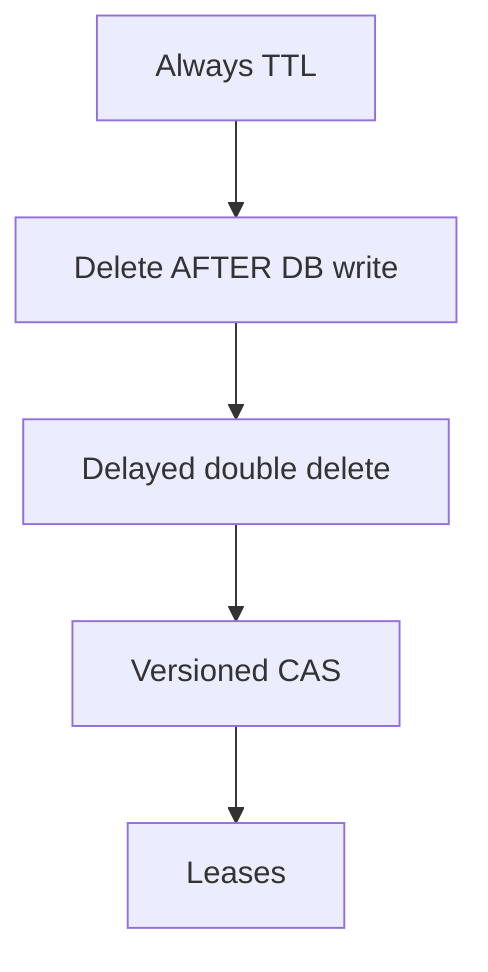
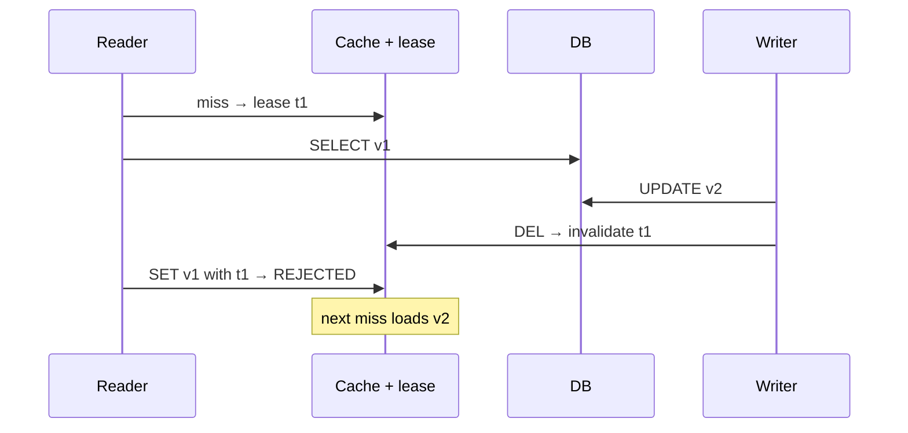
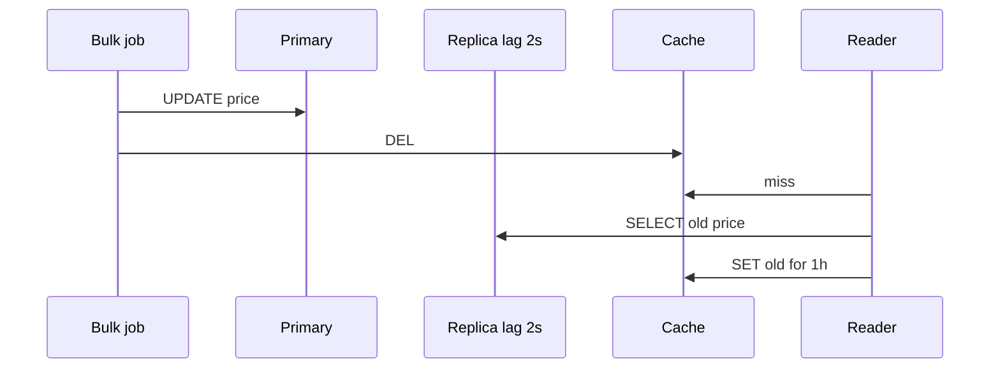

# Lesson 09: Cache Consistency — Stale Sets, Double Delete & Memcache Leases

> **Prerequisites:** [Lesson 08: Cache Invalidation Strategies](../08-cache-invalidation-strategies/README.md) and [Track: Caching](../README.md) overview.  
> **Estimated Reading Time:** 28–35 minutes  
> **Target Audience:** Backend engineers closing the late write-back race, avoiding replica-lag fills, and stating explicit staleness bounds in design reviews.  
> **Free PDF Notes:** [Download SD-F-009.pdf](https://backendroadmap.com/notes/system-design/SD-F-009.pdf)

> [!NOTE]
> **In one line:** A slow reader can write an old value into the cache after a writer's delete, and without a TTL it stays forever. Prevent it with delete-after-write, TTLs, delayed double delete, versioned writes and leases (the Facebook memcache approach), and then decide explicitly how much staleness each kind of data may have.

> [!TIP]
> **The Golden Rule of Cache Consistency:** Always TTL + delete after DB write; escalate to double-delete, CAS, or leases when staleness hurts — and never fill from a lagging replica for recently changed keys.

---

## Words You'll Meet Today

| Word | In Plain Words | Role in a Live Backend System |
| :--- | :--- | :--- |
| **Stale set** | Late write of an old value | Classic cache-aside race |
| **Lease** | Token required to SET after miss | Facebook memcache |
| **Tombstone** | Delete marker with version | Blocks older sets |
| **Double delete** | Delete again after delay | Heuristic cleanup |
| **Compare-and-set** | Write only if newer version | Redis Lua |
| **Read-your-writes** | Writer always sees own change | Session marker → primary |
| **Bounded staleness** | At most N seconds old | Interview-ready bound |
| **Replica lag** | Secondary behind primary | Second source of stale fills |

---

## Visual Mental Models & Architecture

### The Race That Never Heals



*Figure 1. Stale set. TTL caps it; leases reject it.*

### Defence Ladder



*Figure 2. Cheap → strict. Use the cheap ones always; escalate when staleness hurts.*

---

## Core Definition & Taxonomic Comparison

**What it is:** Preventing permanent or long-lived wrong values in the cache after concurrent reads and writes, and choosing how much staleness each data class may accept. **What it isn't:** Strong consistency for free — cache-aside with delete-on-write is eventually consistent with a small stale window.

| Defence | Guarantee | Cost |
| :--- | :--- | :--- |
| **TTL** | Caps every stale value | Eventual heal |
| **Delete after write** | Removes the biggest window | Discipline |
| **Double delete** | Cleans most late write-backs | Heuristic |
| **Versioned CAS** | Rejects older sets | Lua / atomicity |
| **Leases** | Rejects stale sets; limits herds | Token plumbing |

| Consistency need | Pattern |
| :--- | :--- |
| Exact (money / stock) | Read source of truth |
| Read-your-writes | Marker → primary / return new object |
| Bounded staleness | Cache-aside + delete + short TTL |
| Eventual | Long TTL only |

**Business impact.** One race without a TTL leaves the wrong price or name forever. Replica lag during bulk updates can look like "invalidation is broken" when the miss path is the real bug.

---

## Component Anatomy & The Observability Gap

### Defence 1–2: delete after, always a TTL

Delete **after** the database write, never before — deleting first lets a reader repopulate the old value before the write lands. Always set a TTL so no stale value lives forever.

### Defence 3: delayed double delete

Update DB → DEL → wait ≈ fill p99.9 (e.g. 500 ms) → DEL again. A stale value written in the window is cleaned up. Heuristic: a reader slower than the delay still wins (long GC pause).

### Defence 4: versioned CAS

Store a version with the value; write succeeds only if newer. Redis Lua makes check + write atomic. Tombstones: writer stores a versioned delete marker so late stale sets lose the comparison.

### Defence 5: leases

On miss, cache hands a lease token. SET must present the token; delete invalidates outstanding leases → stale set rejected. Also: one lease per key per ~10 s → others wait/retry (stampede control). Facebook memcache paper pattern; approximate in Redis with `SET lease:x token NX EX 10` + CAS Lua.

### Replica lag fills

Miss path reading a lagging replica caches the pre-update row after the writer's delete. Defences: primary for recently written keys; second delete after lag; CAS.

### Observability Gap

| Vantage Point | What It Captures | What It Hides |
| :--- | :--- | :--- |
| Invalidation QPS | Deletes happening | Stale sets winning races |
| Replica lag | Replication health | Miss path still on replica |
| CAS reject rate | Stale writers blocked | Missing TTL still dangerous |
| % primary fills after write | Read-your-writes / recent-write set | Bound not stated in reviews |

---

## Mathematical Model & Worked Scale

Pick double-delete delay from the fill tail:

$$\delta \ge p_{99.9}(\text{miss fill})$$

Lease window: 1 lease / key / 10 s ⇒ at most $0.1$ DB fills/s/key from herd contenders holding leases.

Facebook-style result: large drop in peak database query rates and far fewer stale values left by races.

Read-your-writes window $W$ (cookie/session marker):

$$\text{writer sees own change within } W;\quad\text{others may lag up to TTL}$$

---

## Metrics, Percentiles & Numbers Engineers Must Know

| Metric / Number | Typical Value | Why It Matters |
| :--- | :--- | :--- |
| Double-delete delay | ≥ fill p99.9 (often 300–1000 ms) | Heuristic cleanup window |
| Lease TTL | ~10 s | Herd + stale-set control |
| Read-your-writes window | a few seconds | Writer UX |
| Price TTL (incident) | 1 h → 5 min | Bound damage from bad fills |
| Replica lag alert | during bulk jobs | Second stale source |

**State the bound aloud:** "values may be up to N seconds old, guaranteed by the TTL and invalidation."

---

## Compounding Effects & System Scale

| Scenario | What Compounds | Result |
| :--- | :--- | :--- |
| Bulk updates + replica lag | many deletes + stale fills | Wrong prices for an hour |
| No TTL + one race | permanent stale | SEV until manual flush |
| Non-atomic GET then SET | two writers interleave | Lost updates |
| Promising "consistent" | no number | Interview / review fail |

---

## Protocol & Network Deep Dive

```lua
-- Redis Lua: set only if newer version
-- KEYS[1]=key  ARGV[1]=version  ARGV[2]=json  ARGV[3]=ttl
local cur = redis.call('HGET', KEYS[1], 'v')
if cur and tonumber(cur) >= tonumber(ARGV[1]) then
  return 0
end
redis.call('HSET', KEYS[1], 'v', ARGV[1], 'data', ARGV[2])
redis.call('EXPIRE', KEYS[1], ARGV[3])
return 1
```



*Figure 3. Lease token destroyed by delete — stale write cannot land.*

---

## Hierarchical Budgets & Capacity Sizing

| Consistency need | Pattern | Budget |
| :--- | :--- | :--- |
| Exact (balances, checkout stock) | Read source of truth | 0 stale |
| Read-your-writes | Marker → primary for ~5 s | Writer sees self |
| Bounded staleness | Cache-aside + delete + short TTL | state N seconds |
| Eventual | Long TTL only | up to TTL |

Being explicit about the staleness bound is a strong interview point: "this cache is eventually consistent; entries are at most 60 seconds old; checkout reads the database."

---

## Top Engineering Mitigation Techniques

1. **TTL always** — even a long one.
2. **Delete after DB write** — never before.
3. **Delayed double delete** tuned to fill p99.9.
4. **Versioned CAS / tombstones** (atomic Lua).
5. **Leases** (+ herd control).
6. **Don't fill from lagging replicas** for recently changed keys.
7. **Read-your-writes** marker for the writer.

---

## Production War Story: The Price That Was Wrong After a Replica Lagged

**Severity & Impact:** Retailer cached product prices with a 1-hour TTL and deleted the key on update. During a bulk price change, the replica fell ~2 seconds behind. Readers who missed right after each delete loaded the old price from the replica and cached it for an hour — ~4% of updated SKUs wrong.

**What Happened:**

```text
Primary correct · DEL ran · team suspected invalidation code
Pattern only during bulk updates when replication lagged
→ miss path was the bug, not the delete
```



**Root Cause:** Stale caches can come from stale *sources*. Replica lag on the miss path, not missing deletes.

**The Fix:**
1. Fill from the primary for keys changed in the last 30 seconds (recent-write set in Redis).
2. Delete a second time after 3 seconds (> worst replica lag).
3. Cut price TTL to 5 minutes; alert on replica lag during bulk jobs.

**Lesson:** Check replica lag, not just your invalidation code.

---

## Multi-Language Production Implementation

Double-delete, leases, and CAS in Go, TypeScript, Python, and C#:

````carousel
```go
// Go: delayed double-delete + lease acquire
package consistency

import (
	"context"
	"time"

	"github.com/google/uuid"
	"github.com/redis/go-redis/v9"
)

func UpdateAndInvalidate(ctx context.Context, rdb *redis.Client, key string, persist func() error) error {
	if err := persist(); err != nil {
		return err
	}
	_ = rdb.Del(ctx, key).Err()
	go func() {
		time.Sleep(500 * time.Millisecond) // ≥ fill p99.9
		_ = rdb.Del(context.Background(), key).Err()
	}()
	return nil
}

func TryAcquireLease(ctx context.Context, rdb *redis.Client, key string) (string, bool) {
	token := uuid.NewString()
	ok, err := rdb.SetNX(ctx, "lease:"+key, token, 10*time.Second).Result()
	return token, err == nil && ok
}

const casLua = `
local cur = redis.call('HGET', KEYS[1], 'v')
if cur and tonumber(cur) >= tonumber(ARGV[1]) then return 0 end
redis.call('HSET', KEYS[1], 'v', ARGV[1], 'data', ARGV[2])
redis.call('EXPIRE', KEYS[1], tonumber(ARGV[3]))
return 1`

func CASSet(ctx context.Context, rdb *redis.Client, key string, version int64, json string, ttlSec int) (int64, error) {
	return rdb.Eval(ctx, casLua, []string{key}, version, json, ttlSec).Int64()
}
```
<!-- slide -->
```typescript
// TypeScript: versioned compare-and-set via Lua + recent-write primary hint
const CAS_LUA = `
local cur = redis.call('HGET', KEYS[1], 'v')
if cur and tonumber(cur) >= tonumber(ARGV[1]) then return 0 end
redis.call('HSET', KEYS[1], 'v', ARGV[1], 'data', ARGV[2])
redis.call('EXPIRE', KEYS[1], ARGV[3])
return 1`;

export async function casSet(redis: any, key: string, version: number, json: string, ttl: number) {
  return redis.eval(CAS_LUA, 1, key, String(version), json, String(ttl));
}

export async function markRecentWrite(redis: any, key: string) {
  await redis.set(`recent:${key}`, "1", "EX", 30);
}

export async function shouldReadPrimary(redis: any, key: string): Promise<boolean> {
  return (await redis.exists(`recent:${key}`)) === 1;
}
```
<!-- slide -->
```python
# Python: lease + CAS + double-delete
import asyncio, uuid

CAS_LUA = """
local cur = redis.call('HGET', KEYS[1], 'v')
if cur and tonumber(cur) >= tonumber(ARGV[1]) then return 0 end
redis.call('HSET', KEYS[1], 'v', ARGV[1], 'data', ARGV[2])
redis.call('EXPIRE', KEYS[1], ARGV[3])
return 1
"""

async def set_if_newer(r, key, version, data_json, ttl):
    return await r.eval(CAS_LUA, 1, key, version, data_json, ttl)

async def update_and_invalidate(r, key, persist):
    await persist()
    await r.delete(key)
    async def second():
        await asyncio.sleep(0.5)
        await r.delete(key)
    asyncio.create_task(second())

async def try_lease(r, key):
    token = uuid.uuid4().hex
    ok = await r.set(f"lease:{key}", token, nx=True, ex=10)
    return token if ok else None
```
<!-- slide -->
```csharp
// C#: CAS via Lua + delayed second delete
using StackExchange.Redis;

public sealed class ConsistentCache
{
    private readonly IDatabase _db;
    private const string CasLua = @"
local cur = redis.call('HGET', KEYS[1], 'v')
if cur and tonumber(cur) >= tonumber(ARGV[1]) then return 0 end
redis.call('HSET', KEYS[1], 'v', ARGV[1], 'data', ARGV[2])
redis.call('EXPIRE', KEYS[1], ARGV[3])
return 1";

    public ConsistentCache(IConnectionMultiplexer mux) => _db = mux.GetDatabase();

    public async Task<bool> CasSetAsync(string key, long version, string json, int ttlSec)
    {
        var result = (int)(long)await _db.ScriptEvaluateAsync(CasLua,
            new RedisKey[] { key },
            new RedisValue[] { version, json, ttlSec });
        return result == 1;
    }

    public async Task InvalidateTwiceAsync(string key, TimeSpan delay)
    {
        await _db.KeyDeleteAsync(key);
        _ = Task.Run(async () =>
        {
            await Task.Delay(delay);
            await _db.KeyDeleteAsync(key);
        });
    }
}
```
````

---

## Practical Hands-On CLI Verification

### 1. CAS reject older version

```bash
redis-cli HSET product:1 v 2 data '{"p":10}'
redis-cli EXPIRE product:1 300
# evaluate CAS with version 1 — should return 0 (rejected)
```

### 2. Lease acquire

```bash
redis-cli SET lease:product:1 tok123 NX EX 10
redis-cli SET lease:product:1 other NX EX 10
# second SET fails — only one lease holder
```

### 3. Recent-write marker

```bash
redis-cli SET recent:product:1 1 EX 30
redis-cli EXISTS recent:product:1
```

---

## Common Mistakes to Avoid

- No TTL, so one race produces permanent staleness.
- Deleting before the database write.
- Assuming a double delete is a guarantee — a slow enough reader still beats it.
- Filling the cache from a lagging replica.
- Non-atomic check-then-set in the application instead of a Lua script or lease.
- Promising "consistency" without stating a bound, or caching data that needs strong consistency.
- Testing only the happy path — races need concurrency tests and fault injection.

---

## Key Terms Glossary

| Term | Interview-ready definition |
| :--- | :--- |
| **Stale set** | Writing an old value into the cache late |
| **Lease** | Token a reader must present to set a missed key |
| **Tombstone** | Marker that records a delete with a version |
| **Double delete** | Delete again after a delay |
| **Compare-and-set** | Write only if the version is newer |
| **Read-your-writes** | A user always sees their own changes |
| **Bounded staleness** | Values are at most N seconds old |
| **Eventual consistency** | Copies converge given time without writes |
| **Replica lag** | Delay before a replica has the latest writes |
| **Thundering herd** | Many readers refilling one key |

---

## Interview Practice Questions

<details>
<summary><strong>Q1: How can a cache serve stale data forever? [BASIC]</strong></summary>

A slow reader that missed can write an old value into the cache after a writer has updated the database and deleted the key. Without a TTL nothing removes it.

</details>

<details>
<summary><strong>Q2: How do leases help? [BASIC]</strong></summary>

The cache issues a token on a miss and invalidates it on delete, so a stale set with the old token is rejected; limiting leases per key also stops thundering herds.

</details>

<details>
<summary><strong>Q3: Why delete after the database write rather than before? [BASIC]</strong></summary>

Deleting first lets a reader refill the old value before the write lands. Deleting after leaves only a tiny window.

</details>

<details>
<summary><strong>Q4: What does a delayed double delete do and what is its limit? [BASIC]</strong></summary>

It deletes again after a short delay to remove a late stale write. It is a heuristic: a reader slower than the delay can still write a stale value afterwards.

</details>

<details>
<summary><strong>Q5: How would you implement a lease with Redis? [SCENARIO]</strong></summary>

On a miss set `lease:key` with a random token using `SET NX EX`; the writer's delete also deletes the lease; the reader's write runs a Lua script that stores the value only if its token still matches.

</details>

<details>
<summary><strong>Q6: Users complain that after editing a profile they still see the old one. What do you do? [SCENARIO]</strong></summary>

Make reads after a write go to the source of truth for a few seconds (read-your-writes) or return the new object from the write; verify invalidation and replica lag.

</details>

<details>
<summary><strong>Q7: Some prices stay wrong after bulk updates. Where do you look? [SCENARIO]</strong></summary>

Replica lag on the miss path, missing deletes in the bulk job, and races between fills and deletes. Fill from the primary for recently changed keys and delete again after the lag.

</details>

<details>
<summary><strong>Q8: Which data would you never serve from a cache without checking the source? [SCENARIO]</strong></summary>

Balances used for transfers, inventory at checkout, permission checks that grant access — anything where a stale read causes harm or a legal problem.

</details>

<details>
<summary><strong>Q9: Is cache-aside with delete-on-write strongly consistent? [TRICKY]</strong></summary>

No. It is eventually consistent with a small stale window and rare races. TTLs, leases or versions bound or remove the risk.

</details>

<details>
<summary><strong>Q10: Why must compare-and-set be atomic? [TRICKY]</strong></summary>

A separate GET then SET lets two writers interleave between the check and the write, so use a Lua script or a single atomic command.

</details>

<details>
<summary><strong>Q11: How do versioned keys avoid the stale-set race? [TRICKY]</strong></summary>

A stale reader writes the old version's key, which nobody reads once readers use the new version.

</details>

<details>
<summary><strong>Q12: What bound would you state for a product catalogue cache? [TRICKY]</strong></summary>

For example: "entries are at most 60 seconds old, usually fresher because updates delete the key; checkout reads the database." Always give a number.

</details>

---

## One-Page Master Cheat Sheet

```text
====================================================================================================
                    CACHE CONSISTENCY  —  CHEAT SHEET (SD-F-009)
====================================================================================================
IN ONE LINE   Race: miss → writer updates+DEL → slow reader SETs old. No TTL = forever stale

CHEAP         delete AFTER write · always TTL · delayed double delete (≥ fill p99.9)
STRICT        versioned CAS (Lua) · leases (token invalidated by DEL) · tombstones
LEASES        also stop herds: ~1 lease/key/10s
REPLICA LAG   don't fill recent keys from lagging replica; primary or second DEL after lag
RYW           marker → primary for a few seconds after write
BOUND         state N seconds aloud; exact data reads the database
ANTI          no TTL · DEL before write · non-atomic CAS · promise "consistent" w/o number
====================================================================================================
```

---

## Free PDF notes

Download these notes as a printable PDF with the defence ladder, lease sequence, and interview answers: [SD-F-009.pdf](https://backendroadmap.com/notes/system-design/SD-F-009.pdf).

---

## Sources

- [Nishtala et al. — Scaling Memcache at Facebook (NSDI 2013)](https://www.usenix.org/conference/nsdi13/technical-sessions/presentation/nishtala)
- [Redis docs — Scripting with Lua](https://redis.io/docs/latest/develop/programmability/eval-intro/)
- Martin Kleppmann — Designing Data-Intensive Applications (replication lag & read-your-writes)
- [backendroadmap.com — SD-F-010 Cache Stampede](https://backendroadmap.com/notes/system-design/SD-F-010.pdf)

---

## Next

Next lesson: [Cache Stampede & Thundering Herd: Single-Flight, Locks, SWR](../10-cache-stampede-thundering-herd/README.md)

Track overview: [Track: Caching](../README.md)
