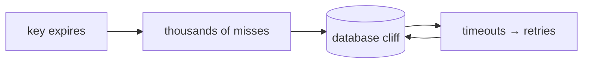
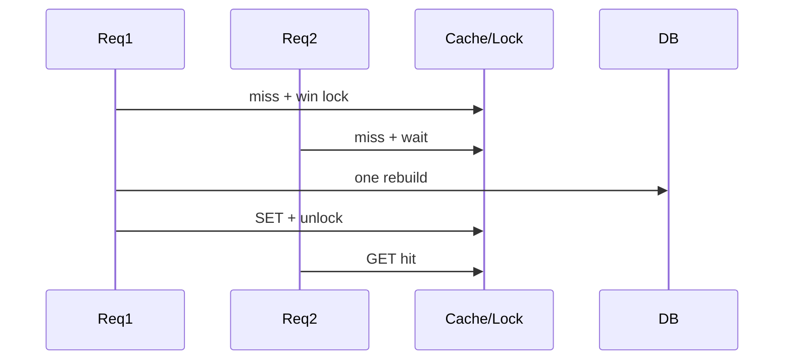
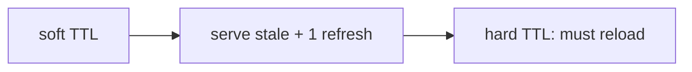
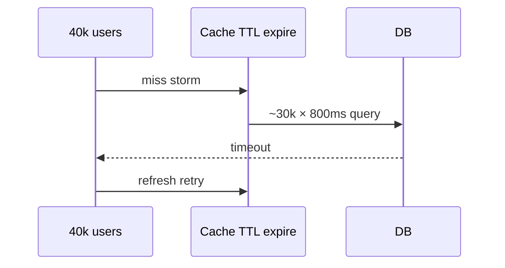

# Lesson 10: Cache Stampede & Thundering Herd — Single-Flight, Locks, SWR

> **Prerequisites:** [Lesson 05: Cache TTL & Expiration](../05-cache-ttl-expiration/README.md), [Lesson 09: Cache Consistency](../09-cache-consistency/README.md), and [Track: Caching](../README.md) overview.  
> **Estimated Reading Time:** 28–35 minutes  
> **Target Audience:** Backend engineers protecting hot keys (homepage, flash sale) from expiry cliffs that take down the database.  
> **Free PDF Notes:** [Download SD-F-010.pdf](https://backendroadmap.com/notes/system-design/SD-F-010.pdf)

> [!NOTE]
> **In one line:** A stampede (dogpile, thundering herd) happens when a hot key expires or is evicted and many concurrent requests all miss and regenerate it, overloading the database. Prevent it with request coalescing, a lock, early (probabilistic) refresh, background refresh and stale-while-revalidate.

> [!TIP]
> **The Golden Rule of Stampede Control:** Never let N waiters become N identical rebuilds — coalesce per process, lock across the fleet, and prefer refreshing before the cliff (XFetch / SWR / background jobs).

---

## Words You'll Meet Today

| Word | In Plain Words | Role in a Live Backend System |
| :--- | :--- | :--- |
| **Stampede / dogpile** | Many rebuilds of one miss | Hot key expiry |
| **Single-flight** | One in-flight load per key | `golang.org/x/sync/singleflight` |
| **Distributed lock** | `SET NX EX` across servers | One fleet-wide rebuild |
| **XFetch** | Probabilistic early refresh | Avoid the expiry moment |
| **Soft / hard TTL** | Serve stale / must reload | SWR window |
| **stale-while-revalidate** | Serve old + refresh in bg | HTTP/CDN + app caches |
| **Cache warming** | Preload before traffic | Deploy / sale start |
| **Load shedding** | Reject some to protect DB | Last defence |

---

## Visual Mental Models & Architecture

### The Key Expires. The Site Goes Down.

Homepage data under one key, read 50,000 times per second. The key expires. In the next 100 ms thousands of requests miss and every one runs the same expensive query. The database slows, timeouts retry, and the site goes down — nothing was "broken"; the cache did exactly what it was told.



*Figure 1. Popular + slow rebuild ⇒ outage.*

### One Rebuild, Others Share



*Figure 2. Lock / single-flight: one rebuild, others share.*

---

## Core Definition & Taxonomic Comparison

**What it is:** Many concurrent misses on the same key all regenerating it at once. Also happens after restart (every key cold), eviction of a hot key, or a deploy that changes key format. **What it isn't:** Penetration (missing keys that never exist) or avalanche (mass expiry of many keys) — related failure modes covered in Lesson 11.

| Technique | Stops | Catch | Use for |
| :--- | :--- | :--- | :--- |
| **Single-flight** | herd inside one process | still 1 query/server | every service, almost free |
| **Redis lock** | herd across servers | lock timeouts / waiting | expensive rebuilds on hot keys |
| **XFetch / early refresh** | the expiry cliff | stores extra metadata | hot keys with predictable traffic |
| **Background refresh** | expiry of known hot keys | job ops; unknown keys | homepage, top lists, config |
| **Stale-while-revalidate** | user-visible waiting | slight staleness | content that can lag seconds |
| **TTL jitter** | many keys expiring together | none | every bulk load |
| **Rate limit / shed** | total overload | some users get errors | last line of defence |

**Business impact.** The hottest key is the most dangerous one. An unprotected flash-sale page can take the database to 100% CPU in under a second at peak hour.

---

## Component Anatomy & The Observability Gap

### Why it is so bad (Little's Law)

Damage grows with popularity × rebuild time:

$$L = \lambda W$$

With $\lambda = 50{,}000$/s wanting one key and $W = 0.2$ s rebuild:

$$L \approx 10{,}000 \text{ concurrent identical queries}$$

### Single-flight vs distributed lock

Coalescing is per process: 20 servers × single-flight ⇒ 20 queries (usually fine). Across the fleet, `SET lock:key token NX EX 10` — winner rebuilds; losers wait and re-read or serve stale. Always give the lock a timeout; release only your own lock (compare token).

### Soft TTL + hard TTL (SWR)

Between soft and hard TTL, serve stale and refresh once. HTTP: `Cache-Control: max-age=60, stale-while-revalidate=30, stale-if-error=300`. CDNs honour these.

### Observability Gap

| Vantage Point | What It Captures | What It Hides |
| :--- | :--- | :--- |
| DB QPS spike at TTL | Stampede | Which key |
| Lock wait time | Contenders | Missing stale fallback |
| Rebuild count/key | Coalesce effectiveness | Per-process-only limit |
| p99 under forced DEL | Protection works | Untested warm keys |

**Operational rule:** load-test by deleting the hot key under traffic — DB should see ~1 rebuild; p99 stays flat.

---

## Mathematical Model & Worked Scale

### Homepage worked example

50,000 rps · 60 s TTL · 200 ms rebuild → ~10,000 concurrent queries at expiry without protection.

With soft TTL 60 s + hard 5 min + one Redis lock: DB sees ~1 query/min for that key; users never wait on the cliff.

### XFetch (probabilistic early recompute)

$$
\text{refresh if } \quad t - \delta \cdot \beta \cdot \ln(U) \ge t_{\text{expiry}},\quad U \sim \text{Uniform}(0,1)
$$

where $\delta$ is last rebuild duration. Slower rebuild → refresh earlier. At high QPS someone wins long before expiry.

---

## Metrics, Percentiles & Numbers Engineers Must Know

| Metric / Number | Typical Value | Why It Matters |
| :--- | :--- | :--- |
| Lock `EX` | 5–10 s | Crashed holder must not block forever |
| Wait/retry | 50 ms × N with cap (~1 s) | Then fall back to stale / DB |
| Soft / hard example | 60 s / 5 min | SWR window |
| Jitter | ±10–20% | Avoid multi-key walls |
| Sale incident | 30k misses × 800 ms | DB 100% in &lt;1 s |

---

## Compounding Effects & System Scale

| Scenario | What Compounds | Result |
| :--- | :--- | :--- |
| 200 servers × no lock | 200 identical rebuilds | Pool exhaustion |
| Timeouts → retries | $\lambda$ multiplies | Cascading cliff |
| Restart / key-format deploy | many keys cold | Multi-key stampede |
| Jitter alone on ultra-hot key | spreads nothing for one key | Still need lock/SWR |

---

## Protocol & Network Deep Dive

```text
Cache-Control: max-age=60, stale-while-revalidate=30, stale-if-error=300
SET lock:home <token> NX EX 10
# release only if token matches (Lua DEL if GET == token)
```



*Figure 3. Users always get an instant answer between soft and hard TTL.*

Rebuild twice must be harmless — the lock can expire mid-rebuild.

---

## Hierarchical Budgets & Capacity Sizing

| Layer | Role |
| :--- | :--- |
| Process single-flight | Collapse local waiters |
| Redis lock | Collapse fleet waiters |
| SWR / early refresh / bg job | Avoid the cliff |
| DB pool + breaker | Survive residual herds |
| Warm + jitter | Deploy / bulk / sale start |

---

## Top Engineering Mitigation Techniques

1. **Single-flight** in every service (almost free).
2. **Redis lock** for ultra-hot expensive rebuilds.
3. **XFetch / background refresh** before expiry.
4. **Soft TTL + stale-while-revalidate**.
5. **TTL jitter** on bulk loads.
6. **Warm hot keys** before traffic; shed/breaker as last defence.

---

## Production War Story: The Midnight Sale

**Severity & Impact:** Sale page built from one expensive query (~800 ms), cached 60 s. At midnight ~40,000 people refreshing. When the entry expired at 00:00:30, ~30,000 requests missed within a second. DB → 100% CPU; timeouts → refreshes; site unusable for six minutes of the busiest hour of the year.

**What Happened:**

```text
30,000 × 800 ms identical queries in <1 s
retries made the next window worse
hottest key + slow rebuild + no coalesce = outage
```



**Root Cause:** No stampede protection on the hottest key. Never load-tested expiry under peak traffic.

**The Fix:**
1. Single-flight in each app instance + Redis lock so only one instance rebuilds.
2. Soft TTL 30 s with SWR for another 5 minutes — page never down, at worst a few seconds old.
3. Scheduled job pre-builds 30 s before the event and refreshes every 20 s.
4. Database connection limit + circuit breaker so overload degrades instead of collapses.

**Lesson:** Protect expiry of hot keys explicitly, and test it with a load test that expires the key under load.

---

## Multi-Language Production Implementation

Single-flight, Redis lock, and XFetch in Go, TypeScript, Python, and C#:

````carousel
```go
// Go: singleflight + Redis lock helpers
package stampede

import (
	"context"
	"time"

	"github.com/redis/go-redis/v9"
	"golang.org/x/sync/singleflight"
)

var group singleflight.Group

type Cache interface {
	Get(string) (any, bool)
	Set(string, any, time.Duration)
}

func GetHome(ctx context.Context, cache Cache, load func(context.Context) (any, error)) (any, error) {
	if v, ok := cache.Get("home"); ok {
		return v, nil
	}
	v, err, _ := group.Do("home", func() (any, error) {
		h, err := load(ctx)
		if err == nil {
			cache.Set("home", h, time.Minute)
		}
		return h, err
	})
	return v, err
}

func TryLock(ctx context.Context, rdb *redis.Client, key, token string) (bool, error) {
	return rdb.SetNX(ctx, "lock:"+key, token, 10*time.Second).Result()
}

const releaseLua = `
if redis.call("GET", KEYS[1]) == ARGV[1] then
  return redis.call("DEL", KEYS[1])
end
return 0`

func ReleaseLock(ctx context.Context, rdb *redis.Client, key, token string) error {
	return rdb.Eval(ctx, releaseLua, []string{"lock:" + key}, token).Err()
}
```
<!-- slide -->
```typescript
// TypeScript: Redis lock rebuild with stale fallback
import { randomUUID } from "crypto";

export async function getHome(redis: any, build: () => Promise<object>) {
  const raw = await redis.get("home");
  if (raw) return JSON.parse(raw);

  const token = randomUUID();
  if (await redis.set("lock:home", token, "NX", "EX", 10)) {
    try {
      const value = await build();
      const ttl = 60 + Math.floor(Math.random() * 11);
      await redis.set("home", JSON.stringify(value), "EX", ttl);
      await redis.set("home:stale", JSON.stringify(value), "EX", 3600);
      return value;
    } finally {
      const release = `
        if redis.call("GET", KEYS[1]) == ARGV[1] then
          return redis.call("DEL", KEYS[1])
        end
        return 0`;
      await redis.eval(release, 1, "lock:home", token);
    }
  }

  for (let i = 0; i < 20; i++) {
    await new Promise((r) => setTimeout(r, 50));
    const hit = await redis.get("home");
    if (hit) return JSON.parse(hit);
  }
  const stale = await redis.get("home:stale");
  return stale ? JSON.parse(stale) : build();
}
```
<!-- slide -->
```python
# Python: Redis lock + XFetch early refresh
import asyncio, json, math, random, time, uuid

async def release_if_owner(r, key, token):
    lua = """
    if redis.call('GET', KEYS[1]) == ARGV[1] then
      return redis.call('DEL', KEYS[1])
    end
    return 0
    """
    await r.eval(lua, 1, key, token)

async def get_home(r, build_home):
    if (raw := await r.get("home")) is not None:
        return json.loads(raw)
    token = uuid.uuid4().hex
    if await r.set("lock:home", token, nx=True, ex=10):
        try:
            value = await build_home()
            await r.set("home", json.dumps(value), ex=60 + random.randint(0, 10))
            await r.set("home:stale", json.dumps(value), ex=3600)
            return value
        finally:
            await release_if_owner(r, "lock:home", token)
    for _ in range(20):
        await asyncio.sleep(0.05)
        if (raw := await r.get("home")) is not None:
            return json.loads(raw)
    stale = await r.get("home:stale")
    return json.loads(stale) if stale else await build_home()

def should_refresh(delta: float, expiry_ts: float, beta: float = 1.0) -> bool:
    # XFetch: slower rebuild → refresh earlier
    return time.time() - delta * beta * math.log(random.random()) >= expiry_ts
```
<!-- slide -->
```csharp
// C#: single-flight via ConcurrentDictionary + Redis lock
using System.Collections.Concurrent;
using StackExchange.Redis;

public sealed class StampedeGuard
{
    private readonly IDatabase _db;
    private readonly ConcurrentDictionary<string, Task<object>> _inflight = new();

    public StampedeGuard(IConnectionMultiplexer mux) => _db = mux.GetDatabase();

    public async Task<object> GetAsync(string key, Func<Task<object>> load, TimeSpan ttl)
    {
        var cached = await _db.StringGetAsync(key);
        if (cached.HasValue) return cached.ToString();

        var task = _inflight.GetOrAdd(key, _ => LoadAndStoreAsync(key, load, ttl));
        try { return await task; }
        finally { _inflight.TryRemove(key, out _); }
    }

    private async Task<object> LoadAndStoreAsync(string key, Func<Task<object>> load, TimeSpan ttl)
    {
        var token = Guid.NewGuid().ToString("N");
        if (await _db.StringSetAsync("lock:" + key, token, TimeSpan.FromSeconds(10), When.NotExists))
        {
            try
            {
                var value = await load();
                await _db.StringSetAsync(key, value.ToString(), ttl);
                return value;
            }
            finally
            {
                // release if owner (Lua in production)
                var cur = await _db.StringGetAsync("lock:" + key);
                if (cur == token) await _db.KeyDeleteAsync("lock:" + key);
            }
        }
        for (var i = 0; i < 20; i++)
        {
            await Task.Delay(50);
            var hit = await _db.StringGetAsync(key);
            if (hit.HasValue) return hit.ToString();
        }
        return await load();
    }
}
```
````

---

## Practical Hands-On CLI Verification

### 1. Simulate lock acquire / contention

```bash
redis-cli SET lock:home tokA NX EX 10
redis-cli SET lock:home tokB NX EX 10
# second fails — only one rebuild leader
redis-cli GET lock:home
```

### 2. XFetch probability sketch

```bash
python -c "
import math, random, time
def should_refresh(delta, expiry_ts, beta=1.0):
    return time.time() - delta*beta*math.log(random.random()) >= expiry_ts
expiry = time.time() + 5
print(sum(should_refresh(0.2, expiry) for _ in range(10000)) / 10000)
expiry2 = time.time() + 0.5
print(sum(should_refresh(0.2, expiry2) for _ in range(10000)) / 10000)
"
```

**Expected:** fraction near 0 far from expiry; much higher near expiry.

### 3. Little's Law concurrency

```bash
python -c "lam=50000; W=0.2; print(f'concurrent rebuilds ≈ {lam*W:.0f}')"
```

**Expected:** `10000`.

---

## Common Mistakes to Avoid

- A lock with no timeout — crashed holder blocks every request for that key.
- Releasing a lock without checking the token and deleting someone else's lock.
- Waiting forever for the lock instead of timing out and falling back to stale data.
- Treating the lock as a guarantee — it can expire mid-rebuild; double rebuild must be harmless.
- Protecting one known hot key but not warm keys that expire together after a restart.
- No jitter, so the herd repeats at every TTL for many keys.
- No limit on database concurrency, so any herd becomes an outage.

---

## Key Terms Glossary

| Term | Interview-ready definition |
| :--- | :--- |
| **Cache stampede** | Many requests rebuilding one missing key |
| **Dogpile / thundering herd** | Other names for the same effect |
| **Single-flight** | One in-flight load per key; others wait |
| **Request coalescing** | Sharing one result among waiting requests |
| **Distributed lock** | `SET NX EX` in Redis so one worker rebuilds |
| **XFetch** | Probabilistic early refresh algorithm |
| **Soft TTL / hard TTL** | Serve stale after soft; remove after hard |
| **stale-while-revalidate** | Serve old, refresh in the background |
| **Cache warming** | Preloading keys before traffic |
| **Load shedding** | Rejecting some requests to protect the database |

---

## Interview Practice Questions

<details>
<summary><strong>Q1: What is a cache stampede? [BASIC]</strong></summary>

When a hot key expires or is evicted and many concurrent requests miss at once and all regenerate it, overloading the database.

</details>

<details>
<summary><strong>Q2: How do you prevent it? [BASIC]</strong></summary>

Coalesce requests with single-flight, use a distributed lock so one request regenerates, refresh early with probabilistic expiration or background jobs, and serve stale values while revalidating.

</details>

<details>
<summary><strong>Q3: What is stale-while-revalidate? [BASIC]</strong></summary>

Serve the old value after it goes stale while a single background task fetches a fresh one, so users get an instant response and only one regeneration runs.

</details>

<details>
<summary><strong>Q4: Why is the lock in a distributed cache given a timeout? [BASIC]</strong></summary>

If the holder crashes, an expiring lock stops the key from being blocked forever.

</details>

<details>
<summary><strong>Q5: A key is read 50,000 times per second and takes 200 ms to rebuild. What happens at expiry? [SCENARIO]</strong></summary>

Up to $50{,}000 \times 0.2 = 10{,}000$ concurrent rebuilds of the same value. Prevent it with coalescing, a lock, early refresh or stale-while-revalidate.

</details>

<details>
<summary><strong>Q6: After a deploy, the database spikes for ten minutes. Why and how do you fix it? [SCENARIO]</strong></summary>

A cold cache or a changed key format means everything misses. Warm the hot keys first, keep old keys valid during a rollout, coalesce misses and limit database concurrency.

</details>

<details>
<summary><strong>Q7: Design the cache for a flash-sale page. [SCENARIO]</strong></summary>

Pre-build the page before the event, refresh it in the background every few seconds, serve stale-while-revalidate, protect rebuilds with a lock and single-flight, and cap database concurrency.

</details>

<details>
<summary><strong>Q8: How would you test your stampede protection? [SCENARIO]</strong></summary>

A load test that deletes the hot key under traffic and checks that the database sees one rebuild, p99 stays flat, and no request waits longer than the lock timeout.

</details>

<details>
<summary><strong>Q9: Lock-based protection or probabilistic early refresh: which is better? [TRICKY]</strong></summary>

They complement each other. Early refresh avoids the cliff for predictable hot keys; a lock protects when a miss still happens (eviction, restart, cold key).

</details>

<details>
<summary><strong>Q10: What can go wrong with the Redis lock? [TRICKY]</strong></summary>

It can expire while the holder is still rebuilding, causing a second rebuild; release must check the token; waiters need a timeout and a fallback.

</details>

<details>
<summary><strong>Q11: Is single-flight enough on its own? [TRICKY]</strong></summary>

It limits the herd to one query per process. With hundreds of servers you still get hundreds of queries, so add a shared lock or a refresh job for very hot keys.

</details>

<details>
<summary><strong>Q12: How does a stampede relate to Little's Law? [TRICKY]</strong></summary>

A rebuild holds a database connection for its whole duration, so concurrency = misses per second × rebuild time. Slow rebuilds on a popular key exhaust pools quickly.

</details>

---

## One-Page Master Cheat Sheet

```text
====================================================================================================
              CACHE STAMPEDE / THUNDERING HERD  —  CHEAT SHEET (SD-F-010)
====================================================================================================
IN ONE LINE   Hot key expires → many concurrent misses → many identical rebuilds → DB cliff

LOAD          L = λW  (e.g. 50k rps × 0.2s = 10k concurrent queries)
PER PROCESS   single-flight / request coalescing
ACROSS FLEET  Redis lock: SET NX EX + token; release only if owner; rebuild twice OK
AVOID CLIFF   XFetch early refresh · background refresh · soft TTL + SWR
ALSO          TTL jitter on bulk · warm before traffic · DB pool + breaker
TEST          DEL hot key under load → expect ~1 rebuild, flat p99
ANTI          lock no EX · DEL others' lock · wait forever · no fallback · no jitter
====================================================================================================
```

---

## Free PDF notes

Download these notes as a printable PDF with the Little's Law worked example, technique comparison, and interview answers: [SD-F-010.pdf](https://backendroadmap.com/notes/system-design/SD-F-010.pdf).

---

## Sources

- [Vattani et al. — Optimal Probabilistic Cache Stampede Prevention (VLDB 2015)](https://www.vldb.org/pvldb/vol8/p886-vattani.pdf)
- [Go docs — golang.org/x/sync/singleflight](https://pkg.go.dev/golang.org/x/sync/singleflight)
- [RFC 5861 — HTTP Cache-Control Extensions for Stale Content](https://datatracker.ietf.org/doc/html/rfc5861)
- [backendroadmap.com — SD-F-011 Cache Penetration and Avalanche](https://backendroadmap.com/notes/system-design/SD-F-011.pdf)

---

## Next

Next lesson: [Cache Penetration & Avalanche: Negative Caching and Bloom Filters](../11-cache-penetration-avalanche/README.md)

Track overview: [Track: Caching](../README.md)
