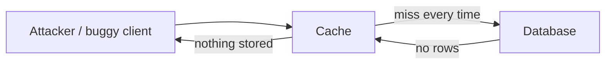
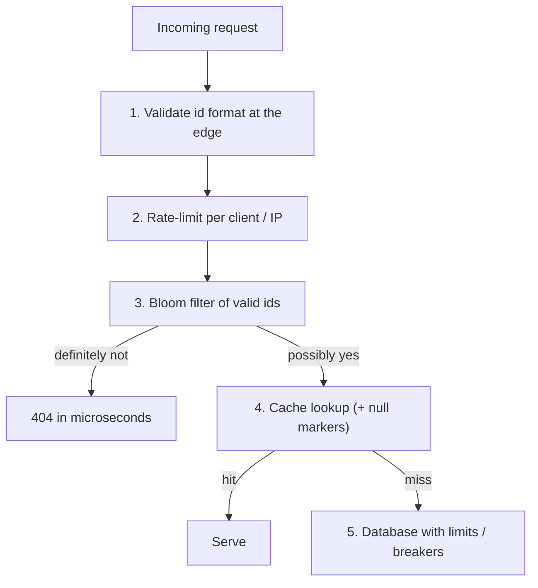
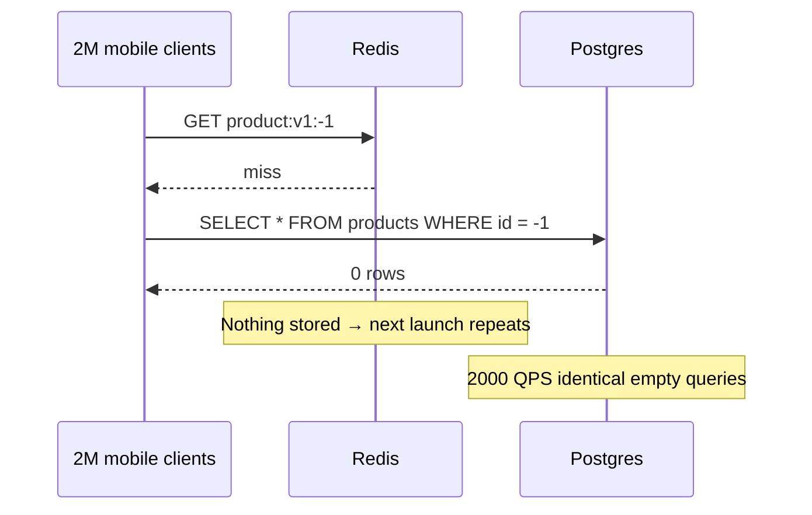

# Lesson 11: Cache Penetration & Avalanche — Negative Caching and Bloom Filters

> **Prerequisites:** [Lesson 10: Cache Stampede & Thundering Herd](../10-cache-stampede-thundering-herd/README.md) and [Track: Caching](../README.md) overview.  
> **Estimated Reading Time:** 30–35 minutes  
> **Target Audience:** Backend engineers protecting databases from missing-key floods, sizing Bloom filters, hardening Redis against mass expiry, and answering “penetration vs stampede vs avalanche” in interviews.  
> **Free PDF Notes:** [Download SD-F-011.pdf](https://backendroadmap.com/notes/system-design/SD-F-011.pdf)

> [!NOTE]
> **In one line:** penetration is traffic for keys that don't exist (always miss → database; fix with negative caching, Bloom filters, validation, rate limits); avalanche is a mass expiry or cache failure that floods the database at once (fix with TTL jitter, replicas, warm-up, and database protection).

> [!TIP]
> **The Golden Rule of Penetration & Avalanche:** Layer cheap filters first (validate → rate-limit → Bloom → cache → DB). Cache “not found” briefly, add every real id to the Bloom filter on create, jitter TTLs so keys never expire as a wall, and size the database for a cold-cache day—not for yesterday’s hit ratio.

---

## Words You'll Meet Today

| Word | In Plain Words | Role in a Live Backend System |
| :--- | :--- | :--- |
| **Cache penetration** | Requests for keys that never exist; every miss hits the DB | Random product ids, scrapers, buggy clients (`id=-1`) |
| **Negative caching** | Caching “not found” under a null marker with a short TTL | Repeat misses become 404s from Redis in microseconds |
| **Null marker** | Special value meaning “known missing” (e.g. `∅`) | Distinguish miss from “we looked; nothing there” |
| **Bloom filter** | Bit array: definitely not / possibly in the set | Reject ~99% of random ids before cache or DB |
| **False positive** | Filter says “possibly in” but key is absent | Rare; request proceeds to cache/DB harmlessly |
| **False negative** | Filter denies a valid key | Must never happen if every valid id was added |
| **Cache avalanche** | Many keys expire or the cache dies → miss flood | Mass TTL, node restart, key-format deploy |
| **Cache breakdown** | One hot key expires → many rebuild it (stampede) | Different failure mode; shared DB protection |

---

## Visual Mental Models & Architecture

### The Question: Why Is the Cache Useless Against Missing Keys?

An attacker (or buggy mobile client) sends random product ids: `9800000`, `4172311`, `77`… None exist. Every request misses the cache, queries the database, finds nothing, and stores nothing. The cache never learns; the database takes every hit. That is **penetration**. Its cousin, the **avalanche**, is even worse: the cache that *was* protecting you fails all at once.



*Figure 1. Normal caching only stores found values—so a not-found is never remembered, and the next identical miss hits the database again.*

### Layered Defences (Cheap → Expensive)



*Figure 2. Each layer is cheaper than the one behind it, so most bad traffic never reaches the database.*

---

## Core Definition & Taxonomic Comparison

**What it is:** Penetration = traffic for keys that don't exist. Avalanche = a large fraction of the cache evaporating at once (mass expiry or failure). **What it isn't:** a stampede/breakdown (one hot key expiry with concurrent rebuilds)—interviewers mix these three constantly.

| Term | Precise Meaning | Production Example |
| :--- | :--- | :--- |
| **Penetration** | Missing keys; cache never helps; DB sees every request | Scraper enumerating ids; mobile bug requesting `/products/-1` |
| **Avalanche** | Many keys expire together *or* cache node/cluster dies empty | Nightly warm-up with identical TTL; Redis restart at peak |
| **Stampede / breakdown** | One popular key expires; many clients rebuild it | Homepage config key TTL hits zero under load |
| **Negative cache** | Short-TTL marker for “not found” | `SET product:999 "∅" EX 30` |
| **Bloom filter** | Probabilistic “definitely not / possibly yes” set | RedisBloom `BF.EXISTS valid_products 9800000` |

**Business impact.** Penetration burns DB connections on work that can never succeed. Avalanche turns a healthy hit ratio into a SEV-1 the moment the cache vanishes. Both look like “the database is slow” on dashboards that only show average latency.

---

## Component Anatomy & The Observability Gap

### Anatomy of a Penetrating Request

```text
 CLIENT                    EDGE                 CACHE              DATABASE
  GET /products/999 ──► validate? ──► Bloom? ──► GET key ──miss──► SELECT … WHERE id=999
                         400/429      404        null marker?       "no rows"
                                                              ◄── nothing to cache (unless negative)
```

### The Observability Gap: Hit Ratio That Lies

| Vantage Point | What It Captures | What It Hides |
| :--- | :--- | :--- |
| **Overall cache hit ratio** | Looks “fine” if real products hit | One missing-key flood lumped into a key family |
| **DB QPS / CPU** | Rising load | Whether queries return rows or “no rows” |
| **p50 latency** | May stay flat (cheap empty queries) | Connection pool saturation from 2k identical misses |
| **Metrics to add** | Not-found rate, top missing keys, Bloom reject rate, DB “no rows”/s, per-node cache miss storms | Averaged hit ratio alone |

**Operational rule:** alert on a sudden rise in **not-found rate** and **top missing keys**, not only on hit ratio.

---

## Mathematical Model & Worked Scale

### Bloom Filter Sizing

For $n$ keys and target false-positive rate $p$, bits per key and hash count are approximately:

$$m/n \approx -\frac{\ln p}{(\ln 2)^2} \approx 1.44 \ln(1/p), \qquad k \approx (\ln 2)\,(m/n) \approx 0.693\,(m/n)$$

| False-positive rate $p$ | Bits per key | Hash functions $k$ | Memory for 10M ids |
| :--- | :--- | :--- | :--- |
| 10% | 4.8 | 3 | ~6 MB |
| **1%** | **9.6** | **7** | **~12 MB** |
| 0.1% | 14.4 | 10 | ~18 MB |
| 0.01% | 19.2 | 13 | ~24 MB |

### Worked Example: 20,000 Random-Id Requests/s

- Bloom rejects ~99% → ~200 req/s reach cache/DB.
- Negative caching absorbs repeats of those 200.
- Edge validation + per-IP rate limits cut the rest.

$$\text{DB load after layers} \ll \text{raw attack rate}$$

### Avalanche Load Spike

If hit ratio $h$ collapses to $0$ under traffic $\lambda$:

$$\lambda_{\text{DB}} \approx \lambda \quad\text{(was } \lambda(1-h)\text{)}$$

At $h=0.95$, $\lambda=10{,}000$/s → DB jumps from $500$/s to $10{,}000$/s. Without breakers, queues grow until outage.

---

## Metrics, Percentiles & Numbers Engineers Must Know

| Metric / Number | Typical Value | Why It Matters |
| :--- | :--- | :--- |
| Bloom memory @ 1% FP, 10M ids | ~12 MB | Fits in one Redis key / process easily |
| Negative-cache TTL | 30–60 s + jitter | New items become visible quickly |
| Positive product TTL | minutes–hours + jitter | Avoid mass expiry walls |
| Empty-query cost | often cheap CPU, expensive **connections** | 2k/s identical misses can consume 15% of pool |
| Avalanche amplification | $1/(1-h)$ | At 95% hit ratio, cold cache ≈ 20× DB load |

---

## Compounding Effects & System Scale

| Scenario | What Compounds | Result |
| :--- | :--- | :--- |
| Random-id attack without Bloom | Every new id = first-time miss | Negative cache alone cannot help |
| Mass identical TTL | All keys expire in one second | Avalanche stampede into DB |
| Deploy changes key prefix | Entire cache unreachable | Instant 0% hit ratio |
| Retries on DB timeout during avalanche | Miss flood × retry multiplier | Cascading outage |

$$P(\text{DB overload}) \text{ rises sharply when miss rate and retry rate both spike.}$$

---

## Hierarchical Budgets & Capacity Sizing

| Layer | Budget Role | Example |
| :--- | :--- | :--- |
| Edge validation | Reject malformed before any I/O | Positive integer ids only |
| Rate limit | Cap per client during floods | Token bucket per IP / API key |
| Bloom | Microsecond reject of impossible keys | 1% FP, sized for growth |
| Cache + negative | Absorb repeats | Null TTL 30–60 s |
| Database | Last line of defence | Connection limits, circuit breakers, load shedding |

**Headroom rule:** size DB + connection pools for **at least one full cache-node failure** (≈ $1/N$ of keys missing with consistent hashing, or 100% on single-node cache).

---

## Top Engineering Mitigation Techniques

1. **Negative caching** — store null markers with short TTL; delete on create.
2. **Bloom filter (or Redis set for small id spaces)** — reject “definitely not” early; add on create; rebuild periodically.
3. **TTL jitter** — `ttl = base + random(0, jitter)` so expiries spread.
4. **HA cache + warm-up** — replicas/failover; warm hot keys before traffic; restart one node at a time.
5. **Database protection** — circuit breakers, bulkheads, queueing, load shedding so a cold cache degrades instead of collapses.
6. **Versioned keys** — `product:v2:` so deploys don’t invalidate the whole store at once.

---

## Production War Story: The App Version That Asked for Product `-1`

**Severity & Impact:** Mobile release requested `/products/-1` on every launch. Two million devices updated in a day. Peak ~2,000 identical empty queries/s held ~15% of DB connections; real traffic slowed. Hit-ratio dashboards looked “fine.”

**What Happened:**

```text
# every cold start
GET /products/-1  →  cache miss  →  SELECT … WHERE id = -1  →  no rows  →  nothing cached
```



**Root Cause:** Penetration from a client bug, not an attack. No edge validation, no negative cache, no not-found metrics.

**The Fix:**
1. Edge validation: ids must be positive integers → `400` with zero lookup.
2. Negative caching with 60 s TTL for not-found products.
3. Dashboard + alert on not-found rate and top missing keys.
4. Client fix in the next release—but the server no longer depended on it.

**Lesson:** Penetration is often a bug. Cheap edge checks plus a null marker neutralize both bugs and attacks.

---

## Multi-Language Production Implementation

Negative caching + Bloom guard in front of the database—Go, TypeScript, Python, C#:

````carousel
```go
package products

import (
	"context"
	"encoding/json"
	"errors"
	"math/rand"
	"strconv"
	"time"

	"github.com/redis/go-redis/v9"
)

const nullMarker = "∅"

var ErrNotFound = errors.New("product not found")

type Store struct {
	RDB *redis.Client
	DB  func(ctx context.Context, id int64) (map[string]any, error)
}

func (s *Store) Get(ctx context.Context, id int64) (map[string]any, error) {
	if id <= 0 {
		return nil, ErrNotFound // edge validation belongs at the gateway too
	}
	// Bloom: 0 = definitely not → reject without DB
	exists, err := s.RDB.Do(ctx, "BF.EXISTS", "valid_products", id).Int()
	if err == nil && exists == 0 {
		return nil, ErrNotFound
	}
	key := "product:v1:" + itoa(id)
	raw, err := s.RDB.Get(ctx, key).Bytes()
	if err == nil {
		if string(raw) == nullMarker {
			return nil, ErrNotFound
		}
		var out map[string]any
		_ = json.Unmarshal(raw, &out)
		return out, nil
	}
	row, err := s.DB(ctx, id)
	if err != nil || row == nil {
		ttl := 30*time.Second + time.Duration(rand.Intn(10))*time.Second
		_ = s.RDB.Set(ctx, key, nullMarker, ttl).Err()
		return nil, ErrNotFound
	}
	b, _ := json.Marshal(row)
	_ = s.RDB.Set(ctx, key, b, 10*time.Minute).Err()
	return row, nil
}

func (s *Store) OnCreate(ctx context.Context, id int64) {
	_ = s.RDB.Do(ctx, "BF.ADD", "valid_products", id).Err()
	_ = s.RDB.Del(ctx, "product:v1:"+itoa(id)).Err() // drop null marker
}

func itoa(id int64) string {
	return strconv.FormatInt(id, 10)
}
```
<!-- slide -->
```typescript
import Redis from "ioredis";

const NULL = "∅";
const r = new Redis(process.env.REDIS_URL!);

export async function getProduct(
  id: number,
  load: (id: number) => Promise<object | null>,
): Promise<object | null> {
  if (!Number.isInteger(id) || id <= 0) return null;

  const maybe = await r.call("BF.EXISTS", "valid_products", String(id));
  if (maybe === 0) return null;

  const key = `product:v1:${id}`;
  const raw = await r.get(key);
  if (raw !== null) return raw === NULL ? null : JSON.parse(raw);

  const row = await load(id);
  if (row === null) {
    const ttl = 30 + Math.floor(Math.random() * 10);
    await r.set(key, NULL, "EX", ttl);
    return null;
  }
  await r.set(key, JSON.stringify(row), "EX", 600);
  return row;
}

export async function onProductCreated(id: number): Promise<void> {
  await r.call("BF.ADD", "valid_products", String(id));
  await r.del(`product:v1:${id}`);
}
```
<!-- slide -->
```python
import json
import random
from fastapi import HTTPException

NULL = "\u2205"  # ∅ marker

async def get_product(r, db, pid: int):
    if pid <= 0:
        raise HTTPException(400, "id must be a positive integer")
    if not await r.execute_command("BF.EXISTS", "valid_products", pid):
        raise HTTPException(404)  # definitely not — microseconds
    key = f"product:v1:{pid}"
    raw = await r.get(key)
    if raw is not None:
        return None if raw == NULL.encode() else json.loads(raw)
    row = await db.fetchrow("SELECT * FROM products WHERE id = $1", pid)
    if row is None:
        await r.set(key, NULL, ex=30 + random.randint(0, 10))
        return None
    await r.set(key, json.dumps(dict(row)), ex=600)
    return dict(row)

async def on_product_created(r, new_id: int):
    await r.execute_command("BF.ADD", "valid_products", new_id)
    await r.delete(f"product:v1:{new_id}")  # drop any null marker
```
<!-- slide -->
```csharp
using StackExchange.Redis;
using System.Text.Json;

public sealed class ProductCache
{
    private const string NullMarker = "∅";
    private readonly IDatabase _db;

    public ProductCache(IConnectionMultiplexer mux) => _db = mux.GetDatabase();

    public async Task<Dictionary<string, object>?> GetAsync(
        long id, Func<long, Task<Dictionary<string, object>?>> load)
    {
        if (id <= 0) return null;
        // Prefer RedisBloom module; guard with EXISTS when available.
        var key = $"product:v1:{id}";
        var raw = await _db.StringGetAsync(key);
        if (raw.HasValue)
            return raw == NullMarker ? null : JsonSerializer.Deserialize<Dictionary<string, object>>((string)raw!);

        var row = await load(id);
        if (row is null)
        {
            var ttl = TimeSpan.FromSeconds(30 + Random.Shared.Next(0, 10));
            await _db.StringSetAsync(key, NullMarker, ttl);
            return null;
        }
        await _db.StringSetAsync(key, JsonSerializer.Serialize(row), TimeSpan.FromMinutes(10));
        return row;
    }

    public async Task OnCreatedAsync(long id)
    {
        await _db.KeyDeleteAsync($"product:v1:{id}");
    }
}
```
````

---

## Practical Hands-On CLI Verification

### 1. Reserve a Bloom filter and probe ids

```bash
redis-cli BF.RESERVE valid_products 0.01 10000000
redis-cli BF.ADD valid_products 42
redis-cli BF.EXISTS valid_products 42
redis-cli BF.EXISTS valid_products 9800000
```

**Expected:** `1` for `42`, `0` for a never-added id (definitely not).

### 2. Simulate negative caching

```bash
redis-cli SET product:v1:999 "∅" EX 30
redis-cli GET product:v1:999
redis-cli TTL product:v1:999
```

### 3. Estimate Bloom memory in Python

```bash
python -c "import math; n=10_000_000; p=0.01; m=-n*math.log(p)/(math.log(2)**2); print(f'{m/8/1e6:.1f} MB, k={m/n*math.log(2):.0f}')"
```

**Expected:** ~11.4–12 MB, ~7 hashes.

---

## Common Mistakes to Avoid

- Caching “not found” for a long TTL so new items stay invisible.
- Forgetting to delete the null marker (or add to the Bloom filter) on create.
- Loading a Bloom filter that misses valid ids → false negatives → real 404s.
- No input validation: negative, huge, or malformed ids reach the database.
- Loading the whole cache with one TTL, then wondering about five-minute spikes.
- One cache node with no replica and no warm-up plan.
- Sizing the database for the cache’s hit ratio with no limits—so a cold cache is a total outage.
- Confusing penetration, stampede, and avalanche in monitoring and interviews.

---

## Key Terms Glossary

| Term | Interview-ready definition |
| :--- | :--- |
| **Cache penetration** | Requests for keys that don't exist; cache never stores a result; DB takes every hit |
| **Negative caching** | Caching “not found” with a short TTL so repeats stop at the cache |
| **Null marker** | Special sentinel value meaning “known missing” |
| **Bloom filter** | Compact bit array answering definitely-not vs possibly-in; no false negatives if fully loaded |
| **False positive** | Filter says possibly present but key is absent |
| **Cache avalanche** | Mass expiry or cache failure sending a flood of misses to the DB |
| **Cache breakdown** | One hot key expiring (stampede / thundering herd) |
| **Circuit breaker** | Stops calling an overloaded dependency so it can recover |
| **Cache warming** | Preloading hot keys before traffic hits a new or restarted node |

---

## Interview Practice Questions

<details>
<summary><strong>1. How do you stop requests for missing keys from hammering the database? [BASIC]</strong></summary>

Cache negative results with a short TTL, put a Bloom filter of valid keys in front so impossible keys are rejected early, and add validation and rate limiting at the edge.

</details>

<details>
<summary><strong>2. What is a cache avalanche? [BASIC]</strong></summary>

A mass expiry or a cache cluster failure that sends a flood of misses to the database. Prevent it with TTL jitter, replicas, cache warming, and database protection (limits, breakers, shedding).

</details>

<details>
<summary><strong>3. What is a Bloom filter, and what can it not do? [BASIC]</strong></summary>

A compact bit array that says a key is definitely not in the set or possibly in it. It never gives false negatives (if every valid key was added), may give false positives, and cannot delete entries unless it is a counting or cuckoo variant.

</details>

<details>
<summary><strong>4. Why must the TTL for negative caching be short? [BASIC]</strong></summary>

So a newly created item becomes visible quickly; you should also delete the marker on creation (and add the id to the Bloom filter).

</details>

<details>
<summary><strong>5. Attackers request random ids. Negative caching isn't helping. Why, and what next? [SCENARIO]</strong></summary>

Each random id is new, so each first request still reaches the database. Add a Bloom filter of valid ids, rate-limit per client, and validate id formats at the edge.

</details>

<details>
<summary><strong>6. Size a Bloom filter for 10 million ids with 1% false positives. [SCENARIO]</strong></summary>

About 9.6 bits per key: roughly 12 MB, with ~7 hash functions. Add ids as they are created and rebuild periodically (or use a scalable filter) so growth does not inflate the false-positive rate.

</details>

<details>
<summary><strong>7. Your Redis cluster restarts empty at peak. What happens and how do you reduce the impact? [SCENARIO]</strong></summary>

An avalanche: every read misses. Use replicas with failover, restart one node at a time, warm hot keys first, keep a local L1 for the hottest data, and have rate limits and breakers on the database.

</details>

<details>
<summary><strong>8. How do you tell penetration from a stampede in monitoring? [SCENARIO]</strong></summary>

Penetration: many distinct keys, mostly not-found results, high database “no rows” rate. Stampede: one or a few keys with many identical concurrent queries at expiry.

</details>

<details>
<summary><strong>9. A user creates an item and gets 404 for a minute. What went wrong? [TRICKY]</strong></summary>

A negative-cache marker (or a Bloom filter that was not updated) from before the item existed. Delete the marker and add to the filter on creation.

</details>

<details>
<summary><strong>10. Can a Bloom filter hurt valid users? [TRICKY]</strong></summary>

Only if a valid key was never added (a bug), which causes a false negative. A false positive just lets a bad request through to the cache and database.

</details>

<details>
<summary><strong>11. Why does jitter prevent an avalanche but not a node failure? [TRICKY]</strong></summary>

Jitter spreads expiries over time. A node failure removes keys regardless of TTL, so you need replicas, warm-up, and a protected database.

</details>

<details>
<summary><strong>12. What is the last line of defence when the cache is gone? [TRICKY]</strong></summary>

The database’s own protection: connection limits, circuit breakers, queueing, load shedding, and graceful degradation—so it slows down rather than falls over.

</details>

---

## One-Page Master Cheat Sheet

```text
====================================================================================================
              CACHE PENETRATION & AVALANCHE  —  CHEAT SHEET
====================================================================================================
IN ONE LINE   Penetration = missing keys. Avalanche = mass expiry / cache death. Protect the DB.

PENETRATION   Keys that don't exist → always miss → DB. Often a bug (id=-1), not only attacks.
DEFENCES      1 validate  2 rate-limit  3 Bloom  4 negative cache (short TTL)  5 DB limits

NEGATIVE TTL  30–60s + jitter; DELETE marker (and BF.ADD) on create
BLOOM @ 1%    ~9.6 bits/key → 10M ids ≈ 12 MB, ~7 hashes; never false-neg if fully loaded
              No deletes in plain Bloom → rebuild / counting / cuckoo if needed

AVALANCHE     Mass same-TTL expiry | node/cluster empty | key-format deploy
DEFENCES      TTL jitter · HA replicas · warm-up · L1 · versioned keys · DB breakers

vs STAMPEDE   Stampede = ONE hot key expiry. Penetration = missing. Avalanche = MANY / failure.
OBSERVE       not-found rate, top missing keys, Bloom reject %, DB no-rows/s, miss storms
ANTI-PATTERNS X long negative TTL   X Bloom missing valid ids   X size DB for hit ratio only
              X one cache node, no warm-up   X identical TTLs on bulk load
====================================================================================================
```

---

## Free PDF notes

Download these notes as a printable PDF with the Bloom sizing table, layered defence diagram, and interview answers: [SD-F-011.pdf](https://backendroadmap.com/notes/system-design/SD-F-011.pdf).

---

## Sources

- [Burton H. Bloom, Space/Time Trade-offs in Hash Coding with Allowable Errors (1970)](https://dl.acm.org/doi/10.1145/362686.362692)
- [Redis Stack / RedisBloom documentation](https://redis.io/docs/latest/develop/data-types/probabilistic/bloom-filter/)
- [Fan et al., Cuckoo Filter: Practically Better Than Bloom](https://www.cs.cmu.edu/~dga/papers/cuckoo-conext2014.pdf)
- [backendroadmap.com — SD-F-012 Hot Keys](https://backendroadmap.com/notes/system-design/SD-F-012.pdf)

---

## Next

Next lesson: [Hot Keys in Redis: Celebrity Problem, L1 Cache & Key Replication](../12-hot-keys-in-redis/README.md)

Track overview: [Track: Caching](../README.md)
