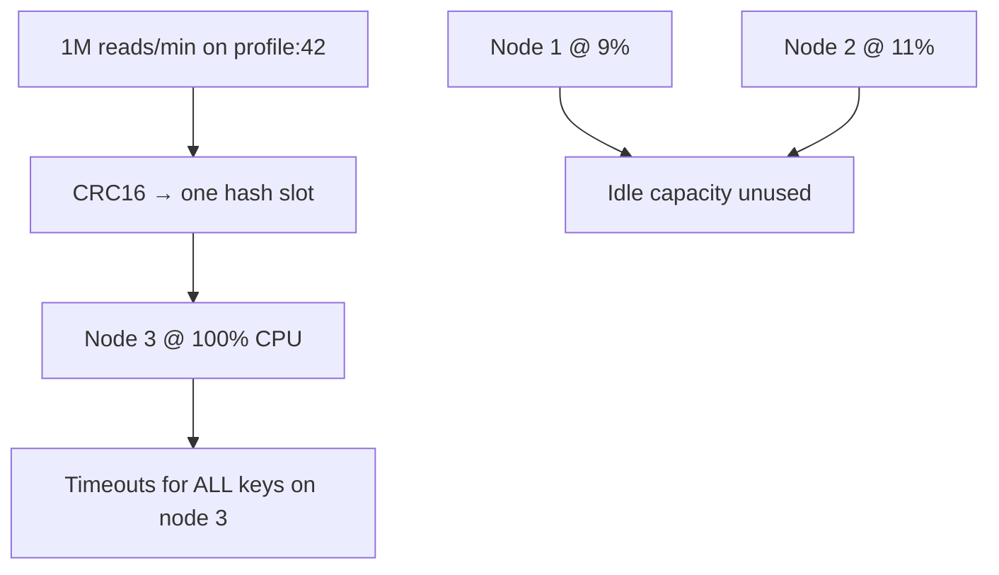
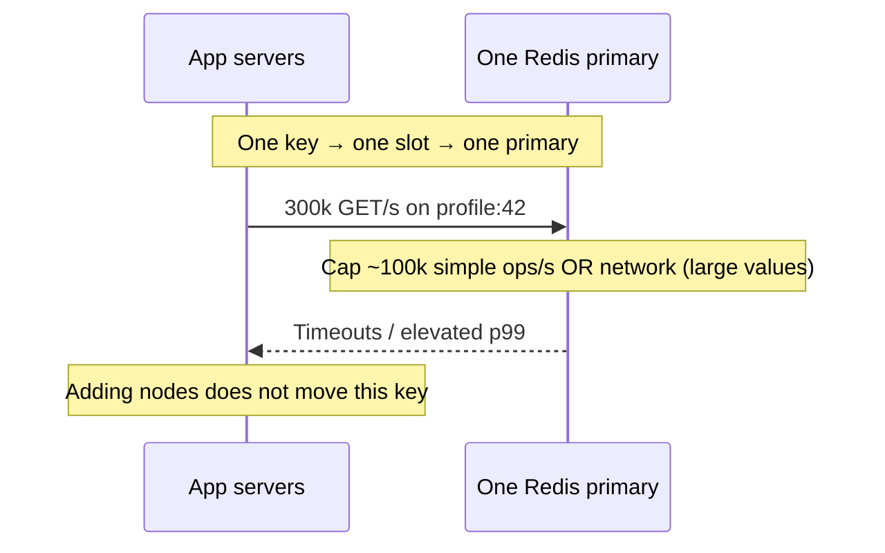
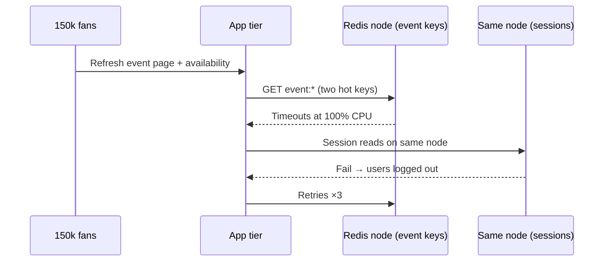

# Lesson 12: Hot Keys in Redis — Celebrity Problem, L1 Cache & Key Replication

> **Prerequisites:** [Lesson 11: Cache Penetration & Avalanche](../11-cache-penetration-avalanche/README.md) and [Track: Caching](../README.md) overview.  
> **Estimated Reading Time:** 30–35 minutes  
> **Target Audience:** Backend engineers debugging one-node Redis CPU cliffs, celebrity/profile traffic spikes, write-hot counters, and cluster averages that hide hot shards.  
> **Free PDF Notes:** [Download SD-F-012.pdf](https://backendroadmap.com/notes/system-design/SD-F-012.pdf)

> [!NOTE]
> **In one line:** a hot key is a single key so popular that the one cache node holding it becomes the bottleneck—and adding nodes doesn't help because a key lives in only one place. Detect it, then spread load with a short L1 cache, key replication under suffixes, and read replicas, accepting a few seconds of staleness.

> [!TIP]
> **The Golden Rule of Hot Keys:** Watch the **busiest node**, not the cluster average. First fix is almost always a **1–5 s in-process L1** on app servers; only then replicate under suffixes or split write-hot counters—and never put `{hash tags}` around copies you need on different slots.

---

## Words You'll Meet Today

| Word | In Plain Words | Role in a Live Backend System |
| :--- | :--- | :--- |
| **Hot key** | One key with traffic beyond one node’s capacity | Celebrity profile, event page, homepage config |
| **Hot shard** | Node overloaded by one or a few keys | Other keys on that node time out too |
| **Hash slot** | One of Redis Cluster’s 16,384 partitions | `CRC16(key) mod 16384` → one primary |
| **L1 cache** | Small in-process cache on each app server | Turns 17k Redis reads/s into ~100/s |
| **Key replication** | Copies under `key#1..N` on different shards | Random read; delete all on write |
| **Read replica** | Async copy that can serve reads | Extra read capacity within one shard |
| **CLIENT TRACKING** | Redis tells clients when cached keys change | L1 with near-instant invalidation |
| **Sharded counter** | Split a hot counter into N keys, sum on read | Fix for write-hot keys |

---

## Visual Mental Models & Architecture

### The Question: Why Does Cluster CPU Look Fine While Users Time Out?

A celebrity posts; their profile is read a million times a minute. All reads hit one key on one Redis node. That node hits 100% CPU while peers sit at ~10%. Cluster average looks ~25% green—until sessions on the same node die.



*Figure 1. Averages hide it: the cluster looks healthy while one node is saturated.*

### Why Sharding Alone Cannot Help



*Figure 2. Two ceilings for one key: operations per second and network bandwidth (e.g. 20k reads/s × 50 KB ≈ 8 Gbit/s).*

---

## Core Definition & Taxonomic Comparison

**What it is:** Sustained traffic on one key exceeding one node’s CPU or NIC. **What it isn't:** a stampede (burst rebuild at miss)—though they can coincide.

| Term | Precise Meaning | Production Example |
| :--- | :--- | :--- |
| **Hot key (read)** | Extreme GET rate on one key | Celebrity `profile:42` |
| **Write hot key** | Extreme INCR/SET on one key | `likes:event:7` at 50k/s |
| **Stampede** | Many rebuilds when a key is missing | TTL expiry without single-flight |
| **L1 near cache** | Per-process short TTL copy | `TTLCache(ttl=2)` |
| **Suffix replication** | N copies hashing to different slots | `profile:42#1..#10` |

**Business impact.** One hot key can invalidate sessions, carts, and unrelated keys that share the shard—an outage that looks “random” until you plot per-node CPU.

---

## Component Anatomy & The Observability Gap

### Detection Paths

| Method | How | Caveat |
| :--- | :--- | :--- |
| Per-node CPU / bandwidth | Max node ≫ peers | Primary signal |
| `redis-cli --hotkeys` | Needs LFU policy; scans keyspace | Run on replica / off-peak |
| `OBJECT FREQ key` | Approx access frequency (LFU) | Per-key drill-down |
| Client 1% sampling | Alert if estimated rate > N/s | Cheap, always-on |
| `MONITOR` | Shows every command | Slows server—seconds only |

### Observability Gap

| Metric | Lies Because |
| :--- | :--- |
| Cluster-average CPU | One node at 100%, five at 10% → “25% OK” |
| Overall hit ratio | Still high while one shard melts |
| Adding nodes | Key never moves; rebalance burns time |

---

## Mathematical Model & Worked Scale

### L1 Reduction Formula

With $S$ app servers and L1 TTL $T$ seconds, Redis sees roughly one refresh per server per TTL:

$$\lambda_{\text{Redis}} \approx \frac{S}{T}$$

**Celebrity example:** $17{,}000$ reads/s, $S=200$, $T=2$:

$$\lambda_{\text{Redis}} \approx 200/2 = 100\text{ reads/s}$$

instead of $17{,}000$.

### Bandwidth Ceiling

$$\text{NIC load} \approx \lambda \times \text{value size}$$

$20{,}000$/s × $50$ KB ≈ $1$ GB/s ≈ $8$ Gbit/s—bandwidth can fail before CPU.

### Suffix Fan-Out

$N$ copies → roughly $\lambda/N$ per shard (if hash tags do **not** force one slot).

---

## Metrics, Percentiles & Numbers Engineers Must Know

| Number | Meaning |
| :--- | :--- |
| ~100k simple ops/s | Rough single-node Redis command ceiling (hardware-dependent) |
| 16,384 | Redis Cluster hash slots |
| L1 TTL 1–5 s | Typical staleness bound for hot reads |
| 100–200 vnodes | Consistent-hash / mental model for spread (suffixes use key diversity) |
| Sample 1% | Client-side hot-key detection without full MONITOR |

---

## Compounding Effects & System Scale

| Effect | Compounding |
| :--- | :--- |
| Hot key + retries | Timeouts → retries → 3× load on the same node |
| Hot key + sessions on same node | Profile spike logs everyone out |
| Suffix copies + missed delete | Stale copies indefinitely |
| `{id}` hash tag on all copies | All copies land on **one** slot—replication useless |

---

## Hierarchical Budgets & Capacity Sizing

| Layer | Role for hot keys |
| :--- | :--- |
| CDN / edge | Public profiles/pages—remove traffic before the app |
| L1 (1–5 s) | First and best read fix; bound memory with `maxsize` |
| Suffix copies | Backup for L1 miss path; few known keys only |
| Replicas | × replica count read capacity within shard |
| Separate cluster | Isolate sessions from celebrity/event keys |

---

## Top Engineering Mitigation Techniques

| Fix | Load reduction | Cost | Staleness | Best for |
| :--- | :--- | :--- | :--- | :--- |
| Local L1 | ÷ (requests per TTL) | Memory/app | Up to L1 TTL | Read-heavy; try first |
| Key replication | ÷ N copies | N× memory & writes | Small if delete-all | Few known hot keys |
| Read replicas | ÷ replicas | More nodes | Replication lag | No code change |
| CLIENT TRACKING | Very high | Server tracking mem | Near zero | L1 + fast invalidate |
| CDN | Removes app traffic | Cache rules | Edge TTL | Public content |
| Split / shard counter | Spreads writes | Design change | None | Write-hot counters |

---

## Production War Story: The Ticket Launch

**Severity & Impact:** Stadium-tour on-sale; 150k fans refreshing. Cluster Redis CPU 25% green; one node 100%. Sessions on that node invalid; retries tripled load. Adding two nodes did nothing for the hot key.



**Fix:** 2 s L1 for page + counter; availability counter split into 16 sub-counters (sum on read); sessions moved to a separate Redis; dashboards show **max node CPU** and top-10 keys by access rate.

**Lesson:** A cluster’s average load tells you nothing about a single key.

---

## Multi-Language Production Implementation

L1 + random suffix reads + delete-all on write:

````carousel
```go
package hotkey

import (
	"context"
	"encoding/json"
	"fmt"
	"math/rand"
	"sync"
	"time"

	"github.com/redis/go-redis/v9"
)

type entry struct {
	val any
	exp time.Time
}

type L1 struct {
	mu   sync.Mutex
	data map[string]entry
	ttl  time.Duration
}

func (l *L1) Get(k string) (any, bool) {
	l.mu.Lock()
	defer l.mu.Unlock()
	e, ok := l.data[k]
	if !ok || time.Now().After(e.exp) {
		return nil, false
	}
	return e.val, true
}

func (l *L1) Set(k string, v any) {
	l.mu.Lock()
	defer l.mu.Unlock()
	if l.data == nil {
		l.data = map[string]entry{}
	}
	l.data[k] = entry{val: v, exp: time.Now().Add(l.ttl)}
}

const copies = 10

func GetHot(ctx context.Context, rdb *redis.Client, l1 *L1, key string) (map[string]any, error) {
	if v, ok := l1.Get(key); ok {
		return v.(map[string]any), nil
	}
	suffix := rand.Intn(copies) + 1
	raw, err := rdb.Get(ctx, fmt.Sprintf("%s#%d", key, suffix)).Bytes()
	if err == redis.Nil {
		raw, err = rdb.Get(ctx, key).Bytes()
	}
	if err != nil {
		return nil, err
	}
	var out map[string]any
	if err := json.Unmarshal(raw, &out); err != nil {
		return nil, err
	}
	l1.Set(key, out)
	return out, nil
}

func InvalidateHot(ctx context.Context, rdb *redis.Client, key string) error {
	keys := make([]string, 0, copies+1)
	keys = append(keys, key)
	for i := 1; i <= copies; i++ {
		keys = append(keys, fmt.Sprintf("%s#%d", key, i))
	}
	return rdb.Del(ctx, keys...).Err()
}
```
<!-- slide -->
```typescript
import Redis from "ioredis";

const COPIES = 10;
const l1 = new Map<string, { v: unknown; exp: number }>();
const TTL_MS = 2_000;

export async function getHot(r: Redis, key: string): Promise<unknown | null> {
  const hit = l1.get(key);
  if (hit && hit.exp > Date.now()) return hit.v;

  const suffix = 1 + Math.floor(Math.random() * COPIES);
  let raw = await r.get(`${key}#${suffix}`);
  if (raw === null) raw = await r.get(key);
  if (raw === null) return null;
  const value = JSON.parse(raw);
  l1.set(key, { v: value, exp: Date.now() + TTL_MS });
  return value;
}

export async function invalidateHot(r: Redis, key: string): Promise<void> {
  const keys = [key, ...Array.from({ length: COPIES }, (_, i) => `${key}#${i + 1}`)];
  await r.del(...keys);
  l1.delete(key);
}
```
<!-- slide -->
```python
import asyncio
import json
import random
from cachetools import TTLCache

COPIES = 10
l1 = TTLCache(maxsize=1000, ttl=2)
locks: dict[str, asyncio.Lock] = {}

async def get_profile(r, uid: int, load_profile):
    key = f"profile:v1:{uid}"
    if key in l1:
        return l1[key]
    lock = locks.setdefault(key, asyncio.Lock())
    async with lock:
        if key in l1:
            return l1[key]
        suffix = random.randint(1, COPIES)
        raw = await r.get(f"{key}#{suffix}")
        if raw is None:
            raw = await r.get(key)
        value = json.loads(raw) if raw else await load_profile(uid)
        l1[key] = value
        return value

async def invalidate_hot(r, key: str):
    await r.delete(key, *[f"{key}#{i}" for i in range(1, COPIES + 1)])
    l1.pop(key, None)

# Write-hot counter: increment a random shard, sum on read
async def incr_likes(r, event_id: int, n: int = 16):
    shard = random.randint(1, n)
    await r.incrby(f"likes:{event_id}#{shard}", 1)

async def get_likes(r, event_id: int, n: int = 16) -> int:
    keys = [f"likes:{event_id}#{i}" for i in range(1, n + 1)]
    vals = await r.mget(*keys)
    return sum(int(v or 0) for v in vals)
```
<!-- slide -->
```csharp
using StackExchange.Redis;
using System.Collections.Concurrent;
using System.Text.Json;

public sealed class HotKeyCache
{
    private const int Copies = 10;
    private readonly IDatabase _db;
    private readonly ConcurrentDictionary<string, (object Val, long ExpMs)> _l1 = new();
    private static readonly long TtlMs = 2000;

    public HotKeyCache(IConnectionMultiplexer mux) => _db = mux.GetDatabase();

    public async Task<T?> GetAsync<T>(string key)
    {
        if (_l1.TryGetValue(key, out var e) && e.ExpMs > Environment.TickCount64)
            return (T)e.Val;

        var suffix = Random.Shared.Next(1, Copies + 1);
        var raw = await _db.StringGetAsync($"{key}#{suffix}");
        if (raw.IsNull) raw = await _db.StringGetAsync(key);
        if (raw.IsNull) return default;
        var val = JsonSerializer.Deserialize<T>((string)raw!)!;
        _l1[key] = (val!, Environment.TickCount64 + TtlMs);
        return val;
    }

    public async Task InvalidateAsync(string key)
    {
        var keys = new RedisKey[Copies + 1];
        keys[0] = key;
        for (var i = 1; i <= Copies; i++) keys[i] = $"{key}#{i}";
        await _db.KeyDeleteAsync(keys);
        _l1.TryRemove(key, out _);
    }
}
```
````

---

## Practical Hands-On CLI Verification

```bash
# Requires LFU policy — prefer a replica / off-peak
redis-cli CONFIG SET maxmemory-policy allkeys-lfu
redis-cli --hotkeys
redis-cli OBJECT FREQ profile:42
```

```bash
python -c "print('L1 reduction:', 200/2, 'Redis reads/s vs 17000')"
```

---

## Common Mistakes to Avoid

- Adding nodes to fix a hot key (it never moves).
- Watching only cluster-average CPU.
- Replicating a key but forgetting to delete every copy on write.
- Using a `{hash tag}` that puts all copies in the same slot.
- Long L1 TTL on data that changes often.
- Sessions or other critical keys on the same node as a known hot key.
- Running `MONITOR` or `--hotkeys` on a primary at peak.
- Storing a counter everyone increments in one key—shard it.

---

## Key Terms Glossary

| Term | Interview-ready definition |
| :--- | :--- |
| **Hot key** | One key with traffic beyond a single node’s capacity |
| **Hot shard** | A node overloaded by one or a few keys |
| **Hash slot** | Redis Cluster’s 16,384 key partitions |
| **L1 cache** | Small in-process cache on each app server |
| **Key replication** | Storing copies under suffixes across shards |
| **Sharded counter** | Split a hot counter into N keys; sum on read |
| **Hash tag** | `{…}` substring that forces the same slot |
| **CLIENT TRACKING** | Server-assisted client-side cache invalidation |

---

## Interview Practice Questions

<details>
<summary><strong>1. How do you handle a single extremely hot cache key? [BASIC]</strong></summary>

Detect with metrics/hotkeys sampling, add a short-lived L1 on app servers, replicate under suffixes across shards, use read replicas, and accept a few seconds of staleness.

</details>

<details>
<summary><strong>2. Why doesn't adding nodes help a hot key? [BASIC]</strong></summary>

One key maps to one shard/slot, so its load cannot spread unless you copy or split it. More nodes only help other keys.

</details>

<details>
<summary><strong>3. How do you detect hot keys? [BASIC]</strong></summary>

Per-node CPU/bandwidth, `redis-cli --hotkeys` with LFU, `OBJECT FREQ`, sampled client counters, careful short `MONITOR` runs.

</details>

<details>
<summary><strong>4. What is the trade-off of a local L1 cache? [BASIC]</strong></summary>

A few seconds of staleness (bounded by TTL) and memory on every app server, in return for removing most Redis traffic for that key.

</details>

<details>
<summary><strong>5. A key gets 17,000 reads/s and you have 200 app servers. What does a 2-second L1 do? [SCENARIO]</strong></summary>

Each server refreshes about every 2 s → Redis sees roughly $200/2 = 100$ reads/s instead of 17,000.

</details>

<details>
<summary><strong>6. A likes counter is incremented 50,000 times/s on one key. What do you do? [SCENARIO]</strong></summary>

Write hot key: shard into N sub-counters, increment a random one, sum on read (and cache the sum), or use write-behind batching.

</details>

<details>
<summary><strong>7. One Redis node is at 100% CPU and others at 10%. Steps? [SCENARIO]</strong></summary>

Identify hot keys, add L1, replicate or split them, move critical keys (sessions) elsewhere, then consider replicas for read spreading.

</details>

<details>
<summary><strong>8. Would a CDN help for a celebrity profile page? [SCENARIO]</strong></summary>

Yes for public cacheable pages—the edge absorbs most traffic. Personalised data still needs L1 or replicated keys.

</details>

<details>
<summary><strong>9. What goes wrong with key replication under suffixes? [TRICKY]</strong></summary>

Writes must update/delete all copies; a missed delete leaves stale data; memory grows; a hash tag can force all copies into one slot.

</details>

<details>
<summary><strong>10. Are read replicas a full fix? [TRICKY]</strong></summary>

They add read capacity within one shard and may lag. Very hot keys still need L1 or key replication.

</details>

<details>
<summary><strong>11. How is a hot key different from a stampede? [TRICKY]</strong></summary>

Hot key = sustained high traffic overloading one node. Stampede = burst of rebuilds when the key is missing. They can happen together.

</details>

<details>
<summary><strong>12. How would you protect other keys on the same node? [TRICKY]</strong></summary>

Isolate critical data in a separate cluster, use L1 so the hot key rarely reaches Redis, and apply per-key or per-client rate limits.

</details>

---

## One-Page Master Cheat Sheet

```text
====================================================================================================
                         HOT KEYS IN REDIS  —  CHEAT SHEET
====================================================================================================
IN ONE LINE   One key → one slot → one node. Detect max-node load; spread with L1 / copies / split.

DETECT        Busiest-node CPU · --hotkeys (LFU) · OBJECT FREQ · 1% client sampling
L1 MATH       Redis reads ≈ servers / TTL     e.g. 200 / 2s ≈ 100/s vs 17,000/s
REPLICATE     key#1..N on different shards; random read; DELETE ALL on write
              NEVER wrap copies in {hash tag} or they share one slot
WRITE-HOT     Shard counters (likes:id#1..N); sum on read; optional L1 on sum
REPLICAS      Help reads within shard only; may lag; not a full fix alone
CDN           Public pages: stop traffic before app/Redis
ISOLATE       Sessions ≠ celebrity/event keys (separate cluster)
ANTI-PATTERNS X add nodes for one key   X average CPU only   X long L1 on mutable data
              X MONITOR on primary at peak   X forget delete-all
====================================================================================================
```

---

## Free PDF notes

[SD-F-012.pdf](https://backendroadmap.com/notes/system-design/SD-F-012.pdf)

---

## Sources

- [Redis Cluster specification (hash slots)](https://redis.io/docs/latest/operate/oss_and_stack/reference/cluster-spec/)
- [Redis client-side caching](https://redis.io/docs/latest/develop/reference/client-side-caching/)
- [redis-cli --hotkeys](https://redis.io/docs/latest/operate/oss_and_stack/management/optimization/memory-optimization/)
- [Nishtala et al., Scaling Memcache at Facebook](https://www.usenix.org/conference/nsdi13/technical-sessions/presentation/nishtala)

---

## Next

Next lesson: [Redis Fundamentals: Why Single-Threaded Is Fast, RDB vs AOF](../13-redis-fundamentals/README.md)

Track overview: [Track: Caching](../README.md)
