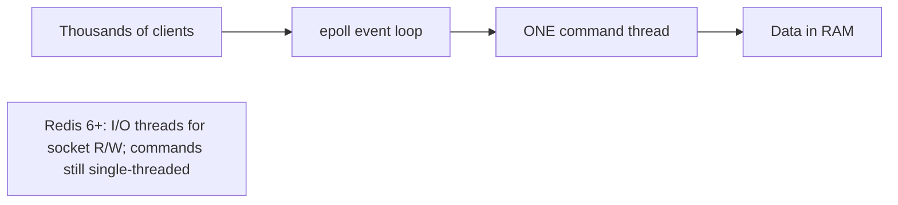
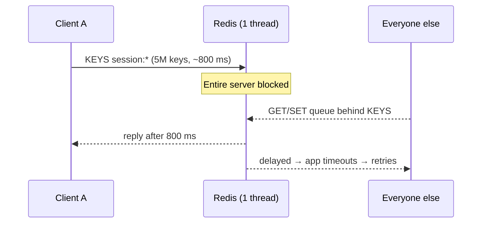
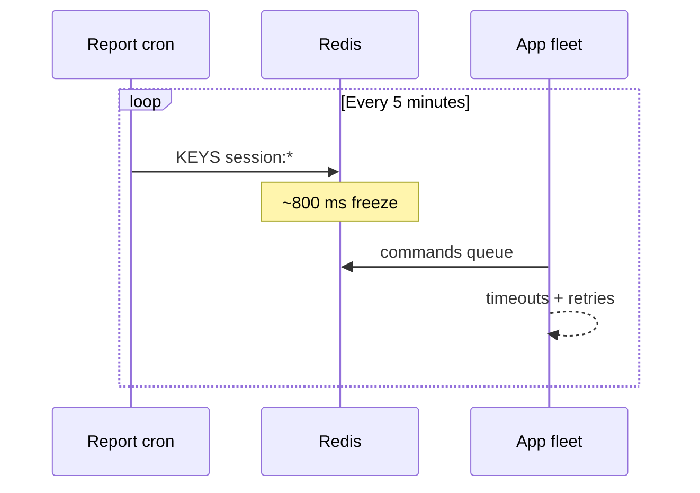

# Lesson 13: Redis Fundamentals — Why Single-Threaded Is Fast, RDB vs AOF

> **Prerequisites:** [Lesson 12: Hot Keys in Redis](../12-hot-keys-in-redis/README.md) and [Track: Caching](../README.md) overview.  
> **Estimated Reading Time:** 32–38 minutes  
> **Target Audience:** Backend engineers choosing Redis data structures, configuring persistence and eviction, avoiding `KEYS *` outages, and explaining single-threaded performance in interviews.  
> **Free PDF Notes:** [Download SD-F-013.pdf](https://backendroadmap.com/notes/system-design/SD-F-013.pdf)

> [!NOTE]
> **In one line:** Redis is an in-memory data structure server—strings, hashes, lists, sets, sorted sets, streams—with atomic commands, a single command thread, optional persistence (RDB + AOF), and explicit eviction. It is fast because data lives in RAM and simple commands run lock-free in one event loop; it is dangerous when you run a slow O(n) command on it.

> [!TIP]
> **The Golden Rule of Redis:** Prefer O(1)/O(log n) commands, pipeline round trips, set `maxmemory` + an eviction policy, never run `KEYS` in production (use `SCAN` / `UNLINK`), and treat Redis as a durable store only when AOF + replication are intentional—not accidental.

---

## Words You'll Meet Today

| Word | In Plain Words | Role in a Live Backend System |
| :--- | :--- | :--- |
| **Data structure server** | Values are typed structures, not only blobs | Leaderboards, queues, rate limits in one box |
| **Event loop / epoll** | One thread waits on many sockets | Hundreds of thousands of ops/s on one core |
| **Atomic command** | Cannot be interrupted mid-command | Safe `INCR` without locks |
| **Lua script** | Server-side script run atomically | Rate limiter check-and-increment |
| **RDB** | Point-in-time snapshot file | Fast restart / backups; may lose minutes |
| **AOF** | Append-only log of writes | ~1 s loss with `everysec` |
| **Pipelining** | Send many commands without waiting each reply | Turns 50 ms of RTTs into ~1–2 ms |
| **SCAN** | Cursor-based incremental key iteration | Safe alternative to blocking `KEYS` |

---

## Visual Mental Models & Architecture

### Why One Thread Is Fast



*Figure 1. RAM + simple commands + no locks + I/O multiplexing. The network is usually the bottleneck, not the CPU.*

### The Slow-Command Trap



*Figure 2. One O(n) command is an outage. Prefer `SCAN`, `SSCAN`, `HSCAN`, `UNLINK`, paginated `LRANGE`.*

---

## Core Definition & Taxonomic Comparison

**What it is:** An in-memory data structure server with optional durability. **What it isn't:** a full ACID database (no rollback on `MULTI` failures like SQL), nor multi-threaded for commands.

| Structure | Commands | Cost | Use |
| :--- | :--- | :--- | :--- |
| **String** | `SET`/`GET`/`INCR`/`SETNX` | O(1) | Cache JSON, counters, locks |
| **Hash** | `HSET`/`HGET`/`HINCRBY` | O(1)/field | Objects with fields |
| **List** | `LPUSH`/`RPOP`/`LTRIM` | O(1) ends | Queues, recent N |
| **Set** | `SADD`/`SISMEMBER`/`SINTER` | O(1) add/check | Tags, unique members |
| **Sorted set** | `ZADD`/`ZREVRANGE`/`ZRANK` | O(log n) | Leaderboards, delayed jobs |
| **Stream** | `XADD`/`XREADGROUP`/`XACK` | O(1) append | Event log + consumer groups |
| **HyperLogLog** | `PFADD`/`PFCOUNT` | O(1), ~12 KB | Approximate unique counts |

| Persistence | What it stores | Crash loss | Restart | Best for |
| :--- | :--- | :--- | :--- | :--- |
| **RDB** | Whole dataset snapshot | Since last snapshot (minutes) | Fast | Backups, rebuildable caches |
| **AOF** | Every write command | ~1 s (`everysec`) / 0 (`always`) | Slower replay | Data you must not lose |
| **Both** | Common production combo | Bounded by AOF | RDB speeds reload | Sessions, queues, counters |

---

## Component Anatomy & The Observability Gap

### Anatomy of a Command

```text
 socket bytes → I/O thread (6+) → command queue → single thread executes → reply buffer → socket
 Lua / MULTI: still one atomic unit on the command thread
```

### Observability Gap

| Signal | Captures | Hides |
| :--- | :--- | :--- |
| Average CPU | Looks fine | Periodic `KEYS` spikes every 5 minutes |
| `used_memory` | Footprint | Fork COW spike during RDB/AOF rewrite |
| Hit ratio | Cache health | Big-key latency / blocked clients |
| Add | `SLOWLOG`, `LATENCY DOCTOR`, `evicted_keys`, fragmentation, blocked_clients | — |

---

## Mathematical Model & Worked Scale

### Pipelining vs Chatty Round Trips

$$T_{\text{serial}} = N \times RTT, \qquad T_{\text{pipeline}} \approx RTT + N \times t_{\text{cmd}}$$

Example: $N=100$, $RTT=0.5$ ms → serial $50$ ms; pipelined ~$1$–$2$ ms.

### Sorted-Set Leaderboard Cost

Each `ZADD`/`ZREVRANK` is $O(\log n)$. At $n=10^6$, $\log_2 n \approx 20$ comparisons—still tiny in RAM.

### Fork Memory Headroom

During RDB/AOF rewrite under heavy writes, COW can approach ~2× `used_memory`. Leave headroom below host RAM.

---

## Metrics, Percentiles & Numbers Engineers Must Know

| Number | Meaning |
| :--- | :--- |
| Hundreds of thousands ops/s | Typical single-instance throughput |
| `appendfsync everysec` | Lose ≤ ~1 s of writes |
| `maxmemory` unset | Redis grows until OOM-kill |
| `SLOWLOG` > 10 ms | Investigate O(n) / big keys |
| Values in KB not MB | Big keys hurt read, delete, and replication |

---

## Compounding Effects & System Scale

| Effect | Why it compounds |
| :--- | :--- |
| Slow command + retries | Block → timeouts → more load |
| No TTL on cache keys | Memory fills → eviction storm or OOM |
| Pub/Sub for durable events | Offline subscribers miss forever |
| `MULTI/EXEC` assumed like SQL | No rollback of earlier commands on later failure |

---

## Hierarchical Budgets & Capacity Sizing

| Concern | Guidance |
| :--- | :--- |
| Cache-only Redis | Persistence optional; plan cold-cache DB load |
| Sessions / queues | AOF `everysec` + replica + failover |
| Eviction | `allkeys-lru`/`lfu` for caches; `noeviction` for primary-ish data |
| Clients | Connection pools, timeouts; pipeline/`MGET` |
| Security | Private network, ACL, TLS; never public internet |

---

## Top Engineering Mitigation Techniques

1. Choose the right structure (don’t fake a leaderboard with lists).
2. Pipeline / `MGET` / Lua for multi-step atomicity + fewer RTTs.
3. `SCAN` + `UNLINK`; ACL-disable `KEYS`.
4. Set `maxmemory` + policy; watch fragmentation and evictions.
5. Keep collections small; hash encoding for small objects.
6. Namespace + version keys (`app:v1:user:42`); always TTL cache keys.

---

## Production War Story: `KEYS` in Production

**Severity & Impact:** Reporting script ran `KEYS session:*` every 5 minutes. Staging had 10k keys; production had 5M. Each call ~800 ms of total block. Regular latency spikes; timeouts and retries; average Redis CPU looked normal.



**Fix:** Maintain a counter or sorted set by last-seen; `ACL SETUSER app -keys`; alert on `SLOWLOG` and p99 command latency.

**Lesson:** With one command thread, a single O(n) command is an outage. Test with production-sized data.

---

## Multi-Language Production Implementation

Leaderboard + atomic rate limiter (Lua) patterns:

````carousel
```go
package redisfund

import (
	"context"

	"github.com/redis/go-redis/v9"
)

// Leaderboard: O(log n) sorted set ops
func UpdateScore(ctx context.Context, rdb *redis.Client, user string, delta float64) error {
	return rdb.ZIncrBy(ctx, "game:lb", delta, user).Err()
}

func Top10(ctx context.Context, rdb *redis.Client) ([]redis.Z, error) {
	return rdb.ZRevRangeWithScores(ctx, "game:lb", 0, 9).Result()
}

// Rate limit: INCR + EXPIRE must be atomic → Lua
var rateLua = redis.NewScript(`
local n = redis.call('INCR', KEYS[1])
if n == 1 then redis.call('EXPIRE', KEYS[1], ARGV[2]) end
if n > tonumber(ARGV[1]) then return 0 end
return 1
`)

func Allow(ctx context.Context, rdb *redis.Client, key string, limit, windowSec int) (bool, error) {
	n, err := rateLua.Run(ctx, rdb, []string{key}, limit, windowSec).Int()
	return n == 1, err
}
```
<!-- slide -->
```typescript
import Redis from "ioredis";

const r = new Redis(process.env.REDIS_URL!);

export async function updateScore(user: string, delta: number) {
  await r.zincrby("game:lb", delta, user);
}

export async function top10() {
  return r.zrevrange("game:lb", 0, 9, "WITHSCORES");
}

const rateLua = `
local n = redis.call('INCR', KEYS[1])
if n == 1 then redis.call('EXPIRE', KEYS[1], ARGV[2]) end
if n > tonumber(ARGV[1]) then return 0 end
return 1`;

export async function allow(key: string, limit: number, windowSec: number) {
  const ok = await r.eval(rateLua, 1, key, limit, windowSec);
  return ok === 1;
}

// Pipeline 100 GETs instead of 100 RTTs
export async function mgetPipelined(keys: string[]) {
  const p = r.pipeline();
  for (const k of keys) p.get(k);
  return p.exec();
}
```
<!-- slide -->
```python
import redis.asyncio as redis

RATE_LUA = """
local n = redis.call('INCR', KEYS[1])
if n == 1 then redis.call('EXPIRE', KEYS[1], ARGV[2]) end
if n > tonumber(ARGV[1]) then return 0 end
return 1
"""

async def update_score(r: redis.Redis, user: str, delta: float):
    await r.zincrby("game:lb", delta, user)

async def top10(r: redis.Redis):
    return await r.zrevrange("game:lb", 0, 9, withscores=True)

async def allow(r: redis.Redis, key: str, limit: int, window: int) -> bool:
    return (await r.eval(RATE_LUA, 1, key, limit, window)) == 1

# Safe iteration — never KEYS
async def count_prefix(r: redis.Redis, match: str) -> int:
    n, cursor = 0, b"0"
    while True:
        cursor, keys = await r.scan(cursor=cursor, match=match, count=500)
        n += len(keys)
        if cursor == b"0" or cursor == 0:
            break
    return n
```
<!-- slide -->
```csharp
using StackExchange.Redis;

public static class RedisFund
{
    private const string RateLua = @"
local n = redis.call('INCR', KEYS[1])
if n == 1 then redis.call('EXPIRE', KEYS[1], ARGV[2]) end
if n > tonumber(ARGV[1]) then return 0 end
return 1";

    public static Task UpdateScore(IDatabase db, string user, double delta) =>
        db.SortedSetIncrementAsync("game:lb", user, delta);

    public static Task<RedisValue[]> Top10(IDatabase db) =>
        db.SortedSetRangeByRankAsync("game:lb", 0, 9, Order.Descending);

    public static async Task<bool> AllowAsync(IDatabase db, string key, int limit, int windowSec)
    {
        var result = (int)await db.ScriptEvaluateAsync(RateLua, new RedisKey[] { key },
            new RedisValue[] { limit, windowSec });
        return result == 1;
    }
}
```
````

---

## Practical Hands-On CLI Verification

```bash
redis-cli ZADD game:lb 4200 anna
redis-cli ZINCRBY game:lb 50 anna
redis-cli ZREVRANGE game:lb 0 9 WITHSCORES
redis-cli SLOWLOG GET 10
redis-cli LATENCY DOCTOR
redis-cli CONFIG GET maxmemory*
```

```bash
# Dangerous — never on prod primary with large keyspace
# redis-cli KEYS '*'
redis-cli SCAN 0 MATCH 'session:*' COUNT 100
```

---

## Common Mistakes to Avoid

- `KEYS`, huge `LRANGE`/`SMEMBERS`/`HGETALL`, or blocking `DEL` on big keys.
- No `maxmemory` or wrong policy → OOM or write rejects.
- Treating Redis as durable with neither persistence nor replication.
- One giant key instead of many small ones.
- No TTLs on cache keys.
- One connection per request; no client timeouts.
- Assuming `MULTI/EXEC` rolls back like SQL.
- Pub/Sub when you need durable, replayable events (use Streams).

---

## Key Terms Glossary

| Term | Interview-ready definition |
| :--- | :--- |
| **In-memory data store** | Working set lives in RAM for speed |
| **Event loop** | One thread multiplexes many sockets |
| **RDB** | Compact point-in-time snapshot |
| **AOF** | Log of write commands replayed on restart |
| **fsync** | Force OS buffers to disk |
| **Pipelining** | Batch commands to amortize RTT |
| **Lua script** | Atomic multi-step server-side logic |
| **maxmemory** | Cap that triggers the eviction policy |

---

## Interview Practice Questions

<details>
<summary><strong>1. Why is Redis fast despite being single-threaded? [BASIC]</strong></summary>

Data in memory, simple O(1)/O(log n) commands, no lock/context-switch overhead between threads, and an epoll event loop serving many connections. Network is usually the limit.

</details>

<details>
<summary><strong>2. RDB versus AOF? [BASIC]</strong></summary>

RDB: periodic compact snapshots, fast restart, can lose minutes. AOF: logs every write, loses ~1 s with `everysec`, larger files, slower replay. Many deployments use both.

</details>

<details>
<summary><strong>3. Name Redis data structures and a use for each. [BASIC]</strong></summary>

Strings (cache/counters), hashes (objects), lists (queues), sets (unique members), sorted sets (leaderboards), streams (consumer groups).

</details>

<details>
<summary><strong>4. How do eviction policies differ? [BASIC]</strong></summary>

`noeviction` rejects writes; `allkeys-lru`/`lfu` evict from all keys (typical cache); `volatile-*` only keys with a TTL.

</details>

<details>
<summary><strong>5. Build a leaderboard. [SCENARIO]</strong></summary>

Sorted set: `ZADD`/`ZINCRBY`, `ZREVRANGE` top N, `ZREVRANK` for position—all O(log n).

</details>

<details>
<summary><strong>6. Implement a rate limiter. [SCENARIO]</strong></summary>

`INCR` + `EXPIRE` on first hit inside Lua so check and increment are atomic; reject above limit. Sliding windows use a sorted set of timestamps.

</details>

<details>
<summary><strong>7. Redis latency spikes every few minutes. What do you check? [SCENARIO]</strong></summary>

`SLOWLOG` for O(n) commands, big keys, RDB fork pauses, AOF rewrites, swapping, huge pipelines.

</details>

<details>
<summary><strong>8. Sessions are stored in Redis. What settings? [SCENARIO]</strong></summary>

AOF `everysec` + replica with automatic failover, `maxmemory` with `noeviction` or `volatile-lru`, TTLs on sessions, monitor loss on failover.

</details>

<details>
<summary><strong>9. Is a Redis transaction like a SQL transaction? [TRICKY]</strong></summary>

`MULTI/EXEC` is an isolated batch but does not roll back earlier commands if a later one fails. Use Lua for conditional atomicity; `WATCH` for optimistic locking.

</details>

<details>
<summary><strong>10. Why can a Redis fork cause latency spikes and memory growth? [TRICKY]</strong></summary>

RDB/AOF rewrite forks; copy-on-write duplicates dirty pages—memory can nearly double on a write-heavy instance, and the fork itself can pause.

</details>

<details>
<summary><strong>11. Pub/Sub or Streams for events? [TRICKY]</strong></summary>

Pub/Sub is fire-and-forget; offline subscribers miss messages. Streams persist with consumer groups, acks, and replay.

</details>

<details>
<summary><strong>12. Why prefer SCAN over KEYS? [TRICKY]</strong></summary>

`KEYS` is O(n) and blocks the single thread until finished. `SCAN` returns a cursor and a few keys at a time so other commands can run between calls.

</details>

---

## One-Page Master Cheat Sheet

```text
====================================================================================================
                       REDIS FUNDAMENTALS  —  CHEAT SHEET
====================================================================================================
IN ONE LINE   In-memory data structure server; one command thread; optional RDB/AOF; set maxmemory.

STRUCTURES    string · hash · list · set · zset · stream (+ HLL, bitmap, geo, modules)
FAST BECAUSE  RAM + O(1)/O(log n) + no locks + epoll; network usually limits
DANGER        KEYS / huge HGETALL / SMEMBERS / DEL big key → blocks EVERYONE
SAFE ITER     SCAN / SSCAN / HSCAN; UNLINK for big deletes; ACL -keys

PERSISTENCE   RDB = snapshot (fast, lose minutes)  AOF everysec ≈ lose 1s  often BOTH
EVICTION      cache: allkeys-lru/lfu   primary-ish: noeviction / volatile-lru
PIPELINE      100×0.5ms RTT = 50ms → pipeline ≈ 1–2ms; Lua = atomic + fewer RTTs
CONFIG        maxmemory + policy; leave fork headroom; timeouts + pools on clients
ANTI-PATTERNS X KEYS in prod   X no TTL on cache keys   X Pub/Sub for durable work
              X MULTI = SQL rollback   X giant keys   X expose Redis to internet
====================================================================================================
```

---

## Free PDF notes

[SD-F-013.pdf](https://backendroadmap.com/notes/system-design/SD-F-013.pdf)

---

## Sources

- [Redis data types](https://redis.io/docs/latest/develop/data-types/)
- [Redis persistence](https://redis.io/docs/latest/operate/oss_and_stack/management/persistence/)
- [Redis pipelining](https://redis.io/docs/latest/develop/use/pipelining/)
- [Redis latency diagnostics](https://redis.io/docs/latest/operate/oss_and_stack/management/optimization/latency/)

---

## Next

Next lesson: [Redis Replication, Sentinel & Cluster: Hash Slots and Failover](../14-redis-replication-sentinel-cluster/README.md)

Track overview: [Track: Caching](../README.md)
