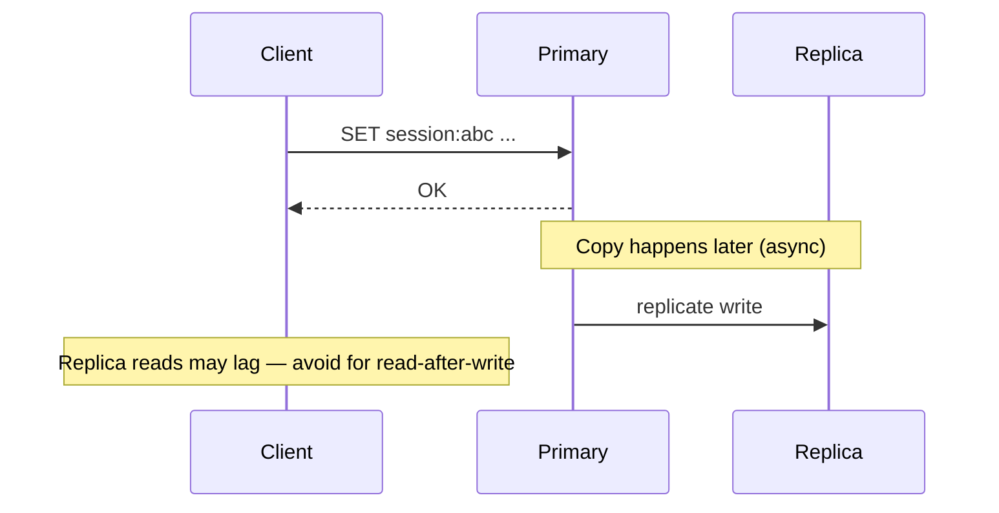
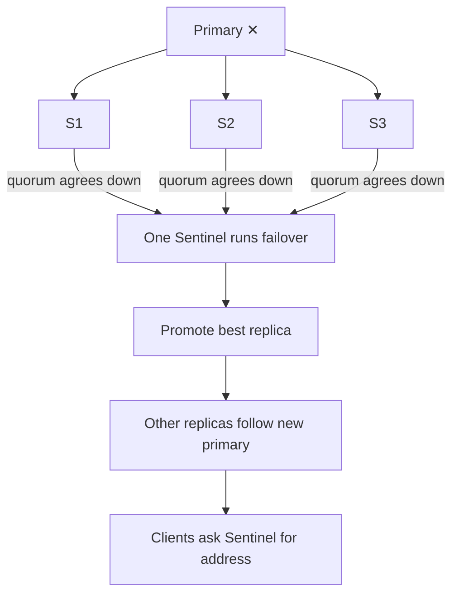
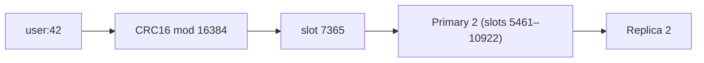
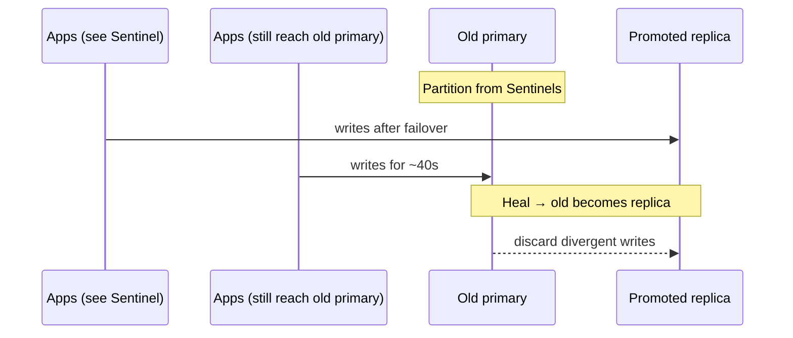

# Lesson 14: Redis Replication, Sentinel & Cluster — Hash Slots and Failover

> **Prerequisites:** [Lesson 13: Redis Fundamentals](../13-redis-fundamentals/README.md) and [Track: Caching](../README.md) overview.  
> **Estimated Reading Time:** 30–35 minutes  
> **Target Audience:** Backend engineers choosing HA vs sharding for Redis, wiring Sentinel/Cluster clients, hashing with tags, and reasoning about failover data loss.  
> **Free PDF Notes:** [Download SD-F-014.pdf](https://backendroadmap.com/notes/system-design/SD-F-014.pdf)

> [!NOTE]
> **In one line:** replication copies a primary’s data to replicas asynchronously; Sentinel detects a dead primary and promotes a replica for HA; Redis Cluster shards keys over 16,384 hash slots across primaries (each with replicas) for memory and write scale. Failover can lose writes that had not been copied yet.

> [!TIP]
> **The Golden Rule of Redis HA:** Pick the simplest topology that fits—Sentinel when data fits one node, Cluster when it doesn’t. Always use Sentinel-aware or cluster-aware clients, set `min-replicas-to-write` so an isolated primary stops accepting writes, and keep anything you cannot lose in a real database.

---

## Words You'll Meet Today

| Word | In Plain Words | Role in a Live Backend System |
| :--- | :--- | :--- |
| **Primary / replica** | Writable node / read-only copy | Replicas serve reads and stand ready |
| **Async replication** | Primary ACKs before replicas copy | Speed over durability |
| **Sentinel** | Quorum monitors + promotes replicas | Automatic failover for one shard |
| **Hash slot** | One of 16,384 key partitions | `CRC16(key) mod 16384` |
| **MOVED / ASK** | Redirects to the slot owner | Clients update their slot map |
| **Hash tag** | `{…}` portion hashed for co-location | Multi-key ops / Lua in Cluster |
| **CROSSSLOT** | Error: keys in different slots | Multi-key without matching tags |
| **min-replicas-to-write** | Refuse writes without enough sync replicas | Limits split-brain loss |

---

## Visual Mental Models & Architecture

### Replication Is Asynchronous



*Figure 1. The client gets OK before replicas have the write. `WAIT n timeout` reduces—but does not eliminate—the loss window.*

### Sentinel Failover



*Figure 2. Run ≥3 Sentinels on separate machines (odd number). Typical failover: seconds.*

### Redis Cluster Slots



*Figure 3. Needs ≥3 primaries; replicas give failover per shard. Resharding moves slots while serving.*

---

## Core Definition & Taxonomic Comparison

| Setup | Failover | Data size | Write scale | Read scale | Multi-key | Ops complexity |
| :--- | :--- | :--- | :--- | :--- | :--- | :--- |
| **Single node** | None | One machine | No | No | Any | Simplest |
| **Replication + Sentinel** | Automatic | One machine | No | Replicas | Any | Moderate (3+ Sentinels) |
| **Redis Cluster** | Per shard | Many machines | Yes | Replicas | Same slot only | Most complex |

**What it is:** Availability (Sentinel) and/or horizontal scale (Cluster). **What it isn't:** synchronous durable consensus like Raft for every write—async replication means possible loss on failover.

---

## Component Anatomy & The Observability Gap

### MOVED Redirect Flow

| Step | Who | What |
| :--- | :--- | :--- |
| 1 | Client | `GET user:42` to node A (stale map) |
| 2 | Node A | `-MOVED 7365 10.0.0.12:6379` |
| 3 | Client | Updates map; retries on B |
| 4 | Node B | Returns value; later commands go straight to B |

`ASK` is used during slot migration; cluster-aware libraries handle both.

### Observability Gap

| Signal | Hides |
| :--- | :--- |
| “Primary is up” from some apps | Partition: old primary still takes writes |
| Replica lag average | Failover promoting a lagging replica → lost keys |
| Cluster “OK” | Hot slot from oversized hash tag |

---

## Mathematical Model & Worked Scale

### Slot Ownership

$$\text{slot}(key) = \text{CRC16}(key) \bmod 16384$$

With 3 primaries ≈ $5461$ slots each.

### Loss Window

Without `WAIT`, any write acknowledged but not yet on the promoted replica can vanish:

$$\text{lost} \subseteq \{\text{writes in replication backlog at failover}\}$$

`WAIT 1 100` waits up to 100 ms for 1 replica—reduces probability, raises latency.

### Capacity

$P$ primaries ≈ $P\times$ memory and write throughput of one node (idealized; skew and hot keys apply).

---

## Metrics, Percentiles & Numbers Engineers Must Know

| Number | Meaning |
| :--- | :--- |
| 16,384 | Fixed hash slots |
| ≥3 Sentinels | Quorum majority |
| ≥3 Cluster primaries | Typical minimum HA cluster |
| Failover seconds | down-after + election + promotion |
| `min-replicas-max-lag` | e.g. 10 s freshness bound |

---

## Compounding Effects & System Scale

| Scenario | Compounding |
| :--- | :--- |
| Network partition without min-replicas-to-write | Old primary accepts writes → discarded on rejoin |
| Giant `{tenant}` hash tag | One hot slot that cannot be split |
| Hard-coded primary address | Clients write to demoted node after failover |
| Read-after-write via replica | Users “lose” their own update |

---

## Hierarchical Budgets & Capacity Sizing

| Need | Choose |
| :--- | :--- |
| Dev / tiny cache | Single node |
| HA, data fits one box | Primary + replicas + Sentinel |
| >1 node memory or write QPS | Redis Cluster |
| Cannot lose data | Real database as source of truth; Redis as cache/accelerator |

Managed services (ElastiCache, Azure Cache, Memorystore) run these topologies for you.

---

## Top Engineering Mitigation Techniques

1. Sentinel-aware / cluster-aware clients—never hard-code the primary.
2. `min-replicas-to-write 1` + `min-replicas-max-lag 10`.
3. `WAIT` for critical writes (sessions/jobs), accepting latency.
4. Hash tags only for small related key groups (`user:{42}:cart`).
5. Idempotent jobs + DB reconciliation after failover.
6. Spread Sentinels/replicas across hosts and AZs.

---

## Production War Story: Writes Lost After a Network Partition

**Severity & Impact:** Redis + Sentinel for a job queue. Partition isolated primary from Sentinels/replicas but not from some app servers. Sentinels promoted a replica; old primary kept accepting writes ~40 s. On heal, old primary demoted and synced—~12,000 jobs vanished.



**Fix:** `min-replicas-to-write 1`; idempotent jobs recorded in DB; reconciliation re-enqueue; alert on failovers and rejected writes.

**Lesson:** Failover is not free. Configure the primary to refuse writes when it cannot replicate.

---

## Multi-Language Production Implementation

Sentinel and Cluster clients:

````carousel
```go
package redisha

import (
	"context"

	"github.com/redis/go-redis/v9"
)

func SentinelClient() *redis.Client {
	return redis.NewFailoverClient(&redis.FailoverOptions{
		MasterName:    "sessions",
		SentinelAddrs: []string{"sentinel1:26379", "sentinel2:26379", "sentinel3:26379"},
		DialTimeout:   200_000_000, // 200ms
		ReadTimeout:   200_000_000,
	})
}

func ClusterClient() *redis.ClusterClient {
	return redis.NewClusterClient(&redis.ClusterOptions{
		Addrs: []string{"10.0.0.11:6379", "10.0.0.12:6379", "10.0.0.13:6379"},
	})
}

// Hash tags keep cart keys in one slot for Lua / MULTI
func CartKey(userID int64, field string) string {
	return "cart:{" + itoa(userID) + "}:" + field
}

func itoa(id int64) string { /* strconv.FormatInt */ return "" }
```
<!-- slide -->
```typescript
import Redis from "ioredis";

export const sentinel = new Redis({
  sentinels: [
    { host: "sentinel1", port: 26379 },
    { host: "sentinel2", port: 26379 },
    { host: "sentinel3", port: 26379 },
  ],
  name: "sessions",
  sentinelRetryStrategy: (times) => Math.min(times * 100, 2000),
});

export const cluster = new Redis.Cluster([
  { host: "10.0.0.11", port: 6379 },
  { host: "10.0.0.12", port: 6379 },
  { host: "10.0.0.13", port: 6379 },
]);

// Same-slot keys via hash tag
export const cartItems = (uid: number) => `cart:{${uid}}:items`;
export const cartTotals = (uid: number) => `cart:{${uid}}:totals`;
```
<!-- slide -->
```python
from redis.sentinel import Sentinel
from redis.cluster import RedisCluster, ClusterNode

hosts = [("sentinel1", 26379), ("sentinel2", 26379), ("sentinel3", 26379)]
s = Sentinel(hosts, socket_timeout=0.2)
primary = s.master_for("sessions", socket_timeout=0.2)
replica = s.slave_for("sessions", socket_timeout=0.2)  # stale-tolerant reads

await primary.set("session:abc", "...", ex=1800)

rc = RedisCluster(startup_nodes=[ClusterNode("10.0.0.11", 6379)])
rc.set("user:42:profile", "...")
# Multi-key: use hash tags
# cart:{42}:items and cart:{42}:totals share a slot
```
<!-- slide -->
```csharp
using StackExchange.Redis;

// Sentinel via configuration string / ConnectionMultiplexer
var sentinel = ConnectionMultiplexer.Connect(
    "sessions,serviceName=sessions,sentinel1:26379,sentinel2:26379,sentinel3:26379");

// Cluster: list node endpoints; library follows MOVED
var cluster = ConnectionMultiplexer.Connect(
    "10.0.0.11:6379,10.0.0.12:6379,10.0.0.13:6379");

var db = cluster.GetDatabase();
// Hash tag for same-slot multi-key work
var itemsKey = $"cart:{{{userId}}}:items";
var totalsKey = $"cart:{{{userId}}}:totals";
```
````

---

## Practical Hands-On CLI Verification

```bash
# Replica
redis-cli INFO replication
# Cluster
redis-cli CLUSTER NODES
redis-cli CLUSTER KEYSLOT user:42
redis-cli CLUSTER KEYSLOT 'user:{42}:cart'
redis-cli CLUSTER KEYSLOT 'user:{42}:profile'   # same slot if tagged
```

---

## Common Mistakes to Avoid

- Hard-coding the primary instead of Sentinel/Cluster clients.
- All Sentinels or replicas in one host/zone.
- Reading replicas immediately after writes (read-after-write).
- Multi-key ops in Cluster without hash tags → `CROSSSLOT`.
- One giant tenant hash tag → hot slot.
- Too-aggressive failure detection → failover storms.
- Treating async Redis replication as durable storage for irreplaceable data.

---

## Key Terms Glossary

| Term | Interview-ready definition |
| :--- | :--- |
| **Asynchronous replication** | Primary acknowledges before replicas copy |
| **Sentinel** | Quorum monitors primary and promotes a replica |
| **Quorum** | Majority of Sentinels that must agree |
| **Resharding** | Moving slots (and keys) between nodes |
| **MOVED / ASK** | Redirects during ownership change / migration |
| **Hash tag** | `{…}` substring used as the hash key |
| **CROSSSLOT** | Multi-key command spanning slots |
| **min-replicas-to-write** | Refuse writes without enough healthy replicas |

---

## Interview Practice Questions

<details>
<summary><strong>1. How does Redis Cluster distribute keys? [BASIC]</strong></summary>

Keys hashed with CRC16 into 16,384 slots; slots spread across primaries; clients route by slot and follow MOVED; hash tags keep related keys together.

</details>

<details>
<summary><strong>2. What data can be lost on failover? [BASIC]</strong></summary>

Writes the primary acknowledged but had not yet replicated. `WAIT` and AOF reduce but do not eliminate that risk.

</details>

<details>
<summary><strong>3. What does Sentinel do? [BASIC]</strong></summary>

Monitors the primary, reaches quorum on failure, promotes the best replica, reconfigures others, and tells clients the new primary.

</details>

<details>
<summary><strong>4. Why Cluster if you have Sentinel? [BASIC]</strong></summary>

Sentinel gives availability but all data and writes stay on one primary. Cluster shards data and writes across several primaries.

</details>

<details>
<summary><strong>5. Redis has 80 GB data and 150k writes/s. What do you choose? [SCENARIO]</strong></summary>

Redis Cluster with several primaries and replicas—one node’s memory and write capacity is exceeded.

</details>

<details>
<summary><strong>6. Cart update Lua fails with CROSSSLOT. Fix? [SCENARIO]</strong></summary>

Hash-tag both keys into one slot, e.g. `cart:{42}:items` and `cart:{42}:totals`, keeping the tagged group small.

</details>

<details>
<summary><strong>7. Replica promoted; users miss recent changes. Why? [SCENARIO]</strong></summary>

Failed primary had acknowledged unreplicated writes. Use `WAIT`, `min-replicas-to-write`, and an idempotent source of truth.

</details>

<details>
<summary><strong>8. How do you add capacity to a running cluster? [SCENARIO]</strong></summary>

Add nodes and migrate slots (resharding) while serving; clients follow MOVED/ASK.

</details>

<details>
<summary><strong>9. Why at least three Sentinels? [TRICKY]</strong></summary>

Quorum needs a majority to avoid split decisions; with two, losing one stops decisions; with one there is no agreement.

</details>

<details>
<summary><strong>10. How can a partitioned old primary cause data loss? [TRICKY]</strong></summary>

It keeps accepting writes from clients that still reach it; when it rejoins as a replica those writes are discarded. `min-replicas-to-write` limits this.

</details>

<details>
<summary><strong>11. Can you read from replicas for a cache? [TRICKY]</strong></summary>

Yes to spread reads, accepting replication lag. Avoid for read-after-write.

</details>

<details>
<summary><strong>12. Why are hash tags both useful and dangerous? [TRICKY]</strong></summary>

They enable multi-key ops by co-locating keys, but too many keys under one tag create a hot slot that cannot be spread or moved.

</details>

---

## One-Page Master Cheat Sheet

```text
====================================================================================================
              REDIS REPLICATION / SENTINEL / CLUSTER  —  CHEAT SHEET
====================================================================================================
IN ONE LINE   Async replica copies; Sentinel = HA; Cluster = 16384 slots for scale. Failover can lose writes.

REPLICATION   Primary → replicas async; WAIT n ms; replica reads may be stale
SENTINEL      ≥3, odd, separate hosts; quorum → promote; clients ask Sentinel
CLUSTER       slot = CRC16(key) % 16384; MOVED/ASK; reshard moves slots
MULTI-KEY     Same slot only → hash tags {userId}; keep groups small
LOSS CONTROL  min-replicas-to-write 1 + max-lag; WAIT for critical; DB as SoT
PICK          1 node → Sentinel (fits RAM) → Cluster (need shards)
ANTI-PATTERNS X hard-code primary   X Sentinels in one AZ   X giant {tenant} tag
              X treat Redis as durable DB   X read-after-write from replica
====================================================================================================
```

---

## Free PDF notes

[SD-F-014.pdf](https://backendroadmap.com/notes/system-design/SD-F-014.pdf)

---

## Sources

- [Redis replication](https://redis.io/docs/latest/operate/oss_and_stack/management/replication/)
- [Redis Sentinel](https://redis.io/docs/latest/operate/oss_and_stack/management/sentinel/)
- [Redis Cluster specification](https://redis.io/docs/latest/operate/oss_and_stack/reference/cluster-spec/)
- [WAIT / min-replicas-to-write](https://redis.io/docs/latest/commands/wait/)

---

## Next

Next lesson: [Memcached vs Redis: When the Simple Cache Wins](../15-memcached-vs-redis/README.md)

Track overview: [Track: Caching](../README.md)
