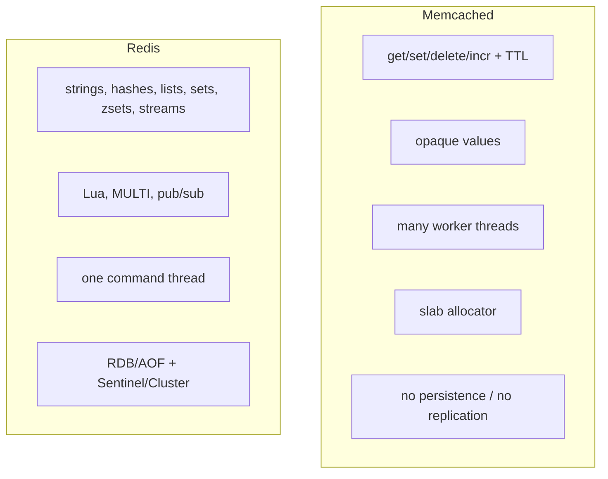
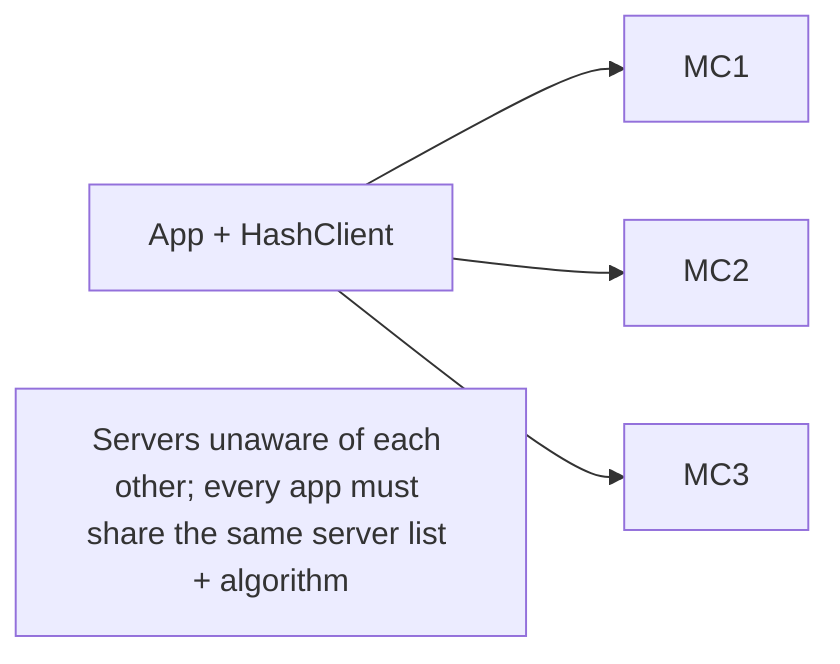
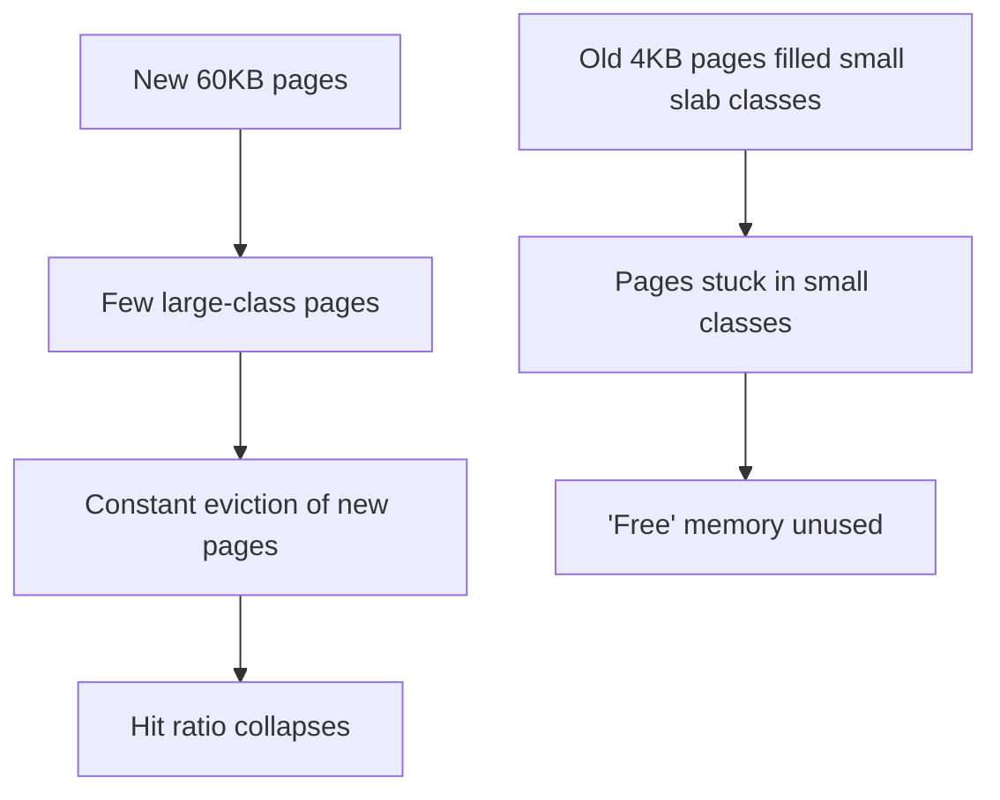

# Lesson 15: Memcached vs Redis — When the Simple Cache Wins

> **Prerequisites:** [Lesson 14: Redis Replication, Sentinel & Cluster](../14-redis-replication-sentinel-cluster/README.md) and [Track: Caching](../README.md) overview.  
> **Estimated Reading Time:** 28–35 minutes  
> **Target Audience:** Backend engineers choosing a cache technology, tuning Memcached slabs, explaining multithreading vs single-threaded Redis, and avoiding “popularity-based” picks.  
> **Free PDF Notes:** [Download SD-F-015.pdf](https://backendroadmap.com/notes/system-design/SD-F-015.pdf)

> [!NOTE]
> **In one line:** Memcached is a deliberately simple, multithreaded, volatile key-value cache with slab memory and client-side sharding; Redis is a single-threaded data structure server with persistence, replication, and clustering. Pick Memcached for pure high-throughput blob caching; pick Redis (the usual default) when you need structures, atomics, durability, or HA.

> [!TIP]
> **The Golden Rule of Cache Choice:** Match the tool to the job—**blobs on big many-core boxes → Memcached**; **structures / Lua / persistence / HA → Redis**. Measure with your value sizes and concurrency. Free memory that sits in the wrong slab class is not free capacity.

---

## Words You'll Meet Today

| Word | In Plain Words | Role in a Live Backend System |
| :--- | :--- | :--- |
| **Memcached** | Simple multithreaded in-memory KV cache | HTML fragments, query result blobs |
| **Slab class** | Pool of fixed-size memory chunks | Fast alloc; per-class LRU |
| **Slab calcification** | Pages stuck in classes that no longer fit traffic | Hit ratio falls while “free” memory sits idle |
| **Client-side sharding** | Client hashes keys to servers | Servers never talk to each other |
| **Consistent hashing / ketama** | Ring placement so ±1 node moves ~1/N keys | Memcached scale-out |
| **CAS** | Compare-and-swap with a token | Optimistic concurrent updates |
| **Volatile** | Not persisted; lost on restart | Pure cache semantics |
| **I/O threads** | Redis 6+ network threads | Commands still single-threaded |

---

## Visual Mental Models & Architecture

### Two Philosophies



*Figure 1. Memcached = a very good volatile cache. Redis = a cache and a toolbox.*

### Client-Side Sharding



*Figure 2. Adding/losing a server moves ~1/N of keys with consistent hashing.*

---

## Core Definition & Taxonomic Comparison

| Dimension | Memcached | Redis |
| :--- | :--- | :--- |
| **Data model** | Key → opaque bytes | Rich structures |
| **Threads** | Multithreaded (uses all cores) | Single command thread (+ I/O threads) |
| **Persistence** | None (extstore is flash for values) | RDB / AOF |
| **HA** | None built-in | Replication, Sentinel, Cluster |
| **Scaling** | Client consistent hashing | Cluster slots or client/proxy |
| **Atomics** | incr/decr, CAS | Many + Lua |
| **Memory** | Slab allocator, per-class LRU | jemalloc + eviction policies |
| **Value size** | 1 MB default | Up to 512 MB (keep small!) |
| **Ops** | Very little to tune | More (persistence, failover, policy) |
| **Typical use** | Fragments, serialized objects | Cache + counters, sessions, queues, locks |

**Decision rule:** simple volatile strings/blobs + huge many-core nodes → Memcached. Anything richer, or one tool for many jobs → Redis (default for most new systems).

---

## Component Anatomy & The Observability Gap

### Slab Allocator Anatomy

```text
1 MB pages → assigned to a slab class → fixed chunks (96, 120, 152, … ×1.25 growth)
Item 100 bytes → 120-byte chunk → ~17% internal waste
Eviction is per slab class (similar-sized items compete)
```

### Observability Gap

| Metric | Lie |
| :--- | :--- |
| “30% memory free” | Free pages may be in wrong slab classes |
| Cluster Redis CPU on 64-core box | One command core busy; 63 idle |
| Hit ratio alone | Misses from calcification look like “need more RAM” |

Watch `stats slabs`, evictions **per class**, and true item-size histogram after redesigns.

---

## Mathematical Model & Worked Scale

### Internal Fragmentation

$$\text{waste} \approx 1 - \frac{\text{item size}}{\text{chunk size}}$$

100 B in 120 B chunk → ~17% waste—accepted for O(1) allocation and no external fragmentation.

### Core Utilization

- Memcached `-t 16` on 16-core box → all cores serve requests.
- One Redis instance → ~1 core for commands; scale with N instances/shards.

### Node Failure (Memcached)

With $N$ nodes, losing one → ~$1/N$ keys miss until rebuilt. No replica—DB must absorb the surge.

---

## Metrics, Percentiles & Numbers Engineers Must Know

| Number | Meaning |
| :--- | :--- |
| Default max item | 1 MB (Memcached) |
| Max key length | 250 bytes (Memcached) |
| Slab growth factor | Default 1.25 |
| Both systems | Hundreds of thousands ops/s possible |
| Factor 1.25 classes | Coarse size buckets → calcification risk when sizes shift |

---

## Compounding Effects & System Scale

| Change | Compounding |
| :--- | :--- |
| Page size 4 KB → 60 KB after redesign | Small slabs full of stale; large classes thrash |
| Different hash lists per language | Split-brain: key written to mc-1, read from mc-2 miss |
| Redis as pure blob cache on 64 cores | Idle cores; pay persistence/ops you don’t need |
| Memcached then need leaderboards | Wrong tool; migrate under pressure |

---

## Hierarchical Budgets & Capacity Sizing

| Workload | Prefer |
| :--- | :--- |
| HTML fragments / API blobs, volatile | Memcached |
| Sessions + rate limit + leaderboard | Redis |
| 64-core cache box, pure KV | Memcached or many Redis instances |
| Need HA without app-level redundancy | Redis Sentinel/Cluster |

Managed offerings exist for both—ops cost is often less decisive than data-model fit.

---

## Top Engineering Mitigation Techniques

1. Enable Memcached slab rebalancer (`slab_reassign`, `slab_automove=1`).
2. Keep identical server lists + hash algorithm across all clients.
3. Size DB headroom for 1/N Memcached node loss.
4. For Redis-on-big-box: shard multiple instances per host.
5. Turn off Redis persistence when it is truly a disposable cache.
6. Benchmark with production value-size mix—not microbenchmarks.

---

## Production War Story: The Cache That Looked Half Empty

**Severity & Impact:** Memcached for rendered pages. Redesign grew pages 4 KB → 60 KB. Monitoring showed 30% free memory; evictions rose; hit ratio 92% → 61%.



**Root cause:** Slab calcification—free memory in the wrong place.

**Fix:** Enable slab rebalancer; restart with correct item-size profile after big changes; warm gradually; alert on **per-slab** evictions.

---

## Multi-Language Production Implementation

Memcached client sharding vs Redis structures:

````carousel
```go
package cachechoice

import (
	"github.com/bradfitz/gomemcache/memcache"
)

func MemcachedFragment() *memcache.Client {
	// Production: use a consistent-hash / ketama client wrapping multiple servers
	return memcache.New("mc-1:11211", "mc-2:11211", "mc-3:11211")
}

func SetFragment(c *memcache.Client, key string, html []byte) error {
	return c.Set(&memcache.Item{Key: key, Value: html, Expiration: 300})
}
```
<!-- slide -->
```typescript
import Memcache from "memjs";
import Redis from "ioredis";

// Memcached: opaque fragments
export const mc = Memcache.Client.create("mc-1:11211,mc-2:11211,mc-3:11211");

export async function setFragment(key: string, html: Buffer) {
  await mc.set(key, html, { expires: 300 });
}

// Redis: when you need structures
export const redis = new Redis(process.env.REDIS_URL!);
export async function leaderboardTop(n: number) {
  return redis.zrevrange("game:lb", 0, n - 1, "WITHSCORES");
}
```
<!-- slide -->
```python
from pymemcache.client.hash import HashClient
import redis.asyncio as redis

mc = HashClient(
    [("mc-1", 11211), ("mc-2", 11211), ("mc-3", 11211)],
    use_pooling=True,
)
mc.set("fragment:card:42", html, expire=300)
html = mc.get("fragment:card:42")  # None on miss
mc.get_many(["fragment:card:42", "fragment:card:43"])
val, token = mc.gets("cfg")
mc.cas("cfg", new_value, token)

# Redis when you need atomic multi-step / structures
r = redis.Redis()
await r.zincrby("game:lb", 50, "anna")
```
<!-- slide -->
```csharp
using Enyim.Caching;
using Enyim.Caching.Configuration;
using StackExchange.Redis;

// Memcached with consistent hashing via client library configuration
var mcConfig = new MemcachedClientConfiguration();
mcConfig.AddServer("mc-1", 11211);
mcConfig.AddServer("mc-2", 11211);
mcConfig.AddServer("mc-3", 11211);
var mc = new MemcachedClient(mcConfig);
mc.Store(StoreMode.Set, "fragment:card:42", html, TimeSpan.FromMinutes(5));

// Redis toolbox
var redis = ConnectionMultiplexer.Connect(Environment.GetEnvironmentVariable("REDIS")!);
var db = redis.GetDatabase();
await db.SortedSetIncrementAsync("game:lb", "anna", 50);
```
````

---

## Practical Hands-On CLI Verification

```bash
echo stats slabs | nc mc-1 11211 | head
echo stats items | nc mc-1 11211 | head
# Redis core usage reminder
redis-cli INFO cpu
redis-cli INFO memory
```

---

## Common Mistakes to Avoid

- Picking Redis for pure blobs on a huge box, or Memcached then needing sets/persistence.
- Different server lists/hash algorithms across app instances.
- Expecting Memcached to survive restart or replicate.
- Storing >1 MB values in Memcached.
- Choosing by popularity instead of workload tests.
- Enabling Redis persistence “just in case” for a disposable cache.

---

## Key Terms Glossary

| Term | Interview-ready definition |
| :--- | :--- |
| **Slab class** | Set of fixed-size chunks for similarly sized items |
| **Chunk** | Fixed-size unit an item is stored in |
| **Slab calcification** | Pages stuck in classes that no longer need them |
| **Client-side sharding** | Client library picks the server |
| **CAS** | Compare-and-swap using a version token |
| **Volatile** | Not persisted; lost on restart |
| **Ketama** | Popular consistent-hash scheme for Memcached |

---

## Interview Practice Questions

<details>
<summary><strong>1. When would you pick Memcached over Redis? [BASIC]</strong></summary>

Pure volatile KV of strings/blobs (HTML fragments, serialized objects), multithreaded performance on large machines, predictable slab memory, no need for structures/persistence/replication.

</details>

<details>
<summary><strong>2. What does Redis add over Memcached? [BASIC]</strong></summary>

Rich data structures, atomic ops and Lua, RDB/AOF, replication with failover, Cluster, and pub/sub.

</details>

<details>
<summary><strong>3. How does Memcached scale across servers? [BASIC]</strong></summary>

Clients shard with consistent hashing; servers are independent. No built-in replication.

</details>

<details>
<summary><strong>4. How does Memcached handle memory? [BASIC]</strong></summary>

Slab allocator: pages assigned to fixed-size chunk classes; item goes into the smallest fitting chunk. Fast and fragmentation-free externally, with some internal waste.

</details>

<details>
<summary><strong>5. Sessions, rate limiter, and leaderboard from one cache—which? [SCENARIO]</strong></summary>

Redis: atomic counters, sorted sets, persistence/replication options. Memcached lacks those structures.

</details>

<details>
<summary><strong>6. A 64-core cache server is mostly idle with Redis. What do you do? [SCENARIO]</strong></summary>

Run several Redis instances/cluster shards per host, or reconsider Memcached for pure KV; also check if the network is the bottleneck.

</details>

<details>
<summary><strong>7. Hit ratio dropped but 30% of Memcached memory is free. Why? [SCENARIO]</strong></summary>

Slab calcification: free pages in wrong classes. Check `stats slabs`, enable rebalancer, or restart with a new size profile.

</details>

<details>
<summary><strong>8. What happens when a Memcached node dies? [SCENARIO]</strong></summary>

~1/N keys miss until rebuilt; DB takes the load. Consistent hashing keeps other keys put. Size DB headroom.

</details>

<details>
<summary><strong>9. Is Redis faster than Memcached? [TRICKY]</strong></summary>

Not as a rule. Both can do hundreds of thousands of ops/s. Memcached uses many cores per process; Redis commands are single-threaded. Depends on value size, concurrency, and network.

</details>

<details>
<summary><strong>10. Why can't Memcached do atomic multi-step logic? [TRICKY]</strong></summary>

No scripting or transactions—only single-key atomics like incr and CAS. Redis has Lua and MULTI/EXEC.

</details>

<details>
<summary><strong>11. What does single-threaded give Redis? [TRICKY]</strong></summary>

Atomic commands without locks and simple reasoning; cost is one core per instance for commands, scaled by sharding.

</details>

<details>
<summary><strong>12. Operational downside of Redis for a pure cache? [TRICKY]</strong></summary>

More to configure (persistence, memory policy, failover) than you need. Turn unused features off, or choose Memcached for simplicity.

</details>

---

## One-Page Master Cheat Sheet

```text
====================================================================================================
                      MEMCACHED vs REDIS  —  CHEAT SHEET
====================================================================================================
IN ONE LINE   Memcached = simple volatile multithreaded KV. Redis = data structures + HA toolbox.

MEMCACHED     slabs · client ketama · no persist/repl · incr/CAS · 1MB items
REDIS         structures · Lua · RDB/AOF · Sentinel/Cluster · 1 command thread
PICK          Pure blobs / big many-core → Memcached    Richer / default → Redis
SLABS         Watch stats slabs; calcification = free mem in wrong class; enable rebalancer
SCALE         MC: client ring (±1/N on change)   Redis: Cluster slots or multi-instance
ANTI-PATTERNS X choose by hype   X mismatched client rings   X Redis persistence "just in case"
              X expect MC to survive restart   X >1MB in Memcached
====================================================================================================
```

---

## Free PDF notes

[SD-F-015.pdf](https://backendroadmap.com/notes/system-design/SD-F-015.pdf)

---

## Sources

- [Memcached slab allocator / tuning](https://github.com/memcached/memcached/wiki/TutorialCachingStory)
- [Nishtala et al., Scaling Memcache at Facebook](https://www.usenix.org/conference/nsdi13/technical-sessions/presentation/nishtala)
- [Redis memory optimization](https://redis.io/docs/latest/operate/oss_and_stack/management/optimization/memory-optimization/)

---

## Next

Next lesson: [Distributed Caching: Sharding, Consistent Hashing & Scaling to 30 Nodes](../16-distributed-caching/README.md)

Track overview: [Track: Caching](../README.md)
