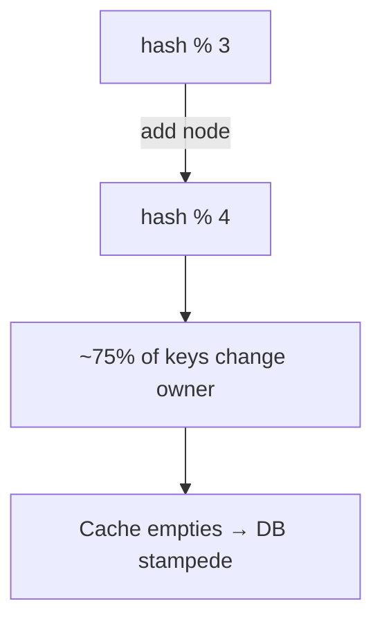
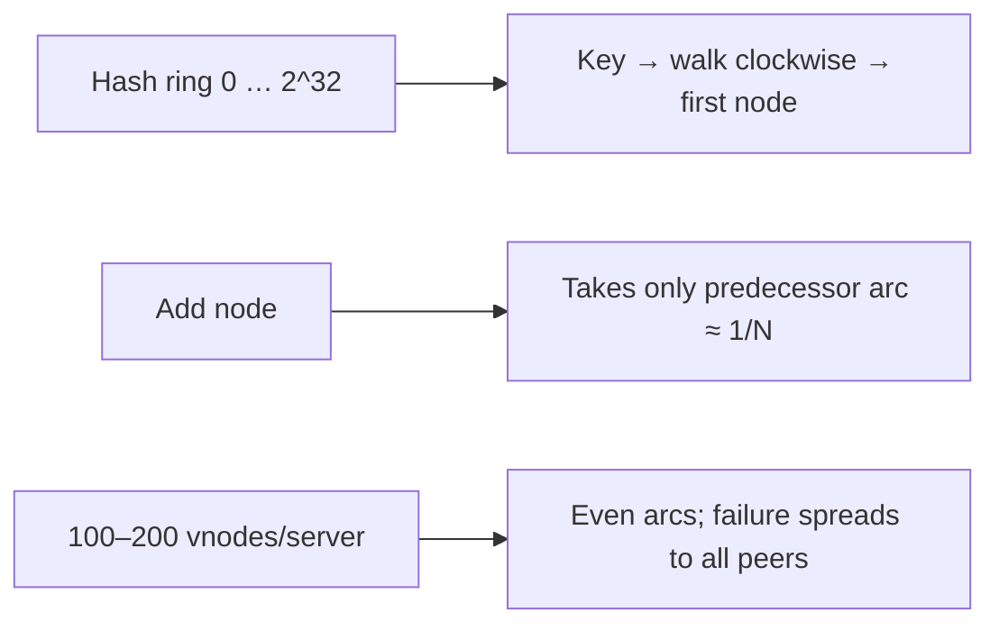
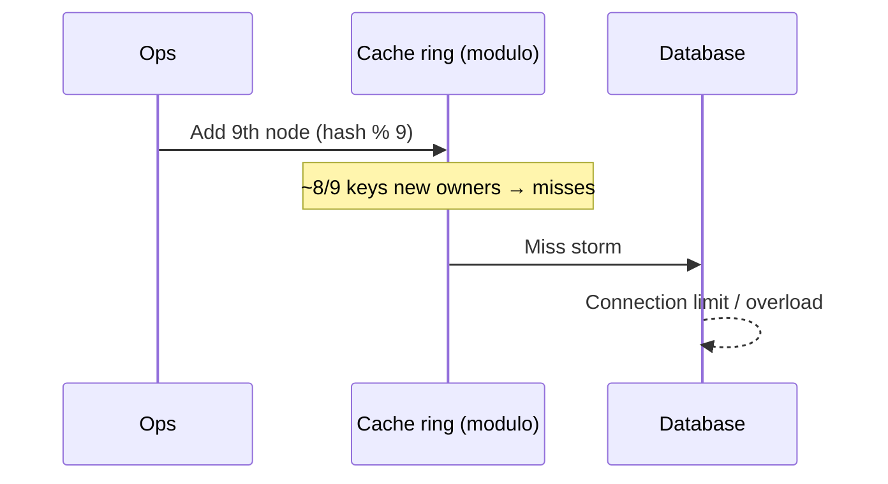

# Lesson 16: Distributed Caching — Sharding, Consistent Hashing & Scaling to 30 Nodes

> **Prerequisites:** [Lesson 15: Memcached vs Redis](../15-memcached-vs-redis/README.md) and [Track: Caching](../README.md) overview.  
> **Estimated Reading Time:** 30–35 minutes  
> **Target Audience:** Backend engineers sharding caches past one machine, implementing consistent hashing with virtual nodes, choosing client vs proxy vs Redis Cluster routing, and surviving node add/loss without emptying the cache.  
> **Free PDF Notes:** [Download SD-F-016.pdf](https://backendroadmap.com/notes/system-design/SD-F-016.pdf)

> [!NOTE]
> **In one line:** to spread a cache over many nodes, use consistent hashing with virtual nodes so adding or losing a node moves only about $1/N$ of the keys (plain `hash % N` moves almost all of them). Decide who routes (client, proxy, or Redis Cluster), expect a node failure to cost ~$1/N$ of hit ratio, and give the database headroom.

> [!TIP]
> **The Golden Rule of Distributed Caching:** Never use `hash % N` for a cache that will resize. Use a ring + many virtual nodes, add capacity gradually at quiet hours, pre-warm hot keys, and size the database for a node-failure miss storm—not just steady state.

---

## Words You'll Meet Today

| Word | In Plain Words | Role in a Live Backend System |
| :--- | :--- | :--- |
| **Sharding** | Splitting the key space over nodes | Capacity + throughput scale-out |
| **Modulo hashing** | `node = hash(key) % N` | Remaps ~most keys when N changes |
| **Consistent hashing** | Ring placement; next node clockwise | ~1/N keys move on membership change |
| **Virtual node** | Many ring points per physical server | Smooth load; spread failures |
| **Ketama** | Popular consistent-hash client scheme | Classic Memcached rings |
| **Hash slot** | Redis Cluster’s fixed 16,384 units | Explicit resharding; no ring |
| **Proxy** | Router between clients and nodes | Twemproxy, Envoy, mcrouter |
| **Gutter pool** | Spare nodes briefly covering failures | Facebook-style miss absorption |

---

## Visual Mental Models & Architecture

### Why One Node Is Not Enough


*Figure 1. Capacity and throughput both force distribution. Replication copies for safety; this lesson is about splitting.*

### Modulo Disaster: 3 → 4 Nodes



*Figure 2. Going 10 → 11 remaps ~91%. You add capacity and immediately hurt the database.*

### Consistent Hash Ring + Virtual Nodes



*Figure 3. Virtual nodes fix uneven arcs and weight bigger machines with more points.*

---

## Core Definition & Taxonomic Comparison

| Routing model | How | Pros | Cons |
| :--- | :--- | :--- | :--- |
| **Client-side** | Library holds ring; talks direct | Fewest hops | Every language needs a correct ring; lists must match |
| **Proxy** | Twemproxy / Envoy / mcrouter | Simple clients; central metrics/retries | Extra hop; proxy HA |
| **Server-side (Redis Cluster)** | 16384 slots; MOVED redirects | Built-in reshard + failover | Cluster clients; multi-key same slot |

**Note:** Redis Cluster is **not** a hash ring—it assigns fixed slots. Moving a slot moves a known key set deliberately.

---

## Component Anatomy & The Observability Gap

### Anatomy of a Lookup

```text
 key → hash → ring position → owner node → GET/SET
 membership change → only keys on affected arcs remapped → misses refill from DB
```

### Observability Gap

| Metric | Hides |
| :--- | :--- |
| Global hit ratio after scale-out | Modulo remap storm vs true capacity win |
| Average node load | Skew / hot keys on one node |
| “Node added successfully” | Miss surge until warm |

Monitor **per-node** hit ratio, memory, evictions, key counts; alert on topology-change miss spikes.

---

## Mathematical Model & Worked Scale

### Fraction Remapped Under Modulo

When $N \rightarrow N+1$, a key stays only if $\mathrm{hash}\bmod N = \mathrm{hash}\bmod(N+1)$, roughly:

$$\text{fraction moved} \approx 1 - \frac{1}{N+1}$$

| Change | Approx keys moved |
| :--- | :--- |
| 3 → 4 | ~75% |
| 10 → 11 | ~91% |
| 10 → 9 | ~90% |

### Consistent Hashing

$$\text{expected moved} \approx \frac{1}{N}$$

### Node Failure Impact

With $N$ nodes: ~$1/N$ of lookups miss. At $N=10$, ~10% miss storm onto the DB.

---

## Metrics, Percentiles & Numbers Engineers Must Know

| Number | Meaning |
| :--- | :--- |
| 100–200 vnodes/node | Typical virtual-node count |
| ~1/N move | Consistent-hash membership change |
| 16384 | Redis Cluster slots |
| Gutter pool | Short-TTL spare capacity for failed-node keys |

---

## Compounding Effects & System Scale

| Event | Compounding |
| :--- | :--- |
| Modulo + add node at peak | Remap + traffic = DB meltdown |
| Add 27 nodes at once | Even with CH, many arcs move together |
| No single-flight on remapped keys | Stampede refill |
| Mismatched client rings | Write to A, read from B → permanent miss |

---

## Hierarchical Budgets & Capacity Sizing

| Layer | Role |
| :--- | :--- |
| Topology | Consistent hash + vnodes (or Cluster slots) |
| Change management | Add few nodes at a time; quiet hours; pre-warm |
| DB headroom | Size for 1-node failure miss load |
| Softeners | Single-flight, TTL jitter, gutter pool |
| Isolation | Watch hot keys separately (Lesson 12) |

### Worked Path: 3 → 30 Nodes

1. Start with 3 nodes, 150 vnodes each.  
2. Add 2–3 at a time—not 27 at once.  
3. Pre-warm hottest keys on new nodes.  
4. Jitter TTLs so refills don’t expire together.  
5. Pool connections so $30 \times$ apps ≠ connection storm.  
6. Watch per-node metrics for skew/hot keys.

---

## Top Engineering Mitigation Techniques

1. Consistent hashing + virtual nodes (ketama).  
2. Gradual scale-out + pre-warm.  
3. Replicas (Redis) so keys aren’t lost on primary death.  
4. More, smaller nodes → smaller $1/N$ blast radius.  
5. Single-flight + jitter on refill.  
6. Gutter / spare pool for failed-node keys.  
7. Proxy or Cluster when polyglot clients can’t share one ring impl.

---

## Production War Story: Adding One Node Halved the Hit Ratio

**Severity & Impact:** 8 nodes with `hash % N`. Added a 9th in the afternoon → ~89% keys remapped; hit ratio 94% → 12%; DB reads ×14; connection limit hit; 25 minutes of crawl.



**Fix:** Switch to consistent hashing + vnodes; add nodes gradually off-peak with pre-warm; single-flight + jitter; load-test “node added” and “node lost” before production.

**Lesson:** Cost of a topology change = share of keys that move. Keep that share small—and rehearse it.

---

## Multi-Language Production Implementation

Minimal consistent-hash ring with virtual nodes:

````carousel
```go
package chash

import (
	"crypto/md5"
	"encoding/binary"
	"sort"
	"strconv"
)

type ring struct {
	points []vnode
}

type vnode struct {
	pos  uint32
	node string
}

func hash32(s string) uint32 {
	sum := md5.Sum([]byte(s))
	return binary.BigEndian.Uint32(sum[:4])
}

func NewRing(nodes []string, vnodes int) *ring {
	r := &ring{}
	for _, n := range nodes {
		r.Add(n, vnodes)
	}
	return r
}

func (r *ring) Add(node string, vnodes int) {
	for i := 0; i < vnodes; i++ {
		r.points = append(r.points, vnode{hash32(node + "#" + strconv.Itoa(i)), node})
	}
	sort.Slice(r.points, func(i, j int) bool { return r.points[i].pos < r.points[j].pos })
}

func (r *ring) Get(key string) string {
	if len(r.points) == 0 {
		return ""
	}
	h := hash32(key)
	i := sort.Search(len(r.points), func(i int) bool { return r.points[i].pos >= h })
	if i == len(r.points) {
		i = 0
	}
	return r.points[i].node
}
```
<!-- slide -->
```typescript
import crypto from "crypto";
import { SortedMap } from "collections-map"; // or maintain sorted array

function h(s: string): number {
  return parseInt(crypto.createHash("md5").update(s).digest("hex").slice(0, 8), 16);
}

export class Ring {
  private points: { pos: number; node: string }[] = [];
  constructor(nodes: string[], private vnodes = 150) {
    for (const n of nodes) this.add(n);
  }
  add(node: string) {
    for (let i = 0; i < this.vnodes; i++) {
      this.points.push({ pos: h(`${node}#${i}`), node });
    }
    this.points.sort((a, b) => a.pos - b.pos);
  }
  get(key: string): string {
    const pos = h(key);
    const i = this.points.findIndex((p) => p.pos >= pos);
    return this.points[i === -1 ? 0 : i].node;
  }
}
```
<!-- slide -->
```python
import bisect, hashlib

def h(s: str) -> int:
    return int(hashlib.md5(s.encode()).hexdigest()[:8], 16)

class Ring:
    def __init__(self, nodes, vnodes=150):
        self.vnodes = vnodes
        self.points = []  # sorted [(pos, node)]
        for n in nodes:
            self.add(n)

    def add(self, node):
        for i in range(self.vnodes):
            bisect.insort(self.points, (h(f"{node}#{i}"), node))

    def remove(self, node):
        self.points = [p for p in self.points if p[1] != node]

    def get(self, key):
        i = bisect.bisect(self.points, (h(key), ""))
        return self.points[i % len(self.points)][1]

# Prove modulo vs consistent hashing move rates
import hashlib as hl
def node_mod(key, n):
    return int(hl.md5(key.encode()).hexdigest(), 16) % n
keys = [f"user:{i}" for i in range(100_000)]
for a, b in ((3, 4), (10, 11), (10, 9)):
    moved = sum(node_mod(k, a) != node_mod(k, b) for k in keys)
    print(f"{a}->{b}: {moved/len(keys):.0%} move under modulo")
```
<!-- slide -->
```csharp
using System.Security.Cryptography;
using System.Text;

public sealed class HashRing
{
    private readonly SortedList<uint, string> _points = new();
    private readonly int _vnodes;

    public HashRing(IEnumerable<string> nodes, int vnodes = 150)
    {
        _vnodes = vnodes;
        foreach (var n in nodes) Add(n);
    }

    static uint Hash(string s)
    {
        var bytes = MD5.HashData(Encoding.UTF8.GetBytes(s));
        return (uint)((bytes[0] << 24) | (bytes[1] << 16) | (bytes[2] << 8) | bytes[3]);
    }

    public void Add(string node)
    {
        for (var i = 0; i < _vnodes; i++)
            _points[Hash($"{node}#{i}")] = node;
    }

    public string Get(string key)
    {
        var h = Hash(key);
        foreach (var kv in _points)
            if (kv.Key >= h) return kv.Value;
        return _points.Values[0];
    }
}
```
````

---

## Practical Hands-On CLI Verification

```bash
python -c "
import hashlib
def node(key,n): return int(hashlib.md5(key.encode()).hexdigest(),16)%n
keys=[f'user:{i}' for i in range(100000)]
for a,b in ((3,4),(10,11)):
 m=sum(node(k,a)!=node(k,b) for k in keys); print(f'{a}->{b}: {m/len(keys):.0%}')
"
```

---

## Common Mistakes to Avoid

- `hash % N` on a cache that will ever change size.
- One point per node on the ring (uneven load).
- Clients with different node lists or hash functions.
- Adding many nodes at once.
- Sizing DB for steady state only.
- Multi-key Redis Cluster ops without hash tags.
- Ignoring per-node load (hot key saturation).

---

## Key Terms Glossary

| Term | Interview-ready definition |
| :--- | :--- |
| **Consistent hashing** | Ring placement so membership changes move ~1/N keys |
| **Virtual node** | One of many ring points per physical server |
| **Ketama** | Popular consistent-hash client algorithm |
| **Rebalancing** | Moving keys/slots between nodes |
| **Skew** | Uneven load between nodes |
| **Gutter pool** | Spare nodes briefly covering a failed node’s keys |

---

## Interview Practice Questions

<details>
<summary><strong>1. Why shard a cache across nodes? [BASIC]</strong></summary>

Capacity (hot data must fit in RAM) and throughput (one node serves limited requests). Every client must agree which node owns which key.

</details>

<details>
<summary><strong>2. What is wrong with hash(key) % N? [BASIC]</strong></summary>

When N changes, most keys remap (~75% for 3→4, ~91% for 10→11), emptying the cache and flooding the DB.

</details>

<details>
<summary><strong>3. What is consistent hashing? [BASIC]</strong></summary>

Nodes and keys on a ring; key belongs to the next node clockwise. Add/remove moves only ~1/N of keys.

</details>

<details>
<summary><strong>4. Why virtual nodes? [BASIC]</strong></summary>

One point per node yields uneven arcs. Many points smooth load, spread a failed node’s keys across all others, and allow weighting.

</details>

<details>
<summary><strong>5. Grow a cache from 3 to 30 nodes. How? [SCENARIO]</strong></summary>

CH + vnodes; add few at a time off-peak; pre-warm; jitter TTLs; pool connections; watch hit ratio and DB load.

</details>

<details>
<summary><strong>6. A cache node dies in a 10-node cluster. What happens? [SCENARIO]</strong></summary>

~10% keys miss onto the DB; others unaffected. Replicas, smaller nodes, single-flight, and DB headroom limit damage.

</details>

<details>
<summary><strong>7. Hit ratio collapses right after adding a node. Likely cause? [SCENARIO]</strong></summary>

Modulo hashing remapped nearly all keys. Move to consistent hashing; add gradually.

</details>

<details>
<summary><strong>8. Which routing model for a polyglot company? [SCENARIO]</strong></summary>

A proxy or Redis Cluster so every language needn’t implement the ring correctly—at the cost of a hop or cluster-aware clients.

</details>

<details>
<summary><strong>9. Does consistent hashing balance load perfectly? [TRICKY]</strong></summary>

No—it balances keys on average, not traffic. A hot key still loads one node; use hot-key techniques too.

</details>

<details>
<summary><strong>10. How does Redis Cluster differ from a hash ring? [TRICKY]</strong></summary>

16384 fixed slots assigned to nodes; moving slots is explicit; nodes reply MOVED. No ring; multi-key needs same slot.

</details>

<details>
<summary><strong>11. Do replicas help scaling reads or availability? [TRICKY]</strong></summary>

Both can benefit, but replicas primarily give availability. Reading replicas adds staleness—use where lag is OK.

</details>

<details>
<summary><strong>12. Why not flush and rebuild on a topology change? [TRICKY]</strong></summary>

A mass miss storm hits the DB at the worst time. Moving only ~1/N keys keeps most of the cache warm.

</details>

---

## One-Page Master Cheat Sheet

```text
====================================================================================================
                     DISTRIBUTED CACHING  —  CHEAT SHEET
====================================================================================================
IN ONE LINE   Shard with consistent hashing + vnodes; ~1/N moves; size DB for node failure.

MODULO        hash % N — simple, remaps ~1-1/(N+1) on change. Avoid for resizing caches.
CONSISTENT    Ring + clockwise owner; add/remove ≈ 1/N keys; 100–200 vnodes/node
ROUTING       Client ketama | Proxy (Envoy/twemproxy) | Redis Cluster slots + MOVED
FAILURE       ≈ 1/N misses → replicas, smaller N blast radius, single-flight, gutter, DB headroom
SCALE 3→30    Add few at a time, pre-warm, jitter, pool conns, per-node metrics
ANTI-PATTERNS X modulo in prod   X 1 vnode/node   X mismatched client rings
              X add 27 nodes at once   X DB sized for steady state only
====================================================================================================
```

---

## Free PDF notes

[SD-F-016.pdf](https://backendroadmap.com/notes/system-design/SD-F-016.pdf)

---

## Sources

- [Karger et al., Consistent Hashing and Random Trees](https://www.akamai.com/site/en/documents/research-paper/consistent-hashing-and-random-trees-distributed-caching-protocols-for-relieving-hot-spots-on-the-world-wide-web-technical-publication.pdf)
- [Nishtala et al., Scaling Memcache at Facebook](https://www.usenix.org/conference/nsdi13/technical-sessions/presentation/nishtala)
- [Redis Cluster specification](https://redis.io/docs/latest/operate/oss_and_stack/reference/cluster-spec/)

---

## Next

Next lesson: [HTTP Caching & CDNs: Cache-Control, private vs public, ETags, 304](../17-http-caching-cdns/README.md)

Track overview: [Track: Caching](../README.md)
