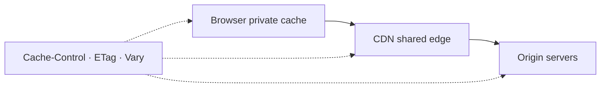
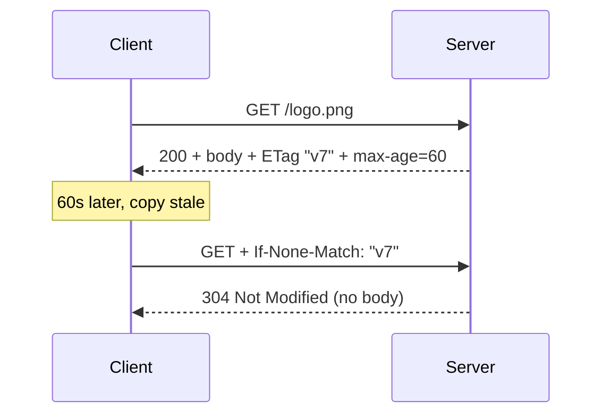
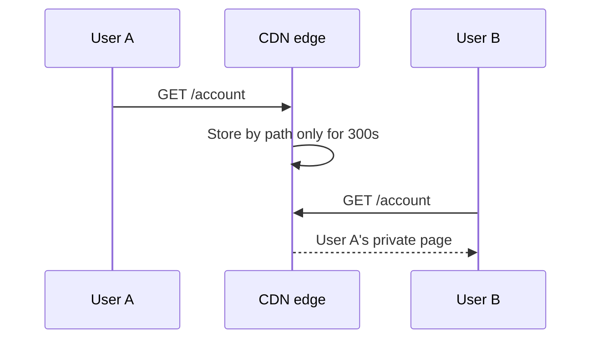

# Lesson 17: HTTP Caching & CDNs — Cache-Control, private vs public, ETags, 304

> **Prerequisites:** [Lesson 16: Distributed Caching](../16-distributed-caching/README.md) and [Track: Caching](../README.md) overview.  
> **Estimated Reading Time:** 28–35 minutes  
> **Target Audience:** Backend and platform engineers configuring CDN/browser caches, preventing private-data leaks at the edge, designing ETag revalidation, and cleaning CDN cache keys.  
> **Free PDF Notes:** [Download SD-F-017.pdf](https://backendroadmap.com/notes/system-design/SD-F-017.pdf)

> [!NOTE]
> **In one line:** HTTP caching is controlled by response headers—`Cache-Control` says who may reuse a response and for how long (`max-age`, `s-maxage`, `public`, `private`, `no-store`), `ETag` lets stale copies revalidate with a cheap `304`, and `Vary` plus a clean CDN cache key decide how many variants you store.

> [!TIP]
> **The Golden Rule of HTTP Caching:** Fingerprinted static assets get `public, max-age=31536000, immutable`. User-specific responses get `private` (or `no-store` for secrets). Never confuse `no-cache` (revalidate) with `no-store` (never store)—and strip tracking params from the CDN cache key.

---

## Words You'll Meet Today

| Word | In Plain Words | Role in a Live Backend System |
| :--- | :--- | :--- |
| **Cache-Control** | Response header with caching rules | One language for browser, CDN, proxy |
| **max-age / s-maxage** | Freshness for all / shared caches | CDN can outlive browser TTL |
| **public / private** | Shared OK / browser-only | Prevents account pages at the edge |
| **no-store / no-cache** | Never store / store but revalidate | Secrets vs revalidate-every-time |
| **ETag** | Content fingerprint | Enables `304 Not Modified` |
| **Vary** | Request headers that change the response | `Accept-Encoding` OK; `Cookie` explodes variants |
| **Cache key** | What counts as “the same” response | Host+path+query (minus junk params) |
| **Surrogate key** | Tag for group purge | Purge all pages containing product-41 |

---

## Visual Mental Models & Architecture

### Two Problems, One Header Set



*Figure 1. Each layer can answer and stop the request. Get headers wrong → private data leaks or stale pages stick forever.*

### ETag Revalidation



*Figure 2. A few hundred bytes instead of re-downloading the whole body.*

---

## Core Definition & Taxonomic Comparison

| Directive | Meaning |
| :--- | :--- |
| `max-age=N` | Any cache may reuse for N seconds |
| `s-maxage=N` | Overrides max-age for shared caches (CDN) |
| `public` | Shared caches may store (even if auth was used) |
| `private` | Only the user’s browser may store |
| `no-cache` | May store, but must revalidate before every reuse |
| `no-store` | Do not store anywhere |
| `immutable` | Will never change—don’t revalidate (fingerprinted assets) |

| Content | Recommended headers |
| :--- | :--- |
| Fingerprinted JS/CSS (`app.3f9a.js`) | `public, max-age=31536000, immutable` |
| Occasionally changing HTML | `public, max-age=60, s-maxage=300, stale-while-revalidate=600` |
| Public API list | `public, max-age=10, s-maxage=30` + ETag |
| Logged-in page / cart | `private, max-age=0` or `no-cache` |
| Banking / tokens / PII | `no-store` |

**Careful:** `no-cache` does **not** mean “don’t cache.” `no-store` does.

---

## Component Anatomy & The Observability Gap

### CDN Cache Key Anatomy

```text
default key = host + path + query
/products?id=7                         → one entry
/products?id=7&utm_source=mail         → DIFFERENT entry → extra origin hit
/products?id=7&utm_source=ad&fbclid=x  → yet another entry
fix: drop tracking params; keep only id, page, sort, lang…
```

### Observability Gap

| Signal | Hides |
| :--- | :--- |
| Low CDN hit ratio | Tracking params / `Vary: Cookie` / private on public content |
| “Cache everything” savings | Account pages served across users |
| Heuristic caching | Unpredictable freshness when headers missing |

---

## Mathematical Model & Worked Scale

### Origin Load With Shared TTL

With $E$ edge locations and shared freshness $T$ seconds for a global public resource:

$$\lambda_{\text{origin}} \approx \frac{E}{T} \quad\text{(order of magnitude, plus revalidations)}$$

Instead of thousands of end-user RPS.

### Staleness Budget

$$\text{worst-case staleness} \lesssim s\text{-maxage}_{\text{CDN}} + \text{max-age}_{\text{browser}}$$

Example: `s-maxage=30`, `max-age=10` → write down “~40 s” as the product contract.

### Variant Explosion

If `|User-Agent| ≈ thousands`, `Vary: User-Agent` → thousands of near-identical entries → hit ratio collapses.

---

## Metrics, Percentiles & Numbers Engineers Must Know

| Number | Meaning |
| :--- | :--- |
| 31536000 | One year—fingerprinted assets |
| 304 size | Hundreds of bytes vs full body |
| `stale-while-revalidate` | Serve stale while refreshing |
| `stale-if-error` | Serve stale when origin fails |

---

## Compounding Effects & System Scale

| Mistake | Compounding |
| :--- | :--- |
| Missing `private` on `/account` | One user’s PII cached at edge for everyone nearby |
| utm_* in cache key | Hit ratio death by a thousand keys |
| Weak per-server ETags | Load-balanced fleet never agrees → no 304s |
| Long max-age without fingerprint or purge | Wrong content stuck worldwide |

---

## Hierarchical Budgets & Capacity Sizing

| Layer | Budget |
| :--- | :--- |
| Fingerprinted static | Year + immutable |
| Public HTML/API | Seconds–minutes + ETag + SWR |
| Authenticated | Bypass CDN or `private`/`no-store` |
| Purge | Surrogate keys on write path |

Separate hostnames/path rules: static hard-cached; user-specific never.

---

## Top Engineering Mitigation Techniques

1. Explicit `Cache-Control` on every response—no heuristics.  
2. Fingerprint filenames for static assets.  
3. ETag from content hash (same on every server).  
4. Clean CDN cache keys; careful `Vary`.  
5. Surrogate-key purge on entity updates.  
6. `stale-while-revalidate` / `stale-if-error` for resilience.  
7. Automated test: anonymous fetch of `/account` asserts `private`/`no-store`.

---

## Production War Story: The Account Page That Went Public

**Severity & Impact:** CDN “cache everything” enabled. `/account` shipped with `Cache-Control: max-age=300` and no `private`. Customer A’s name/address/orders served to neighbors for 5 minutes. Support flood; purge + remove account from CDN.



**Fix:** Authenticated responses `private`/`no-store`; bypass when session/`Authorization` present; separate cache rules for static vs user; regression test for headers.

---

## Multi-Language Production Implementation

ETag + Cache-Control responses:

````carousel
```go
package httpcache

import (
	"crypto/sha256"
	"encoding/hex"
	"encoding/json"
	"net/http"
)

func ProductsHandler(load func() (any, error)) http.HandlerFunc {
	return func(w http.ResponseWriter, r *http.Request) {
		data, err := load()
		if err != nil {
			http.Error(w, "error", 500)
			return
		}
		body, _ := json.Marshal(data)
		sum := sha256.Sum256(body)
		etag := `"` + hex.EncodeToString(sum[:8]) + `"`
		if r.Header.Get("If-None-Match") == etag {
			w.Header().Set("ETag", etag)
			w.WriteHeader(http.StatusNotModified)
			return
		}
		w.Header().Set("ETag", etag)
		w.Header().Set("Cache-Control", "public, max-age=10, s-maxage=30")
		w.Header().Set("Content-Type", "application/json")
		w.Write(body)
	}
}

func AccountHandler(w http.ResponseWriter, r *http.Request) {
	w.Header().Set("Cache-Control", "private, no-store")
	// ... render account ...
}
```
<!-- slide -->
```typescript
import { createHash } from "crypto";
import type { Request, Response } from "express";

export async function products(req: Request, res: Response, load: () => Promise<unknown>) {
  const data = await load();
  const body = JSON.stringify(data);
  const etag = `"${createHash("sha256").update(body).digest("hex").slice(0, 16)}"`;
  if (req.headers["if-none-match"] === etag) {
    res.status(304).setHeader("ETag", etag).end();
    return;
  }
  res
    .setHeader("ETag", etag)
    .setHeader("Cache-Control", "public, max-age=10, s-maxage=30")
    .type("json")
    .send(body);
}

export function accountHeaders(res: Response) {
  res.setHeader("Cache-Control", "private, no-store");
}
```
<!-- slide -->
```python
import hashlib, json
from fastapi import FastAPI, Request, Response

app = FastAPI()

@app.get("/products")
async def products(request: Request, response: Response):
    data = await load_products()
    body = json.dumps(data, separators=(",", ":"), sort_keys=True)
    etag = '"' + hashlib.sha256(body.encode()).hexdigest()[:16] + '"'
    if request.headers.get("if-none-match") == etag:
        return Response(status_code=304, headers={"ETag": etag})
    headers = {"ETag": etag, "Cache-Control": "public, max-age=10, s-maxage=30"}
    return Response(content=body, media_type="application/json", headers=headers)

@app.get("/account")
async def account():
    return Response(
        content="...",
        headers={"Cache-Control": "private, no-store"},
    )
```
<!-- slide -->
```csharp
using System.Security.Cryptography;
using System.Text;
using System.Text.Json;
using Microsoft.AspNetCore.Mvc;

[ApiController]
public class ProductsController : ControllerBase
{
    [HttpGet("/products")]
    public async Task<IActionResult> Products()
    {
        var data = await LoadProductsAsync();
        var body = JsonSerializer.Serialize(data);
        var hash = Convert.ToHexString(SHA256.HashData(Encoding.UTF8.GetBytes(body)))[..16];
        var etag = $"\"{hash}\"";
        if (Request.Headers.IfNoneMatch == etag)
            return StatusCode(304, null!); // set ETag header in filter/middleware
        Response.Headers.ETag = etag;
        Response.Headers.CacheControl = "public, max-age=10, s-maxage=30";
        return Content(body, "application/json");
    }

    [HttpGet("/account")]
    public IActionResult Account()
    {
        Response.Headers.CacheControl = "private, no-store";
        return Ok(/* ... */);
    }
}
```
````

---

## Practical Hands-On CLI Verification

```bash
curl -sI https://example.com/ | grep -iE 'cache-control|etag|vary|age'
curl -sI -H 'If-None-Match: "v7"' https://example.com/logo.png | head
# Expect 304 when ETag matches
```

---

## Common Mistakes to Avoid

- Assuming `no-cache` means “don’t cache.”
- No explicit headers → heuristic caching.
- Missing `private` on user-specific responses.
- Tracking params left in the CDN cache key.
- `Vary: Cookie` or `Vary: User-Agent` on public content.
- Long `max-age` on non-fingerprinted URLs without purge.
- Weak ETags that differ per server in a fleet.

---

## Key Terms Glossary

| Term | Interview-ready definition |
| :--- | :--- |
| **304 Not Modified** | Revalidation success; reuse stored body |
| **Surrogate key** | Tag used to purge groups of responses |
| **stale-while-revalidate** | Serve stale while refreshing in background |
| **stale-if-error** | Serve stale when origin is failing |
| **Heuristic caching** | Guessed freshness when headers absent—avoid |

---

## Interview Practice Questions

<details>
<summary><strong>1. What does Cache-Control: private mean? [BASIC]</strong></summary>

Only the end user’s browser may cache it; shared caches (CDNs, proxies) must not. For sensitive data use `no-store`.

</details>

<details>
<summary><strong>2. How do ETags work? [BASIC]</strong></summary>

Server sends a content fingerprint; client later sends `If-None-Match`; if unchanged → `304` with no body.

</details>

<details>
<summary><strong>3. Difference between max-age and s-maxage? [BASIC]</strong></summary>

`max-age` applies to all caches; `s-maxage` overrides it for shared caches only so a CDN can keep content longer than browsers.

</details>

<details>
<summary><strong>4. no-cache vs no-store? [BASIC]</strong></summary>

`no-cache`: may store but must revalidate before reuse. `no-store`: forbid storing at all.

</details>

<details>
<summary><strong>5. How do you cache hashed static assets? [SCENARIO]</strong></summary>

Fingerprint the filename and send `public, max-age=31536000, immutable`; new build ⇒ new URL.

</details>

<details>
<summary><strong>6. CDN hit ratio is 30%. Where do you look? [SCENARIO]</strong></summary>

Cache key (tracking params, cookies), `Vary`, short TTLs, and responses marked private/no-cache that could be public.

</details>

<details>
<summary><strong>7. Product changes; CDN shows old price. What do you do? [SCENARIO]</strong></summary>

Purge by surrogate key/URL; design short `s-maxage` + SWR or event-driven purges from the write path.

</details>

<details>
<summary><strong>8. Cheap for logged-out users, personalised for logged-in? [SCENARIO]</strong></summary>

Anonymous version with `public` headers; with session cookie bypass CDN or use `private`. Never mix under one cache key.

</details>

<details>
<summary><strong>9. Why can Vary: User-Agent hurt? [TRICKY]</strong></summary>

Thousands of UA strings ⇒ a copy per string ⇒ almost nothing reused.

</details>

<details>
<summary><strong>10. Can the CDN serve stale on purpose? [TRICKY]</strong></summary>

Yes—`stale-while-revalidate` and `stale-if-error`.

</details>

<details>
<summary><strong>11. Are ETags always safe on a server fleet? [TRICKY]</strong></summary>

Only if every server generates the same ETag for the same content. Body hashes are safe; inode/timestamp tags may differ per host.

</details>

<details>
<summary><strong>12. Does HTTPS stop a CDN from caching? [TRICKY]</strong></summary>

No. The CDN terminates TLS and caches as usual; headers matter, not the protocol.

</details>

---

## One-Page Master Cheat Sheet

```text
====================================================================================================
                    HTTP CACHING & CDNs  —  CHEAT SHEET
====================================================================================================
IN ONE LINE   Headers decide who stores what and how long; clean keys; ETag → cheap 304.

HEADERS       public+s-maxage shared · private per-user · no-store secrets
              no-cache = revalidate (NOT "don't cache")
STATIC        fingerprint URL + max-age=31536000, immutable
API/HTML      short TTL + ETag + stale-while-revalidate; write the staleness budget down
ETAG          If-None-Match → 304; hash body so all servers agree
CDN KEY       drop utm_*/fbclid; avoid Vary Cookie/UA on public content
PURGE         Surrogate-Key / cache tags on write path
ANTI-PATTERNS X cache everything   X missing private on /account   X heuristic caching
              X weak per-server ETags   X tracking params in key
====================================================================================================
```

---

## Free PDF notes

[SD-F-017.pdf](https://backendroadmap.com/notes/system-design/SD-F-017.pdf)

---

## Sources

- [RFC 9111: HTTP Caching](https://www.rfc-editor.org/rfc/rfc9111)
- [MDN: HTTP caching](https://developer.mozilla.org/en-US/docs/Web/HTTP/Caching)
- [web.dev: Love your cache](https://web.dev/articles/love-your-cache)

---

## Next

Next lesson: [Multi-Level Caching: In-Process L1 + Redis L2 (and Its Risks)](../18-multi-level-caching/README.md)

Track overview: [Track: Caching](../README.md)
