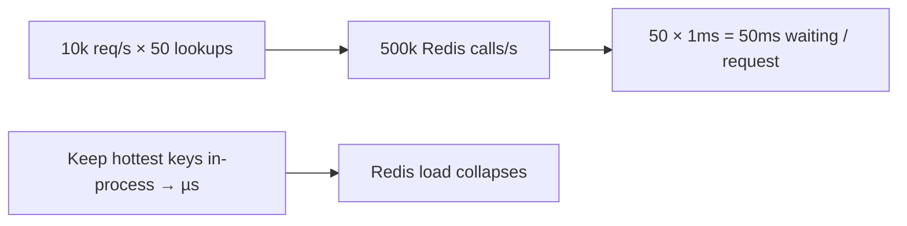
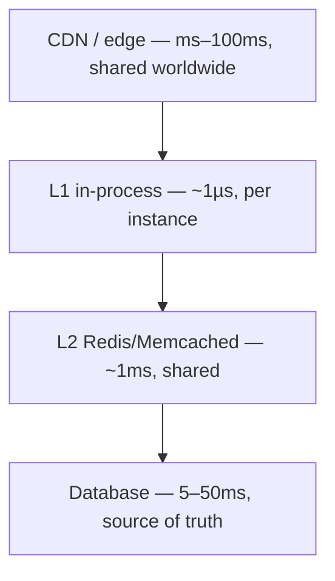
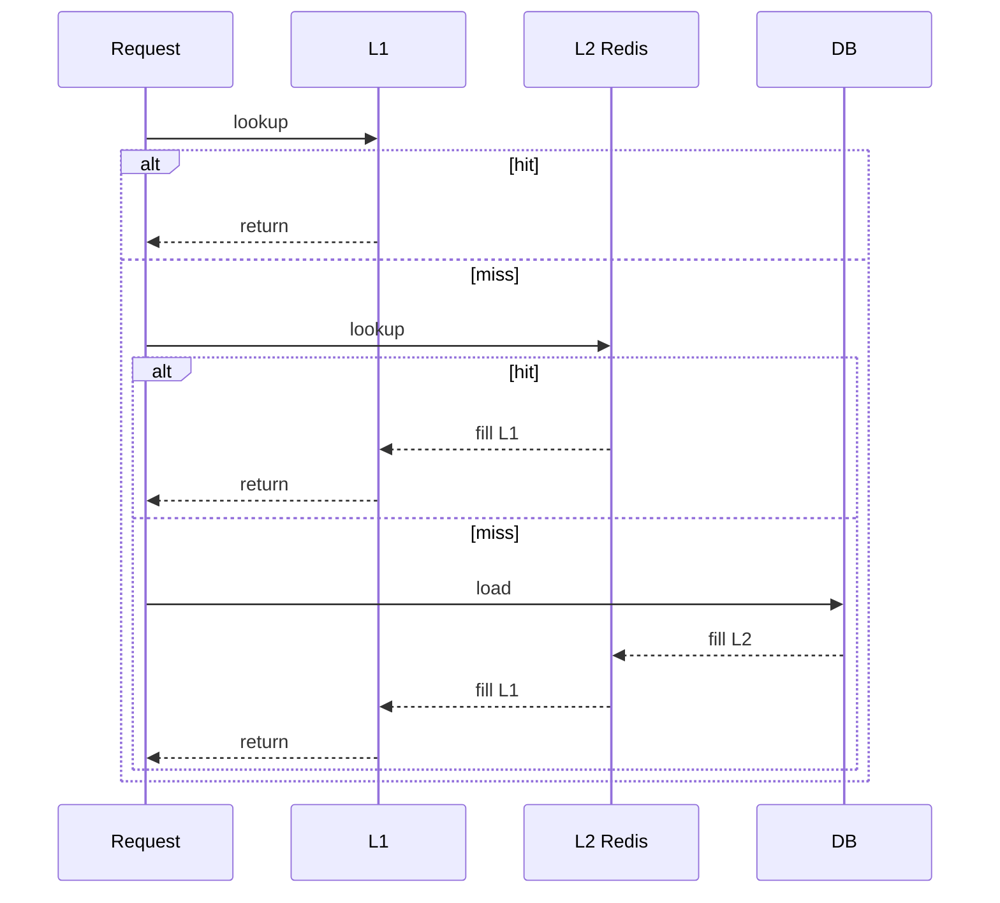
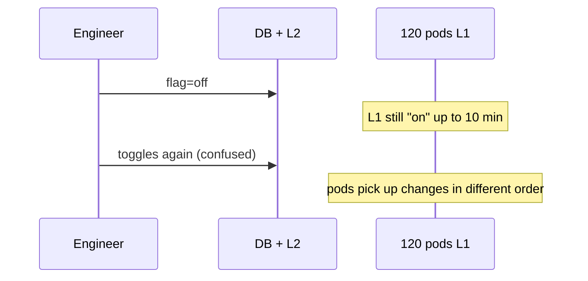

# Lesson 18: Multi-Level Caching — In-Process L1 + Redis L2 (and Its Risks)

> **Prerequisites:** [Lesson 17: HTTP Caching & CDNs](../17-http-caching-cdns/README.md), [Lesson 12: Hot Keys](../12-hot-keys-in-redis/README.md), and [Track: Caching](../README.md) overview.  
> **Estimated Reading Time:** 28–35 minutes  
> **Target Audience:** Backend engineers stacking in-process caches in front of Redis, bounding staleness across pods, and invalidating L1 without lying to users.  
> **Free PDF Notes:** [Download SD-F-018.pdf](https://backendroadmap.com/notes/system-design/SD-F-018.pdf)

> [!NOTE]
> **In one line:** stack caches from fast and small to slow and large—L1 in-process (µs, per instance), L2 Redis (ms, shared), then the database. L1 removes most network calls for hot data, but you pay with cross-pod inconsistency, duplicated memory, and harder invalidation—so bound staleness with a short TTL and broadcasts.

> [!TIP]
> **The Golden Rule of Multi-Level Caching:** L1 only for **small, hot, read-mostly** data that tolerates seconds of staleness. Always set `maxsize` + short TTL; on write **delete L2 and notify L1** (pub/sub or CLIENT TRACKING); treat TTL as the safety net because pub/sub is fire-and-forget. Write the staleness bound down—it is the real contract.

---

## Words You'll Meet Today

| Word | In Plain Words | Role in a Live Backend System |
| :--- | :--- | :--- |
| **L1 / near cache** | In-process cache next to the code | µs lookups; no network |
| **L2** | Shared distributed cache (Redis) | Shared across instances |
| **Staleness bound** | Longest a stale value may be served | Product/ops contract |
| **Pub/sub invalidation** | Broadcast “key changed” | Drop local L1 copies |
| **CLIENT TRACKING** | Redis pushes invalidations to clients | Near-zero staleness L1 |
| **Cold start** | New pod with empty L1 | Temporary L2 pressure |
| **Fan-out** | One change reaching many pods | Invalidation bursts |
| **Read-mostly** | Reads ≫ writes | Good L1 candidate |

---

## Visual Mental Models & Architecture

### Why L1 Exists



*Figure 1. Cost is the number of lookups, not only the speed of one.*

### The Levels



*Figure 2. Narrower and faster at the top; wider, slower, more complete at the bottom.*

### Read Path



*Figure 3. Fill on the way back.*

---

## Core Definition & Taxonomic Comparison

| Level | Latency | Scope | Typical tool |
| :--- | :--- | :--- | :--- |
| CDN | ms–100 ms | Shared per region | CloudFront, Cloudflare, Fastly |
| L1 | ~1 µs | One process | Caffeine, cachetools, Ristretto, Guava |
| L2 | ~1 ms | All instances | Redis, Memcached |
| DB | 5–50 ms | Source of truth | Postgres, MySQL, DynamoDB |

| Good in L1 | Bad in L1 |
| :--- | :--- |
| Config, feature flags, reference data, hot keys | Balances, stock counts, sessions, fast-changing user data |

---

## Component Anatomy & The Observability Gap

### Invalidation Across Levels

```text
Writer updates DB → DELETE L2 key → PUBLISH invalidate
Each pod's listener: L1.pop(key)
Safety net: L1 TTL 1–10s if a message was missed
Never rely on pub/sub alone (fire-and-forget)
```

### Observability Gap

| Metric | Hides |
| :--- | :--- |
| L2 hit ratio only | L1 serving different versions per pod |
| “Flag off” in admin UI | 120 pods still on old L1 for minutes |
| Redis CPU drop after L1 | Memory × pods and cold-start storms on deploy |

Expose flag/config **version** on a health endpoint per pod.

---

## Mathematical Model & Worked Scale

### Redis Call Reduction

If fraction $f$ of lookups are L1 hits:

$$\lambda_{L2} \approx \lambda_{\text{lookups}} \times (1-f)$$

### Memory Multiplication

$$\text{fleet L1 RAM} \approx \text{per-pod size} \times \text{pods}$$

200 pods × 200 MB = 40 GB duplicated.

### Staleness Without L2 Delete

If write does **not** delete L2:

$$\text{staleness} \leq TTL_{L1} + TTL_{L2}$$

Because L1 can refill from a still-stale L2. Always delete L2 on write.

---

## Metrics, Percentiles & Numbers Engineers Must Know

| Number | Meaning |
| :--- | :--- |
| L1 TTL 1–10 s | Typical bound for flags/config |
| L2 TTL minutes | Shared layer |
| ~1 µs vs ~1 ms | L1 vs L2 order of magnitude |
| Pub/Sub | Not durable—TTL required |

---

## Compounding Effects & System Scale

| Risk | Compounding |
| :--- | :--- |
| Long L1 TTL, no broadcast | Incidents “won’t turn off” for minutes |
| Deploy restart all pods | Cold L1 → L2 latency spike |
| Huge unbounded L1 | GC pauses + memory leaks |
| Same TTL on L1 and L2 without L2 delete | Staleness adds |

---

## Hierarchical Budgets & Capacity Sizing

| Concern | Budget |
| :--- | :--- |
| What enters L1 | Hot set only; `maxsize` hard cap |
| Staleness | Explicit seconds, agreed with product |
| Invalidation | Broadcast + TTL safety net |
| Deploys | Stagger rollout; warm hot keys at startup |
| Single-flight | Collapse simultaneous L2/DB fills |

---

## Top Engineering Mitigation Techniques

1. Short L1 TTL (self-heal).  
2. Pub/sub (or Redis CLIENT TRACKING) for fast drop.  
3. Delete L2 on write before/with notify.  
4. Sticky routing only if you need tighter read-your-writes.  
5. Skip L1 for balances/inventory.  
6. Document the staleness bound in runbooks.

---

## Production War Story: The Flag That Flipped Back

**Severity & Impact:** Feature flags in L1 with 10-minute TTL, no broadcast. Engineer disabled a bad feature in DB+Redis; dashboards showed off; 120 pods served old “on” up to 10 minutes. Engineer flipped again; TTLs expired in different orders → mixed on/off for minutes.



**Fix:** L1 TTL 5 s + pub/sub invalidation; expose flag version on health; document “changes within 5 seconds.”

**Lesson:** Every cache level needs an explicit, short, written staleness bound. The slowest level to expire decides what users see.

---

## Multi-Language Production Implementation

Two-level read + pub/sub invalidation:

````carousel
```go
package multilevel

import (
	"context"
	"encoding/json"
	"sync"
	"time"

	"github.com/redis/go-redis/v9"
)

type entry struct {
	v   any
	exp time.Time
}

type L1 struct {
	mu   sync.Mutex
	data map[string]entry
	ttl  time.Duration
}

func (l *L1) Get(k string) (any, bool) {
	l.mu.Lock()
	defer l.mu.Unlock()
	e, ok := l.data[k]
	if !ok || time.Now().After(e.exp) {
		return nil, false
	}
	return e.v, true
}

func (l *L1) Set(k string, v any) {
	l.mu.Lock()
	defer l.mu.Unlock()
	if l.data == nil {
		l.data = map[string]entry{}
	}
	l.data[k] = entry{v, time.Now().Add(l.ttl)}
}

func (l *L1) Del(k string) {
	l.mu.Lock()
	defer l.mu.Unlock()
	delete(l.data, k)
}

func GetFlag(ctx context.Context, l1 *L1, rdb *redis.Client, name string, load func(context.Context, string) (any, error)) (any, error) {
	if v, ok := l1.Get(name); ok {
		return v, nil
	}
	raw, err := rdb.Get(ctx, "flag:"+name).Bytes()
	if err == nil {
		var v any
		_ = json.Unmarshal(raw, &v)
		l1.Set(name, v)
		return v, nil
	}
	v, err := load(ctx, name)
	if err != nil {
		return nil, err
	}
	b, _ := json.Marshal(v)
	_ = rdb.Set(ctx, "flag:"+name, b, 5*time.Minute).Err()
	l1.Set(name, v)
	return v, nil
}

func UpdateFlag(ctx context.Context, l1 *L1, rdb *redis.Client, name string, value any, save func(context.Context, string, any) error) error {
	if err := save(ctx, name, value); err != nil {
		return err
	}
	_ = rdb.Del(ctx, "flag:"+name).Err()
	_ = rdb.Publish(ctx, "cache-invalidate", name).Err()
	l1.Del(name)
	return nil
}
```
<!-- slide -->
```typescript
import Redis from "ioredis";

const l1 = new Map<string, { v: unknown; exp: number }>();
const L1_TTL = 5_000;

export async function getFlag(r: Redis, name: string, load: () => Promise<unknown>) {
  const hit = l1.get(name);
  if (hit && hit.exp > Date.now()) return hit.v;
  const raw = await r.get(`flag:${name}`);
  let val: unknown;
  if (raw !== null) val = JSON.parse(raw);
  else {
    val = await load();
    await r.set(`flag:${name}`, JSON.stringify(val), "EX", 300);
  }
  l1.set(name, { v: val, exp: Date.now() + L1_TTL });
  return val;
}

export async function updateFlag(r: Redis, name: string, value: unknown, save: () => Promise<void>) {
  await save();
  await r.del(`flag:${name}`);
  await r.publish("cache-invalidate", name);
  l1.delete(name);
}

// startup: subscribe once
export function listenInvalidations(sub: Redis) {
  sub.subscribe("cache-invalidate");
  sub.on("message", (_ch, key) => l1.delete(key));
}
```
<!-- slide -->
```python
import json
from cachetools import TTLCache
import redis.asyncio as redis

l1 = TTLCache(maxsize=10_000, ttl=5)
l2 = redis.Redis()

async def get_flag(name: str, db_load_flag):
    if name in l1:
        return l1[name]
    raw = await l2.get(f"flag:{name}")
    if raw is not None:
        val = json.loads(raw)
    else:
        val = await db_load_flag(name)
        await l2.set(f"flag:{name}", json.dumps(val), ex=300)
    l1[name] = val
    return val

async def invalidation_listener():
    ps = l2.pubsub()
    await ps.subscribe("cache-invalidate")
    async for msg in ps.listen():
        if msg["type"] == "message":
            l1.pop(msg["data"].decode(), None)

async def update_flag(name, value, db_save_flag):
    await db_save_flag(name, value)          # 1. source of truth
    await l2.delete(f"flag:{name}")          # 2. L2
    await l2.publish("cache-invalidate", name)  # 3. every pod's L1
```
<!-- slide -->
```csharp
using StackExchange.Redis;
using System.Collections.Concurrent;
using System.Text.Json;

public sealed class MultiLevelFlags
{
    private readonly IDatabase _db;
    private readonly ISubscriber _sub;
    private readonly ConcurrentDictionary<string, (object Val, long Exp)> _l1 = new();
    private static readonly long TtlMs = 5_000;

    public MultiLevelFlags(IConnectionMultiplexer mux)
    {
        _db = mux.GetDatabase();
        _sub = mux.GetSubscriber();
        _sub.Subscribe("cache-invalidate", (_, key) => _l1.TryRemove(key!, out _));
    }

    public async Task<T> GetAsync<T>(string name, Func<Task<T>> load)
    {
        if (_l1.TryGetValue(name, out var e) && e.Exp > Environment.TickCount64)
            return (T)e.Val;
        var raw = await _db.StringGetAsync($"flag:{name}");
        T val;
        if (raw.HasValue) val = JsonSerializer.Deserialize<T>((string)raw!)!;
        else
        {
            val = await load();
            await _db.StringSetAsync($"flag:{name}", JsonSerializer.Serialize(val), TimeSpan.FromMinutes(5));
        }
        _l1[name] = (val!, Environment.TickCount64 + TtlMs);
        return val;
    }

    public async Task UpdateAsync<T>(string name, T value, Func<Task> save)
    {
        await save();
        await _db.KeyDeleteAsync($"flag:{name}");
        await _sub.PublishAsync("cache-invalidate", name);
        _l1.TryRemove(name, out _);
    }
}
```
````

---

## Practical Hands-On CLI Verification

```bash
redis-cli PUBLISH cache-invalidate my-flag
redis-cli GET flag:my-flag
# After update path: key should be gone from L2; pods drop L1
```

---

## Common Mistakes to Avoid

- Caching user-specific or fast-changing data in L1.
- No `maxsize` on in-process cache.
- Invalidating L2 and forgetting L1 (or reverse).
- Relying on pub/sub alone without TTL.
- Long L1 TTL “because L2 is already fast.”
- Ignoring memory × pods and cold-start load after deploys.
- Putting both levels on TTLs that add when L2 isn’t deleted.

---

## Key Terms Glossary

| Term | Interview-ready definition |
| :--- | :--- |
| **Near cache** | In-process L1 beside the application |
| **Staleness bound** | Max time a stale value may be served |
| **Cold start** | Empty L1 after start/restart |
| **Fan-out** | One invalidation reaching many pods |
| **CLIENT TRACKING** | Redis server-assisted client cache invalidation |

---

## Interview Practice Questions

<details>
<summary><strong>1. What is multi-level caching? [BASIC]</strong></summary>

Stacking caches from fastest/smallest (in-process L1) to larger/slower (shared L2) then the DB so most hot reads stop at the fastest level.

</details>

<details>
<summary><strong>2. Risks of in-process caches across many pods? [BASIC]</strong></summary>

Inconsistent versions across pods, memory duplicated per pod, cold starts, hard invalidation fan-out.

</details>

<details>
<summary><strong>3. How do you keep levels in sync? [BASIC]</strong></summary>

Short L1 TTLs, invalidation broadcasts, delete L2 on writes, accept a small explicit staleness window.

</details>

<details>
<summary><strong>4. What data belongs in L1? [BASIC]</strong></summary>

Small, hot, read-mostly data that tolerates seconds of staleness: config, flags, reference data, hot keys.

</details>

<details>
<summary><strong>5. Redis CPU high from 500 tiny hot keys. What do you do? [SCENARIO]</strong></summary>

Add short-TTL L1 for those keys; also consider hot-key sharding if needed.

</details>

<details>
<summary><strong>6. Price update takes minutes for some users. Why? [SCENARIO]</strong></summary>

Long L1/CDN TTL without broadcast. Shorten TTL, add event invalidation; consider keeping prices out of L1.

</details>

<details>
<summary><strong>7. How much memory will L1 use across 200 pods? [SCENARIO]</strong></summary>

Per-pod size × pods. Cap `maxsize`, measure, cache only the hot set.

</details>

<details>
<summary><strong>8. Pods restart on deploy; Redis latency spikes. Why? [SCENARIO]</strong></summary>

Cold L1s miss to L2 at once. Stagger rollout, warm at startup, single-flight.

</details>

<details>
<summary><strong>9. Total staleness with L1 TTL 5s and L2 TTL 300s? [TRICKY]</strong></summary>

With L2 delete + broadcast: a few seconds. Without: up to 5+300 because L1 can refill from stale L2.

</details>

<details>
<summary><strong>10. Can pub/sub guarantee invalidation? [TRICKY]</strong></summary>

No—fire-and-forget; disconnected subscribers miss messages. Keep a TTL safety net or use streams.

</details>

<details>
<summary><strong>11. L1 and read-your-writes? [TRICKY]</strong></summary>

Writer’s pod can update its L1, but the next request may hit another pod. Sticky sessions, versioned keys, or skip L1 for that data.

</details>

<details>
<summary><strong>12. Why not make L1 huge? [TRICKY]</strong></summary>

Memory × pods, larger GC pauses, worse cold starts, diminishing hit-ratio returns beyond the hot set.

</details>

---

## One-Page Master Cheat Sheet

```text
====================================================================================================
                     MULTI-LEVEL CACHING  —  CHEAT SHEET
====================================================================================================
IN ONE LINE   L1 (µs) → L2 Redis (ms) → DB. Fill on the way back. Bound L1 staleness in writing.

L1 FOR        Small, hot, read-mostly (flags, config, reference, hot keys)
L1 NOT FOR    Balances, stock, sessions, fast-changing personal data
INVALIDATE    DB write → DEL L2 → PUBLISH; L1 TTL = safety net (pub/sub loses messages)
MATH          Fleet RAM ≈ size × pods; without DEL L2, staleness ≤ TTL_L1 + TTL_L2
DEPLOY        Stagger + warm + single-flight to protect L2
CONTRACT      Write the staleness bound down ("flags ≤ 5s")
ANTI-PATTERNS X unbounded L1   X pub/sub only   X long L1 TTL   X forget L2 delete
====================================================================================================
```

---

## Free PDF notes

[SD-F-018.pdf](https://backendroadmap.com/notes/system-design/SD-F-018.pdf)

---

## Sources

- [Caffeine wiki](https://github.com/ben-manes/caffeine/wiki)
- [Redis client-side caching](https://redis.io/docs/latest/develop/reference/client-side-caching/)
- [Nishtala et al., Scaling Memcache at Facebook](https://www.usenix.org/conference/nsdi13/technical-sessions/presentation/nishtala)

---

## Next

Next lesson: [Caching in Python: lru_cache Pitfalls, cachetools, Async Redis, Keys](../19-caching-in-python/README.md)

Track overview: [Track: Caching](../README.md)
