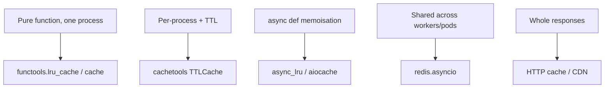
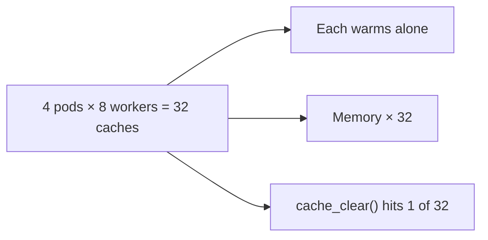
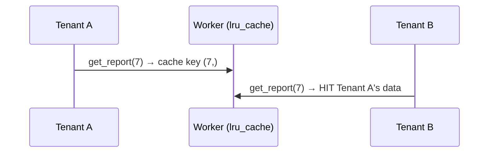

# Lesson 19: Caching in Python — lru_cache Pitfalls, cachetools, Async Redis, Keys

> **Prerequisites:** [Lesson 18: Multi-Level Caching](../18-multi-level-caching/README.md) and [Track: Caching](../README.md) overview.  
> **Estimated Reading Time:** 30–35 minutes  
> **Target Audience:** Python backend engineers using FastAPI/Django/Gunicorn, choosing between `lru_cache`, cachetools, and Redis, and designing safe cache keys for multi-tenant apps.  
> **Free PDF Notes:** [Download SD-F-019.pdf](https://backendroadmap.com/notes/system-design/SD-F-019.pdf)

> [!NOTE]
> **In one line:** `functools.lru_cache` suits pure functions in one process but has no TTL and is per worker; cachetools adds TTL and size bounds; with many workers and pods, shared or changing data belongs in Redis via `redis.asyncio`; choose serialization deliberately, and build keys from namespace, version, and every input that changes the result.

> [!TIP]
> **The Golden Rule of Python Caching:** Per-process caches for immutable/tiny reference data; Redis for anything shared or changing. Never put `@lru_cache` on `async def` (it caches the coroutine), never omit tenant/user from keys, and never let a cache outage take down the app—short timeouts + fallback to the source of truth.

---

## Words You'll Meet Today

| Word | In Plain Words | Role in a Live Backend System |
| :--- | :--- | :--- |
| **lru_cache** | functools decorator: memoise with LRU | Pure, hashable, one process, no TTL |
| **TTLCache** | cachetools cache with expiry | Per-process TTL + maxsize |
| **Memoisation** | Cache a function’s result by arguments | Avoid recomputing pure work |
| **Worker** | One Gunicorn/uvicorn process | Own memory ⇒ own cache |
| **redis.asyncio** | Async Redis client | Non-blocking cache I/O |
| **Serialization** | Objects → bytes for Redis | JSON / msgpack / (risky) pickle |
| **Key version** | `v2` → `v3` in the key | Format changes without flush |
| **Namespace** | Key prefix for a service/type | Avoid collisions |

---

## Visual Mental Models & Architecture

### Pick the Tool by Scope



*Figure 1. Start local for pure functions; move down as data becomes shared or changing.*

### The Multi-Worker Trap



*Figure 2. Low hit ratio, duplicated memory, stale copies after “invalidation.”*

---

## Core Definition & Taxonomic Comparison

| Tool | Scope | TTL | Notes |
| :--- | :--- | :--- | :--- |
| `@lru_cache(maxsize=…)` | One process | None | Hashable args only; `cache_clear()` only reset |
| `@cache` | One process | None | Unbounded—memory leak risk |
| `cachetools.TTLCache` | One process | Yes | Needs explicit `Lock` for threads |
| `alru_cache` / aiocache | One process, async | Optional | Caches **result**, not coroutine |
| `redis.asyncio` | Shared | `ex=` | Pool once at startup; timeouts + fallback |

**What it is:** Choosing the right memoisation/cache layer for Python concurrency. **What it isn't:** assuming one decorator fixes caching in a multi-worker deploy.

---

## Component Anatomy & The Observability Gap

### Good Key Anatomy

```text
namespace : version : tenant/user : hash(canonical inputs)
search:v2:tenant:42:a3f9c1…
include everything that changes the result
exclude timestamps, request ids, noise
missing tenant = cross-tenant data leak
```

### Observability Gap

| Signal | Hides |
| :--- | :--- |
| Great hit ratio in unit tests | 32 workers in prod each miss cold |
| `cache_clear()` in one request | 31 workers still stale |
| Redis “up” | Sync client blocking the event loop |
| Fast endpoint locally | Pickle/JSON of huge ORM graphs dominating time |

Track per-level hit ratios (L1 vs Redis) and cache error rates separately from DB errors.

---

## Mathematical Model & Worked Scale

### Worker Multiplication

$$N_{\text{caches}} = W_{\text{workers/pod}} \times P_{\text{pods}}$$

8 × 4 = 32 independent `lru_cache`s.

### Embeddings Cache Win

$$T_{\text{hit}} \approx 1\text{ ms}, \quad T_{\text{miss}} \approx 200\text{ ms} \Rightarrow \text{speedup} \approx 200\times \text{ on hits}$$

### Serialization Cost

For large objects, serialize/deserialize can exceed the Redis RTT—measure with real payloads; compress above a few KB.

---

## Metrics, Percentiles & Numbers Engineers Must Know

| Number | Meaning |
| :--- | :--- |
| `maxsize=None` / `@cache` | Unbounded growth |
| Socket timeout 0.2 s | Fail fast when Redis is sick |
| Key digest 16 hex chars | Enough uniqueness for most query hashes |
| msgpack vs JSON | Often smaller/faster; still need a schema |

---

## Compounding Effects & System Scale

| Pitfall | Compounding |
| :--- | :--- |
| `lru_cache` on method | `self` in key → instance kept alive + per-instance entries |
| Mutable cached return | Callers mutate shared object → heisenbugs |
| Sync Redis in `async def` | Blocks entire worker event loop |
| Pickle from shared Redis | RCE if attacker can write values |
| Timestamp in key | Hit ratio → 0 |

---

## Hierarchical Budgets & Capacity Sizing

| Data | Layer |
| :--- | :--- |
| Regex / schema / country code | `lru_cache` / cachetools |
| Flags with 30–60 s freshness | TTLCache or Redis |
| Multi-tenant reports / embeddings | Redis + versioned keys |
| Cross-language consumers | JSON or msgpack—not pickle |

---

## Top Engineering Mitigation Techniques

1. One pooled `redis.asyncio` client in FastAPI lifespan.  
2. Try/except around cache I/O—degrade to DB.  
3. `alru_cache` for async memoisation.  
4. Version bump in keys for schema changes (no flush).  
5. Include tenant_id in every tenant-scoped key.  
6. Prefer msgpack/JSON; never unpickle untrusted data.  
7. Combine small L1 + Redis L2 (Lesson 18).

---

## Production War Story: The Cache That Served Another Tenant

**Severity & Impact:** Reporting used `@lru_cache` on `get_report(report_id)`. Report `7` existed per tenant with different data. Tenant B sometimes got Tenant A’s numbers (only on workers that had cached A)—looked random, hard to repro. Caught when a customer recognized a competitor’s figures.



**Fix:** Key includes tenant: `get_report(tenant_id, report_id)` and Redis `report:v1:tenant:{id}:{report_id}` with TTL. Never `lru_cache` anything that depends on who is asking. Add a test asserting two tenants get different payloads for the same report id.

**Lesson:** The key must contain every input that changes the output—including identity.

---

## Multi-Language Production Implementation

Focus is Python; Go/TS/C# show the same key + shared-client patterns for polyglot teams:

````carousel
```go
package pycacheequiv

import (
	"context"
	"crypto/sha256"
	"encoding/hex"
	"encoding/json"

	"github.com/redis/go-redis/v9"
)

func SearchKey(tenantID int64, query map[string]any) string {
	b, _ := json.Marshal(query) // prefer sorted keys in real code
	sum := sha256.Sum256(b)
	return "search:v2:tenant:" + itoa(tenantID) + ":" + hex.EncodeToString(sum[:8])
}

func CachedGet(ctx context.Context, rdb *redis.Client, key string, load func(context.Context) (any, error), ttlSeconds int) (any, error) {
	raw, err := rdb.Get(ctx, key).Bytes()
	if err == nil {
		var v any
		_ = json.Unmarshal(raw, &v)
		return v, nil
	}
	v, err := load(ctx)
	if err != nil {
		return nil, err
	}
	b, _ := json.Marshal(v)
	_ = rdb.Set(ctx, key, b, 0).Err()
	_ = rdb.Expire(ctx, key, /* ttl */ 0).Err()
	return v, nil
}

func itoa(id int64) string { return "" /* strconv */ }
```
<!-- slide -->
```typescript
import { createHash } from "crypto";
import Redis from "ioredis";

export function searchKey(tenantId: number, query: Record<string, unknown>) {
  const canon = JSON.stringify(query, Object.keys(query).sort());
  const digest = createHash("sha256").update(canon).digest("hex").slice(0, 16);
  return `search:v2:tenant:${tenantId}:${digest}`;
}

const redis = new Redis(process.env.REDIS_URL!, {
  connectTimeout: 200,
  commandTimeout: 200,
  maxRetriesPerRequest: 1,
});

export async function cachedGet<T>(key: string, loader: () => Promise<T>, ttl = 300): Promise<T> {
  try {
    const raw = await redis.get(key);
    if (raw !== null) return JSON.parse(raw) as T;
  } catch {
    /* fall through */
  }
  const val = await loader();
  try {
    await redis.set(key, JSON.stringify(val), "EX", ttl);
  } catch {
    /* ignore cache write failures */
  }
  return val;
}
```
<!-- slide -->
```python
from functools import lru_cache, cache
from cachetools import TTLCache, cached
from threading import Lock
from contextlib import asynccontextmanager
from fastapi import FastAPI
import hashlib, json, msgpack
import redis.asyncio as redis

# --- lru_cache: pure, hashable, one process ---
@lru_cache(maxsize=1024)
def country_name(code: str) -> str:
    return db_lookup(code)

# @cache  # == lru_cache(maxsize=None): unbounded — avoid for open-ended inputs

# --- cachetools with TTL + lock ---
flags = TTLCache(maxsize=2_000, ttl=30)

@cached(flags, lock=Lock())
def get_flag(name: str):
    return db_load_flag(name)

# --- async: never bare lru_cache on async def ---
from async_lru import alru_cache

@alru_cache(maxsize=512, ttl=30)
async def get_user(uid: int):
    return await fetch_user(uid)

# --- FastAPI: one shared Redis client ---
@asynccontextmanager
async def lifespan(app: FastAPI):
    app.state.redis = redis.from_url(
        "redis://cache:6379",
        max_connections=50,
        socket_timeout=0.2,
        socket_connect_timeout=0.2,
    )
    yield
    await app.state.redis.aclose()

app = FastAPI(lifespan=lifespan)

async def cached_get(r, key, loader, ttl=300):
    try:
        if (raw := await r.get(key)) is not None:
            return json.loads(raw)
    except redis.RedisError:
        pass
    val = await loader()
    try:
        await r.set(key, json.dumps(val), ex=ttl)
    except redis.RedisError:
        pass
    return val

def search_key(tenant_id: int, query: dict) -> str:
    canon = json.dumps(query, sort_keys=True, separators=(",", ":"))
    digest = hashlib.sha256(canon.encode()).hexdigest()[:16]
    return f"search:v2:tenant:{tenant_id}:{digest}"

async def embed(r, text: str, model="text-emb-3"):
    norm = " ".join(text.lower().split())
    key = f"embed:v1:{model}:" + hashlib.sha256(norm.encode()).hexdigest()
    if (hit := await r.get(key)) is not None:
        return msgpack.unpackb(hit)
    vec = await call_model(norm, model)
    await r.set(key, msgpack.packb(vec), ex=86_400)
    return vec
```
<!-- slide -->
```csharp
using StackExchange.Redis;
using System.Security.Cryptography;
using System.Text;
using System.Text.Json;

public static class PythonParityCache
{
    public static string SearchKey(long tenantId, object query)
    {
        var canon = JsonSerializer.Serialize(query);
        var digest = Convert.ToHexString(SHA256.HashData(Encoding.UTF8.GetBytes(canon)))[..16];
        return $"search:v2:tenant:{tenantId}:{digest}";
    }

    public static async Task<T?> CachedGetAsync<T>(IDatabase db, string key, Func<Task<T>> load, int ttlSec = 300)
    {
        try
        {
            var raw = await db.StringGetAsync(key);
            if (raw.HasValue) return JsonSerializer.Deserialize<T>((string)raw!);
        }
        catch (RedisException) { /* fall through */ }

        var val = await load();
        try
        {
            await db.StringSetAsync(key, JsonSerializer.Serialize(val), TimeSpan.FromSeconds(ttlSec));
        }
        catch (RedisException) { /* ignore */ }
        return val;
    }
}
```
````

---

## Practical Hands-On CLI Verification

```bash
python -c "from functools import lru_cache
@lru_cache(maxsize=2)
def f(x): return x*x
f(1); f(1); print(f.cache_info())"
```

```bash
# Prove async pitfall conceptually:
python -c "import asyncio
from functools import lru_cache
@lru_cache
async def bad(x): return x
async def main():
  a=bad(1); b=bad(1); print('same coroutine object?', a is b)
asyncio.run(main())"
```

---

## Common Mistakes to Avoid

- `lru_cache` on async functions or user/time-dependent functions.
- `@cache` / `maxsize=None` on unbounded inputs.
- Expecting `cache_clear()` to invalidate across workers/pods.
- Mutable cached values callers modify.
- Sync Redis client inside `async def`.
- No timeouts / no fallback when Redis is down.
- `pickle.loads` on shared-cache data others can write.
- Keys without version or tenant; timestamps inside keys.

---

## Key Terms Glossary

| Term | Interview-ready definition |
| :--- | :--- |
| **lru_cache** | Process-local LRU memoisation decorator |
| **TTLCache** | Size-bounded cache with per-entry expiry |
| **Worker** | OS process with isolated memory |
| **msgpack** | Compact binary JSON-like format |
| **pickle** | Python object format; unsafe on untrusted data |
| **Key version** | Prefix segment that invalidates old formats |

---

## Interview Practice Questions

<details>
<summary><strong>1. What should a cache key contain? [BASIC]</strong></summary>

A namespace, a version, and every input that changes the result—including tenant/user when results differ—but nothing irrelevant like timestamps.

</details>

<details>
<summary><strong>2. Pitfalls of lru_cache in multi-worker deployments? [BASIC]</strong></summary>

Each process has its own cache: lower hit ratio, duplicated memory, no TTL, invalidation reaches one worker. Shared/changing data belongs in Redis.

</details>

<details>
<summary><strong>3. When is lru_cache the right tool? [BASIC]</strong></summary>

Pure functions with hashable arguments and stable results in one process: config parsing, regex compilation, small lookups.

</details>

<details>
<summary><strong>4. Why use redis.asyncio in async code? [BASIC]</strong></summary>

A synchronous client blocks the event loop while waiting on the network; the async client lets other requests run.

</details>

<details>
<summary><strong>5. Hit ratio low after scaling to 32 workers. Why and what next? [SCENARIO]</strong></summary>

32 independent per-process caches. Move shared data to Redis (optionally with small L1); watch per-level hit ratios.

</details>

<details>
<summary><strong>6. Need 60 s cache in async FastAPI. How? [SCENARIO]</strong></summary>

Async-aware TTL cache (`alru_cache`/aiocache) for per-process data, or Redis with `ex=60` for shared data—not `lru_cache` on the coroutine.

</details>

<details>
<summary><strong>7. Redis is down. What should the app do? [SCENARIO]</strong></summary>

Short timeouts, catch cache errors, fall back to the source (with single-flight/breaker to protect the DB). Caching must not reduce availability.

</details>

<details>
<summary><strong>8. Schema change breaks readers of cached values. Rollout? [SCENARIO]</strong></summary>

Bump key version (`v2`→`v3`); new code reads/writes v3; old entries ignored until TTL expiry—no flush needed.

</details>

<details>
<summary><strong>9. Why is pickle risky in a shared cache? [TRICKY]</strong></summary>

Unpickling can execute code—anyone who can write the cache can compromise readers. Also breaks when class definitions change.

</details>

<details>
<summary><strong>10. What happens when you lru_cache an instance method? [TRICKY]</strong></summary>

`self` becomes part of the key; the cache holds a reference, keeping instances alive and creating a separate entry per instance.

</details>

<details>
<summary><strong>11. JSON or msgpack for cached values? [TRICKY]</strong></summary>

JSON for debuggability and cross-language readability; msgpack when size/speed matter. Measure with real values; compress above a few KB.

</details>

<details>
<summary><strong>12. Does a cache decorator make a function thread-safe? [TRICKY]</strong></summary>

No. `lru_cache` is safe for its bookkeeping, but concurrent misses can all compute (stampede); cachetools needs an explicit lock; use single-flight for expensive work.

</details>

---

## One-Page Master Cheat Sheet

```text
====================================================================================================
                    CACHING IN PYTHON  —  CHEAT SHEET
====================================================================================================
IN ONE LINE   lru_cache = local pure; cachetools = TTL; Redis = shared. Keys include tenant+version.

TOOLS         lru_cache: hashable, 1 process, no TTL
              cachetools: TTL + maxsize (+ Lock)
              alru_cache: async results (NOT bare lru_cache on async def)
              redis.asyncio: one pooled client, timeouts, fallback

WORKERS       N workers = N caches; cache_clear() is local → use Redis for shared/changing data
KEYS          namespace:version:tenant:hash(inputs) — never timestamps; bump version on schema change
SERIALIZE     JSON portable · msgpack compact · pickle Python-only & unsafe if writable by others
ANTI-PATTERNS X lru_cache(async)   X omit tenant   X sync Redis in async   X unbounded @cache
              X pickle untrusted   X mutable cached objects
====================================================================================================
```

---

## Free PDF notes

[SD-F-019.pdf](https://backendroadmap.com/notes/system-design/SD-F-019.pdf)

---

## Sources

- [Python docs: functools.lru_cache](https://docs.python.org/3/library/functools.html#functools.lru_cache)
- [cachetools documentation](https://cachetools.readthedocs.io/)
- [redis-py asyncio](https://redis.readthedocs.io/en/stable/examples/asyncio_examples.html)

---

## Next

End of the Caching track written lectures for SD-F-011–019. Return to [Track: Caching](../README.md) or continue into performance/traffic tracks from the [System Design course index](../../README.md).

Track overview: [Track: Caching](../README.md)
