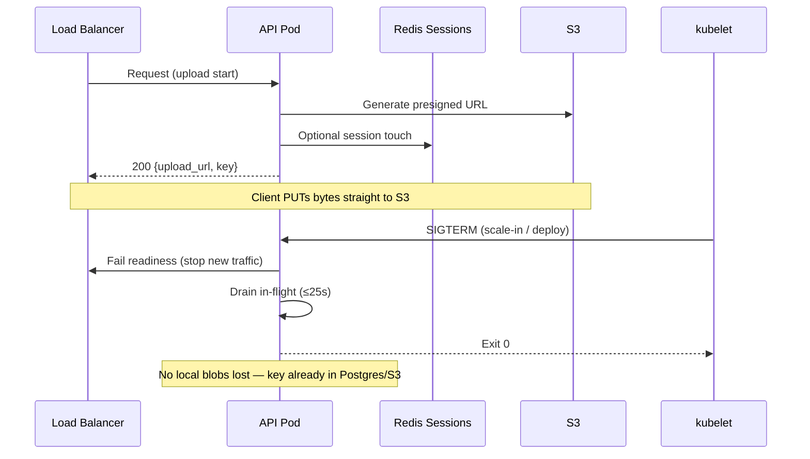
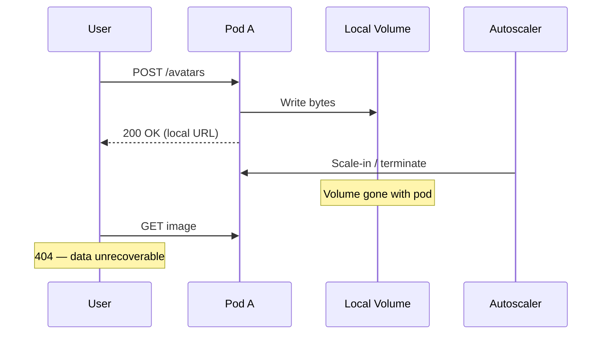

# Lesson 01: Stateless Service Design

> **Prerequisites:** [Lesson 19: Stateless vs. Stateful Architecture](../../01-core-fundamentals/19-stateless-vs-stateful/README.md) · [Lesson 07: Horizontal Scaling](../../01-core-fundamentals/07-horizontal-scaling/README.md).  
> **Estimated Reading Time:** 28–32 minutes  
> **Target Audience:** Backend engineers, platform SREs, and system designers making Kubernetes pods, FastAPI/Go services, and autoscaling fleets truly disposable.  
> **Free PDF Notes:** [Download SD-J-001.pdf](https://backendroadmap.com/notes/system-design/SD-J-001.pdf) · [Phase 3, Caching Scaling & Traffic (PDF)](https://backendroadmap.com/notes/system-design/Phase3_Caching_Scaling_Traffic_Notes.pdf)

> [!NOTE]
> **In one line:** A stateless service keeps no client or request state in its own memory or disk between requests—state lives in external stores (Redis, S3, databases, queues)—so any instance can serve any request and instances are disposable.

> [!TIP]
> **The Golden Rule of Stateless Design:** If killing an instance loses data a user still needs, it was never stateless. List every piece of data the process keeps between requests, move each to a shared home, keep only disposable caches in memory, and prove it by terminating pods mid-flow in staging.

---

## 1. What Statelessness Is, and What It Isn't

A user uploads a profile photo; it is saved to the pod's local disk. Ten minutes later Kubernetes reschedules the pod and the photo is gone. Another user's session lived in memory on a pod that just crashed, and they are logged out. The fix for both is the same: make the service **stateless**.

Statelessness does **not** mean there is no state. It means the state lives somewhere else—outside the process—so any identical replica can finish the next request.

| Term | Precise Meaning | Production Example |
| :--- | :--- | :--- |
| **Stateless service** | No client/request state kept in local memory or disk between requests | FastAPI pod stores only the S3 object key in Postgres; any replica can continue the flow. |
| **Stateful service** | Holds session, connection, or working set that must stick to one machine | WebSocket gateway keeping open sockets; game match room with live scores in RAM. |
| **Sticky sessions** | Load balancer pins a client to one backend for affinity | Cookie affinity to an in-memory session store—fragile under scale-in and deploys. |
| **Disposable process** | Start fast, shut down gracefully; losing the process loses nothing that matters | Spot instances and rolling deploys terminate pods freely because state is external. |

### Why It Matters
1. **Horizontal scaling becomes trivial:** a new instance is identical to the rest.
2. **Autoscaling, rolling deploys, and spot instances become safe.**
3. **The load balancer can use any algorithm**—no sticky sessions required for correctness.
4. **Failures are cheap:** a dead instance loses nothing durable.

---

## 2. Anatomy: Where State Actually Lives

| Kind of State | Bad Home (local) | Good Home (shared) | Why |
| :--- | :--- | :--- | :--- |
| **Sessions** | Process memory / local Redis sidecar only | Shared Redis, or signed JWT | Any pod can authenticate the next request. |
| **Uploaded files** | `/tmp` or pod volume | Object storage (S3, GCS) | Reschedules no longer delete blobs. |
| **Caches** | Local map treated as truth | Shared Redis/Memcached; local = optimization only | Cache loss must be recoverable. |
| **Durable data** | SQLite file on the node | Postgres / managed DB | Survives every pod restart. |
| **Background work** | In-process thread | Queue + workers | Work survives the API process. |
| **Rate-limit counters** | Per-instance variable | Shared Redis counter | Limits apply fleet-wide. |

```
+------------------------------------------------------------------+
|                         Load Balancer                            |
+-----------+------------------+------------------+----------------+
|   Pod 1   |      Pod 2       |      Pod 3       |  (identical)   |
|  (stateless handlers only)   |                  |                |
+-----+-----+--------+---------+--------+---------+----------------+
      |              |                  |
      v              v                  v
+-----------+  +-----------+  +------------------+
| Redis     |  | S3 files  |  | Postgres         |
| sessions  |  | blobs     |  | durable rows     |
+-----------+  +-----------+  +------------------+
```

*Figure 1. Disposable processes over shared state. Pods are identical; all durable state is external.*

> [!WARNING]
> **The Observability Gap:** A pod-local metric of “disk used in `/tmp`” or “in-memory session count” looks healthy until the autoscaler scales in. Always measure **external** store health (Redis hit rate, S3 PUT success, Postgres connections) and verify that **killing any pod mid-request** still lets the user finish on another instance.

---

## 3. Mathematical Model: Why Stickiness Collapses Capacity

Sticky sessions shrink the effective capacity of a fleet. If traffic is pinned unevenly, utilization on the hot pod rises while others idle—queueing delay explodes on the pinned node even when fleet-average CPU looks fine.

$$\rho_{\text{hot}} = \frac{\lambda_{\text{pinned}}}{\mu_{\text{single}}} \qquad \text{Response} \approx \frac{S}{1 - \rho_{\text{hot}}}$$

| Fleet Utilization (avg) | Sticky Hot-Pod Share | Hot Pod $\rho$ | Latency Multiplier $\frac{1}{1-\rho}$ | Operational State |
| :---: | :---: | :---: | :---: | :--- |
| **$50\%$** | even | $50\%$ | $2.0\times$ | Comfortable if truly balanced. |
| **$50\%$** | $2\times$ skew | $80\%$ | $5.0\times$ | Sticky skew creates fake overload. |
| **$60\%$** | $2\times$ skew | $95\%$ | $20.0\times$ | Tail latency cliff on one pod. |
| **$70\%$** | even (stateless) | $70\%$ | $3.3\times$ | Autoscaling target; any LB algorithm OK. |

> [!IMPORTANT]
> **The 60–70% Rule Still Applies—Per Owner.** Stateless fleets keep peak utilization around $60\text{–}70\%$ across **any** instance. Sticky designs concentrate load so one pod hits $95\%$ while the fleet average still looks green.

---

## 4. Metrics, Percentiles & What “Healthy” Hides

| Metric | Precise Meaning | Who It Describes |
| :--- | :--- | :--- |
| **$p_{50}$ request latency** | Median end-to-end handler time | Typical user on a warm pod. |
| **$p_{99}$ request latency** | Slowest $1\%$ of requests | Users stuck on a dying pod or cold connection. |
| **In-flight drain time** | Time from SIGTERM to zero active requests | Rolling-deploy safety margin vs `terminationGracePeriodSeconds`. |
| **Pod restart / eviction rate** | How often instances disappear | Whether local-disk state would have been lost. |

### Worked Example: Average Lies About Sticky Pain
100 requests across 10 sticky pods; 90 complete in $40\text{ ms}$, 9 wait $300\text{ ms}$ on a hot pod, 1 stalls $2{,}000\text{ ms}$ during a reschedule:

$$\text{Average} = \frac{90\times40 + 9\times300 + 1\times2000}{100} = 83\text{ ms}$$

The average looks fine; $p_{95}$ is already $300\text{ ms}$ and the reschedule victim waited $2\text{ s}$. Percentiles plus “kill-pod” chaos tests expose the truth.

---

## 5. Compounding at Scale: Retries Across Disposable Instances

When a client retries after a timeout, the second attempt may land on a **different** instance. Without idempotency, each retry compounds side effects:

$$P(\text{at least one duplicate charge}) = 1 - (1 - p_{\text{retry}})^{N}$$

| Concurrent Checkouts ($N$) with $p_{\text{retry}}=0.05$ | Chance of $\ge 1$ Retry Storm Victim | Implication |
| :---: | :---: | :--- |
| **1** | $5\%$ | Single request risk. |
| **10** | $40\%$ | Flash sale starts showing doubles. |
| **20** | $64\%$ | Most bursts produce duplicates without idempotency keys. |
| **50** | $92\%$ | Nearly certain double-charge incidents without a unique key store. |

Stateless routing **requires** idempotency keys in the shared database so any instance can safely replay the original result.

---

## 6. Numbers Every Backend Engineer Must Know

| Operation / Decision | Layer | Typical Cost / Limit | Relative Impact | Architectural Implication |
| :--- | :--- | :---: | :---: | :--- |
| In-memory session lookup | Local RAM | $\sim 100\text{ ns}$ | $1\times$ | Fast but dies with the pod. |
| Redis session GET (same AZ) | Network + RAM | $\sim 0.3\text{–}1\text{ ms}$ | $\sim 10{,}000\times$ | Shared truth; any pod can continue. |
| Local disk write `/tmp` | Node SSD | $\sim 0.1\text{–}1\text{ ms}$ | — | Lost on reschedule; never store user blobs. |
| S3 PUT (same region) | Object store | $\sim 20\text{–}100\text{ ms}$ | — | Durable; use presigned URLs for large uploads. |
| Kubernetes SIGTERM → SIGKILL | Orchestrator | default grace $\sim 30\text{ s}$ | — | Drain in-flight work before kill. |
| Spot interruption notice | Cloud | often $\sim 30\text{–}120\text{ s}$ | — | Only safe if processes are disposable. |

---

## 7. Protocol & Lifecycle Deep Dive: SIGTERM Drain

Kubernetes sends **SIGTERM**, marks the pod not-ready, then waits `terminationGracePeriodSeconds` before **SIGKILL**. Stateless services must finish in-flight requests and stop accepting new ones.



Cold vs warm: a brand-new pod needs env config and healthy connections to Redis/Postgres/S3—not a restored local disk. That is the twelve-factor payoff.

---

## 8. Hierarchical Budgets & Capacity Sizing

| Budget Slice | Target | Derived Control |
| :--- | :--- | :--- |
| **API handler (sync path)** | $p_{99} \le 100\text{ ms}$ | No local disk I/O; no sync email. |
| **Presigned URL generation** | $\le 30\text{ ms}$ | S3 SDK timeout $50\text{ ms}$. |
| **Session Redis** | $\le 5\text{ ms}$ | Pool size via Little's Law; fail open to re-auth. |
| **Graceful shutdown drain** | $\le 25\text{ s}$ | `terminationGracePeriodSeconds = 30`. |
| **Headroom** | $20\%$ | Keep fleet CPU $60\text{–}70\%$ at peak. |

---

## 9. Top Engineering Mitigation Techniques

1. **Externalize sessions** — Redis or short-lived signed JWTs; never rely on stickiness for correctness.
2. **Presigned object uploads** — Client PUTs to S3; API stores only the object key.
3. **Idempotency keys** — Unique key in the database so retries on any instance return the original result.
4. **Graceful shutdown** — On SIGTERM: fail readiness, drain, then exit.
5. **Disposable local caches only** — Memory caches are optimizations; the durable copy lives elsewhere.

---

## 10. Production War Story (SEV-1): The Lost Uploads

- **Severity & Impact:** SEV-1 content loss. Autoscaler scaled in overnight; daytime uploads stored on pod volumes vanished. Support tickets spiked; images were unrecoverable.
- **Detection → Resolution:** $\sim 14\text{ h}$ until correlated with scale-in events; fix shipped next day.

**What Happened (flaw):**

```python
# BAD: durable user data on the pod
@app.post("/avatars")
def upload(file: UploadFile, user=Depends(auth)):
    path = f"/var/data/avatars/{user.id}.jpg"  # local volume
    Path(path).write_bytes(file.file.read())
    return {"url": f"/static/{user.id}.jpg"}
```



- **RCA:** Handlers treated local disk as durable storage. Statelessness was assumed, not enforced.
- **Fix & Hardening:**
  1. Presigned S3 uploads; store object key in Postgres.
  2. Lint/CI check forbidding writes under `/var/data` and `/tmp` in handlers.
  3. Chaos: terminate pods mid-upload in staging and assert the client flow still completes.

**Lesson:** If killing an instance loses data, it was never stateless.

---

## 11. Multi-Language Production Code Tabs

````carousel
```go
// Go: graceful shutdown + idempotent charge (stateless handler)
package main

import (
	"context"
	"encoding/json"
	"net/http"
	"os"
	"os/signal"
	"syscall"
	"time"
)

type Store interface {
	GetPayment(ctx context.Context, key string) (json.RawMessage, bool, error)
	InsertPayment(ctx context.Context, key string, result json.RawMessage) error
}

func ChargeHandler(db Store, gateway func(user string, amount int) (json.RawMessage, error)) http.HandlerFunc {
	return func(w http.ResponseWriter, r *http.Request) {
		key := r.Header.Get("Idempotency-Key")
		if key == "" {
			http.Error(w, "missing Idempotency-Key", http.StatusBadRequest)
			return
		}
		if row, ok, _ := db.GetPayment(r.Context(), key); ok {
			w.Header().Set("Content-Type", "application/json")
			w.Write(row)
			return
		}
		result, err := gateway(r.FormValue("user"), 100)
		if err != nil {
			http.Error(w, err.Error(), http.StatusBadGateway)
			return
		}
		_ = db.InsertPayment(r.Context(), key, result)
		w.Header().Set("Content-Type", "application/json")
		w.Write(result)
	}
}

func main() {
	srv := &http.Server{Addr: ":8080", Handler: http.DefaultServeMux}
	go srv.ListenAndServe()

	stop := make(chan os.Signal, 1)
	signal.Notify(stop, syscall.SIGTERM, os.Interrupt)
	<-stop
	ctx, cancel := context.WithTimeout(context.Background(), 25*time.Second)
	defer cancel()
	_ = srv.Shutdown(ctx) // drain in-flight, then exit
}
```
<!-- slide -->
```typescript
// TypeScript/Node: SIGTERM drain + presigned upload metadata only
import express from "express";
import { randomUUID } from "crypto";

const app = express();
const server = app.listen(8080);

app.post("/uploads", async (req, res) => {
  const key = `avatars/${req.user.id}/${randomUUID()}.jpg`;
  const uploadUrl = await s3.getSignedUrlPromise("putObject", {
    Bucket: process.env.BUCKET!,
    Key: key,
    Expires: 300,
  });
  await db.query("insert into uploads(user_id, key) values ($1, $2)", [req.user.id, key]);
  res.json({ upload_url: uploadUrl, key }); // client PUTs straight to S3
});

async function charge(key: string, user: string, amount: number) {
  const existing = await db.query("select result from payments where key=$1", [key]);
  if (existing.rowCount) return existing.rows[0].result;
  const result = await gateway.charge(user, amount);
  await db.query("insert into payments(key, result) values ($1, $2)", [key, result]);
  return result;
}

process.on("SIGTERM", () => {
  server.close(() => process.exit(0)); // stop accepts, drain in-flight
  setTimeout(() => process.exit(1), 25_000).unref();
});
```
<!-- slide -->
```python
# Python: FastAPI SIGTERM drain + presigned S3 + idempotent charge
import asyncio, signal, uuid
from fastapi import Depends, FastAPI, Header, HTTPException

app = FastAPI()
stop = asyncio.Event()
signal.signal(signal.SIGTERM, lambda *_: stop.set())

@app.post("/uploads")
def start_upload(user=Depends(auth)):
    key = f"avatars/{user.id}/{uuid.uuid4()}.jpg"
    url = s3.generate_presigned_url(
        "put_object",
        Params={"Bucket": BUCKET, "Key": key},
        ExpiresIn=300,
    )
    db.execute("insert into uploads(user_id, key) values (%s, %s)", (user.id, key))
    return {"upload_url": url, "key": key}  # client PUTs to S3

def charge(key: str, user: str, amount: int):
    row = db.get("payments", key)  # idempotency key from the client
    if row:
        return row.result  # replay the first answer on any instance
    result = gateway.charge(user, amount)
    db.insert("payments", key=key, result=result)  # unique on key
    return result

async def main():
    await start_server()
    await stop.wait()
    await server.shutdown(timeout=25)  # finish in-flight, then exit
```
<!-- slide -->
```csharp
// C#: Kestrel graceful shutdown + idempotent payment
using Microsoft.AspNetCore.Mvc;

var builder = WebApplication.CreateBuilder(args);
var app = builder.Build();

app.MapPost("/uploads", async (HttpContext ctx, IUser user, IS3 s3, IDb db) =>
{
    var key = $"avatars/{user.Id}/{Guid.NewGuid()}.jpg";
    var url = await s3.GetPresignedPutUrlAsync(key, TimeSpan.FromMinutes(5));
    await db.ExecuteAsync("insert into uploads(user_id, key) values (@u, @k)",
        new { u = user.Id, k = key });
    return Results.Json(new { upload_url = url, key });
});

app.MapPost("/charge", async ([FromHeader(Name = "Idempotency-Key")] string key,
    ChargeReq req, IDb db, IGateway gw) =>
{
    var existing = await db.GetPaymentAsync(key);
    if (existing is not null) return Results.Json(existing);
    var result = await gw.ChargeAsync(req.User, req.Amount);
    await db.InsertPaymentAsync(key, result);
    return Results.Json(result);
});

app.Lifetimeouts.KeepAliveTimeout = TimeSpan.FromSeconds(30);
await app.RunAsync(); // SIGTERM triggers IHostApplicationLifetime drain
```
````

---

## 12. Hands-On CLI Verification Workflows

### Step 1: Prove local disk is not durable under restart
```bash
# Write a marker, kill the process tree, confirm the path is gone in a fresh container
docker run --rm -v "${PWD}/tmpdata:/data" alpine sh -c 'echo secret >/data/x; cat /data/x'
# Without a persistent volume claim shared across reschedules, a new pod will not see /data/x
```

### Step 2: Simulate graceful drain timing
```bash
# Start a sleep server, send SIGTERM, measure drain window
python3 -c "
import http.server, signal, sys, time
signal.signal(signal.SIGTERM, lambda *_: (print('drain...'), time.sleep(2), sys.exit(0)))
http.server.HTTPServer(('127.0.0.1', 8765), http.server.BaseHTTPRequestHandler).serve_forever()
" &
PID=$!
sleep 1
kill -TERM $PID
wait $PID
```

### Step 3: Idempotency mental check
```bash
# Two identical charges with the same key must return one stored result
curl -s -H 'Idempotency-Key: abc-1' -d 'user=u1' http://localhost:8080/charge
curl -s -H 'Idempotency-Key: abc-1' -d 'user=u1' http://localhost:8080/charge
```

---

## 13. Common Mistakes to Avoid

1. **Writing user data to local disk** (`/tmp`, emptyDir treated as durable).
2. **In-memory sessions with no external store.**
3. **Relying on sticky sessions for correctness.**
4. **Local caches treated as the only copy of truth.**
5. **No graceful shutdown**—in-flight requests drop on deploy.
6. **Retries without idempotency**—double charges across instances.
7. **Config baked into images** instead of environment (twelve-factor violation).
8. **Assuming “stateless” means “no Redis/Postgres”**—state moved, not deleted.

---

## 14. Key Terms Glossary

| Key Term | Clear Architectural Definition |
| :--- | :--- |
| **Stateless** | No client state kept locally between requests; any replica can serve the next call. |
| **Backing service** | Attached external resource (DB, cache, queue, object store) treated as a linked resource. |
| **Presigned URL** | Temporary signed link allowing the client to upload/download directly from object storage. |
| **Idempotency key** | Client-supplied unique ID that makes retries return the original side-effect result. |
| **Twelve-factor** | Cloud-native methodology: stateless processes, env config, attached services, disposability. |
| **Disposable** | Start fast, stop gracefully; losing the process loses nothing durable. |
| **SIGTERM** | Polite termination signal (Kubernetes) preceding forced kill. |
| **Session store** | External shared store for login/session data (often Redis). |
| **JWT** | Signed token carrying claims so the server need not store the session body. |
| **Object storage** | S3-style blob store for durable files independent of compute nodes. |

---

## 15. System Design Interview Questions & Answers

### Basic Conceptual Questions

<details>
<summary><strong>Q1: What makes a service stateless? [BASIC]</strong></summary>

**Answer:**
It keeps no client state locally between requests: sessions, files, caches, and durable data live in external stores like Redis, S3, and databases. Any instance can handle any request, and instances are disposable.
</details>

<details>
<summary><strong>Q2: Why does statelessness matter? [BASIC]</strong></summary>

**Answer:**
It makes horizontal scaling, autoscaling, rolling deploys, spot instances, and failure recovery simple and safe. The load balancer does not need sticky sessions for correctness.
</details>

<details>
<summary><strong>Q3: Where do sessions, files, and caches go? [BASIC]</strong></summary>

**Answer:**
Sessions → Redis or signed tokens; files → object storage; shared caches → Redis/Memcached; durable data → a database; background work → a queue. Local memory holds only disposable optimizations.
</details>

<details>
<summary><strong>Q4: What is a twelve-factor app (relevant parts)? [BASIC]</strong></summary>

**Answer:**
A methodology for cloud-native apps: processes are stateless and share nothing; config comes from the environment; backing services are attached resources; processes are disposable (fast start, graceful shutdown on termination signals).
</details>

### Scenario-Based Architecture Questions

<details>
<summary><strong>Q5: Pods lose uploads when rescheduled. Fix? [SCENARIO]</strong></summary>

**Answer:**
Stop writing blobs to the pod. Create a presigned S3 URL, let the client upload directly, and store only the object key in the database. Lint against local-disk writes and chaos-test pod termination in staging.
</details>

<details>
<summary><strong>Q6: Retries cause double charges. [SCENARIO]</strong></summary>

**Answer:**
Require an `Idempotency-Key`. Persist the key and result in the database with a unique constraint. On retry, any instance returns the original result instead of calling the payment gateway again.
</details>

<details>
<summary><strong>Q7: Make an existing app stateless. [SCENARIO]</strong></summary>

**Answer:**
Inventory local state (sessions, files, caches, counters, locks, in-flight jobs). Move each to the right external store. Remove stickiness from the load balancer. Keep only disposable caches in memory. Kill instances mid-flow to verify continuity.
</details>

<details>
<summary><strong>Q8: Shut down a pod without errors. [SCENARIO]</strong></summary>

**Answer:**
On SIGTERM: fail readiness so the LB stops sending new traffic, drain in-flight requests within the grace period (e.g. $25\text{ s}$ of a $30\text{ s}$ grace), close listeners, then exit before SIGKILL.
</details>

### Advanced & Tricky Interview Questions

<details>
<summary><strong>Q9: Is a local cache allowed? [TRICKY]</strong></summary>

**Answer:**
Yes—as an optimization that can be lost at any moment. Never as the only copy of important data. After a restart, the service must rebuild from the shared source of truth.
</details>

<details>
<summary><strong>Q10: Are JWT sessions stateless? [TRICKY]</strong></summary>

**Answer:**
The server stores nothing for the token body, which is stateless for validation. Revocation still needs a denylist, short expiry, or versioned secrets—so “fully session-free” is rarely absolute.
</details>

<details>
<summary><strong>Q11: Is any service fully stateless? [TRICKY]</strong></summary>

**Answer:**
No. State is pushed to dependencies (Redis, DB, S3, queues), which must then scale and stay available. Stateless compute shifts the durability and capacity problem to backing services.
</details>

<details>
<summary><strong>Q12: Statelessness versus idempotency? [TRICKY]</strong></summary>

**Answer:**
Statelessness lets any instance serve any request. Idempotency makes repeats safe when clients retry and land on a different instance. You need both for reliable retries under timeouts and load balancers.
</details>

---

## 16. One-Page Master Cheat Sheet

```
+---------------------------------------------------------------------------------------------------------+
|                           STATELESS SERVICE DESIGN — MASTER CHEAT SHEET                                 |
+---------------------------------------------------------------------------------------------------------+
| 1. CORE RULE:                                                                                           |
|    No client state in process memory/disk between requests. State → Redis / S3 / DB / queues.           |
|    Test: kill any instance mid-flow; the user must continue on another.                                 |
+---------------------------------------------------------------------------------------------------------+
| 2. TWELVE-FACTOR BASICS:                                                                                |
|    Stateless processes · Config from env · Attached backing services · Disposable (SIGTERM drain).      |
+---------------------------------------------------------------------------------------------------------+
| 3. STATE HOMES:                                                                                         |
|    Sessions → Redis/JWT · Files → S3 (presigned) · Caches → shared · Jobs → queue · Counters → Redis.   |
+---------------------------------------------------------------------------------------------------------+
| 4. RETRIES:                                                                                             |
|    Idempotency keys in DB. Stateless routing + retries without keys = duplicate side effects.           |
+---------------------------------------------------------------------------------------------------------+
| 5. PAYOFF:                                                                                              |
|    Easy H-scale, rolling deploys, spot instances, any LB algorithm, cheap failure.                      |
|    Anti-patterns: local disk uploads, sticky correctness, no drain, cache-as-truth.                     |
+---------------------------------------------------------------------------------------------------------+
```

---

## Further Reading & Sources

- The Twelve-Factor App — Processes & Disposability.
- Kubernetes documentation — Pod lifecycle & termination grace periods.
- AWS documentation — Presigned URLs.
- [SD-J-002 Scaling Stateful Services](https://backendroadmap.com/notes/system-design/SD-J-002.pdf) — when state must stay in memory.

---

## Free PDF Notes

Download these notes as a printable PDF: [SD-J-001.pdf](https://backendroadmap.com/notes/system-design/SD-J-001.pdf).

---

## Next

Continue with [Lesson 02: Scaling Stateful Services](../02-scaling-stateful-services/README.md) — partition by key, give each partition one owner, and rebalance without split-brain.
