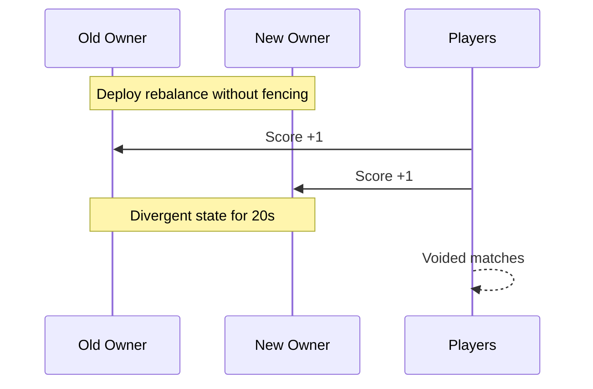

# Lesson 02: Scaling Stateful Services

> **Prerequisites:** [Lesson 01: Stateless Service Design](../01-stateless-service-design/README.md) · [Lesson 05: Consistent Hashing](../../06-load-balancing/05-consistent-hashing-explained/README.md).  
> **Estimated Reading Time:** 30–35 minutes  
> **Target Audience:** Backend engineers designing WebSocket gateways, game match servers, stream processors, and any service that must keep hot state in memory.  
> **Free PDF Notes:** [Download SD-J-002.pdf](https://backendroadmap.com/notes/system-design/SD-J-002.pdf) · [Phase 3, Caching Scaling & Traffic (PDF)](https://backendroadmap.com/notes/system-design/Phase3_Caching_Scaling_Traffic_Notes.pdf)

> [!NOTE]
> **In one line:** Some services must hold state in memory (chat connections, game matches, stream counters)—scale them by partitioning by key, giving each partition a single owner, routing requests to that owner, and making rebalancing safe with recoverable state.

> [!TIP]
> **The Golden Rule of Stateful Scale:** One owner per partition at a time—enforced with leases and fencing tokens, never assumed. Keep many small fixed partitions, back memory with a durable log/snapshot, and pause or buffer a partition during moves so two nodes never both believe they own it.

---

## 1. What Stateful Scaling Is, and What It Isn't

A chat server holds a million open WebSocket connections. A game server keeps each match's live state in memory. A stream processor keeps running counts per user. That state must stay in memory, close to the code, for speed. Stateless tricks (push everything to Redis) would add a network hop on every message.

| Term | Precise Meaning | Production Example |
| :--- | :--- | :--- |
| **Stateful service** | Process holds a working set that must stick to a designed owner | Game match room scores in RAM on one node. |
| **Partition** | Slice of keyspace (user, room, match ID) | `hash(room_id) % 256 → partition 17`. |
| **Owner** | The single node currently allowed to mutate a partition | Node B owns partitions 7 and 8. |
| **Sticky sessions** | Accidental affinity from a past request | Cookie stickiness without recovery or fencing—not the same design. |

### Why It Matters
Without single ownership you get conflicting copies, divergent scores, and silent split-brain. With it, the owner can keep everything in memory without distributed locks on every write.

---

## 2. Anatomy: Key → Partition → Owner

```
key (user 42) → hash → partition p7 → partition_map[p7] = node B → serve / forward
```

| Component | Role | Failure Mode If Wrong |
| :--- | :--- | :--- |
| **Key** | Stable identity (user, room, match) | Hot key overloads one partition. |
| **Partition map** | `partition → node` from etcd/ZK/Kafka group | Stale maps → dual ownership. |
| **Router** | LB ring hash, lookup layer, or peer forward | Mis-route → wrong memory. |
| **Durable log / snapshot** | Rebuild source after failover | Crash loses state forever. |

> [!WARNING]
> **The Observability Gap:** Node-local metrics (“I own 40 partitions”) can disagree with the coordinator. Always scrape the **authoritative partition map** (etcd revision / consumer-group generation) and alert on **ownership conflicts** and **fencing-token rejections**, not only on CPU.

---

## 3. Mathematical Model: Fixed Partitions & Move Cost

Fix $P$ partitions forever; assign them across $N$ nodes. Rebalancing moves whole partitions, not individual keys:

$$\text{Partitions per node} \approx \frac{P}{N} \qquad \text{Keys moved on }+1\text{ node} \approx \frac{P}{N(N+1)}\text{ partitions' worth}$$

With consistent hashing of keys directly onto nodes, adding a node moves $\sim 1/N$ of keys; with a **fixed partition count**, you move $\sim P/N$ whole partitions—simpler units.

| $P$ partitions | $N$ nodes | Avg partitions/node | Rebalance unit | Operational Note |
| :---: | :---: | :---: | :--- | :--- |
| **16** | 4 | 4 | large | Slow transfers; coarse hotspots. |
| **256** | 8 | 32 | small | Sweet spot for many systems. |
| **1024** | 16 | 64 | tiny | Fast moves; more map churn. |
| **256** | 8 → 9 | $32 → 28.4$ | ~28 partitions move | Prefer whole-partition moves. |

> [!IMPORTANT]
> **Many small partitions.** Keep $P \gg N$ so failover moves many small pieces quickly instead of one giant blob.

---

## 4. Metrics & Distributions for Ownership Health

| Metric | Meaning | Who It Describes |
| :--- | :--- | :--- |
| **$p_{50}$ / $p_{99}$ route latency** | Time to resolve owner + forward | Typical vs tail routed RPCs. |
| **Partition skew** | $\max(\text{load}_i) / \text{avg}$ | Hot-partition victims. |
| **Failover RTO** | Time from heartbeat loss → new owner serving | Users reconnecting / matches paused. |
| **Fencing rejection rate** | Stale owner write attempts blocked | Split-brain near-misses. |

### Worked Example: Average Hides a Hot Partition
8 nodes, 256 partitions, average $1{,}000$ msgs/s each. One celebrity room lands $20{,}000$ msgs/s on a single partition:

$$\rho_{\text{hot}} \approx \frac{20000}{5000} = 4\times \text{ over capacity of that owner core}$$

Fleet-average CPU may still be $40\%$ while that room's $p_{99}$ explodes. Fix: split the partition, change the key, or add read replicas.

---

## 5. Compounding: Dual-Ownership Windows

If ownership transfer allows a $T$ second overlap with write rate $\lambda$:

$$\text{Expected conflicting writes} \approx \lambda \cdot T$$

| Write rate $\lambda$ | Overlap $T$ | Expected conflicts | Impact |
| :---: | :---: | :---: | :--- |
| $10$/s | $1\text{ s}$ | $10$ | Minor divergence. |
| $100$/s | $20\text{ s}$ | $2{,}000$ | Match scores voided (real incident scale). |
| $1{,}000$/s | $5\text{ s}$ | $5{,}000$ | Catastrophic without fencing. |

---

## 6. Numbers Every Engineer Must Know

| Operation | Layer | Typical Cost | Implication |
| :--- | :--- | :---: | :--- |
| In-memory partition read | RAM | $\sim 100\text{ ns}$ | Why state stays local. |
| Forward to owner (same AZ) | RPC | $\sim 0.5\text{–}2\text{ ms}$ | Acceptable tax vs wrong-node mutation. |
| etcd watch / map update | Coord | $\sim 10\text{–}50\text{ ms}$ | Routers must invalidate caches on revision. |
| Snapshot load $1\text{ GB}$ | Disk | seconds–tens of s | Prefer small partitions. |
| WebSocket reconnect | Client | $100\text{–}500\text{ ms}$ | Acceptable blip if registry updates. |
| Heartbeat timeout | Failure detect | often $1\text{–}10\text{ s}$ | Bounds failover RTO. |

---

## 7. Protocol Deep Dive: Failover Sequence

```mermaid
sequenceDiagram
    participant N_B as Node B (owner p7)
    participant Coord as etcd / ZK
    participant N_C as Node C
    participant R as Router

    N_B--xCoord: Heartbeat lost
    Coord->>Coord: Map update p7 → Node C (epoch+1)
    Coord->>N_C: Assign p7
    N_C->>N_C: Rebuild snapshot + log replay
    Coord->>R: Push new map (revision)
    Note over N_B: Stale writes rejected (fencing token)
    R->>N_C: Requests for keys in p7
    N_C-->>R: Serve; buffered requests resume
```

**Assignment options:**

| Approach | How | Notes |
| :--- | :--- | :--- |
| **Consistent hashing** | Keys/nodes on a ring | No central map; less explicit control. |
| **Coordinator** | ZooKeeper, etcd, Kafka consumer group | Explicit map + rebalance protocols. |

---

## 8. Hierarchical Budgets & Sizing

| Budget | Target | Control |
| :--- | :--- | :--- |
| Owner lookup + forward | $\le 2\text{ ms}$ $p_{99}$ | Local map cache + revision checks. |
| Failover RTO | $\le 10\text{ s}$ | Small partitions; warm standby snapshots. |
| Dual-own window | $0$ (hard) | Lease + fencing on every write. |
| Partitions | $P \ge 16N$ | Fixed forever; move wholes. |
| Hot-key skew | $< 3\times$ avg | Split / re-key alerts. |

---

## 9. Top Mitigations

1. **Fixed partition count** — move wholes, never rehash all keys on join.
2. **Single ownership with fencing** — leases, epochs, reject stale writers.
3. **Recoverable memory** — durable log + periodic snapshots.
4. **Registry for connections** — Redis/etcd maps user → gateway node.
5. **Rebalance strategies** — rebuild from durable source, transfer from old owner, or reconnect clients.

---

## 10. Production War Story (SEV-1): Two Owners

- **Severity & Impact:** SEV-1 game integrity. During deploy, old and new nodes both ran the same match for $\sim 20\text{ s}$. Scores diverged; matches voided; compensation issued.
- **What Happened:** Partition move without drain/fencing.



- **RCA:** Ownership assumed exclusive; no fencing token on writes; no drain before handover.
- **Fix:** Ownership lease + fencing token on every write; drain partition before handoff; chaos-test node loss.

**Lesson:** Single ownership must be enforced, not assumed.

---

## 11. Multi-Language Production Code Tabs

````carousel
```go
// Go: fixed partitions + owner lookup + forward
package main

import (
	"crypto/md5"
	"encoding/binary"
	"fmt"
)

const NPartitions = 256 // many small partitions, fixed forever

func PartitionOf(key string) int {
	sum := md5.Sum([]byte(key))
	return int(binary.BigEndian.Uint64(sum[:8]) % NPartitions)
}

func OwnerOf(key string, partitionMap map[int]string) string {
	return partitionMap[PartitionOf(key)]
}

func Handle(key string, self string, partitionMap map[int]string, local, forward func() error) error {
	owner := OwnerOf(key, partitionMap)
	if owner == self {
		return local()
	}
	return forward() // peer RPC to owner
}

func main() {
	m := map[int]string{7: "node-b", 8: "node-b"}
	fmt.Println(PartitionOf("user:42"), OwnerOf("user:42", m))
}
```
<!-- slide -->
```typescript
// TypeScript: WebSocket registry + route-to-owner
import crypto from "crypto";
import Redis from "ioredis";

const N_PARTITIONS = 256;
const redis = new Redis(process.env.REDIS_URL);
const NODE_ID = process.env.NODE_ID!;

export function partitionOf(key: string): number {
  const hex = crypto.createHash("md5").update(key).digest("hex");
  return Number(BigInt(`0x${hex.slice(0, 16)}`) % BigInt(N_PARTITIONS));
}

export async function onConnect(userId: string) {
  await redis.hset("conn", userId, NODE_ID);
  await redis.expire("conn", 3600);
}

export async function sendToUser(toUser: string, body: string, bus: { publish: Function }) {
  const node = await redis.hget("conn", toUser);
  if (!node) return;
  if (node === NODE_ID) return localPush(toUser, body);
  await bus.publish(`node:${node}`, { to: toUser, body });
}
```
<!-- slide -->
```python
# Python: partition map + WebSocket registry
import hashlib, os
import redis

N_PARTITIONS = 256
SELF = os.environ["NODE_ID"]
r = redis.Redis.from_url(os.environ["REDIS_URL"])

def partition_of(key: str) -> int:
    return int(hashlib.md5(key.encode()).hexdigest(), 16) % N_PARTITIONS

def owner_of(key: str, partition_map: dict[int, str]) -> str:
    return partition_map[partition_of(key)]

def handle(key: str, req, partition_map, local, forward):
    node = owner_of(key, partition_map)
    return local(req) if node == SELF else forward(node, req)

# On connect / message
def on_connect(user_id: str):
    r.hset("conn", user_id, SELF)
    r.expire("conn", 3600)

def on_message(to_user: str, text: str, bus):
    node = r.hget("conn", to_user)
    bus.publish(f"node:{node.decode()}", {"to": to_user, "body": text})
```
<!-- slide -->
```csharp
// C#: partition ownership + fencing token check
using System.Security.Cryptography;
using System.Text;

static class Partitions
{
    public const int N = 256;
    public static int Of(string key)
    {
        var hash = MD5.HashData(Encoding.UTF8.GetBytes(key));
        var n = BitConverter.ToUInt64(hash, 0);
        return (int)(n % N);
    }
}

sealed class OwnerLease
{
    public string Node { get; init; } = "";
    public long Epoch { get; init; } // fencing token
}

bool TryWrite(OwnerLease lease, long requestEpoch, Action write)
{
    if (requestEpoch < lease.Epoch) return false; // reject stale owner
    write();
    return true;
}
```
````

---

## 12. Hands-On CLI Verification Workflows

```bash
# Show evenness of MD5 partition assignment for sample keys
python3 -c "
import hashlib
from collections import Counter
P=256
c=Counter(int(hashlib.md5(f'user:{i}'.encode()).hexdigest(),16)%P for i in range(10000))
print('min',min(c.values()),'max',max(c.values()),'avg',sum(c.values())/len(c))
"

# Simulate fencing: higher epoch wins
python3 -c "
lease_epoch=5
for e in (4,5,6):
    print(e, 'ACCEPT' if e>=lease_epoch else 'REJECT')
"
```

---

## 13. Common Mistakes to Avoid

1. **Two nodes believing they own the same key.**
2. **Rehashing all keys when nodes change.**
3. **Giant partitions that take long to move.**
4. **No durable source**—crash loses state.
5. **Routers with stale partition maps.**
6. **Hot partitions** (one key much busier than the rest).
7. **Confusing sticky sessions with designed ownership + recovery.**
8. **Transferring state without draining / fencing.**

---

## 14. Key Terms Glossary

| Key Term | Definition |
| :--- | :--- |
| **Partition** | Slice of state keyed by a stable identity. |
| **Owner** | Single node allowed to hold/mutate a partition. |
| **Partition map** | Assignment of partitions to nodes. |
| **Rebalancing** | Moving partitions when nodes join/leave/fail. |
| **Fencing token** | Monotonic epoch that blocks stale owners. |
| **Consumer group** | Kafka's partition assignment mechanism. |
| **Ring hash** | Consistent-hash routing at the LB. |
| **Snapshot** | Checkpoint of partition state for fast rebuild. |
| **Lease** | Time-limited ownership grant. |
| **Hot partition** | Partition with outsized load vs peers. |

---

## 15. System Design Interview Questions & Answers

### Basic Conceptual Questions

<details>
<summary><strong>Q1: How would you scale a service that must keep in-memory state? [BASIC]</strong></summary>

**Answer:**
Partition by key, give each partition one owner via consistent hashing or a coordinator, route requests to the owner, and handle rebalancing by rebuilding, transferring, or reconnecting—keeping state recoverable from a durable log/snapshot.
</details>

<details>
<summary><strong>Q2: What is the hardest part? [BASIC]</strong></summary>

**Answer:**
Moving ownership safely when nodes join or fail—without dual writers, data loss, or long unavailability.
</details>

<details>
<summary><strong>Q3: Why single ownership? [BASIC]</strong></summary>

**Answer:**
It avoids conflicting copies, so the owner can keep state in memory without per-write distributed coordination.
</details>

<details>
<summary><strong>Q4: How are requests routed? [BASIC]</strong></summary>

**Answer:**
Hash the key at the LB (ring/Maglev), look up the partition map, or accept on any node and forward to the owner. Routing is by key, not random session stickiness.
</details>

### Scenario-Based Architecture Questions

<details>
<summary><strong>Q5: Design WebSocket chat at scale. [SCENARIO]</strong></summary>

**Answer:**
Gateways own connections of users connected to them. A registry maps user → node. Messages look up the owner and publish to that node's bus; the owner writes the socket. On failure, clients reconnect, land elsewhere, and the registry updates.
</details>

<details>
<summary><strong>Q6: A node dies. What happens to its state? [SCENARIO]</strong></summary>

**Answer:**
Coordinator assigns partitions to a new owner. It rebuilds from snapshot + log (or clients reconnect and resync). Buffered requests resume after the map revision propagates.
</details>

<details>
<summary><strong>Q7: Prevent two owners. [SCENARIO]</strong></summary>

**Answer:**
Leases with fencing tokens/epochs, quorum coordination, drain before handoff, and reject writes with stale tokens.
</details>

<details>
<summary><strong>Q8: One partition is overloaded. [SCENARIO]</strong></summary>

**Answer:**
Split the partition, add read replicas, or redesign the key to spread load (e.g. shard celebrity rooms).
</details>

### Advanced & Tricky Interview Questions

<details>
<summary><strong>Q9: Why many fixed partitions? [TRICKY]</strong></summary>

**Answer:**
Moving whole partitions is simple operationally, keeps unit size small, and avoids reshuffling every key when membership changes.
</details>

<details>
<summary><strong>Q10: Consistent hashing versus a coordinator? [TRICKY]</strong></summary>

**Answer:**
Hashing needs no central map but offers less control. A coordinator (etcd/ZK/Kafka group) gives explicit assignment and richer rebalancing protocols at the cost of another dependency.
</details>

<details>
<summary><strong>Q11: Is in-memory state durable? [TRICKY]</strong></summary>

**Answer:**
No. Treat memory as a working copy; back it with a log or database and snapshots so a new owner can rebuild.
</details>

<details>
<summary><strong>Q12: How does this differ from sticky sessions? [TRICKY]</strong></summary>

**Answer:**
Sticky sessions accidentally pin by past request without designed recovery or fencing. Stateful scale routes by key to a designed owner with explicit failover and durable rebuild.
</details>

---

## 16. One-Page Master Cheat Sheet

```
+---------------------------------------------------------------------------------------------------------+
|                         SCALING STATEFUL SERVICES — MASTER CHEAT SHEET                                  |
+---------------------------------------------------------------------------------------------------------+
| 1. CORE: Partition by key · One owner per partition · Route to owner · Recoverable memory.              |
+---------------------------------------------------------------------------------------------------------+
| 2. ASSIGN: Consistent hashing OR coordinator (etcd/ZK/Kafka group) with a shared partition map.         |
+---------------------------------------------------------------------------------------------------------+
| 3. REBALANCE: Rebuild / transfer / reconnect · Drain · Fencing tokens · Never dual-own.                 |
+---------------------------------------------------------------------------------------------------------+
| 4. SIZING: Many small fixed partitions (e.g. 256) · Snapshot + log · Watch hot keys.                    |
+---------------------------------------------------------------------------------------------------------+
| 5. ANTI-PATTERNS: Sticky-as-design · Rehash-all · Giant partitions · Stale maps · No durable source.    |
+---------------------------------------------------------------------------------------------------------+
```

---

## Further Reading & Sources

- Kleppmann, *Designing Data-Intensive Applications*, ch. 6.
- Kafka docs — Consumer groups.
- Orleans / Akka docs — actors and sharding.

---

## Free PDF Notes

[SD-J-002.pdf](https://backendroadmap.com/notes/system-design/SD-J-002.pdf)

---

## Next

Continue with [Lesson 03: Database Bottlenecks](../03-database-bottlenecks/README.md) — diagnose first, then climb the scaling ladder one step at a time.
