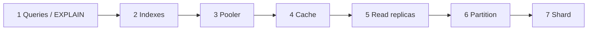
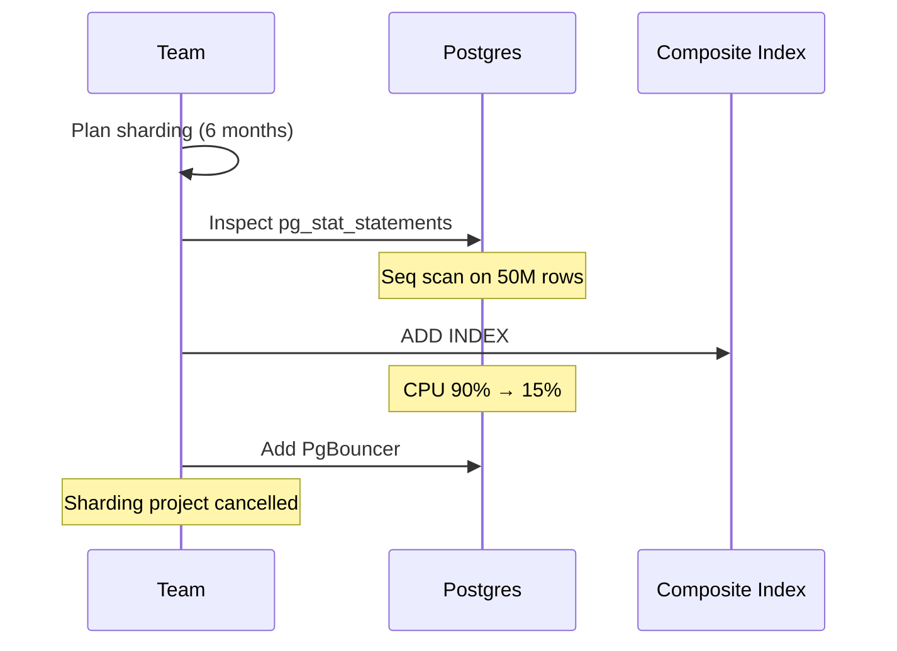

# Lesson 03: Database Bottlenecks

> **Prerequisites:** [Lesson 01: Stateless Service Design](../01-stateless-service-design/README.md) · [Lesson 29: Database Connection Pooling](../../04-databases/29-database-connection-pooling/README.md).  
> **Estimated Reading Time:** 30–35 minutes  
> **Target Audience:** Backend engineers and DBAs diagnosing saturated Postgres/MySQL fleets and climbing the scale ladder without jumping straight to sharding.  
> **Free PDF Notes:** [Download SD-J-003.pdf](https://backendroadmap.com/notes/system-design/SD-J-003.pdf) · [Phase 3, Caching Scaling & Traffic (PDF)](https://backendroadmap.com/notes/system-design/Phase3_Caching_Scaling_Traffic_Notes.pdf)

> [!NOTE]
> **In one line:** Find what the database has run out of (connections, CPU, IOPS, or locks), then climb the ladder in order—optimize queries, add indexes, pool connections, cache, read replicas, partition, and only then shard—measuring after each step.

> [!TIP]
> **The Golden Rule of Database Scale:** Diagnose before you design. A missing composite index or PgBouncer often beats a six-month sharding project. Never add app servers that open more connections until you know which resource is saturated.

---

## 1. What a Database Bottleneck Is, and What It Isn't

App servers scale out easily: add more and throughput rises—until it doesn't. Latency climbs and every graph points to the same place. The database is the most common bottleneck in system design interviews and production alike.

| Term | Precise Meaning | Production Example |
| :--- | :--- | :--- |
| **Database bottleneck** | A saturated DB resource caps end-to-end throughput/latency | CPU at $90\%$ from sequential scans; adding API pods changes nothing. |
| **Hot row** | One row every writer must lock | Global `page_views` counter updated $5{,}000$/s. |
| **Connection exhaustion** | Too many backend sessions vs DB memory/CPU | Thousands of app pods each opening pools. |
| **Sharding** | Split data across multiple database servers | Last rung of the ladder—highest complexity. |

### Why It Matters
Adding app capacity without fixing the DB **amplifies** pressure (more connections, more lock waiters). Interviewers expect the ladder order, not “we'll shard.”

---

## 2. Anatomy: What Databases Run Out Of

| Resource | Symptom | Typical Cause | First Probe |
| :--- | :--- | :--- | :--- |
| **Connections** | Errors, slow connects; Postgres degrades with thousands | Each connection costs memory; too many app instances | `pg_stat_activity`, pooler stats |
| **CPU** | High CPU, slow queries | Expensive sorts/joins, missing indexes | `pg_stat_statements` |
| **Disk IOPS** | High read latency, I/O wait | Random reads missing buffer cache; heavy WAL | `iostat`, buffer hit ratio |
| **Lock contention** | Transactions waiting, low CPU | Many writers on the same rows | `wait_event`, `pg_locks` |

```sql
-- What is running and waiting?
SELECT pid, state, wait_event_type, wait_event,
       now() - query_start AS age, left(query, 60)
FROM pg_stat_activity
WHERE state <> 'idle'
ORDER BY age DESC LIMIT 20;

-- Slowest statements by total time (needs pg_stat_statements)
SELECT calls, round(mean_exec_time::numeric, 1) AS ms, left(query, 60)
FROM pg_stat_statements
ORDER BY total_exec_time DESC LIMIT 10;
```

> [!WARNING]
> **The Observability Gap:** App $p_{99}$ rising while DB CPU looks idle often means **lock waits**, not “slow SQL.” Always join latency with `wait_event_type` / lock graphs. Conversely, high CPU with healthy locks points to plans and indexes—not sharding.

---

## 3. Mathematical Model: Hot Rows & Queueing Behind Locks

A hot row serializes writers. Effective throughput is bounded by lock → modify → commit time $S$:

$$\lambda_{\max} \approx \frac{1}{S} \qquad W_{\text{queue}} \approx \frac{\rho}{\mu(1-\rho)} \quad (\rho=\lambda S)$$

| Updates/s trying for one row | Row service $S$ | $\rho$ | Queue multiplier | State |
| :---: | :---: | :---: | :---: | :--- |
| $100$ | $1\text{ ms}$ | $0.10$ | $\sim 1.1\times$ | Fine |
| $500$ | $1\text{ ms}$ | $0.50$ | $2\times$ | Warm |
| $800$ | $1\text{ ms}$ | $0.80$ | $5\times$ | Warning |
| $950$ | $1\text{ ms}$ | $0.95$ | $20\times$ | Latency cliff |
| $5{,}000$ | $1\text{ ms}$ | $>1$ | unbounded | Saturated — bigger DB does not help |

**Sharded counters:** $K$ rows reduce per-row rate by $\sim K$:

$$\lambda_{\text{per shard}} \approx \frac{\lambda}{K}$$

---

## 4. Metrics & How Averages Lie

| Metric | Meaning | Audience |
| :--- | :--- | :--- |
| **$p_{50}$ / $p_{99}$ query time** | Plan cost vs lock/IO tail | Typical vs victim transactions |
| **Buffer cache hit ratio** | Fraction served from RAM | IOPS pressure signal |
| **Active connections vs `max_connections`** | Session pressure | Pooler sizing |
| **Lock wait time** | Hot-row / deadlock risk | Writers on popular keys |

### Worked Example
90 queries at $5\text{ ms}$, 9 at $80\text{ ms}$ (lock wait), 1 at $2{,}000\text{ ms}$:

$$\text{Avg} = \frac{90\times5 + 9\times80 + 2000}{100} = 31.7\text{ ms}$$

Average looks healthy; $p_{99}$ is already multi-second. Percentiles + wait events expose the hot row.

---

## 5. Compounding: More App Servers, Worse DB

If each app pod opens $c$ DB connections and you scale pods from $N$ to $kN$:

$$\text{Client connections} = k \cdot N \cdot c$$

| Pods | Pool/pod | Client conns | Without pooler | With PgBouncer (40 server conns) |
| :---: | :---: | :---: | :--- | :--- |
| 10 | 20 | 200 | Manageable | Fine |
| 50 | 20 | 1{,}000 | Memory pressure | Still 40 server conns |
| 200 | 20 | 4{,}000 | Collapse | Required |

---

## 6. Numbers Every Engineer Must Know

| Fact | Typical Order | Implication |
| :--- | :---: | :--- |
| Postgres connection RAM | $\sim 1\text{–}10\text{ MB}$ each | Thousands of connections hurt. |
| Hot-row update ceiling | hundreds–few thousand/s | Scale the *contention*, not the box. |
| Missing index → seq scan | $10\times\text{–}100\times$ slower | Often cheaper than sharding. |
| PgBouncer transaction pool | dozens of server conns | Multiplex thousands of clients. |
| Read replica lag | ms–seconds | Stale reads; read-your-writes may need primary. |
| Index write amplification | every INSERT updates indexes | Don't index blindly. |

---

## 7. Protocol / Ladder Deep Dive



| Step | What | Watch out for |
| :--- | :--- | :--- |
| 1 Optimize queries | EXPLAIN, fix N+1, select needed columns | Often $10\times$ wins |
| 2 Indexes | Right composite indexes | Slows writes |
| 3 Pooler | PgBouncer shares few dozen DB conns | Transaction-mode limits |
| 4 Cache | Redis for hot reads | Invalidation |
| 5 Read replicas | Route read-only queries | Replication lag |
| 6 Partition | Split big tables by time/key | Queries must include key |
| 7 Shard | Multiple databases | Cross-shard queries, resharding |

```ini
# PgBouncer: many app connections, few real ones
[pgbouncer]
pool_mode = transaction
max_client_conn = 5000
default_pool_size = 40
```

---

## 8. Hierarchical Budgets & Sizing

| Slice | Budget | Control |
| :--- | :--- | :--- |
| Primary CPU | Peak $\le 70\%$ | Index + query fixes first |
| Server connections | $\sim 20\text{–}100$ via pooler | Cap app pools |
| Hot-row $\rho$ | $\le 0.5$ | Shard counters / Redis buffer |
| Replica lag SLO | e.g. $p_{99} < 1\text{ s}$ | Alert + primary fallback |
| Cache hit rate | $> 80\%$ on hot keys | Before adding replicas |

---

## 9. Top Mitigations

1. **EXPLAIN + indexes** before architecture changes.
2. **Connection pooling** (PgBouncer) before more pods.
3. **Cache hot reads** (Redis).
4. **Break hot rows** — $K$ counter shards, Redis INCR + flush, or queue + batch aggregate.
5. **Replicas → partition → shard** only as load demands.

---

## 10. Production War Story (SEV-1): Jumping to Sharding

- **Impact:** Six-month sharding project planned while DB slowed under load.
- **What Happened:** `pg_stat_statements` showed one sequential scan on a $50\text{ M}$ row table.



- **Fix:** Diagnose with metrics; climb the ladder; re-measure after every change. Index cut CPU $90\% \to 15\%$; pooler removed connection errors.

**Lesson:** The cheapest fix is usually a missing index or a connection pooler.

---

## 11. Multi-Language Production Code Tabs

````carousel
```go
// Go: sharded counter update (spread hot row)
package main

import (
	"database/sql"
	"math/rand"
)

func IncrPageView(db *sql.DB, pageID int) error {
	shard := rand.Intn(64)
	_, err := db.Exec(`
		UPDATE page_views SET n = n + 1
		WHERE page_id = $1 AND shard = $2`, pageID, shard)
	return err
}

func ReadPageViews(db *sql.DB, pageID int) (int64, error) {
	var sum int64
	err := db.QueryRow(`SELECT COALESCE(SUM(n),0) FROM page_views WHERE page_id=$1`, pageID).Scan(&sum)
	return sum, err
}
```
<!-- slide -->
```typescript
// TypeScript: diagnose-friendly pool sizing + sharded incr
import { Pool } from "pg";

const pool = new Pool({
  max: 10, // per pod — rely on PgBouncer for multiplexing
  idleTimeoutMillis: 10_000,
});

export async function incrViews(pageId: number) {
  const shard = Math.floor(Math.random() * 64);
  await pool.query(
    `UPDATE page_views SET n = n + 1 WHERE page_id=$1 AND shard=$2`,
    [pageId, shard]
  );
}

export async function getViews(pageId: number) {
  const { rows } = await pool.query(
    `SELECT SUM(n)::bigint AS n FROM page_views WHERE page_id=$1`,
    [pageId]
  );
  return Number(rows[0].n ?? 0);
}
```
<!-- slide -->
```python
# Python: hot-row relief patterns
import random

def incr_sharded(conn, page_id: int) -> None:
    shard = random.randrange(64)
    conn.execute(
        "UPDATE page_views SET n = n + 1 WHERE page_id=%s AND shard=%s",
        (page_id, shard),
    )

def read_sum(conn, page_id: int) -> int:
    row = conn.execute(
        "SELECT SUM(n) FROM page_views WHERE page_id=%s", (page_id,)
    ).fetchone()
    return int(row[0] or 0)

# Alternative: Redis buffer, flush every few seconds
# r.incr(f"pv:{page_id}"); periodic SUM flush into Postgres
```
<!-- slide -->
```csharp
// C#: sharded counter + pooled connections
using Npgsql;

async Task IncrAsync(NpgsqlDataSource ds, int pageId)
{
    var shard = Random.Shared.Next(64);
    await using var cmd = ds.CreateCommand(
        "UPDATE page_views SET n = n + 1 WHERE page_id=@p AND shard=@s");
    cmd.Parameters.AddWithValue("p", pageId);
    cmd.Parameters.AddWithValue("s", shard);
    await cmd.ExecuteNonQueryAsync();
}

async Task<long> ReadAsync(NpgsqlDataSource ds, int pageId)
{
    await using var cmd = ds.CreateCommand(
        "SELECT COALESCE(SUM(n),0) FROM page_views WHERE page_id=@p");
    cmd.Parameters.AddWithValue("p", pageId);
    return (long)(await cmd.ExecuteScalarAsync() ?? 0L);
}
```
````

---

## 12. Hands-On CLI Verification Workflows

```bash
# Hot-row math: capacity ≈ 1/S
python3 -c "
S=0.001
for lam in (100,500,800,950,5000):
    rho=lam*S
    mult=(1/(1-rho)) if rho<1 else float('inf')
    print(f'lambda={lam}/s rho={rho:.2f} mult={mult}')
"

# Sanity: 64 shards cut per-row rate 64x
python3 -c "print(5000/64, 'updates/s per shard')"
```

---

## 13. Common Mistakes to Avoid

1. **Sharding before indexes and pooling.**
2. **Adding app servers that open more connections and make it worse.**
3. **A hot counter or sequence row.**
4. **Reading from replicas where stale data breaks correctness.**
5. **Too many indexes slowing writes.**
6. **Not measuring after each change.**
7. **Treating low CPU as “healthy” during lock storms.**
8. **Skipping EXPLAIN on the top `pg_stat_statements` offenders.**

---

## 14. Key Terms Glossary

| Key Term | Definition |
| :--- | :--- |
| **Connection pool** | Shared set of database connections reused by many clients. |
| **PgBouncer** | Popular Postgres connection pooler. |
| **IOPS** | Disk I/O operations per second. |
| **Lock contention** | Transactions waiting on the same rows/objects. |
| **Hot row** | A row everyone updates; serializes throughput. |
| **Read replica** | Copy serving reads (usually async). |
| **Replication lag** | Delay before replica reflects primary writes. |
| **Partitioning** | Splitting a table inside one database. |
| **Sharding** | Splitting data across multiple database servers. |
| **EXPLAIN** | Shows the planner's chosen access path. |

---

## 15. System Design Interview Questions & Answers

### Basic Conceptual Questions

<details>
<summary><strong>Q1: What is your approach when the database is the bottleneck? [BASIC]</strong></summary>

**Answer:**
Find what is saturated (connections, CPU, IOPS, or locks), then climb the ladder: optimize queries, add indexes, pool connections, cache hot reads, add read replicas, partition tables, and only then shard—measuring after each step.
</details>

<details>
<summary><strong>Q2: How do you fix a hot row? [BASIC]</strong></summary>

**Answer:**
Split into sharded counters and sum on read; buffer increments in Redis and flush; or aggregate events from a queue in batches. A bigger primary does not remove the lock bottleneck.
</details>

<details>
<summary><strong>Q3: Why use a connection pooler? [BASIC]</strong></summary>

**Answer:**
It lets thousands of app connections share a few dozen database connections, saving memory and CPU on the database server.
</details>

<details>
<summary><strong>Q4: Read replicas help with what? [BASIC]</strong></summary>

**Answer:**
Read-heavy load. They do not scale writes and introduce replication lag; read-your-writes may still need the primary.
</details>

### Scenario-Based Architecture Questions

<details>
<summary><strong>Q5: Throughput stops rising when you add app servers. [SCENARIO]</strong></summary>

**Answer:**
The database is saturated. Check connections, CPU, IOPS, and locks; fix that bottleneck rather than adding more servers that open more sessions.
</details>

<details>
<summary><strong>Q6: A query is slow on a large table. [SCENARIO]</strong></summary>

**Answer:**
Use EXPLAIN, add a suitable composite index, avoid selecting unneeded columns, and consider partitioning once indexes and filters are correct.
</details>

<details>
<summary><strong>Q7: Reads dominate load. [SCENARIO]</strong></summary>

**Answer:**
Cache in Redis and add read replicas, with explicit lag awareness and primary fallback for strong read-after-write paths.
</details>

<details>
<summary><strong>Q8: Writes dominate load. [SCENARIO]</strong></summary>

**Answer:**
Batch writes, queue them, eliminate hot rows, partition, then shard by a good key—only after cheaper steps.
</details>

### Advanced & Tricky Interview Questions

<details>
<summary><strong>Q9: Why not shard first? [TRICKY]</strong></summary>

**Answer:**
It is the most complex and least reversible step. Earlier ladder rungs are cheaper and often enough (missing index, pooler, cache).
</details>

<details>
<summary><strong>Q10: What does an extra index cost? [TRICKY]</strong></summary>

**Answer:**
Slower writes and more storage. Index what queries need; remove unused indexes.
</details>

<details>
<summary><strong>Q11: Why can replicas serve stale reads? [TRICKY]</strong></summary>

**Answer:**
Async replication means a replica may lag. For read-your-writes, route to the primary or use session consistency mechanisms.
</details>

<details>
<summary><strong>Q12: Partitioning versus sharding? [TRICKY]</strong></summary>

**Answer:**
Partitioning splits a table within one database. Sharding spreads data across multiple database servers with cross-shard complexity.
</details>

---

## 16. One-Page Master Cheat Sheet

```
+---------------------------------------------------------------------------------------------------------+
|                           DATABASE BOTTLENECKS — MASTER CHEAT SHEET                                     |
+---------------------------------------------------------------------------------------------------------+
| 1. DIAGNOSE: connections · CPU · IOPS · locks (wait events). Don't guess.                               |
+---------------------------------------------------------------------------------------------------------+
| 2. HOT ROW: λ_max ≈ 1/S · shard counters · Redis buffer · queue+batch. Bigger box ≠ fix.              |
+---------------------------------------------------------------------------------------------------------+
| 3. LADDER: queries → indexes → pooler → cache → replicas → partitions → shards. Measure each step.      |
+---------------------------------------------------------------------------------------------------------+
| 4. MATH: more pods × pool size = client conns; pooler keeps server conns ~dozens.                       |
+---------------------------------------------------------------------------------------------------------+
| 5. ANTI-PATTERNS: shard-first · ignore EXPLAIN · replica for strong reads · index sprawl.               |
+---------------------------------------------------------------------------------------------------------+
```

---

## Further Reading & Sources

- Use The Index, Luke.
- PostgreSQL docs — `pg_stat_statements`.
- PgBouncer docs.
- Kleppmann, DDIA, ch. 3, 5, 6.

---

## Free PDF Notes

[SD-J-003.pdf](https://backendroadmap.com/notes/system-design/SD-J-003.pdf)

---

## Next

Continue with [Lesson 04: Asynchronous Processing](../04-asynchronous-processing/README.md) — do only what the user needs now; queue the rest.
