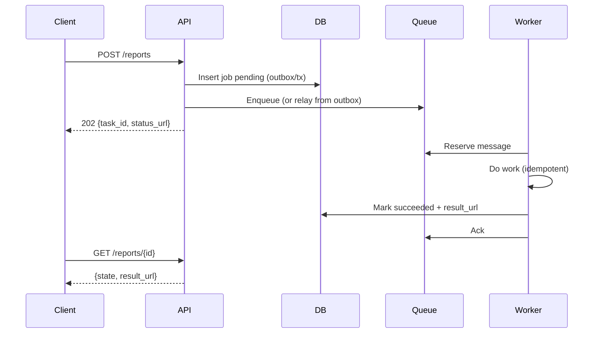
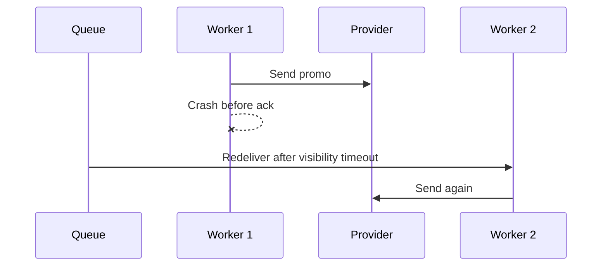

# Lesson 04: Asynchronous Processing

> **Prerequisites:** [Lesson 01: Stateless Service Design](../01-stateless-service-design/README.md) · [Lesson 03: Database Bottlenecks](../03-database-bottlenecks/README.md).  
> **Estimated Reading Time:** 28–34 minutes  
> **Target Audience:** Backend engineers designing signup, reports, webhooks, and Celery/SQS worker fleets without blocking the request path.  
> **Free PDF Notes:** [Download SD-J-004.pdf](https://backendroadmap.com/notes/system-design/SD-J-004.pdf) · [Phase 3, Caching Scaling & Traffic (PDF)](https://backendroadmap.com/notes/system-design/Phase3_Caching_Scaling_Traffic_Notes.pdf)

> [!NOTE]
> **In one line:** Keep the request path short—validate and save, then put slow, unreliable, or retryable work on a queue for background workers; return `202 Accepted` with a task ID for long jobs; make tasks idempotent with backoff, a DLQ, and worker autoscaling on queue age.

> [!TIP]
> **The Golden Rule of Async:** Do only what the user needs *now* on the request path. Queues give **at-least-once** delivery—duplicates are your problem—so idempotency + outbox + DLQ are mandatory, not optional polish.

---

## 1. What Asynchronous Processing Is, and What It Isn't

A user clicks sign up. Your API creates the account, sends a welcome email, resizes their photo into five sizes, and syncs them to the CRM. Eight seconds later the page finally responds—if the email provider did not time out first. Most of that work did not need to happen while the user waited.

| Term | Precise Meaning | Production Example |
| :--- | :--- | :--- |
| **Synchronous path** | User waits for the result before continuing | Create user row; return `201` with `id`. |
| **Asynchronous job** | Work executed later by a worker | Send welcome email; generate thumbnails. |
| **202 Accepted** | Request accepted for processing; not done yet | Report generation with `task_id` + status URL. |
| **Fire-and-forget (bad)** | Enqueue with no status, retries, or DLQ | Silent loss when workers die. |

### Why It Matters
1. API latency drops from seconds to tens of milliseconds.
2. Bursts fill the queue instead of crashing the front door.
3. Flaky third parties become retryable without failing the user-visible transaction.

---

## 2. Anatomy: Request Path vs Workers

```
User → API (validate, save, enqueue) → 201/202
              ↓
           Queue  → email worker / thumbnail worker / CRM worker
```

| Kind of Work | Examples | Sync or Async? |
| :--- | :--- | :--- |
| **Slow** | Video encode, reports, AI calls | Async |
| **Unreliable** | Third-party APIs that time out | Async |
| **Retryable later** | Emails, webhooks | Async |
| **Batchable** | Analytics events, notifications | Async |
| **Needed to continue** | Auth token, inventory reservation confirmation | Sync |

> [!WARNING]
> **The Observability Gap:** API $p_{99}$ can look perfect while users wait minutes for emails. Monitor **queue depth and task age** (time since enqueue)—age is the user-visible delay depth alone can hide.

---

## 3. Mathematical Model: Queue Absorbs Bursts

Little's Law on the worker side: $L = \lambda W$.

$$\text{Workers needed} \approx \lambda \times W_{\text{task}} / \text{target utilization}$$

| Arrival $\lambda$ | Mean task time $W$ | Target $\rho$ | Workers $\approx \lambda W / \rho$ |
| :---: | :---: | :---: | :---: |
| $10$/s | $2\text{ s}$ | $0.7$ | $\approx 29$ |
| $100$/s | $200\text{ ms}$ | $0.7$ | $\approx 29$ |
| $500$/s | $100\text{ ms}$ | $0.7$ | $\approx 71$ |

During a campaign spike, depth grows if workers lag:

$$\text{Age} \approx \frac{\text{Depth}}{\mu_{\text{out}}} \quad (\text{when outflow stable})$$

| Phase | Depth | Age (if $\mu=20$/s) | Action |
| :--- | :---: | :---: | :--- |
| Start | 200 | $10\text{ s}$ | OK |
| Behind | 8{,}000 | $400\text{ s}$ | Autoscale / shed |
| Recovered | 150 | $7.5\text{ s}$ | Steady |

---

## 4. Metrics & Percentiles

| Metric | Meaning | Who It Describes |
| :--- | :--- | :--- |
| **API $p_{99}$** | Sync path only | User waiting on HTTP |
| **Task age $p_{99}$** | Enqueue → start/finish | User waiting on side effects |
| **Retry rate** | Transient failures | Provider health |
| **DLQ rate** | Poison / permanent fails | Needs human intervention |

### Worked Example
API returns in $80\text{ ms}$ average, but $5\%$ of welcome emails sit $10\text{ minutes}$ in queue. Average API latency hides a campaign-time email SLA breach—track task age percentiles.

---

## 5. Compounding: At-Least-Once Duplicates

With crash probability $p$ before ack per attempt:

$$P(\ge 1 \text{ duplicate send}) = 1 - (1-p)^{k} \text{ over } k \text{ deliveries}$$

| Crashes before ack | Sends without idempotency | With sent-flag |
| :---: | :---: | :--- |
| 0 | 1 | 1 |
| 1 | 2 | 1 |
| 4 | 5 | 1 |

---

## 6. Numbers Every Engineer Must Know

| Item | Typical | Implication |
| :--- | :---: | :--- |
| Sync signup path | $\sim 50\text{–}150\text{ ms}$ | DB write + enqueue only |
| Email provider RTT | $200\text{ ms}\text{–}several s}$ | Never on request path |
| Visibility timeout | seconds–minutes | Redelivery window |
| Celery / RQ / Arq | Python task queues | Pick by async needs |
| SQS / Service Bus | Managed queues | Serverless workers |
| Outbox publish lag | ms–seconds | Safer than publish-after-commit races |

---

## 7. Protocol Deep Dive: 202 + Status + Outbox



| Tool | Notes |
| :--- | :--- |
| **Celery** | Classic Python; RabbitMQ/Redis; retries, schedules, results |
| **RQ** | Simpler, Redis-based |
| **Arq** | Designed for asyncio |
| **SQS / Service Bus** | Managed + serverless workers |

---

## 8. Hierarchical Budgets & Sizing

| Slice | Budget | Control |
| :--- | :--- | :--- |
| Sync API | $p_{99} \le 150\text{ ms}$ | No third-party calls |
| Enqueue | $\le 20\text{ ms}$ | Local broker / outbox writer |
| Email SLA | $p_{99} < 2\text{ min}$ | Autoscale on age |
| Max retries | 5 with exp backoff | Then DLQ |
| Payload size | IDs not blobs | Pass object keys |

---

## 9. Top Mitigations

1. **Short request path** — validate, persist, enqueue, return.
2. **202 + task ID + status URL** for user-visible long work.
3. **Idempotent handlers** + `acks_late`.
4. **Exponential backoff + jitter** and a **dead letter queue**.
5. **Transactional outbox** so enqueue cannot be lost after commit.
6. **Autoscale workers** on depth/age; alert on age.

---

## 10. Production War Story (SEV-1): Duplicate Emails

- **Impact:** Promotional email sent up to 5× after worker crashes before ack; visibility timeout redelivered.
- **Sequence:**



- **Fix:** Record `sent` flag keyed by task before ack; `acks_late` with idempotent handlers; DLQ + alert.

**Lesson:** Queues give at-least-once delivery; duplicates are your problem.

---

## 11. Multi-Language Production Code Tabs

````carousel
```go
// Go: enqueue + idempotent worker sketch
package main

type Store interface {
	WelcomeSent(userID string) (bool, error)
	MarkWelcomeSent(userID string) error
}

func SendWelcome(db Store, mailer func(string) error, userID, email string) error {
	ok, _ := db.WelcomeSent(userID)
	if ok {
		return nil // idempotent
	}
	if err := mailer(email); err != nil {
		return err // caller retries with backoff
	}
	return db.MarkWelcomeSent(userID)
}
```
<!-- slide -->
```typescript
// TypeScript: 202 Accepted + status poll
import { Router } from "express";
const r = Router();

r.post("/reports", async (req, res) => {
  const task = await queue.add("build_report", { userId: req.user.id, ...req.body });
  res.status(202).json({ task_id: task.id, status_url: `/reports/${task.id}` });
});

r.get("/reports/:id", async (req, res) => {
  const job = await queue.getJob(req.params.id);
  res.json({
    state: await job?.getState(),
    result_url: job?.returnvalue ?? null,
  });
});
```
<!-- slide -->
```python
# Python: FastAPI + Celery signup / report patterns
from celery.result import AsyncResult
from fastapi import Depends, FastAPI

app = FastAPI()

@app.post("/reports", status_code=202)
def create_report(req: ReportReq, user=Depends(auth)):
    task = build_report.delay(user.id, req.dict())
    return {"task_id": task.id, "status_url": f"/reports/{task.id}"}

@app.get("/reports/{task_id}")
def status(task_id: str):
    r = AsyncResult(task_id)
    return {"state": r.state, "result_url": r.result if r.successful() else None}

@app.post("/signup", status_code=201)
async def signup(u: NewUser):
    user = await create_user(u)
    send_welcome.delay(user.id)  # enqueue and return immediately
    return {"id": user.id}

@celery.task(bind=True, max_retries=5, acks_late=True)
def send_welcome(self, user_id):
    user = db.get_user(user_id)
    if user.welcome_sent:
        return
    try:
        mailer.send(user.email, "welcome")
        db.mark_welcome_sent(user_id)
    except TransientError as e:
        raise self.retry(exc=e, countdown=2 ** self.request.retries * 5)
```
<!-- slide -->
```csharp
// C#: 202 + idempotent background work
app.MapPost("/reports", async (ReportReq req, IBackgroundQueue q) =>
{
    var id = Guid.NewGuid().ToString("n");
    await q.EnqueueAsync(new BuildReport(id, req));
    return Results.Accepted($"/reports/{id}", new { task_id = id, status_url = $"/reports/{id}" });
});

async Task SendWelcomeAsync(IDb db, IMailer mailer, string userId)
{
    if (await db.WelcomeSentAsync(userId)) return;
    await mailer.SendWelcomeAsync(userId);
    await db.MarkWelcomeSentAsync(userId); // before ack/complete
}
```
````

---

## 12. Hands-On CLI Verification Workflows

```bash
# Worker sizing from Little's Law
python3 -c "
lam, W, rho = 100, 0.2, 0.7
print('workers ≈', round(lam*W/rho))
"

# Age from depth
python3 -c "
for depth, mu in [(200,20),(8000,20),(150,20)]:
    print(depth, '→', depth/mu, 's age')
"
```

---

## 13. Common Mistakes to Avoid

1. **Slow third-party calls inside the request.**
2. **Non-idempotent tasks.**
3. **No DLQ**—poison messages loop forever.
4. **No monitoring of queue age.**
5. **Fire-and-forget with no user status.**
6. **Large payloads in messages** instead of IDs/keys.
7. **Publish after commit without an outbox** (lost tasks).
8. **Ack before side effects complete.**

---

## 14. Key Terms Glossary

| Key Term | Definition |
| :--- | :--- |
| **Task queue** | Buffer of background jobs. |
| **Worker** | Process executing tasks. |
| **202 Accepted** | Accepted for later processing. |
| **Task ID** | Handle for status polling. |
| **Idempotent task** | Safe to run twice with one effect. |
| **Dead letter queue** | Holds repeatedly failing messages. |
| **Backoff** | Growing retry delay (often + jitter). |
| **Visibility timeout** | Time before an unacked message redelivers. |
| **At-least-once** | Delivery that may repeat. |
| **Transactional outbox** | Write task in the same DB tx; publish from there. |

---

## 15. System Design Interview Questions & Answers

### Basic Conceptual Questions

<details>
<summary><strong>Q1: What work should be done asynchronously? [BASIC]</strong></summary>

**Answer:**
Anything slow, unreliable, retryable, or batchable that the user does not need immediately—emails, thumbnails, reports, third-party calls.
</details>

<details>
<summary><strong>Q2: How do you report task status? [BASIC]</strong></summary>

**Answer:**
Return `202 Accepted` with a task ID and status URL, store status in DB/Redis (`pending|running|succeeded|failed`), and let the client poll or receive WebSocket/SSE/push/email notification.
</details>

<details>
<summary><strong>Q3: Name Python task queues. [BASIC]</strong></summary>

**Answer:**
Celery, RQ, and Arq, plus managed queues such as SQS / cloud service buses.
</details>

<details>
<summary><strong>Q4: Why make tasks idempotent? [BASIC]</strong></summary>

**Answer:**
Queues may deliver more than once after crashes or visibility-timeout redeliveries.
</details>

### Scenario-Based Architecture Questions

<details>
<summary><strong>Q5: Sign-up takes 8 seconds. Fix? [SCENARIO]</strong></summary>

**Answer:**
Save the user, enqueue email and thumbnail tasks, return `201` immediately (~80 ms). Workers handle providers with retries.
</details>

<details>
<summary><strong>Q6: Tasks keep failing. [SCENARIO]</strong></summary>

**Answer:**
Retry with exponential backoff and jitter; after N failures move to a DLQ and alert a human.
</details>

<details>
<summary><strong>Q7: Workers fall behind during a campaign. [SCENARIO]</strong></summary>

**Answer:**
Autoscale on queue depth or age; prioritize critical queues; shed or defer low-priority work.
</details>

<details>
<summary><strong>Q8: User waits for a report. [SCENARIO]</strong></summary>

**Answer:**
Return `202`, expose progress via status URL, notify when done (WS/SSE/email).
</details>

### Advanced & Tricky Interview Questions

<details>
<summary><strong>Q9: Exactly-once processing? [TRICKY]</strong></summary>

**Answer:**
Practically you get at-least-once delivery plus idempotency, which yields effectively-once *results*.
</details>

<details>
<summary><strong>Q10: Enqueue fails after DB commit? [TRICKY]</strong></summary>

**Answer:**
Use a transactional outbox: write the task row in the same transaction as business data; a publisher relays to the queue.
</details>

<details>
<summary><strong>Q11: Queue versus synchronous call? [TRICKY]</strong></summary>

**Answer:**
A queue decouples and absorbs bursts but adds delay and complexity. Use it when the user need not wait for the side effect.
</details>

<details>
<summary><strong>Q12: Why monitor task age? [TRICKY]</strong></summary>

**Answer:**
Age reflects user-visible delay. Depth alone can look fine while a stuck partition ages out the SLA.
</details>

---

## 16. One-Page Master Cheat Sheet

```
+---------------------------------------------------------------------------------------------------------+
|                         ASYNCHRONOUS PROCESSING — MASTER CHEAT SHEET                                    |
+---------------------------------------------------------------------------------------------------------+
| 1. PATH: validate + save + enqueue → return. Queue slow/unreliable/retryable/batchable work.            |
+---------------------------------------------------------------------------------------------------------+
| 2. UX: 202 + task_id + status_url · poll or push notification.                                          |
+---------------------------------------------------------------------------------------------------------+
| 3. SAFETY: idempotent · acks_late · backoff+jitter · DLQ · transactional outbox.                        |
+---------------------------------------------------------------------------------------------------------+
| 4. OPS: watch depth AND age · autoscale workers · pass IDs not blobs.                                   |
+---------------------------------------------------------------------------------------------------------+
| 5. MATH: workers ≈ λW/ρ · age ≈ depth/μ_out under backlog.                                              |
+---------------------------------------------------------------------------------------------------------+
```

---

## Further Reading & Sources

- Celery docs — Task best practices.
- AWS docs — SQS dead-letter queues.
- Chris Richardson — Transactional outbox.

---

## Free PDF Notes

[SD-J-004.pdf](https://backendroadmap.com/notes/system-design/SD-J-004.pdf)

---

## Next

Continue with [Lesson 05: Python Concurrency](../05-python-concurrency/README.md) — GIL, asyncio, threads vs processes.
